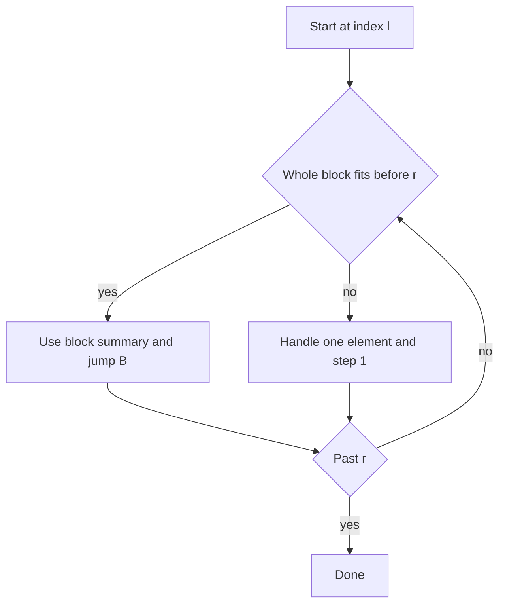

## The hook

A problem gives you 200,000 numbers and asks two kinds of questions: add a value to a range, and sum a range. A plain loop is O(n) per operation, which means billions of steps. Prefix sums answer sums instantly but must be rebuilt after every change.

A segment tree solves this in O(log n), but writing one with range updates under contest pressure is where many people lose twenty minutes. There is a simpler middle path, at O(√n) per operation, that you can write correctly in a few minutes and that often still fits the time limit. It also handles odd operations that do not fit a tree well.

## The intuition

:::analogy
Imagine a long road with houses numbered 0 to 9,999. Asking "how many people live between house 1,234 and house 8,765?" by knocking on every door takes forever. So the city splits the road into neighbourhoods of 100 houses each and keeps a notice board in every neighbourhood with its total population. Now you knock only on the loose houses at the two ends of your stretch, and for every neighbourhood fully inside it you just read the board.
:::

That is [[square root decomposition]]. Cut the array into [[block]]s of B consecutive elements and store one summary per block, such as its sum or minimum. Any range a[l..r] then splits into three parts:

1. a left tail inside the first block, which may be a [[partial block]],
2. some whole blocks in the middle,
3. a right tail inside the last block, also possibly partial.

With B near √n there are about √n blocks in total and each tail has fewer than B elements. Either way you do O(√n) work.

## How it works

Index blocks so that element i belongs to block i / B (integer division). Block b covers indices b·B to b·B + B − 1. When n is not a multiple of B, the last block is simply shorter.

**Build.** Walk the array once and add a[i] into blockSum[i / B]. That is O(n).

**Range sum.** Walk from l to r. If you are standing at the start of a block and the whole block fits before r, add its stored sum and jump B places. Otherwise add the single element and step by one. The jumps happen at most n / B times and the single steps at most about 2B times.

**Point update.** To add v to a[i], change a[i] and blockSum[i / B]. That is O(1).

**Range update.** To add v to every element of a[l..r], walk the range the same way as a query. For a whole block, do not touch its elements: add v to its [[block lazy tag]] and v × B to its sum. For a loose element, change it and its block's sum. When you later read a loose element, its true value is a[i] plus its block's tag.



:::insight
Square root decomposition trades a little speed for a lot of simplicity: every operation is "a few loose elements plus a few whole blocks", and choosing B ≈ √n makes both counts about √n. In the neighbourhood picture, you never knock on more than two neighbourhoods' worth of doors or read more than √n notice boards.
:::

### Choosing the block size

The cost of one operation is roughly 2B for the tails plus n / B for the whole blocks. Small B makes many blocks; large B makes long tails. The sum is smallest when the two parts are about equal, which happens near √n. For n = 10⁵, √n is about 316, and a query then costs at most around 950 simple steps.

Two practical notes:

- **Use one constant.** Setting B from the maximum n (for example, 316 or a nearby round number) is fine and avoids recomputing per test case.
- **Rebalance when costs differ.** If whole blocks are expensive (say, each needs a binary search inside a sorted copy of the block) or updates are far rarer than queries, the best B shifts away from √n. Write the cost as a function of B, then pick B so the two terms match.

### Beyond sums

The same skeleton works for any summary you can maintain per block: minimum, maximum, count of zeros, or a sorted copy of the block for "how many values below x" questions. It also powers other techniques. One classic is a ball hopping forward along positions with changing hop lengths, where each position stores where the ball leaves its block and how many hops that takes; an update rebuilds just one block. *Holes* on Codeforces is built on that idea. Splitting the *queries* into √n groups instead of the array leads to Mo's algorithm, the natural next step.

## Walk through an example

Let a = [4, 1, 7, 3, 8, 2, 6, 5, 9, 0], so n = 10 and B = ⌊√10⌋ = 3.

| Block | Indices | Elements | Sum |
|---|---|---|---|
| 0 | 0 to 2 | 4, 1, 7 | 12 |
| 1 | 3 to 5 | 3, 8, 2 | 13 |
| 2 | 6 to 8 | 6, 5, 9 | 20 |
| 3 | 9 | 0 | 0 |

**Query sum of a[1..7].**

| Position | Whole block fits? | Adds | Running sum |
|---|---|---|---|
| 1 | no, not a block start | a[1] = 1 | 1 |
| 2 | no | a[2] = 7 | 8 |
| 3 | yes, block 1 ends at 5 | 13 | 21 |
| 6 | no, block 2 ends at 8 | a[6] = 6 | 27 |
| 7 | no | a[7] = 5 | **32** |

**Point update: add 5 to a[4].** Now a[4] = 13 and block 1's sum becomes 18. The same query now gives 1 + 7 + 18 + 6 + 5 = **37**.

**Range update: add 10 to a[2..7].**

| Position | Action | Effect |
|---|---|---|
| 2 | loose element | a[2] = 17, block 0 sum 22 |
| 3 | block 1 fully covered | tag 10, sum 18 + 30 = 48 |
| 6 | loose element | a[6] = 16, block 2 sum 30 |
| 7 | loose element | a[7] = 15, block 2 sum 40 |

**Query sum of a[0..4].** Block 0 fits completely, so read its sum 22. Then positions 3 and 4 are loose: their stored values 3 and 13 plus block 1's tag 10 give 13 and 23. The total is 22 + 13 + 23 = **58**. A direct check on the true array [4, 1, 17, 13, 23, 12, 16, 15, 9, 0] agrees.

:::try-this
After all the updates above, what is the sum of a[1..7], and which blocks are read whole? (Loose 1 and 17 from block 0, block 1 whole with sum 48, loose 16 and 15 from block 2: 1 + 17 + 48 + 16 + 15 = 97.)
:::

## The code

```pseudo
build(a):
    B = floor(sqrt(n)); blockSum[b] = sum of block b; lazy[b] = 0

whole_block(i, r): return i mod B == 0 and i + B - 1 <= r

add(l, r, v):
    i = l
    while i <= r:
        if whole_block(i, r): lazy[i/B] += v; blockSum[i/B] += v * B; i += B
        else: a[i] += v; blockSum[i/B] += v; i += 1

sum(l, r):
    i = l; s = 0
    while i <= r:
        if whole_block(i, r): s += blockSum[i/B]; i += B
        else: s += a[i] + lazy[i/B]; i += 1
    return s
```

```cpp
#include <bits/stdc++.h>
using namespace std;

struct SqrtSum {
    int n, B;
    vector<long long> a, blockSum, lazy;  // lazy[b] = amount added to every element of block b
    SqrtSum(const vector<long long>& v) : n(v.size()), a(v) {
        B = max(1, (int)sqrt((double)n));
        int blocks = (n + B - 1) / B;
        blockSum.assign(blocks, 0);
        lazy.assign(blocks, 0);
        for (int i = 0; i < n; i++) blockSum[i / B] += a[i];
    }
    bool wholeBlock(int i, int r) const { return i % B == 0 && i + B - 1 <= r; }
    void add(int l, int r, long long v) {  // add v to a[l..r]
        for (int i = l; i <= r;) {
            if (wholeBlock(i, r)) { lazy[i / B] += v; blockSum[i / B] += v * B; i += B; }
            else { a[i] += v; blockSum[i / B] += v; i++; }
        }
    }
    long long sum(int l, int r) const {  // sum of a[l..r]
        long long s = 0;
        for (int i = l; i <= r;) {
            if (wholeBlock(i, r)) { s += blockSum[i / B]; i += B; }
            else { s += a[i] + lazy[i / B]; i++; }
        }
        return s;
    }
};

int main() {
    SqrtSum s({4, 1, 7, 3, 8, 2, 6, 5, 9, 0});  // n = 10, B = 3
    cout << s.sum(1, 7) << '\n';                 // 32
    s.add(4, 4, 5);                              // point update: a[4] += 5
    cout << s.sum(1, 7) << '\n';                 // 37
    s.add(2, 7, 10);                             // range update
    cout << s.sum(0, 4) << '\n';                 // 58
}
```

The short last block never counts as "whole", because the test needs B elements before r, so `v * B` is always the right amount to add to a block sum.

## Complexity

- **Build:** O(n), one pass to fill the block sums.
- **Query and range update:** O(B + n / B), which is O(√n) with B ≈ √n: at most about 2B loose elements and n / B whole blocks.
- **Point update:** O(1) for sums. For a minimum, it is O(B), because the block's minimum must be recomputed from scratch.
- **Space:** O(n) for the array plus O(√n) for block sums and tags.

For 2 × 10⁵ operations on 2 × 10⁵ elements that is roughly 2 × 10⁵ × 1,300 ≈ 2.7 × 10⁸ simple steps, which often fits in C++ when the loop body is simple, but is far more work than a segment tree's O(log n) per operation. Compare with [A Tournament Bracket for Your Array](article:cp-segment-tree) when the limit is tight.

## Common mistakes

:::warning
Common misconception: "the block size must be exactly √n of the current input." Any B within a small factor of √n gives the same O(√n) bound, and a fixed constant chosen from the maximum n is standard. What matters is balancing the two costs; when whole blocks or updates are more expensive than loose elements, the best B moves, and you should derive it from the actual cost.
:::

- **Forgetting the lazy tag** when reading a loose element, so range updates seem to vanish.
- **Adding v × B to a short last block.** Either never treat it as whole, as in the code above, or use its real length.
- **Recomputing B inside a loop** or using floating-point `sqrt` without rounding, giving B = 0 when n is small; clamp B to at least 1.
- **Using `int` for sums**, which overflows once values and counts reach 10⁹ and 10⁵.
- **Minimum blocks with a range add**: a tag shifts the block's minimum by v, but a loose update forces a rebuild of that block's minimum.

## Practice problems

Start with *Dynamic Range Sum Queries* (CSES) and *Range Sum Query - Mutable* (LeetCode): point updates and range sums, the first table above. *Range Update Queries* (CSES) needs range adds and single-value reads, which is the lazy tag alone. *Dynamic Range Minimum Queries* changes the summary to a minimum and shows why point updates cost O(B) there. *Holes* (Codeforces) is the hopping-ball idea and a real test of the technique. Square root decomposition appears from roughly 1900 rating, and the same block mindset shows up again in Mo's algorithm.

## Key takeaways

- Square root decomposition cuts the array into blocks of about √n elements and keeps one summary per block.
- Every range splits into at most two partial blocks, handled element by element, and some whole blocks, handled by their summaries.
- A block size near √n balances the two costs and gives O(√n) per query or update, and a fixed constant from the maximum n works well.
- Range updates store a lazy tag per whole block, and every read of a loose element must add its block's tag.
- The technique is slower than a segment tree but simpler to write and easy to adapt to unusual per-block summaries.
