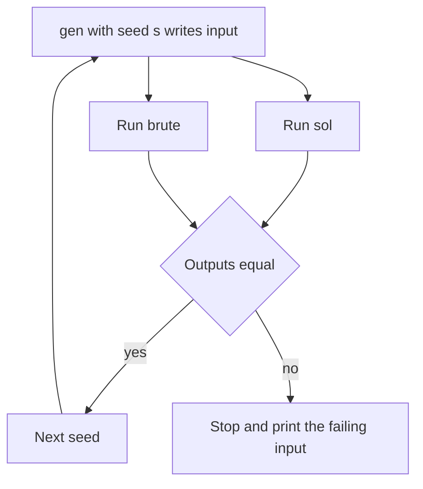

## The hook

Wrong answer on test 7. You reread your code three times. It looks right. The samples pass. You cannot see test 7. Twenty minutes slip by while you stare at the screen, trying to imagine what the judge could possibly be feeding it.

Experienced contestants do something different. In about five minutes, they build a tiny robot that throws thousands of random inputs at their solution and stops at the first one that breaks it.

## The intuition

:::analogy
Car makers do not wait for real accidents to learn whether a car is safe. They put crash-test dummies inside and run thousands of controlled crashes. A [[stress test]] is a crash-test lab for your code: a referee that is always right, a machine that invents random crashes, and a camera that freezes the first crash that goes wrong.
:::

The referee is a [[brute force]] solution: slow, but so simple it is obviously correct. The crash machine is a [[generator]] that prints small random inputs. The loop runs both solutions on each input and compares. The first mismatch is a [[counterexample]] you can trace by hand.

## How it works

You need three programs and one loop:

1. **`sol`**: your fast solution, the one getting Wrong Answer.
2. **`brute`**: the simplest correct solution you can write in two minutes. It may be O(n³) or O(2ⁿ); it only runs on tiny inputs.
3. **`gen`**: prints a random valid input. It reads a [[seed]] from the command line so every test can be regenerated.
4. **The loop**: for seed = 1, 2, 3, ..., generate, run both, compare; stop and print the input on the first difference.



:::insight
Most Wrong Answers live in small inputs: n = 1, all values equal, two elements in the wrong order. A random generator with n from 1 to 6 explores those corners far faster and more thoroughly than you can by imagination.
:::

## Walk through an example

Problem: given n numbers, print the maximum subarray sum. Your fast solution uses Kadane's algorithm but, by mistake, starts the answer at 0.

- **brute**: try every pair (l, r) and sum, O(n³) but trivially correct.
- **gen**: n between 1 and 5, values between −5 and 5.

The loop runs:

| Seed | Input | sol | brute | Result |
|---|---|---|---|---|
| 1 | 3 / 2 −1 4 | 5 | 5 | match |
| 2 | 2 / 0 3 | 3 | 3 | match |
| 3 | 4 / 1 −3 2 2 | 4 | 4 | match |
| 4 | 2 / −2 −4 | **0** | **−2** | **mismatch, stop** |

Seed 4 is all negative. The fast solution returns 0, an empty subarray, while the problem wants a non-empty one. The bug, which looked invisible for twenty minutes, is now a two-number test you can fix in seconds. See [Kadane's algorithm](article:dsa-kadane) for the correct initialisation.

:::try-this
Write down, without a computer, a generator for "given a string of lowercase letters, find the longest substring without repeating characters". What ranges would you use for the length and the alphabet? (A length from 1 to 8 and only letters a to c work well: a small alphabet forces many repeats, which is where bugs hide.)
:::

## The code

The idea in pseudocode:

```pseudo
for seed in 1, 2, 3, ...:
    input = gen(seed)
    if sol(input) != brute(input):
        print "Found a failing test, seed", seed
        print input
        stop
```

A generator in C++ (one file, compiled separately):

```cpp
#include <bits/stdc++.h>
using namespace std;

int main(int argc, char* argv[]) {
    int seed = argc > 1 ? atoi(argv[1]) : 1;
    mt19937 rng(seed);
    auto rnd = [&](int lo, int hi) { return uniform_int_distribution<int>(lo, hi)(rng); };
    int n = rnd(1, 5);
    cout << n << '\n';
    for (int i = 0; i < n; i++) cout << rnd(-5, 5) << " \n"[i == n - 1];
}
```

And the loop as a shell script (Linux or macOS), after compiling `sol`, `brute` and `gen`:

```pseudo
for i in $(seq 1 10000); do
    ./gen $i > in.txt
    ./sol < in.txt > out1.txt
    ./brute < in.txt > out2.txt
    if ! cmp -s out1.txt out2.txt; then
        echo "Mismatch on seed $i"; cat in.txt; break
    fi
done
```

## Complexity

Each test is tiny, so even an O(2ⁿ) brute force finishes instantly. Thousands of tests typically run in a few seconds. The real cost is the five minutes to write `brute` and `gen` the first time; after that, you reuse the script and the generator skeleton in every contest.

## Common mistakes

:::warning
Common misconception: "if 10,000 random tests pass, my solution is correct." A stress test only checks what the generator produces. Overflow needs huge values, time limits need maximum sizes, and some bugs need special shapes like sorted or all-equal arrays. Add targeted generators for those, and test the largest input separately for speed.
:::

- **A wrong brute force.** Keep it painfully simple; if it is clever, it can be wrong too.
- **Using `rand()` or `time(0)` as the seed**, which makes failures impossible to reproduce. Pass the loop counter as the seed.
- **Generating invalid inputs** that break the problem's guarantees, such as duplicates when the statement promises distinct values.
- **Problems with many correct answers.** If any valid answer is accepted, comparing outputs line by line will report false failures. Write a small checker instead, which reads the input and your answer and verifies the required property, for example that the chosen pair really sums to the target, and use the brute force only to confirm whether an answer exists at all.

## Practice problems

Pick any of these, write a deliberately buggy version (start an answer at 0, use `<=` instead of `<`, forget to sort), and let a stress test find your planted bug. Then write the real solution and stress it against the brute force before submitting. It feels slow the first time and becomes a two-minute habit.

## Key takeaways

- A stress test compares your fast solution with a simple brute force on thousands of small random inputs.
- The first mismatch gives a tiny counterexample that makes an invisible bug obvious.
- Seed the generator so every failing test can be reproduced exactly.
- Keep tests small for the brute force, but add separate checks for overflow, maximum sizes and special shapes.
- Writing the generator and loop once lets you reuse them in every contest in a couple of minutes.
