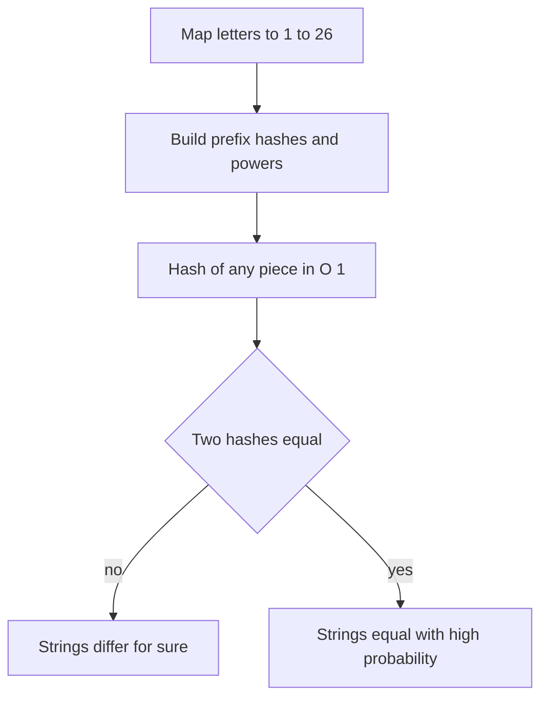

## The hook

A problem asks, a hundred thousand times, "is this piece of the string equal to that piece?" Each piece can be a hundred thousand characters long. Comparing letter by letter is correct and hopeless: up to 10¹⁰ character checks.

What if every substring carried a short number, so that equal substrings always have equal numbers and different substrings almost never do? Then each question becomes one integer comparison. Polynomial hashing gives you exactly that, after O(n) preparation, and it turns many hard string problems into simple loops.

## The intuition

:::analogy
Police do not compare two people by measuring every part of their bodies. They compare fingerprints: a small pattern that is quick to check and almost never shared by two different people. Imagine a fingerprint for every substring of your string, and a way to read off any substring's print in one step. Two equal substrings always leave the same print. Two different ones share a print only by rare accident, or because someone forged it on purpose.
:::

A [[polynomial hash]] treats a string as a number written in base B. Map 'a' to 1, 'b' to 2 and so on, so "abc" becomes the digits 1, 2, 3. In base B = 31 that is 1 · 31² + 2 · 31 + 3 = 1026. To keep numbers small, take everything modulo a large prime M, such as 10⁹ + 7. If clock arithmetic is new to you, [Doing Maths on a Clock Face](article:cp-modular-arithmetic) covers it; here you only need that addition and multiplication can be reduced mod M at every step without changing the final remainder.

$$H(s) = \left(s_0 B^{m-1} + s_1 B^{m-2} + \dots + s_{m-1}\right) \bmod M$$

Here $s_i$ is the code of the i-th character, $m$ is the length, $B$ is the base and $M$ is the modulus. The first character is the "most significant digit", exactly as in decimal numbers.

## How it works

### Prefix hashes

Compute the hash of every prefix, one character at a time, as you would read a decimal number left to right:

$$h[0] = 0, \qquad h[i+1] = (h[i] \cdot B + s_i) \bmod M$$

Also store the powers $p[i] = B^i \bmod M$. This [[prefix hash]] array takes O(n) to build.

### Any substring in O(1)

The prefix h[r] contains the prefix h[l], shifted left by r − l digits, followed by the digits of s[l..r). Remove the shifted part and what remains is the substring's own hash:

$$\text{hash}(l, r) = \left(h[r] - h[l] \cdot p[r-l]\right) \bmod M$$

Here l is the first index included and r the first index excluded. This is the same trick as prefix sums, except the earlier part must be shifted before it is subtracted. In C++ the subtraction can go negative, so add M before the final `% M`.

A [[rolling hash]] is the sliding-window form of the same idea: to move a window of length k one step right, subtract the leaving character times $B^{k-1}$, multiply by B, and add the new character. The prefix array does this for every window at once.



:::insight
A hash comparison is one-sided. Different hashes prove the strings differ. Equal hashes only say they are probably equal, so the whole game is making "probably" close enough to "certainly" that no test, random or malicious, can tell the difference.
:::

### How likely is a collision?

A [[collision]] is two different strings with the same hash. With only M possible values and far more strings than that, collisions must exist; the question is whether you will meet one.

- **One comparison.** For a random base, treat a single comparison as colliding with probability about 1/M. The rigorous bound is at most (m − 1)/M for strings of length m, because the difference of two hashes is a polynomial in B with at most m − 1 roots mod a prime.
- **Many hashes in one set.** The [[birthday paradox]] bites here. With k hashes, expect about k²/(2M) colliding pairs. For k = 10⁶ and M ≈ 10⁹ that is about 500 pairs. A single 10⁹ modulus is fine for comparing a few pairs, and unsafe for sets of millions.

The fix is [[double hashing]]: compute two hashes with different moduli (say 10⁹ + 7 and 10⁹ + 9) and treat strings as equal only if both agree. The effective space becomes about 10¹⁸, and the same million hashes give an expected 5 × 10⁻⁷ colliding pairs. A popular alternative is one modulus of 2⁶¹ − 1, a prime, with 128-bit multiplication.

### Anti-hash tests

Random strings almost never collide. Chosen strings can. An [[anti-hash test]] is input built so that your particular hash function collides.

- **Overflow hashing.** Letting `unsigned long long` overflow means hashing mod 2⁶⁴, which is not a prime. A well-known construction based on the Thue–Morse sequence builds two different strings that collide under mod 2⁶⁴ for every odd base, and even bases fail even more easily. Never rely on natural overflow alone.
- **Fixed base and fixed prime.** If your base and modulus are constants in the code, someone who knows them can search offline for two colliding strings. On Codeforces, other contestants can read your code and submit exactly such a test as a hack, and setters sometimes add tests aimed at common choices like base 31 with 10⁹ + 7.

The defence is to pick the base at random when the program starts, so nobody can know it in advance. The collision bound above holds for every pair of strings over the random choice of base, including adversarial ones.

:::warning
Common misconception: "a big prime modulus makes collisions impossible in practice." A large prime only makes random collisions rare for a few comparisons. Collisions still pile up when you store millions of hashes, and a fixed, public base can be attacked deliberately. Use two moduli or 2⁶¹ − 1, and a random base.
:::

## Walk through an example

Hash s = "abcab" with B = 31 and M = 10⁹ + 7, letters a = 1, b = 2, c = 3. The values stay below M, so no reduction happens yet.

| i | s[i] | h[i+1] = h[i] · 31 + code | p[i+1] = 31^(i+1) |
|---|---|---|---|
| 0 | a | 0 · 31 + 1 = 1 | 31 |
| 1 | b | 1 · 31 + 2 = 33 | 961 |
| 2 | c | 33 · 31 + 3 = 1026 | 29791 |
| 3 | a | 1026 · 31 + 1 = 31807 | 923521 |
| 4 | b | 31807 · 31 + 2 = 986019 | 28629151 |

**Is s[0..2) equal to s[3..5)?** hash(0, 2) = h[2] − h[0] · p[2] = 33. hash(3, 5) = h[5] − h[3] · p[2] = 986019 − 1026 · 961 = 986019 − 985986 = 33. The fingerprints match, and indeed both pieces are "ab".

**Is s[1..3) equal to s[0..2)?** hash(1, 3) = 1026 − 1 · 961 = 65, which differs from 33, so "bc" and "ab" are certainly different.

**A collision on purpose.** Shrink the modulus to M = 101. Then "ab" hashes to 33 and "dj" hashes to (4 · 31 + 10) mod 101 = 134 mod 101 = 33. There are 676 two-letter strings and only 101 possible values, so collisions are guaranteed. Large M makes them rare; it never makes them impossible.

:::try-this
With B = 31 and no modulus, what is the hash of "ca", and what would the formula give for s[2..4) of "abcab"? (3 · 31 + 1 = 94. From the table, h[4] − h[2] · 961 = 31807 − 33 · 961 = 31807 − 31713 = 94. Both are "ca", so they match.)
:::

## The code

```pseudo
build(s, B, M):
    h[0] = 0; p[0] = 1
    for i in 0 .. n-1:
        h[i+1] = (h[i] * B + code(s[i])) mod M      // code: a=1 .. z=26
        p[i+1] = p[i] * B mod M

get(l, r):                                           // hash of s[l..r)
    return (h[r] - h[l] * p[r-l]) mod M, made non-negative

find_all(text, pat):
    choose random bases once; build double hashes of text and pat
    for every start i: if get(i, i + |pat|) == hash(pat): report i
```

```cpp
#include <bits/stdc++.h>
using namespace std;

struct Hasher {
    long long mod, base;
    vector<long long> h, p;  // h[i] = hash of s[0..i), p[i] = base^i
    Hasher(const string& s, long long base_, long long mod_) : mod(mod_), base(base_) {
        int n = s.size();
        h.assign(n + 1, 0);
        p.assign(n + 1, 1);
        for (int i = 0; i < n; i++) {
            h[i + 1] = (h[i] * base + (s[i] - 'a' + 1)) % mod;  // letters map to 1..26, never 0
            p[i + 1] = p[i] * base % mod;
        }
    }
    long long get(int l, int r) const {  // hash of s[l..r), O(1)
        return ((h[r] - h[l] * p[r - l]) % mod + mod) % mod;
    }
};

const long long M1 = 1000000007, M2 = 1000000009;
mt19937_64 rng(chrono::steady_clock::now().time_since_epoch().count());
long long randomBase(long long mod) { return uniform_int_distribution<long long>(256, mod - 1)(rng); }

// Double hash: two independent (base, mod) pairs; equal only if both agree.
struct DoubleHasher {
    Hasher a, b;
    DoubleHasher(const string& s, long long b1, long long b2) : a(s, b1, M1), b(s, b2, M2) {}
    pair<long long, long long> get(int l, int r) const { return {a.get(l, r), b.get(l, r)}; }
};

vector<int> findAll(const string& text, const string& pat) {
    long long b1 = randomBase(M1), b2 = randomBase(M2);  // same bases for both strings
    DoubleHasher ht(text, b1, b2), hp(pat, b1, b2);
    auto target = hp.get(0, pat.size());
    vector<int> pos;
    for (int i = 0; i + (int)pat.size() <= (int)text.size(); i++)
        if (ht.get(i, i + pat.size()) == target) pos.push_back(i);
    return pos;
}

int main() {
    Hasher fixed("abcab", 31, M1);                    // the traced example
    for (long long x : fixed.h) cout << x << ' ';     // 0 1 33 1026 31807 986019
    cout << '\n' << fixed.get(0, 2) << ' ' << fixed.get(3, 5) << ' ' << fixed.get(1, 3) << '\n';  // 33 33 65
    for (int i : findAll("abcabcab", "ab")) cout << i << ' ';  // 0 3 6
    cout << '\n';
}
```

The products stay below about 10¹⁸, so `long long` is safe for moduli near 10⁹. Both strings must use the same bases, which is why `findAll` draws them once and passes them to both.

### Where it pays off

- **Pattern matching:** compare every window of the text with the pattern's hash, O(n + m) in total.
- **Borders and periods:** p is a period of s exactly when s[0..n−p) equals s[p..n), one O(1) check per p.
- **Longest repeated substring:** binary search on the length L; for each L, put every window hash in a set and look for a repeat. This is where the birthday paradox makes double hashing mandatory.
- **Lexicographic comparison:** binary search the longest common prefix of two substrings with hash checks, then compare the next character, O(log n) per comparison.

## Complexity

- **Preprocessing:** O(n) time and space for prefix hashes and powers, per modulus.
- **Substring hash:** O(1), one multiplication, one subtraction and a reduction.
- **Pattern matching:** O(n + m), since each of the n − m + 1 windows costs O(1).
- **Double hashing** doubles the constant factor, not the complexity.

## Common mistakes

- **Mapping 'a' to 0**, so "b", "ab" and "aab" all get the same hash because leading zero digits vanish.
- **Negative results** from `h[r] - h[l] * p[r-l]` in C++. Add the modulus before the final `%`.
- **Overflow** when the modulus is near 2⁶¹ and you multiply in `long long`; use `__int128` for that product.
- **Different bases for the two strings** being compared, which makes every comparison fail.
- **Trusting one 10⁹ modulus** in problems that store or compare millions of hashes.

## Practice problems

Begin with *String Matching* (CSES), the direct window comparison. *Repeated DNA Sequences* stores window hashes in a set, a gentle first taste of the birthday effect. *Finding Borders* and *Finding Periods* use one O(1) prefix-versus-suffix check per length. *Longest Duplicate Substring* combines binary search on the answer with a set of hashes, exactly where double hashing is the safe choice. Hashing shows up from roughly 1800 rating, often as the quick alternative to the prefix function or Z-function.

## Key takeaways

- A polynomial hash reads a string as a number in base B modulo a prime M, with letters mapped to 1 through 26 so that no character is invisible.
- Prefix hashes and stored powers give the hash of any substring in O(1) by subtracting the prefix shifted by the substring's length.
- Different hashes prove two strings differ, while equal hashes mean they are equal only with high probability.
- By the birthday paradox, a million hashes under one 10⁹ modulus collide hundreds of times, so use two moduli or one near 2⁶¹.
- A base chosen at random when the program starts defeats anti-hash tests, which target fixed bases and overflow hashing mod 2⁶⁴.
