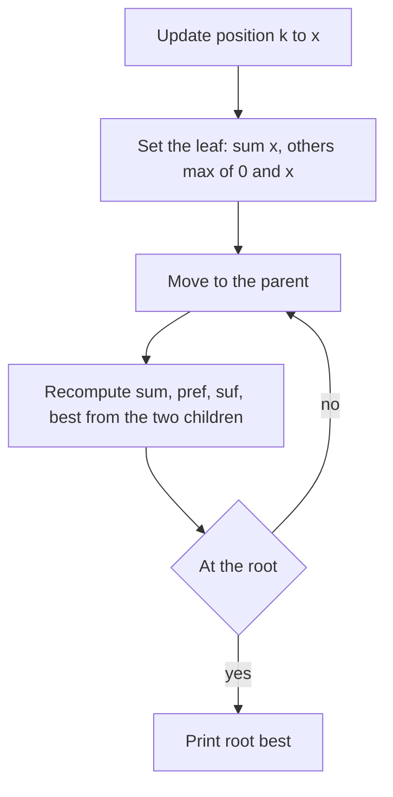

## The hook

Kadane's algorithm finds the best stretch of consecutive gains in one pass. Now the numbers keep changing: after every single update, you must report the best stretch again. Rerunning Kadane after each of 2 × 10⁵ updates on an array of 2 × 10⁵ values is 4 × 10¹⁰ steps.

The segment tree answer is short and elegant, and it is the standard example of a node that must store more than one number. Each node reports four facts about its segment, and four lines of merging keep the whole tree right after any update.

## The problem

CSES *Subarray Sum Queries*: an array of n integers and m updates "set position k to x". After each update, print the maximum sum of a contiguous subarray. The [[empty subarray]], with sum 0, is allowed, so the answer is never negative. n and m go up to 2 × 10⁵.

For [3, -5, 4, -1, 2, -6, 5], the answer before any update is 5. After setting position 3 (1-based) to -2 it is still 5; after setting position 6 to 3 it becomes 10.

## The obvious approach

Run Kadane, from [The Gambler Who Knows When to Walk Away](article:dsa-kadane), after every update: O(n) each, O(n × m) overall. Divide and conquer computes the best subarray of an array in O(n log n), but recomputing it after every update is just as slow, unless the divide-and-conquer results are kept and only the changed parts recomputed. That is exactly a segment tree.

## The key insight

:::analogy
Picture a company where every manager hands up a four-line report about their team's stretch of days: the total, the best run that starts on their first day, the best run that ends on their last day, and the best run anywhere. A boss with two teams can write their own four lines from the two reports alone: the best run is the left team's best, the right team's best, or the left team's best ending glued to the right team's best start. When one day's figure changes, only the managers above that day rewrite their reports.
:::

Each segment tree node is a [[four-field node]] (sum, pref, suf, best). For a merged node P from children L and R:

- P.sum = L.sum + R.sum;
- P.pref = max(L.pref, L.sum + R.pref);
- P.suf = max(R.suf, R.sum + L.suf);
- P.best = max(L.best, R.best, L.suf + R.pref).

The last term is the best [[crossing subarray]]. A leaf with value x has sum = x and, with empty subarrays allowed, pref = suf = best = max(0, x).

Since every query asks about the whole array, the answer is the [[root answer]], root.best, read in O(1). Each update changes one leaf and re-merges its O(log n) ancestors. The general idea of rich node summaries is in [Managers Who Keep a Richer Summary](article:cp-segment-tree-beats).

| Field | Meaning | Merge |
|---|---|---|
| sum | total of the segment | L.sum + R.sum |
| pref | best sum of a prefix | max(L.pref, L.sum + R.pref) |
| suf | best sum of a suffix | max(R.suf, R.sum + L.suf) |
| best | best sum of any subarray | max(L.best, R.best, L.suf + R.pref) |



:::insight
The best subarray of a segment is in its left half, its right half, or crosses the middle. Storing each half's best prefix and best suffix alongside its total and best makes the crossing case a single addition, so the tree can maintain the answer under updates in O(log n).
:::

## Walk through an example

Array [3, -5, 4, -1, 2, -6, 5]. Split at the root into L = [3, -5, 4, -1] and R = [2, -6, 5].

| Node | sum | pref | suf | best |
|---|---|---|---|---|
| L = [3, -5, 4, -1] | 1 | 3 | 3 | 4 |
| R = [2, -6, 5] | 1 | 2 | 5 | 5 |
| Root | 2 | max(3, 1 + 2) = 3 | max(5, 1 + 3) = 5 | max(4, 5, 3 + 2) = 5 |

The root's best is 5, which can be [4, -1, 2] crossing the middle or [5] alone. L's suffix [4, -1] = 3 and R's prefix [2] = 2 make the crossing value 5.

### Updates (1-based positions)

| Update | Array afterwards | Answer |
|---|---|---|
| position 3 to -2 | 3, -5, -2, -1, 2, -6, 5 | 5 |
| position 6 to 3 | 3, -5, -2, -1, 2, 3, 5 | 10 |
| position 1 to -4 | -4, -5, -2, -1, 2, 3, 5 | 10 |
| position 7 to -1 | -4, -5, -2, -1, 2, 3, -1 | 5 |

After the second update, the best is 2 + 3 + 5 = 10, all in the right part of the array. Each update recomputed only the leaf and about three ancestors.

:::try-this
If every element is negative, say [-3, -1, -2], what does the tree report, and how would it change if the empty subarray were not allowed? (With the empty subarray allowed, every leaf has best = 0, so the root's best is 0. If it were not allowed, leaves would use best = pref = suf = x, and the root would report -1, the largest single element.)
:::

:::warning
Common misconception: "best = max(L.best, R.best) is enough, plus the root's sum." The best subarray often crosses the middle, as [4, -1, 2] does in the example, and neither child's best captures it. Without pref and suf, the crossing case is invisible to the parent. All four fields are needed.
:::

## The code

```pseudo
leaf(x): (sum = x, pref = suf = best = max(0, x))
merge(L, R):
    sum  = L.sum + R.sum
    pref = max(L.pref, L.sum + R.pref)
    suf  = max(R.suf, R.sum + L.suf)
    best = max(L.best, R.best, L.suf + R.pref)
update(k, x): set leaf k; for each ancestor: node = merge(left, right)
answer: root.best
```

```cpp
#include <bits/stdc++.h>
using namespace std;
using ll = long long;

struct Node { ll sum, pref, suf, best; };

Node leaf(ll x) { ll y = max(0LL, x); return {x, y, y, y}; }   // empty subarray allowed
Node merge(const Node& L, const Node& R) {
    return {L.sum + R.sum,
            max(L.pref, L.sum + R.pref),
            max(R.suf, R.sum + L.suf),
            max({L.best, R.best, L.suf + R.pref})};              // the crossing case
}

struct MaxSubarrayTree {
    int size;
    vector<Node> t;
    explicit MaxSubarrayTree(const vector<ll>& a) {
        size = 1;
        while (size < (int)a.size()) size <<= 1;
        t.assign(2 * size, leaf(0));                             // padding behaves like zeros
        for (size_t i = 0; i < a.size(); i++) t[size + i] = leaf(a[i]);
        for (int v = size - 1; v >= 1; v--) t[v] = merge(t[2 * v], t[2 * v + 1]);
    }
    void set(int pos, ll x) {                                    // 0-based
        int v = size + pos;
        t[v] = leaf(x);
        for (v /= 2; v >= 1; v /= 2) t[v] = merge(t[2 * v], t[2 * v + 1]);
    }
    ll best() const { return t[1].best; }
};

int main() {
    MaxSubarrayTree tr({3, -5, 4, -1, 2, -6, 5});
    cout << tr.best() << ' ';
    for (auto [k, x] : vector<pair<int, ll>>{{3, -2}, {6, 3}, {1, -4}, {7, -1}}) {
        tr.set(k - 1, x);                                       // CSES positions are 1-based
        cout << tr.best() << ' ';
    }
    cout << '\n';                                               // 5 5 10 10 5
    MaxSubarrayTree neg({-3, -1, -2});
    cout << neg.best() << '\n';                                 // 0
}
```

Padding leaves are zeros with all fields 0, which is exactly an empty segment when empty subarrays are allowed, so they never change the answer.

## Complexity

- **Build: O(n).**
- **Each update: O(log n)** merges of four fields.
- **Each answer: O(1),** reading the root.
- **Space: O(n),** four 64-bit values per node.

## Common mistakes

- **Dropping the crossing term** L.suf + R.pref from best.
- **Mixing up suf's formula:** it is max(R.suf, R.sum + L.suf), built from the right side.
- **Initialising leaves as if empty subarrays were not allowed,** or the other way round; read the statement.
- **Padding with a neutral node that is wrong for the convention,** for example large negative values when empty subarrays are allowed.
- **Using int;** sums reach 2 × 10⁵ × 10⁹.

## Practice problems

*Subarray Sum Queries* is this walkthrough. *Maximum Subarray* is the static version, solved by Kadane in O(n), a good check of the same idea without updates. *Prefix Sum Queries* uses a two-field node (sum, pref) for range queries instead of whole-array answers.

## Key takeaways

- The maximum subarray of a segment lies in its left half, its right half, or crosses the middle.
- Each node stores its total, best prefix, best suffix and best subarray, so a parent can be computed from its two children.
- The crossing case is the left child's best suffix plus the right child's best prefix.
- A point update changes one leaf and re-merges its O(log n) ancestors, and the answer for the whole array is the root's best field.
- Whether the empty subarray is allowed decides how leaves are initialised, so read the statement before writing leaf().
