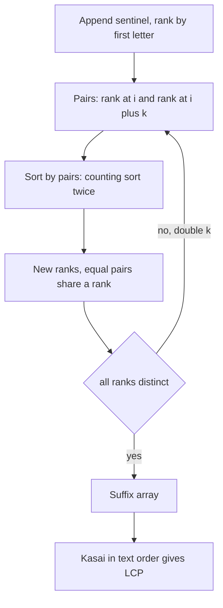

## The hook

Write down every ending of a word, from the whole word to its last letter, and sort the list as a dictionary would. For "banana" that is a, ana, anana, banana, na, nana. This tiny list answers surprisingly many questions: how many different substrings does the word have, which substring repeats and is longest, how often does a pattern occur, which substring comes k-th in alphabetical order.

The list of starting positions is the suffix array. Building it naively, by sorting n strings of length up to n, costs O(n² log n). Doubling the compared length each round brings it to O(n log n), and a neat argument then gives all neighbouring common prefixes in O(n).

## The intuition

:::analogy
A dictionary maker must alphabetise every ending of a long word. First they sort the endings by their first letter only. Then by their first two letters, which is easy: each ending's first two letters are its first letter plus the first letter of the ending one position later, and both are already ranked. Then by four letters, built from two ranked halves of two, then eight, and so on. After a handful of rounds every ending has its own place. Once alphabetised, neighbours in the dictionary share long beginnings, and those shared beginnings are where the word repeats itself.
:::

The sorted list is the [[suffix array]]; each ending's place is its [[rank]]; the round-by-round method is [[prefix doubling]]; and the shared beginnings form the [[LCP array]].

## How it works

### Prefix doubling

Append a [[sentinel]] '$', smaller than every letter, and treat the string as cyclic. Round 0 ranks positions by their first letter. If rk ranks the length-k cyclic substrings, then the length-2k substring at i is the pair (rk[i], rk[(i + k) mod n]): sorting by pairs sorts by 2k letters. After the round, give equal pairs equal ranks. Once all ranks are distinct, the order is final; that happens after at most ⌈log₂ n⌉ rounds.

Two speeds are common:

| Method | Per round | Total | When |
|---|---|---|---|
| std::sort on pairs | O(n log n) | O(n log² n) | simple, fine for n ≈ 10⁵ |
| two-pass counting sort | O(n) | O(n log n) | n ≈ 10⁶, or tight limits |

The counting-sort version uses one trick: the order by second halves is free. The previous round's order sa, shifted left by k, already lists positions sorted by rk[i + k]. A stable counting sort by first halves then finishes the round.

### The LCP array by Kasai's argument

lcp[i] is the common prefix length of the suffixes at sa[i] and sa[i + 1]. Computing each one from scratch is O(n²) in the worst case. [[Kasai's argument]] processes suffixes in text order instead, keeping the current match length h:

- for suffix i, let j be the suffix right after it in sorted order; extend h while s[i + h] = s[j + h]; record lcp[rank[i]] = h;
- then decrease h by 1 before moving to i + 1.

Why h needs only to drop by one: if suffix i shares h letters with j, then suffix i + 1 shares h − 1 letters with suffix j + 1, and j + 1 sorts after i + 1. Every suffix between them in sorted order also shares at least h − 1 letters with i + 1, including its immediate successor. So h starts each step at no less than its old value minus one; it rises at most 2n times in total.

### What the arrays answer

| Question | Answer from sa and lcp |
|---|---|
| number of distinct substrings | n(n + 1)/2 − sum of lcp |
| longest substring occurring at least twice | max of lcp, at the suffix where it occurs |
| occurrences of pattern p | binary search for the block of suffixes starting with p, O(\|p\| log n) |
| first occurrence of p | minimum position in that block |
| k-th smallest distinct substring | walk sa, suffix i adds n − sa[i] − lcp[i − 1] new substrings |
| longest common substring of a and b | sa of a + '#' + b; max lcp between neighbours from different sides |

The distinct-substring formula works because every substring is a prefix of some suffix, and walking suffixes in sorted order, the only prefixes counted twice are the ones shared with the previous suffix.



:::insight
Sorting long strings is expensive only if you compare them letter by letter. Prefix doubling never does: every comparison is between two numbers that already summarise half of each string, so log n rounds of integer sorting replace n² letter comparisons.
:::

## Walk through an example

s = "banana", with sentinel: "banana$", positions 0 to 6. Letter ranks: $ is 0, a is 1, b is 2, n is 3.

| Position | 0 | 1 | 2 | 3 | 4 | 5 | 6 |
|---|---|---|---|---|---|---|---|
| first letter | b | a | n | a | n | a | $ |
| rank by 1 letter | 2 | 1 | 3 | 1 | 3 | 1 | 0 |
| first 2 letters | ba | an | na | an | na | a$ | $b |
| rank by 2 letters | 3 | 2 | 4 | 2 | 4 | 1 | 0 |
| first 4 letters | bana | anan | nana | ana$ | na$b | a$ba | $ban |
| rank by 4 letters | 4 | 3 | 6 | 2 | 5 | 1 | 0 |

After the round of 4 letters, every rank is distinct, so sorting is complete after two doubling rounds. Dropping the sentinel's own suffix:

| Sorted index | 0 | 1 | 2 | 3 | 4 | 5 |
|---|---|---|---|---|---|---|
| sa | 5 | 3 | 1 | 0 | 4 | 2 |
| suffix | a | ana | anana | banana | na | nana |
| lcp with next | 1 | 3 | 0 | 0 | 2 | |

**Kasai in text order.**

| Suffix i | Suffix | Next in sorted order | Starting h | Final h = lcp |
|---|---|---|---|---|
| 0 | banana | na | 0 | 0 |
| 1 | anana | banana | 0 | 0 |
| 2 | nana | last, none | | reset to 0 |
| 3 | ana | anana | 0 | 3 |
| 4 | na | nana | 3 − 1 = 2 | 2 |
| 5 | a | ana | 2 − 1 = 1 | 1 |

At suffixes 4 and 5 no letters need comparing beyond the inherited value, apart from the one comparison that fails.

**Answers.** Distinct substrings: 21 − (1 + 3 + 0 + 0 + 2) = 15. The longest repeated substring is the one with lcp 3, "ana". Searching "ana" by binary search finds the block {ana, anana}: 2 occurrences, at positions 3 and 1. Searching "nab" finds an empty block.

:::try-this
Using the sa and lcp rows, list the substrings of "banana" in sorted order and find the 7th. (Suffix a adds "a". ana adds "an", "ana", skipping "a". anana adds "anan", "anana". banana adds "b", "ba", "ban", "bana", "banan", "banana". So the order begins a, an, ana, anan, anana, b, ba: the 7th is "ba".)
:::

:::warning
Common misconception: "The sentinel is optional, because cyclic doubling sorts suffixes on its own." For "abab", the cyclic shifts starting at 0 and at 2 are both "abab", so their ranks stay equal in every round and the loop never sees all ranks distinct. More generally, comparing cyclic shifts lets a short suffix borrow letters from the start of the string when it should simply end. Appending a unique smallest '$' makes every cyclic comparison agree with the suffix comparison and guarantees that the ranks become distinct.
:::

## The code

```pseudo
suffixArray(s): s += '$'; rank by letter; sa = positions sorted by letter
    for k = 1, 2, 4, ...:
        by2[i] = sa[i] - k (mod n)             # already sorted by second half
        stable counting sort by2 by rk[first half] -> sa
        new rk: increment when the pair (rk[i], rk[i+k]) changes along sa
        stop when all ranks are distinct
kasai(s, sa): h = 0; for i in text order: j = suffix after i in sa
    while s[i+h] == s[j+h]: h += 1; lcp[rank[i]] = h; if h > 0: h -= 1
```

```cpp
#include <bits/stdc++.h>
using namespace std;
using ll = long long;

vector<int> suffixArray(string s) {                              // O(n log n) prefix doubling
    s += '$';                                                    // smaller than every letter: ends each suffix
    int n = s.size();
    vector<int> sa(n), rk(n), tmp(n), cnt(max(256, n), 0);
    for (int i = 0; i < n; i++) sa[i] = i, rk[i] = (unsigned char)s[i];
    sort(sa.begin(), sa.end(), [&](int a, int b) { return rk[a] < rk[b]; });
    for (int k = 1;; k <<= 1) {                                  // rk ranks cyclic substrings of length k
        auto key = [&](int i) { return make_pair(rk[i], rk[(i + k) % n]); };
        vector<int> by2(n);                                      // sort by second half: shift the current order
        for (int i = 0; i < n; i++) by2[i] = (sa[i] - k % n + n) % n;
        fill(cnt.begin(), cnt.end(), 0);                         // stable counting sort by first half
        for (int i = 0; i < n; i++) cnt[rk[i]]++;
        for (int i = 1; i < (int)cnt.size(); i++) cnt[i] += cnt[i - 1];
        for (int i = n - 1; i >= 0; i--) sa[--cnt[rk[by2[i]]]] = by2[i];
        tmp[sa[0]] = 0;
        for (int i = 1; i < n; i++) tmp[sa[i]] = tmp[sa[i - 1]] + (key(sa[i]) != key(sa[i - 1]));
        rk = tmp;
        if (rk[sa[n - 1]] == n - 1) break;                       // all ranks distinct: fully sorted
    }
    sa.erase(sa.begin());                                        // drop the suffix that is just "$"
    return sa;
}

vector<int> kasai(const string& s, const vector<int>& sa) {      // lcp[i] = LCP of suffixes sa[i] and sa[i+1]
    int n = s.size();
    vector<int> rank(n), lcp(max(0, n - 1));
    for (int i = 0; i < n; i++) rank[sa[i]] = i;
    for (int i = 0, h = 0; i < n; i++) {                         // suffixes in text order
        if (rank[i] == n - 1) { h = 0; continue; }
        int j = sa[rank[i] + 1];                                 // the next suffix in sorted order
        while (i + h < n && j + h < n && s[i + h] == s[j + h]) h++;
        lcp[rank[i]] = h;
        if (h) h--;                                              // dropping one letter loses at most one
    }
    return lcp;
}

int countOccurrences(const string& s, const vector<int>& sa, const string& p) {   // binary search on the sorted suffixes
    auto lo = lower_bound(sa.begin(), sa.end(), p, [&](int i, const string& q) { return s.compare(i, q.size(), q) < 0; });
    auto hi = upper_bound(sa.begin(), sa.end(), p, [&](const string& q, int i) { return s.compare(i, q.size(), q) > 0; });
    return hi - lo;
}

int main() {
    string s = "banana";
    auto sa = suffixArray(s);
    for (int x : sa) cout << x << ' ';
    cout << '\n';                                                // 5 3 1 0 4 2
    auto lcp = kasai(s, sa);
    for (int x : lcp) cout << x << ' ';
    cout << '\n';                                                // 1 3 0 0 2
    ll n = s.size(), distinct = n * (n + 1) / 2;
    for (int x : lcp) distinct -= x;
    int best = max_element(lcp.begin(), lcp.end()) - lcp.begin();
    cout << distinct << ' ' << s.substr(sa[best], lcp[best]) << '\n';            // 15 ana
    cout << countOccurrences(s, sa, "ana") << ' ' << countOccurrences(s, sa, "nab") << '\n';   // 2 0

    mt19937 rng(22);                                             // against sorting the suffixes directly
    bool ok = true;
    for (int t = 0; t < 400; t++) {
        int m = 1 + rng() % 30;
        string x;
        for (int i = 0; i < m; i++) x += char('a' + rng() % 3);
        vector<int> naive(m);
        iota(naive.begin(), naive.end(), 0);
        sort(naive.begin(), naive.end(), [&](int a, int b) { return x.substr(a) < x.substr(b); });
        auto S = suffixArray(x);
        ok = ok && S == naive;
        auto L = kasai(x, S);
        set<string> subs;
        for (int i = 0; i < m; i++) for (int len = 1; i + len <= m; len++) subs.insert(x.substr(i, len));
        ll d = (ll)m * (m + 1) / 2;
        for (int v : L) d -= v;
        ok = ok && d == (ll)subs.size();
    }
    cout << (ok ? "stress ok" : "stress FAILED") << '\n';        // stress ok
}
```

The random test sorts all suffixes of 400 random strings directly and compares with the doubling result, then checks the distinct-substring formula against a set of every substring.

## Complexity

- **Construction: O(n log n)** with counting sort, O(n log² n) with comparison sort on pairs.
- **LCP: O(n)** by Kasai's argument.
- **Pattern search: O(|p| log n)** per pattern by binary search over sa.
- **Space: O(n)** integers.

## Common mistakes

- **Forgetting the sentinel,** so periodic strings never reach distinct ranks.
- **Using a sentinel that is not smaller than every letter,** which misorders prefixes such as "a" and "ab".
- **An unstable sort** in the counting-sort step, which destroys the second-half order.
- **Not resetting h to 0** at the last suffix in sorted order in Kasai's loop.
- **Summing lcp into an int** for distinct substrings: n(n + 1)/2 for n = 10⁵ is about 5·10⁹.
- **Indexing lcp by text position** instead of by sorted index.

## Practice problems

*Distinct Substrings* is the formula with the sum of LCP values. *Repeating Substring* is the maximum LCP. *Substring Order I* walks sa counting new substrings per suffix until the k-th. *Pattern Positions* asks for the first occurrence of many patterns, which binary search over sa plus a range minimum over positions answers. Comparing substrings by hashing instead is in [A Fingerprint for Every Substring](article:cp-string-hashing), and range minimum queries on the LCP array are in [Lookout Towers Built for Contest Speed](article:cp-sparse-table).

## Key takeaways

- A suffix array lists every suffix of a string in sorted order, and with an LCP array it answers counting, repetition and search questions about all substrings.
- Prefix doubling sorts by 1, 2, 4 and more letters, each round ranking pairs of ranks from the previous round, so about log n rounds suffice.
- With counting sort, each round is linear because the order by second halves is the previous order shifted, giving O(n log n) overall.
- Kasai's argument computes every LCP in linear time, because moving to the next suffix in text order loses at most one letter of common prefix.
- The number of distinct substrings is n(n + 1)/2 minus the sum of the LCP array, and the longest repeated substring is where the LCP is largest.
