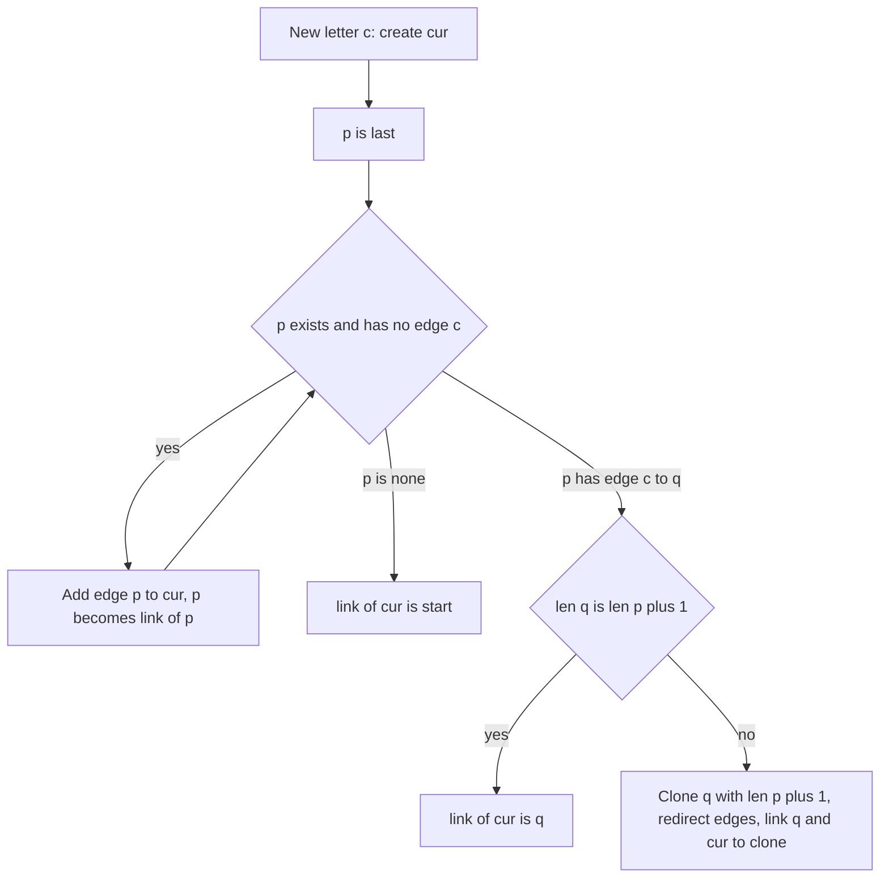

## The hook

The suffix array from [A Dictionary of Every Ending of a Word](article:cp-suffix-array) answers questions about all substrings after sorting. The suffix automaton answers many of the same questions with a different shape: a map of junctions and one-way roads, where every route from the start spells a substring, and every substring is spelled by exactly one route.

It is built online, one letter at a time, in linear time for a fixed alphabet, and it has at most 2n − 1 junctions. It is also the hardest string structure in this track to get right, almost entirely because of one step, the clone. This article traces that step letter by letter.

## The intuition

:::analogy
Imagine a road map for reading pieces of a word. You start at the depot and every road is labelled with a letter; following roads spells a piece of the word, and any piece of the word can be spelled this way. To keep the map small, junctions are shared: two pieces that end at exactly the same places in the word lead to the same junction, because whatever letter you add next, they either both continue or both stop. Each junction also has a signpost pointing to a coarser junction, the one for its pieces with a few letters dropped from the front, which end in more places.
:::

The map is the [[suffix automaton]]; "the places where a piece ends" is its [[endpos]] set; the signpost is the [[suffix link]].

## How it works

### What a state holds

Group substrings by their endpos sets. One group, one state. Three facts make the structure work:

- the strings in a state are consecutive suffixes of the longest one, with lengths from len[link[v]] + 1 up to [[len]][v];
- the suffix link goes to the state of the next shorter suffix, whose endpos set is strictly larger;
- following the links from any state reaches the start state, which holds the empty string.

So a state with len 4 and a link to a state with len 1 holds three strings, of lengths 2, 3 and 4.

### Extending by one letter

Adding letter c at position i creates a state cur for the whole prefix, with len = len[last] + 1. Then walk the suffix-link chain from last, the state of the whole previous prefix:

- **Add edges.** While the current state p has no edge by c, add p → cur by c and move to link[p]. These are suffixes that had never been followed by c.
- **No state had an edge:** link[cur] = start.
- **State p already has an edge by c to q:**
   - if len[q] = len[p] + 1, every string of q gains the new end position; link[cur] = q;
   - otherwise q mixes strings of different lengths, and only the shorter ones, up to len[p] + 1, gain the new end position. Create a [[clone]] of q with len[p] + 1, the same edges and the same link; redirect to the clone every edge by c that pointed to q along the rest of the chain; then link[q] = link[cur] = clone.

At most one clone per letter keeps the total at 2n − 1 states, and the walks are amortised linear.

### What the automaton answers

| Question | How |
|---|---|
| is p a substring | follow edges from the start; failure means no |
| number of distinct substrings | sum of len[v] − len[link[v]] |
| occurrences of p | size of endpos of p's state: 1 per non-clone state, summed along links in decreasing len |
| first occurrence of p | firstEnd of p's state minus \|p\| plus 1; a clone copies firstEnd from the state it was cloned from |
| longest common substring with t | walk t through the automaton, dropping to suffix links on failure |
| is p a suffix of s | p's state is one of the [[terminal states]] |

The occurrence count works because each non-clone state is created as the full prefix ending at one position, and every suffix of that prefix, the suffix-link chain, also ends there.



:::insight
A state is a set of strings that will always be extended the same way. The clone appears exactly when a new letter makes some strings of a state end at a new place and others not, so the state must split in two. Every other step only adds edges.
:::

## Walk through an example

s = "abcbc". State 0 is the start.

| Pos | Letter | New state | Edges added by the walk | Found | Action |
|---|---|---|---|---|---|
| 0 | a | 1, len 1 | 0 → 1 by a | none | link[1] = 0 |
| 1 | b | 2, len 2 | 1 → 2, 0 → 2 by b | none | link[2] = 0 |
| 2 | c | 3, len 3 | 2 → 3, 0 → 3 by c | none | link[3] = 0 |
| 3 | b | 4, len 4 | 3 → 4 by b | state 0 has b to 2, but len 0 + 1 < 2 | clone 5 of 2 with len 1; 0 → 5 by b; link[2] = link[4] = 5 |
| 4 | c | 6, len 5 | 4 → 6 by c | state 5 has c to 3, but len 1 + 1 < 3 | clone 7 of 3 with len 2; 5 → 7 and 0 → 7 by c; link[3] = link[6] = 7 |

Why the first clone: before position 3, state 2 held both "ab" and "b", which ended only at position 1. Now "b" also ends at position 3, but "ab" does not. They must separate: the clone 5 takes "b", and state 2 keeps "ab".

**Final states.**

| State | len | link | Strings held | endpos | Count of strings |
|---|---|---|---|---|---|
| 1 | 1 | 0 | a | {0} | 1 |
| 2 | 2 | 5 | ab | {1} | 1 |
| 3 | 3 | 7 | abc | {2} | 1 |
| 4 | 4 | 5 | cb, bcb, abcb | {3} | 3 |
| 5, clone | 1 | 0 | b | {1, 3} | 1 |
| 6 | 5 | 7 | cbc, bcbc, abcbc | {4} | 3 |
| 7, clone | 2 | 0 | c, bc | {2, 4} | 2 |

**Distinct substrings:** 1 + 1 + 1 + 3 + 1 + 3 + 2 = 12, which is 15 substrings by position minus the repeats of b, c and bc.

**Occurrences.** Non-clone states 1, 2, 3, 4 and 6 start with count 1. In decreasing len, push into links: 6 gives 1 to 7; 4 gives 1 to 5; 3 gives 1 to 7, which now has 2; 2 gives 1 to 5, which now has 2. So "bc" occurs twice, matching its state 7, and its first occurrence starts at firstEnd 2 minus 2 plus 1, position 1.

**Longest common substring** with t = "cbcbab": walking t, the matched length reaches 3 for "cbc", the longest piece shared with "abcbc".

:::try-this
Which state does "cb" reach, and how many times does it occur? (From the start, c leads to state 7 and then b leads to state 4. State 4 has endpos {3}, count 1: "cb" occurs once, starting at 3 − 2 + 1 = 2.)
:::

:::warning
Common misconception: "A clone is a brand new state, so give it empty edges and set its count to 1 like a new prefix." A clone copies q's edges and link, because its strings continue exactly as q's do, and it must start with count 0, because it does not correspond to a new prefix end; its occurrences arrive only through suffix links. Getting either part wrong breaks substring tests or occurrence counts while the distinct-substring total can still look right.
:::

## The code

```pseudo
extend(c, i): cur = new state, len = len[last] + 1, firstEnd = i
    p = last; while p exists and no edge p by c: edge p -c-> cur; p = link[p]
    if p is none: link[cur] = start
    else: q = edge p by c
        if len[p] + 1 == len[q]: link[cur] = q
        else: clone = copy of q with len[p] + 1 (same edges, link, firstEnd), marked clone
              while p exists and edge p by c == q: redirect to clone; p = link[p]
              link[q] = link[cur] = clone
    last = cur
distinct = sum over v != start of len[v] - len[link[v]]
counts: 1 for non-clone states; in decreasing len: cnt[link[v]] += cnt[v]
```

```cpp
#include <bits/stdc++.h>
using namespace std;
using ll = long long;

struct SuffixAutomaton {
    struct State { int len = 0, link = -1, firstEnd = -1; bool clone = false; map<char, int> next; };
    vector<State> st;
    int last = 0;
    SuffixAutomaton() { st.push_back({}); }
    void extend(char c, int pos) {
        int cur = st.size();
        st.push_back({});
        st[cur].len = st[last].len + 1, st[cur].firstEnd = pos;
        int p = last;
        while (p != -1 && !st[p].next.count(c)) st[p].next[c] = cur, p = st[p].link;   // new endings get edge c
        if (p == -1) st[cur].link = 0;
        else {
            int q = st[p].next[c];
            if (st[p].len + 1 == st[q].len) st[cur].link = q;   // q's strings all end here too
            else {                                               // q mixes lengths: split off the short ones
                int cl = st.size();
                st.push_back(st[q]);
                st[cl].len = st[p].len + 1, st[cl].clone = true;
                while (p != -1 && st[p].next.count(c) && st[p].next[c] == q) st[p].next[c] = cl, p = st[p].link;
                st[q].link = st[cur].link = cl;
            }
        }
        last = cur;
    }
    SuffixAutomaton(const string& s) : SuffixAutomaton() { for (int i = 0; i < (int)s.size(); i++) extend(s[i], i); }
    ll distinctSubstrings() const {
        ll total = 0;
        for (int v = 1; v < (int)st.size(); v++) total += st[v].len - st[st[v].link].len;   // lengths owned by v
        return total;
    }
    vector<ll> occurrenceCounts() const {                        // |endpos| of every state
        int n = st.size();
        vector<ll> cnt(n, 0);
        for (int v = 1; v < n; v++) if (!st[v].clone) cnt[v] = 1;    // each prefix end, once
        vector<int> order(n);
        iota(order.begin(), order.end(), 0);
        sort(order.begin(), order.end(), [&](int a, int b) { return st[a].len > st[b].len; });
        for (int v : order) if (st[v].link >= 0) cnt[st[v].link] += cnt[v];
        return cnt;
    }
    int longestCommon(const string& t) const {                   // longest common substring with t
        int v = 0, l = 0, best = 0;
        for (char c : t) {
            while (v && !st[v].next.count(c)) v = st[v].link, l = st[v].len;   // drop letters from the front
            if (st[v].next.count(c)) v = st[v].next.at(c), l++;
            best = max(best, l);
        }
        return best;
    }
    int find(const string& p) const {                            // state reached by p, or -1
        int v = 0;
        for (char c : p) { auto it = st[v].next.find(c); if (it == st[v].next.end()) return -1; v = it->second; }
        return v;
    }
};

int main() {
    SuffixAutomaton a("abcbc");
    cout << a.st.size() << ' ' << a.distinctSubstrings() << '\n';                   // 8 12
    auto cnt = a.occurrenceCounts();
    for (string p : {"bc", "cb", "abcbc", "ca"}) {
        int v = a.find(p);
        cout << p << ':' << (v < 0 ? 0 : cnt[v]) << ':' << (v < 0 ? -1 : a.st[v].firstEnd - (int)p.size() + 1) << ' ';
    }
    cout << '\n';                                                // bc:2:1 cb:1:2 abcbc:1:0 ca:0:-1
    cout << a.longestCommon("cbcbab") << '\n';                   // 3

    mt19937 rng(26);                                             // against brute force over all substrings
    bool ok = true;
    for (int it = 0; it < 300; it++) {
        int n = 1 + rng() % 14;
        string x, y;
        for (int i = 0; i < n; i++) x += char('a' + rng() % 3);
        for (int i = 0; i < 1 + (int)(rng() % 10); i++) y += char('a' + rng() % 3);
        SuffixAutomaton S(x);
        auto C = S.occurrenceCounts();
        map<string, pair<ll, int>> brute;                        // substring -> (count, first start)
        for (int i = 0; i < n; i++)
            for (int len = 1; i + len <= n; len++) {
                auto& e = brute[x.substr(i, len)];
                if (e.first++ == 0) e.second = i;
            }
        ok = ok && S.distinctSubstrings() == (ll)brute.size() && (int)S.st.size() <= max(2, 2 * n);
        for (auto& [sub, e] : brute) {
            int v = S.find(sub);
            ok = ok && v >= 0 && C[v] == e.first && S.st[v].firstEnd - (int)sub.size() + 1 == e.second;
        }
        int lcs = 0;
        for (int i = 0; i < (int)y.size(); i++)
            for (int len = 1; i + len <= (int)y.size(); len++) if (brute.count(y.substr(i, len))) lcs = max(lcs, len);
        ok = ok && S.longestCommon(y) == lcs && S.find(string(n + 1, 'a')) == -1;
    }
    cout << (ok ? "stress ok" : "stress FAILED") << '\n';        // stress ok
}
```

The random test builds automata for 300 random strings over three letters and checks, against a map of every substring, the distinct count, the occurrence count and first position of every substring, the bound of 2n states, rejection of a non-substring, and the longest common substring with a second random string.

## Complexity

- **Construction: O(n log σ)** with map transitions, O(n·σ) memory with arrays; the walks are amortised linear.
- **At most 2n − 1 states and 3n − 4 transitions** for n ≥ 3.
- **Counts:** a sort by len, O(n log n), or a counting sort by len in O(n).
- **Queries:** O(|p|) for substring tests and lookups.

## Common mistakes

- **Not copying the clone's edges and link** from q.
- **Giving clones a count of 1** in occurrence counting.
- **Redirecting edges to the clone without stopping** when an edge no longer points to q.
- **Forgetting to update link[q]** to the clone.
- **Pushing counts in arbitrary order** instead of decreasing len.
- **Recursion over the automaton** for path counting without memoisation, which is exponential.

## Practice problems

*Distinct Substrings* is the sum of len differences. *Counting Patterns* and *Pattern Positions* walk each pattern and read the count or first end. SPOJ *Longest Common Substring* walks the second string through the first string's automaton, dropping along suffix links on mismatches. The same distinct-substring answer from sorting is in [A Dictionary of Every Ending of a Word](article:cp-suffix-array).

## Key takeaways

- A suffix automaton groups substrings that end at exactly the same positions into one state, giving at most 2n − 1 states for a string of length n.
- Each state holds consecutive suffix lengths from one more than its link's len up to its own len, so the number of distinct substrings is the sum of those ranges.
- Extending by a letter adds edges along the suffix-link chain and clones a state exactly when only its shorter strings gain the new end position.
- A clone copies its source's edges, link and first end position, but contributes no occurrence of its own.
- Occurrence counts come from counting one per real prefix state and pushing counts along suffix links in decreasing len.
