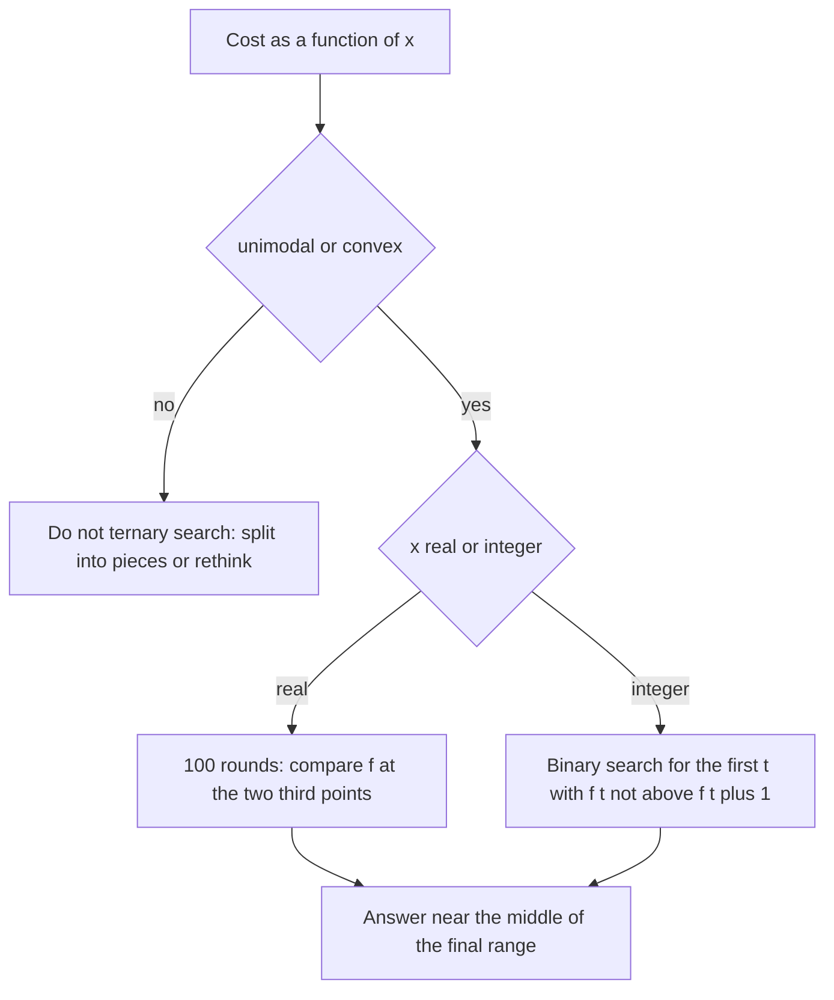

## The hook

A hiker in thick fog wants the lowest point of a valley. They cannot see the slope, but they can stand at two spots and compare heights. If the left spot is lower, the valley floor cannot be to the right of the right spot, so they can forget about that whole stretch. Two measurements, and a third of the ground is ruled out.

That is ternary search. Many contest costs, such as "pick a value x that minimises the worst imbalance" or "pick a target height that minimises the total work", behave exactly like such a valley. Binary search, from [Guessing the Answer, Then Checking It](article:dsa-binary-search-answer), needs a yes or no question; ternary search needs only that the function goes down and then up.

## The intuition

:::analogy
Standing in fog on a single valley, the hiker places two markers splitting the remaining ground into thirds. Whichever marker is higher tells them the floor is not beyond it: walking downhill from the higher marker leads towards the lower one. They move the boundary to the higher marker and repeat. The ground shrinks by a third each time, and after a hundred rounds it is narrower than a grain of sand. The method only fails if the ground has two valleys, because then the higher marker may stand between the hiker and the deeper valley.
:::

A single valley is a [[unimodal]] function; cost functions that are [[convex function]]s are the most common kind; and each round removes the [[discarded third]].

## How it works

### Real-valued ternary search

```
repeat 100 times:
    m1 = lo + (hi - lo) / 3;  m2 = hi - (hi - lo) / 3
    if f(m1) < f(m2): hi = m2        # minimum is not in (m2, hi]
    else:             lo = m1        # minimum is not in [lo, m1)
answer around (lo + hi) / 2
```

Use a fixed [[iteration budget]] rather than `while (hi − lo > eps)`. Each step keeps two thirds, so 100 steps shrink the range by a factor of about (3/2)¹⁰⁰ ≈ 4·10¹⁷, plenty for any double precision answer, and the loop cannot run forever because of rounding. Golden-section search reuses one probe per step and needs fewer evaluations, which matters only when f is expensive.

### Integer version: search the slope instead

On integers, convexity means the differences f(t + 1) − f(t) never decrease. So "f(t) ≤ f(t + 1)" is false, false, ..., then true, true: a monotone predicate. A [[slope search]], an ordinary binary search for the first true, lands on a minimum. This avoids the classic ternary pitfalls on integers: ranges of size 2 or 3, and probes that coincide.

### Recognising convex costs

You rarely get told a function is convex. These rules cover most contest cases:

| Cost of choosing x | Convex? | Why |
|---|---|---|
| \|a − x\|, (a − x)², any weight ≥ 0 times these | yes | basic convex shapes |
| sum of convex functions | yes | sums preserve convexity |
| maximum of convex functions | yes | the upper envelope of convex shapes |
| max over segments of \|sum of (a[i] − x)\| | yes | a maximum of absolute values of linear functions of x |
| minimum of two convex functions | not in general | can have two valleys |
| the number of something, as a step function | often not | flat stretches break the discard rule |

Codeforces *Weakness and Poorness* minimises exactly the fourth row; *Devu and his Brother* minimises a sum of linear costs in a target value, and *Restorer Distance* is a sum of convex costs in a target height.

### Plateaus

A convex function may have a flat bottom, which is fine: both probes on it are optimal. A flat stretch away from the minimum is not fine: f(m1) = f(m2) there tells you nothing, and the rule discards the wrong side half the time. Such functions are not unimodal, and ternary search does not apply.



:::insight
Ternary search needs no derivative and no yes or no question, only the promise of a single valley. Proving that promise, usually by writing the cost as a sum or maximum of convex pieces, is the real work; the search itself is ten lines.
:::

## Walk through an example

### Real: the weakness of a sequence

For a = 4, −2, 7, 1, the weakness of x is the largest absolute sum of any segment of a[i] − x. Each segment sum is a linear function of x, so the weakness is a maximum of absolute values of linear functions: convex.

| Round | lo | hi | m1 | f(m1) | m2 | f(m2) | Keep |
|---|---|---|---|---|---|---|---|
| 1 | −10 | 10 | −3.333 | 23.333 | 3.333 | 5.333 | lo = m1 |
| 2 | −3.333 | 10 | 1.111 | 5.889 | 5.556 | 12.222 | hi = m2 |
| 3 | −3.333 | 5.556 | −0.370 | 11.481 | 2.593 | 4.593 | lo = m1 |
| 4 | −0.370 | 5.556 | 1.605 | 5.395 | 3.580 | 5.580 | hi = m2 |
| 5 | −0.370 | 3.580 | 0.947 | 6.214 | 2.263 | 4.737 | lo = m1 |

After 100 rounds the search settles at x = 2.5 with weakness 4.5. At that point a[i] − x is 1.5, −4.5, 4.5, −1.5, and the segments {−4.5} and {4.5} balance each other: moving x either way makes one of them worse.

| x | 0 | 1 | 2 | 2.5 | 3 | 4 |
|---|---|---|---|---|---|---|
| weakness | 10 | 6 | 5 | 4.5 | 5 | 6 |

### Integer: a weighted meeting height

Heights 3, 9, 4, 10, 1 with weights 2, 1, 3, 1, 2, and the cost of a target t is the sum of weight times |height − t|. The slope search over t from 0 to 20 finds t = 4 with cost 2·1 + 1·5 + 3·0 + 1·6 + 2·3 = 19: the weighted median, as theory predicts.

### When it fails

f(t) = min((t − 1)² − 3, (t − 8)²) on [0, 10] has a deep valley at 1, value −3, and a shallow one at 8, value 0. The first probes, 3.33 and 6.67, give 2.44 and 1.78, so the rule keeps the right part and throws away the deep valley. The program confirms the search ends at 8 with value 0.

:::try-this
For the weighted heights, compute f(3), f(4) and f(5), and say what where the slope predicate switches from false to true. (f(3) = 0 + 6 + 3 + 7 + 4 = 20, f(4) = 19 and f(5) = 4 + 4 + 3 + 5 + 8 = 24. The predicate f(t) ≤ f(t + 1) is false at t = 3, since 20 > 19, and true at t = 4, since 19 ≤ 24, so the first true position, and the minimum, is t = 4.)
:::

:::warning
Common misconception: "Ternary search finds the minimum of any function on an interval." It finds the minimum of a unimodal one. On the two-valley function above it confidently returns 8, a local minimum with value 0, while the true minimum is −3 at 1. If you cannot argue unimodality, test the function on a fine grid first or choose a different method.
:::

## The code

```pseudo
ternaryReal(f, lo, hi): repeat 100 times:
    m1 = lo + (hi - lo)/3; m2 = hi - (hi - lo)/3
    if f(m1) < f(m2): hi = m2 else lo = m1
    return (lo + hi)/2
argminInteger(f, lo, hi): while lo < hi:
    mid = (lo + hi)/2
    if f(mid) <= f(mid + 1): hi = mid else lo = mid + 1
    return lo
```

```cpp
#include <bits/stdc++.h>
using namespace std;
using ll = long long;

double weakness(const vector<double>& a, double x) {             // max |sum| over all segments of a[i] - x
    double best = 0, curMax = 0, curMin = 0;
    for (double v : a) {
        curMax = max(v - x, curMax + v - x), curMin = min(v - x, curMin + v - x);   // Kadane both ways
        best = max({best, curMax, -curMin});
    }
    return best;
}

template <class F> double ternaryReal(F f, double lo, double hi, int iters = 100) {   // minimum of a unimodal f
    for (int it = 0; it < iters; it++) {
        double m1 = lo + (hi - lo) / 3, m2 = hi - (hi - lo) / 3;
        if (f(m1) < f(m2)) hi = m2; else lo = m1;                // the minimum cannot be in the discarded third
    }
    return (lo + hi) / 2;
}

template <class F> ll argminInteger(F f, ll lo, ll hi) {         // convex f on integers: binary search on the slope
    while (lo < hi) {
        ll mid = lo + (hi - lo) / 2;
        if (f(mid) <= f(mid + 1)) hi = mid; else lo = mid + 1;   // not decreasing any more: the minimum is at or left of mid
    }
    return lo;
}

int main() {
    vector<double> a = {4, -2, 7, 1};
    double x = ternaryReal([&](double t) { return weakness(a, t); }, -10, 10);
    printf("%.6f %.6f\n", x, weakness(a, x));                   // 2.500000 4.500000

    vector<ll> h = {3, 9, 4, 10, 1}, w = {2, 1, 3, 1, 2};       // weighted distance cost to a meeting height
    auto cost = [&](ll t) { ll c = 0; for (size_t i = 0; i < h.size(); i++) c += w[i] * llabs(h[i] - t); return c; };
    ll best = argminInteger(cost, 0, 20);
    cout << best << ' ' << cost(best) << '\n';                  // 4 19

    auto twoValleys = [](double t) { return min((t - 1) * (t - 1) - 3, (t - 8) * (t - 8)); };   // not unimodal
    double y = ternaryReal(twoValleys, 0, 10);
    printf("%.3f %.3f\n", y, twoValleys(y));                    // 8.000 0.000: the true minimum is -3 at 1

    mt19937 rng(32);                                             // integer version vs every t, real version vs a fine grid
    bool ok = true;
    for (int t = 0; t < 300; t++) {
        int n = 1 + rng() % 8;
        vector<ll> H(n), W(n);
        for (auto& v : H) v = rng() % 50;
        for (auto& v : W) v = 1 + rng() % 5;
        auto c = [&](ll t) { ll s = 0; for (int i = 0; i < n; i++) s += W[i] * llabs(H[i] - t); return s; };
        ll bruteBest = LLONG_MAX;
        for (ll t = 0; t <= 50; t++) bruteBest = min(bruteBest, c(t));
        ok = ok && c(argminInteger(c, 0, 50)) == bruteBest;
        vector<double> A(n);
        for (auto& v : A) v = (double)(rng() % 21) - 10;
        double gx = ternaryReal([&](double s) { return weakness(A, s); }, -20, 20), g = weakness(A, gx), grid = 1e18;
        for (int k = -2000; k <= 2000; k++) grid = min(grid, weakness(A, k / 100.0));
        ok = ok && g <= grid + 1e-6;
    }
    cout << (ok ? "stress ok" : "stress FAILED") << '\n';        // stress ok
}
```

The random test checks the integer slope search against every target from 0 to 50 for random weighted heights, and the real search against a grid with step 0.01 for random sequences: the ternary answer must be at least as good as the best grid point.

## Complexity

- **Real version: O(K · cost of f)** for K iterations, typically 100, with two evaluations each.
- **Integer slope search: O(log(range) · cost of f)**, two evaluations per step.
- **Space: O(1)** beyond evaluating f.

## Common mistakes

- **Using ternary search on a function with several valleys** or with flat stretches away from the minimum.
- **Looping while hi − lo > eps** with an eps finer than the double precision near the answer, which never terminates.
- **Integer ternary search with fiddly stops** that skip the answer on ranges of size 2 or 3; search the slope instead.
- **Maximising with the minimising comparison,** or the reverse.
- **Overflow inside f,** since costs are often sums of large products.
- **Too narrow an initial range** that does not contain the optimum.

## Practice problems

*Weakness and Poorness* is the real-valued convex example above, at n = 2·10⁵, where each evaluation is one Kadane pass. *Devu and his Brother* chooses a threshold that minimises total operations, convex in the threshold. *Restorer Distance* minimises a cost in the final common height, again a convex sum. *Peak Index in a Mountain Array* is the discrete version of a single hill, solved by comparing neighbours, which is the slope search.

## Key takeaways

- Ternary search finds the minimum of a unimodal function by comparing two inner points and discarding the third of the range beyond the higher one.
- For real numbers a fixed budget of about 100 iterations is safer than an epsilon test and more than precise enough.
- For integers, a binary search on whether f(t) ≤ f(t + 1) finds the minimum of a convex function with fewer pitfalls than integer ternary search.
- Sums and maxima of convex pieces such as absolute values, squares and linear functions are convex, which is how most contest costs are shown to be unimodal.
- On functions with more than one valley, or with flat stretches away from the minimum, the discard rule fails and the search can return a wrong answer.
