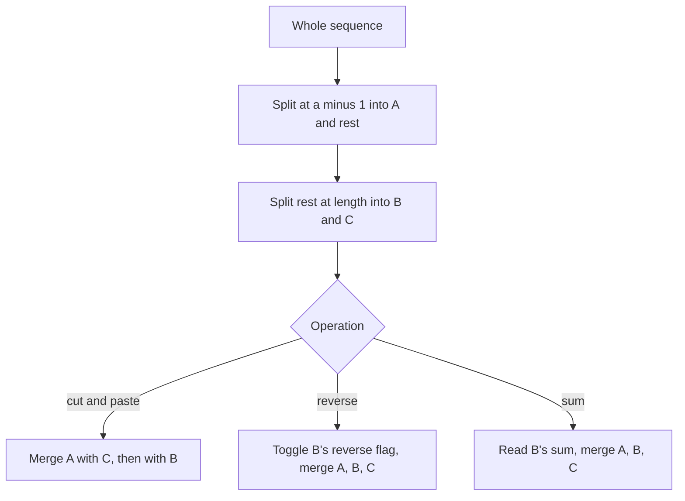

## The hook

Insert the numbers 1 to 100,000 in order into a plain binary search tree and you get a long chain: every operation becomes O(n). Shuffle the numbers first, and the same tree comes out bushy, with depth around 40. A treap gets that shuffle for free: each node draws a random priority, and the tree arranges itself as if the keys had been inserted in random order.

What makes treaps a contest favourite is not search, which std::set already does, but split and merge. With them, a treap becomes an array where you can cut out a piece, paste it elsewhere, or reverse it, each in O(log n), which no standard container can do.

## The intuition

:::analogy
Picture a deck of cards, each with a number printed on the front and a random lucky number on the back. Lay them out as a family tree: the card with the highest lucky number is the head, everything with a smaller front number goes to its left, everything larger to its right, and the same rule picks the head of each side. Because the lucky numbers are random, the heads are like cards drawn from a shuffled deck, so no side grows much longer than the other. To cut the deck into two piles at some position, or to stack two piles back together, you only ever walk down one path of heads.
:::

The family tree is a [[treap]]: a binary search tree by key and a heap by priority. Two operations do all the work:

- **[[Split]]** a treap into a left part and a right part at a position or a key.
- **[[Merge]]** two treaps whose elements are already in order, choosing the root by higher priority.

Insert, delete, cut, paste and reverse are all a few splits followed by a few merges. Each walks one root-to-leaf path, O(log n) expected.

## How it works

### Merge

merge(a, b), where every element of a comes before every element of b:

- if either is empty, return the other;
- if a's root has the higher priority, a stays root and a.right = merge(a.right, b);
- otherwise b stays root and b.left = merge(a, b.left).

### Split with implicit keys

With [[implicit key]]s, each node stores the size of its subtree, and a node's position is computed from sizes. split(t, k) returns (first k elements, the rest):

- if size(t.left) ≥ k, split t.left into (L, R'), set t.left = R', and return (L, t);
- otherwise split t.right at k - size(t.left) - 1 into (L', R), set t.right = L', and return (t, R).

Update sizes after every change. Keyed treaps split by comparing keys instead of sizes; everything else is the same.

### Cut and paste

CSES *Cut and Paste* takes the substring from a to b and moves it to the end. Split the treap into A (first a - 1), B (the next b - a + 1) and C (the rest), then merge(merge(A, C), B). Two splits and two merges, O(log n).

### Reversal with a lazy flag

CSES *Substring Reversals* reverses substrings. Split out the middle piece B, toggle its [[reverse flag]], and merge back. Pushing a flag down swaps the node's two children and toggles the flag on each child; every split and merge must push before looking at children. This is lazy propagation, from [A Manager Who Promises Raises to the Whole Team](article:cp-lazy-propagation), on a tree whose shape changes. *Reversals and Sums* adds a subtree sum to each node, recomputed with the size.

| Operation | Splits | Merges | Extra |
|---|---|---|---|
| Insert at position p | 1 | 2 | a new single node |
| Delete position p | 2 | 1 | drop the middle node |
| Move [a, b] to the end | 2 | 2 | |
| Reverse [a, b] | 2 | 2 | toggle the middle's flag |
| Sum of [a, b] | 2 | 2 | read the middle's stored sum |



:::insight
Random priorities make a treap's shape behave like a random binary search tree, so its depth is logarithmic in expectation. With split and merge on implicit positions, every array operation becomes cut into pieces, act on one piece's root, and glue back.
:::

## Walk through an example

String "ABCDEFGH" as an implicit treap; positions 1-based as on CSES.

| Operation | Pieces after splitting | Result |
|---|---|---|
| cut [2, 4], paste at end | A = "A", B = "BCD", C = "EFGH" | merge(A, C), then B: "AEFGHBCD" |
| reverse [3, 6] | A = "AE", B = "FGHB", C = "CD" | B's flag toggled: "AE" + "BHGF" + "CD" = "AEBHGFCD" |
| cut [1, 3], paste at end | A = "", B = "AEB", C = "HGFCD" | "HGFCDAEB" |

In the reversal, no characters were moved at the time: only B's root got a flag. The characters inside B were swapped lazily, when a later split or the final in-order print walked into them.

:::try-this
Starting from "ABCDEFGH", reverse [1, 8] and then reverse [1, 4]. What is the string, and how many flags were toggled? (After the first reversal, "HGFEDCBA", with one flag on the whole treap's root. The second splits off the first four, "HGFE", which pushes that flag down along the split path, then toggles a flag on that piece: "EFGH" + "DCBA" = "EFGHDCBA". Two toggles, plus a few pushes along the way.)
:::

:::warning
Common misconception: "A treap needs rotations like other balanced trees." Rotation-based treaps exist, but split and merge make rotations unnecessary: every operation is a combination of the two, and both keep the heap order on priorities automatically. Split-merge treaps are shorter to write and much harder to get wrong under contest pressure.
:::

## The code

```pseudo
merge(a, b):
    if not a or not b: return a or b
    if pri[a] > pri[b]: push(a); right[a] = merge(right[a], b); update(a); return a
    push(b); left[b] = merge(a, left[b]); update(b); return b

split(t, k):                                  # first k elements, rest
    if not t: return (none, none)
    push(t)
    if size(left[t]) >= k: (L, R) = split(left[t], k); left[t] = R; update(t); return (L, t)
    (L, R) = split(right[t], k - size(left[t]) - 1); right[t] = L; update(t); return (t, R)
```

```cpp
#include <bits/stdc++.h>
using namespace std;

mt19937 rng(20260302);

struct Treap {
    vector<int> L{0}, R{0}, sz{0}, pri{0};
    vector<char> ch{0}, rev{0};
    int node(char c) {
        L.push_back(0), R.push_back(0), sz.push_back(1), pri.push_back(rng()), ch.push_back(c), rev.push_back(0);
        return ch.size() - 1;
    }
    void push(int t) {
        if (t && rev[t]) {
            swap(L[t], R[t]);
            if (L[t]) rev[L[t]] ^= 1;
            if (R[t]) rev[R[t]] ^= 1;
            rev[t] = 0;
        }
    }
    void update(int t) { if (t) sz[t] = 1 + sz[L[t]] + sz[R[t]]; }
    int merge(int a, int b) {
        if (!a || !b) return a ? a : b;
        if (pri[a] > pri[b]) { push(a); R[a] = merge(R[a], b); update(a); return a; }
        push(b); L[b] = merge(a, L[b]); update(b); return b;
    }
    pair<int, int> split(int t, int k) {                 // first k elements, rest
        if (!t) return {0, 0};
        push(t);
        if (sz[L[t]] >= k) { auto [a, b] = split(L[t], k); L[t] = b; update(t); return {a, t}; }
        auto [a, b] = split(R[t], k - sz[L[t]] - 1);
        R[t] = a; update(t);
        return {t, b};
    }
    void print(int t, string& out) {
        if (!t) return;
        push(t);
        print(L[t], out), out += ch[t], print(R[t], out);
    }
};

int main() {
    Treap tr;
    int root = 0;
    for (char c : string("ABCDEFGH")) root = tr.merge(root, tr.node(c));
    auto cutPaste = [&](int a, int b) {                  // 1-based, move [a, b] to the end
        auto [A, rest] = tr.split(root, a - 1);
        auto [B, C] = tr.split(rest, b - a + 1);
        root = tr.merge(tr.merge(A, C), B);
    };
    auto reverse = [&](int a, int b) {
        auto [A, rest] = tr.split(root, a - 1);
        auto [B, C] = tr.split(rest, b - a + 1);
        tr.rev[B] ^= 1;                                  // lazy: nothing moves yet
        root = tr.merge(tr.merge(A, B), C);
    };
    auto show = [&]() { string s; tr.print(root, s); cout << s << ' '; };
    cutPaste(2, 4), show();
    reverse(3, 6), show();
    cutPaste(1, 3), show();
    cout << '\n';                                        // AEFGHBCD AEBHGFCD HGFCDAEB

    string ref = "ABCDEFGHIJKLMNOPQRSTUVWXYZ";           // random check against std::string
    Treap big;
    int r2 = 0;
    for (char c : ref) r2 = big.merge(r2, big.node(c));
    int bad = 0;
    for (int it = 0; it < 2000; it++) {
        int a = rng() % 26 + 1, b = rng() % 26 + 1;
        if (a > b) swap(a, b);
        auto [A, rest] = big.split(r2, a - 1);
        auto [B, C] = big.split(rest, b - a + 1);
        if (it % 2) { big.rev[B] ^= 1; r2 = big.merge(big.merge(A, B), C); std::reverse(ref.begin() + a - 1, ref.begin() + b); }
        else { r2 = big.merge(big.merge(A, C), B); ref = ref.substr(0, a - 1) + ref.substr(b) + ref.substr(a - 1, b - a + 1); }
        string s;
        big.print(r2, s);
        bad += s != ref;
    }
    cout << bad << '\n';                                 // 0
}
```

The random check applies 2,000 mixed cuts and reversals to both a treap and a plain string and compares them after every step; it is the quickest way to trust split, merge and the lazy flag together.

## Complexity

- **Split and merge: O(log n) expected,** since the expected depth of a random treap is O(log n).
- **Each array operation: O(log n) expected,** a constant number of splits and merges.
- **Printing the whole sequence: O(n).**
- **Space: O(n)** nodes, each with a few integers.

## Common mistakes

- **Forgetting to push the reverse flag** before reading or changing a node's children, in split, merge and traversal alike.
- **Not updating sizes** after changing children, which breaks every later position.
- **Off-by-one in split:** "first k elements" versus "elements up to position k"; keep one convention, here first k.
- **Using a poor random generator** such as rand() with a small range, which can produce many equal priorities on some platforms; use mt19937.
- **Deep recursion fears:** expected depth is small, so recursion is fine in practice; worst-case depth only happens with bad randomness.

## Practice problems

*Cut and Paste* is two splits and two merges per operation. *Substring Reversals* adds the lazy reverse flag. *Reversals and Sums* combines the flag with a subtree sum. For ordered sets with ranks but no cutting, the GCC structure in [A Sorted Shelf That Knows Every Book's Position](article:cp-pbds-ordered-set) is shorter.

## Key takeaways

- A treap is a binary search tree by key and a heap by random priority, which keeps its expected depth logarithmic.
- Split and merge are the only primitives needed; insertions, deletions and array operations are combinations of them.
- With implicit keys, subtree sizes give positions, so a treap behaves like an array that supports cutting and pasting in O(log n).
- Reversing a range toggles a lazy flag on the split-off piece, and the flag swaps children only when an operation descends into them.
- Every split, merge and traversal must push pending flags and update sizes, or positions and order go wrong.
