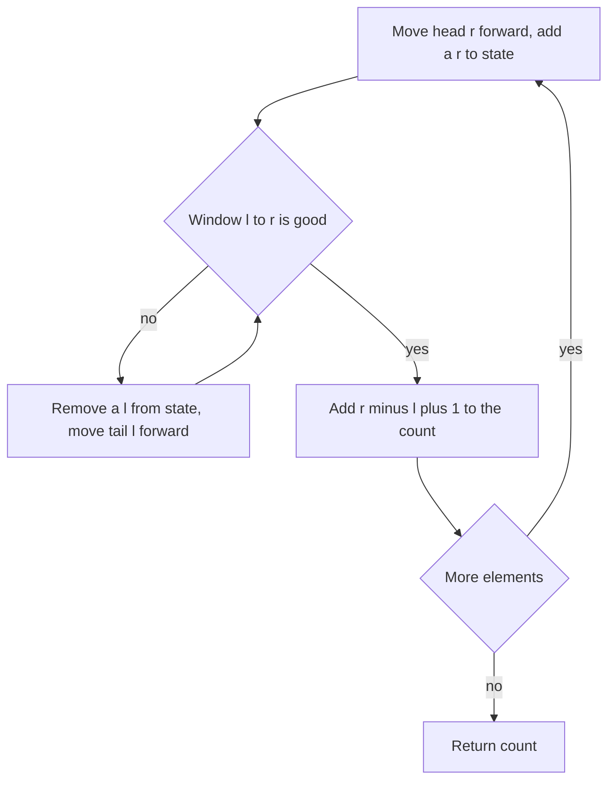

## The hook

"Count the subarrays whose sum is at most S." The array has 200,000 positive numbers, so there are about 2 × 10¹⁰ subarrays. You cannot even list the answer's members in time, let alone check each one. Yet the intended solution is a single pass that finishes in well under a second.

In [The Caterpillar That Reads Arrays in One Pass](article:dsa-sliding-window) you used a window to find the longest or shortest valid stretch. Contest problems push the same idea further: they ask you to **count** windows, count pairs, and prove that the pointers never need to move back. That proof is the part most people skip, and it is exactly where wrong answers come from.

## The intuition

:::analogy
Remember the caterpillar crawling along a branch, head in front, tail behind. Now give it one rule that it never breaks: it never backs up. The head moves forward one leaf at a time. The tail creeps forward only when the body holds something it should not. At each step, the caterpillar's length tells you how many good stretches end exactly at its head, so it can count them as it crawls.
:::

Why can it count that way? Because of one property of the condition.

Call a subarray that satisfies it a [[good segment]]. Most contest conditions are [[closed under shrinking]]: if [l, r] is good, every segment inside it is good too. Sum at most S with positive numbers, at most K distinct values, maximum minus minimum at most D: all of them are.

For each right end r, let L(r) be the [[leftmost valid start]]. Closure under shrinking says every start from L(r) to r also works. So the caterpillar's body, from L(r) to r, is exactly the set of good segments ending at r.

## How it works

### The monotonicity argument

Here is the proof that the tail never moves back: **L(r + 1) ≥ L(r)**.

Suppose not, so L(r + 1) < L(r). Then [L(r + 1), r + 1] is good, and by closure so is [L(r + 1), r], its part without the last element. That gives r a valid start smaller than L(r), contradicting L(r) being the leftmost. So L never decreases.

Both pointers are now [[monotone pointer]]s. The head moves n times and the tail moves at most n times in total, so the whole scan is O(n) no matter how many times the inner loop runs at a single step.

:::insight
Two pointers is correct exactly when the boundary of "good" moves in one direction as the other pointer advances. Prove that one sentence before coding, and the counting formula, the complexity and the correctness all follow from it.
:::

### Recipe 1: count good subarrays



The total is the sum of r − L(r) + 1 over all r. Use a 64-bit counter: with n = 200,000 the count can reach n(n + 1)/2, about 2 × 10¹⁰.

### Recipe 2: at least, and exactly

Some conditions are closed under **growing** instead, like "sum at least S". Use [[complement counting]]: all n(n + 1)/2 subarrays minus those with sum at most S − 1. And "exactly" conditions, which are not monotone at all, become a difference of two monotone counts:

$$\text{count}(= S) = \text{count}(\le S) - \text{count}(\le S - 1)$$

Here count(≤ S) means the number of subarrays whose sum is at most S. The same trick turns "exactly K distinct" into "at most K" minus "at most K − 1".

### Recipe 3: count pairs in a sorted array

To count pairs i < j with a[i] + a[j] ≤ X in a sorted array, put i at the start and j at the end. As i increases, a[i] grows, so its largest valid partner can only move left. For each i, slide j left while the pair is too big, then add j − i. It is the same monotonicity argument, applied to a boundary that moves leftward.

Variants follow the same shape: pairs with difference at most D (both pointers move right), and pairs across two sorted arrays A and B with a + b ≤ X (one pointer per array).

### Recipe 4: fix one, scan the rest

For three values with a given sum, sort the array, fix the first element, and run the pair scan on the elements after it. That is O(n) per fixed element, O(n²) in total. If the problem wants original positions, sort (value, index) pairs instead of bare values.

### When the window needs a data structure

Monotonicity is about the condition, not about how cheaply you can check it. "At most K distinct values" needs a frequency map, and "max − min ≤ D" needs a multiset or two monotonic deques. The pointers still move O(n) times; each move just costs O(log n) or amortised O(1).

## Walk through an example

**Subarrays with sum at most 5** in [2, 1, 3, 1, 1, 4]:

| r | a[r] | removed from tail | window sum | L(r) | r − L(r) + 1 | running total |
|---|---|---|---|---|---|---|
| 0 | 2 | none | 2 | 0 | 1 | 1 |
| 1 | 1 | none | 3 | 0 | 2 | 3 |
| 2 | 3 | 2 | 4 | 1 | 2 | 5 |
| 3 | 1 | none | 5 | 1 | 3 | 8 |
| 4 | 1 | 1 | 5 | 2 | 3 | 11 |
| 5 | 4 | 3, 1 | 5 | 4 | 2 | 13 |

The answer is **13**, and a brute force over all 21 subarrays agrees. Notice L(r) in the fifth column: 0, 0, 1, 1, 2, 4. It never decreases, just as the argument promised.

Running the same scan with S = 4 gives 10, so exactly 13 − 10 = **3** subarrays have sum exactly 5: [1, 3, 1], [3, 1, 1] and [1, 4].

**Pairs with sum at most 9** in the sorted array [1, 2, 4, 5, 7, 9]:

| i | a[i] | j after sliding | a[j] | pairs added (j − i) | total |
|---|---|---|---|---|---|
| 0 | 1 | 4 | 7 | 4 | 4 |
| 1 | 2 | 4 | 7 | 3 | 7 |
| 2 | 4 | 3 | 5 | 1 | 8 |
| 3 | 5 | 3 | none | stop, j ≤ i | 8 |

There are **8** pairs. For i = 0, j slides past 9 because 1 + 9 = 10 is too big, and from then on j only moves left, like the caterpillar's tail viewed from the other end.

:::try-this
Count subarrays of [1, 2, 1, 3, 2, 2] with at most 2 distinct values. (L(r) is 0, 0, 0, 2, 3, 3, so the per-step counts are 1, 2, 3, 2, 2, 3 and the total is 13.)
:::

## The code

```pseudo
count_at_most(a, S):                    // all a[i] > 0
    l = 0, sum = 0, count = 0
    for r in 0 .. n-1:
        sum += a[r]
        while sum > S: sum -= a[l]; l += 1
        count += r - l + 1
    return count

count_pairs(a, X):                      // a sorted, pairs i < j with a[i] + a[j] <= X
    j = n - 1, count = 0
    for i in 0 .. n-1:
        while j > i and a[i] + a[j] > X: j -= 1
        if j <= i: break
        count += j - i
    return count
```

```cpp
#include <bits/stdc++.h>
using namespace std;
using ll = long long;

ll countAtMost(const vector<ll>& a, ll S) {
    ll sum = 0, cnt = 0;
    for (int l = 0, r = 0; r < (int)a.size(); r++) {
        sum += a[r];
        while (sum > S) sum -= a[l++];
        cnt += r - l + 1;
    }
    return cnt;
}

ll countPairs(const vector<ll>& a, ll X) {
    ll cnt = 0;
    int j = (int)a.size() - 1;
    for (int i = 0; i < (int)a.size(); i++) {
        while (j > i && a[i] + a[j] > X) j--;
        if (j <= i) break;
        cnt += j - i;
    }
    return cnt;
}

ll atMostKDistinct(const vector<int>& a, int K) {
    map<int, int> freq;
    ll cnt = 0;
    for (int l = 0, r = 0; r < (int)a.size(); r++) {
        freq[a[r]]++;
        while ((int)freq.size() > K)
            if (--freq[a[l++]] == 0) freq.erase(a[l - 1]);
        cnt += r - l + 1;
    }
    return cnt;
}

int main() {
    vector<ll> a = {2, 1, 3, 1, 1, 4};
    cout << countAtMost(a, 5) << ' ' << countAtMost(a, 5) - countAtMost(a, 4) << '\n';  // 13 3
    cout << countPairs({1, 2, 4, 5, 7, 9}, 9) << '\n';                                   // 8
    cout << atMostKDistinct({1, 2, 1, 3, 2, 2}, 2) << '\n';                              // 13
}
```

## Complexity

- **Time:** O(n) for each scan, because each pointer moves at most n times over the whole run. A frequency `map` adds a log factor; a `vector` of counts after [Renaming Huge Numbers as 1, 2, 3](article:cp-coordinate-compression) removes it.
- **Sorting:** pair counting and the fix-one-scan-the-rest pattern need sorted input, so add O(n log n). Three values cost O(n²) in total.
- **Space:** O(1) for sums, O(n) for frequency counts or for (value, index) pairs.

## Common mistakes

:::warning
Common misconception: "any subarray condition works with two pointers." It works only when good segments are closed under shrinking (or under growing, with complement counting). With negative numbers, "sum at most S" fails: [5, −4] has sum 1, but its part [5] has sum 5. The tail would need to move back, so the scan silently skips answers. For sums with negatives, switch to prefix sums with a hash map, as in counting subarrays with sum exactly k, or with a sorted structure for "at most".
:::

- **Overflow in the count.** The number of subarrays grows like n²/2, so a 32-bit counter breaks at around n = 65,000.
- **Counting pairs twice or pairing an element with itself.** Keep the guard j > i, and decide whether the problem counts ordered or unordered pairs.
- **Forgetting to undo state** when the tail moves: decrement the frequency, subtract the value, and erase keys whose count reaches zero before checking the size.
- **Losing original indices** when sorting for *Sum of Three Values*; sort (value, index) pairs.
- **"Exactly" without the subtraction trick.** A window for "exactly K distinct" cannot decide when to move its tail; count "at most K" minus "at most K − 1".

## Practice problems

*Subarray Sums I* counts subarrays with an exact sum in an array of positive numbers: use the difference of two counts or a direct window. *Ferris Wheel* pairs the heaviest remaining child with the lightest, a pair scan with a greedy twist. *Books* (Codeforces) is the longest window with sum at most t. *Distinct Values Subarrays II* is Recipe 1 with a frequency map. *Sum of Three Values* is Recipe 4 with original indices.

Codeforces tags this family "two pointers", and it shows up from around the 1200-1400 rating range as the key step of many B and C problems.

## Key takeaways

- Two pointers is correct when good segments are closed under shrinking, because then the leftmost valid start never moves backwards as the right end advances.
- Each pointer moves at most n times over the whole scan, so the total work is linear even with an inner while loop.
- The number of good subarrays ending at r is r − L(r) + 1, and summing that over all r counts every good subarray without listing them.
- Conditions with "exactly" or "at least" become monotone through subtraction: exactly S is at most S minus at most S − 1, and at least is the total minus the complement.
- In sorted arrays the same argument counts pairs in O(n), and fixing one element first extends it to triples in O(n²).
