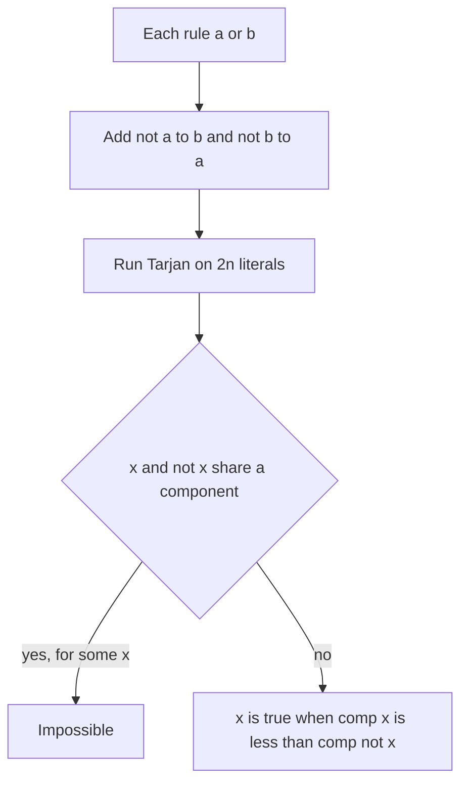

## The hook

A wedding planner has two rooms, the garden and the hall, and every guest goes into exactly one. The families send in rules, each naming two placements of which at least one must happen: "Asha in the garden or Ben in the garden", "Asha in the hall or Chen in the hall". Can every rule be honoured, and if so, where does each guest go?

With n guests there are 2ⁿ seatings, far too many to try. Yet when every rule names exactly two placements, the problem collapses into a graph question that strongly connected components answer in linear time. That is 2-SAT, and it shows up in contests whenever each object has two states and the constraints come in pairs.

## The intuition

:::analogy
The planner rewrites every rule as two one-way arrows. "Asha in the garden or Ben in the garden" becomes "if Asha is not in the garden, Ben must be" and "if Ben is not in the garden, Asha must be". Now a single seating decision starts a chain reaction along the arrows. The planner is in trouble only if some guest's arrows lead in a full circle: putting Asha in the garden eventually forces her into the hall, and putting her in the hall eventually forces her into the garden.
:::

Each placement is a [[literal]]: x means "guest x in the garden" and ¬x means "in the hall". Each rule is a [[clause]] (a ∨ b). The arrows form the [[implication graph]] on 2n literals, and the full circle is exactly "x and ¬x in the same strongly connected component".

| Rule in words | Clause | Arrows added |
|---|---|---|
| a or b (at least one) | (a ∨ b) | ¬a → b, ¬b → a |
| if a then b | (¬a ∨ b) | a → b, ¬b → ¬a |
| not both a and b | (¬a ∨ ¬b) | a → ¬b, b → ¬a |
| exactly one of a, b | (a ∨ b) and (¬a ∨ ¬b) | four arrows |
| a and b equal | (¬a ∨ b) and (a ∨ ¬b) | four arrows |
| a must hold | (a ∨ a) | ¬a → a |

Every arrow is added together with its [[contrapositive]]: "if a then b" and "if not b then not a" say the same thing. That pairing gives the graph [[skew symmetry]]: negate every literal and reverse every arrow, and you get the same graph back.

## How it works

### Detecting impossibility

If x and ¬x are in one component, there are paths x ⇝ ¬x and ¬x ⇝ x. Setting x true forces ¬x true, a contradiction; setting x false forces x true, also a contradiction. So the instance has no solution.

The surprising half is the converse: if no variable shares a component with its negation, a solution always exists, and we can read it off.

### Building the assignment

Fix a topological order of the components, the [[condensation order]], and write pos(l) for the position of literal l's component. For each variable choose the literal that comes **later**:

- x is true when pos(x) > pos(¬x), and false otherwise.

Why it works. Suppose some arrow u → v went from a true literal u to a false literal v. Then:

- u true means pos(¬u) < pos(u);
- the arrow u → v means pos(u) ≤ pos(v);
- v false means pos(v) < pos(¬v);
- skew symmetry gives the arrow ¬v → ¬u, so pos(¬v) ≤ pos(¬u).

Chained together, pos(¬u) < pos(u) ≤ pos(v) < pos(¬v) ≤ pos(¬u), which is impossible. So no arrow leads from true to false, and every clause, being a pair of arrows, is satisfied.

### Using Tarjan's order directly

[One-Way Streets, Found in a Single Walk](article:cp-scc) showed that Tarjan's algorithm numbers components in reverse topological order: sinks get the smallest ids. "Later in topological order" therefore means "smaller id", and the whole rule becomes one comparison:

- x is true exactly when comp[x] < comp[¬x].

With Kosaraju's algorithm the components come out in topological order instead, and the comparison flips. Mixing the two conventions is the classic way to get an assignment that violates clauses.

### Encoding literals

Store literal "x true" as 2x and "x false" as 2x + 1. Then negation is `l ^ 1`, and the clause (a ∨ b) is two lines: `adj[a ^ 1].push_back(b)` and `adj[b ^ 1].push_back(a)`.



:::insight
A clause of two literals is really two implications, and implications chain. Strongly connected components capture "these literals force each other", and the topological order tells you which side of each variable lies further downstream, which is always the safe side to make true.
:::

## Walk through an example

Three guests, A, B and C; a literal without ¬ means "in the garden". Four rules:

| Rule | Clause | Arrows |
|---|---|---|
| 1 | A ∨ B | ¬A → B, ¬B → A |
| 2 | ¬A ∨ B | A → B, ¬B → ¬A |
| 3 | ¬B ∨ C | B → C, ¬C → ¬B |
| 4 | ¬A ∨ ¬C | A → ¬C, C → ¬A |

Adjacency lists in insertion order: A → B, ¬C; ¬A → B; B → C; ¬B → A, ¬A; C → ¬A; ¬C → ¬B. Tarjan starts at A:

| Step | Event | Stack | Notes |
|---|---|---|---|
| 1 | visit A, B, C, ¬A | A B C ¬A | idx 0, 1, 2, 3 |
| 2 | ¬A → B, on stack | | low[¬A] = 1 |
| 3 | ¬A, then C finish with low 1 | | not roots |
| 4 | B finishes, low 1 = idx 1 | A | pop {¬A, C, B}: component 0 |
| 5 | from A, visit ¬C, then ¬B | A ¬C ¬B | idx 4, 5 |
| 6 | ¬B → A, on stack | | low[¬B] = 0 |
| 7 | ¬B → ¬A, already in component 0 | | ignored |
| 8 | ¬B, ¬C finish; A finishes, low 0 = idx 0 | empty | pop {¬B, ¬C, A}: component 1 |

The two components mirror each other, as skew symmetry promises: {B, C, ¬A} and its negation {¬B, ¬C, A}. Component 1 points into component 0 (A → B), so component 0 is later in topological order and has the smaller id.

| Variable | comp[x] | comp[¬x] | Value |
|---|---|---|---|
| A | 1 | 0 | false: A in the hall |
| B | 0 | 1 | true: B in the garden |
| C | 0 | 1 | true: C in the garden |

Check: rule 1 holds by B, rule 2 by B, rule 3 by C, rule 4 by ¬A. Brute force over all eight seatings confirms this is the only one that works.

Now add rule 5, A ∨ ¬B, which adds ¬A → ¬B and B → A. The cycle B → A → ¬C → ¬B → ¬A → B joins all six literals into one component. B and ¬B share it, so no seating exists: rules 1 and 2 force B into the garden, rule 5 then forces A into the garden, and rules 3 and 4 make C both garden and hall.

:::try-this
In the original four rules, what single extra rule would leave the answer unchanged but add no new information? (Any clause already satisfied by every solution, for example B ∨ C, or B alone, written B ∨ B. The arrows it adds, such as ¬B → B, already follow from paths in the graph, such as ¬B → A → B, so reachability, the components and the answer all stay the same.)
:::

:::warning
Common misconception: "A rule 'a or b' means a → b and b → a." Those two arrows say a and b are equal, which is a different rule entirely. The correct arrows start from the negations: ¬a → b and ¬b → a. A quick self-check is that every arrow should be satisfied whenever the clause is, and a → b fails when a is true and b false, which (a ∨ b) allows.
:::

## The code

```pseudo
literal(x, true) = 2x;  literal(x, false) = 2x + 1;  not l = l xor 1
either(a, b): add edge (not a) -> b; add edge (not b) -> a
solve:
    run Tarjan on the 2n literals, giving comp[] in reverse topological order
    for each variable x:
        if comp[2x] == comp[2x + 1]: return impossible
        value[x] = comp[2x] < comp[2x + 1]
```

```cpp
#include <bits/stdc++.h>
using namespace std;

struct TwoSat {
    int n;                                                       // literal 2x is "x true", 2x+1 is "x false"
    vector<vector<int>> adj;
    vector<int> comp;
    TwoSat(int n) : n(n), adj(2 * n) {}
    static int lit(int x, bool value) { return 2 * x + (value ? 0 : 1); }
    void either(int a, int b) {                                  // clause (a or b)
        adj[a ^ 1].push_back(b);                                 // not a  ->  b
        adj[b ^ 1].push_back(a);                                 // not b  ->  a
    }
    bool solve(vector<bool>& value) {                            // iterative Tarjan, safe for 2*10^5 literals
        int N = 2 * n, timer = 0, count = 0;
        vector<int> idx(N, -1), low(N), it(N, 0), st, cs;
        vector<bool> on(N, false);
        comp.assign(N, -1);
        for (int s = 0; s < N; s++) {
            if (idx[s] != -1) continue;
            cs = {s}; idx[s] = low[s] = timer++; st.push_back(s); on[s] = true;
            while (!cs.empty()) {
                int u = cs.back();
                if (it[u] < (int)adj[u].size()) {
                    int v = adj[u][it[u]++];
                    if (idx[v] == -1) { idx[v] = low[v] = timer++; st.push_back(v); on[v] = true; cs.push_back(v); }
                    else if (on[v]) low[u] = min(low[u], idx[v]);
                } else {
                    cs.pop_back();
                    if (low[u] == idx[u]) {                      // u is the root of a component
                        while (true) {
                            int x = st.back(); st.pop_back();
                            on[x] = false, comp[x] = count;
                            if (x == u) break;
                        }
                        count++;
                    }
                    if (!cs.empty()) low[cs.back()] = min(low[cs.back()], low[u]);
                }
            }
        }
        value.assign(n, false);
        for (int x = 0; x < n; x++) {
            if (comp[2 * x] == comp[2 * x + 1]) return false;   // x forces not x and back
            value[x] = comp[2 * x] < comp[2 * x + 1];            // smaller id = later in topological order
        }
        return true;
    }
};

string giantPizza(int m, const vector<pair<int, int>>& wishes) {   // wish +t / -t; toppings 1..m
    TwoSat s(m);
    auto toLit = [](int w) { return TwoSat::lit(abs(w) - 1, w > 0); };
    for (auto [a, b] : wishes) s.either(toLit(a), toLit(b));
    vector<bool> v;
    if (!s.solve(v)) return "IMPOSSIBLE";
    string out;
    for (int t = 0; t < m; t++) out += string(t ? " " : "") + (v[t] ? "+" : "-");
    return out;
}

int main() {
    // guests A, B, C as toppings 1, 2, 3: rules (A or B), (not A or B), (not B or C), (not A or not C)
    vector<pair<int, int>> rules = {{1, 2}, {-1, 2}, {-2, 3}, {-1, -3}};
    cout << giantPizza(3, rules) << '\n';                        // - + +
    rules.push_back({1, -2});                                    // rule 5: (A or not B)
    cout << giantPizza(3, rules) << '\n';                        // IMPOSSIBLE

    mt19937 rng(11);                                             // compare with brute force on small cases
    bool good = true;
    for (int rep = 0; rep < 500; rep++) {
        int n = 1 + rng() % 5, m = rng() % 9;
        vector<array<int, 2>> cl;
        TwoSat s(n);
        for (int i = 0; i < m; i++) {
            int a = rng() % (2 * n), b = rng() % (2 * n);
            cl.push_back({a, b});
            s.either(a, b);
        }
        bool brute = false;
        for (int mask = 0; mask < (1 << n) && !brute; mask++) {
            auto holds = [&](int l) { return (((mask >> (l / 2)) & 1) == 1) == (l % 2 == 0); };
            bool all = true;
            for (auto [a, b] : cl) all = all && (holds(a) || holds(b));
            brute = all;
        }
        vector<bool> v;
        bool got = s.solve(v);
        good = good && got == brute;
        if (got)
            for (auto [a, b] : cl) {
                auto holds = [&](int l) { return v[l / 2] == (l % 2 == 0); };
                good = good && (holds(a) || holds(b));
            }
    }
    cout << (good ? "stress ok" : "stress FAILED") << '\n';      // stress ok
}
```

`giantPizza` follows the CSES input style: each person gives two wishes, a sign and a topping number, and at least one wish per person must come true. The stress test checks both directions: the solver says "impossible" exactly when brute force finds nothing, and every assignment it returns satisfies every clause.

## Complexity

- **Time: O(n + m)** for n variables and m clauses: 2n literals, 2m arrows, one Tarjan pass.
- **Space: O(n + m)** for the graph and Tarjan's arrays.

## Common mistakes

- **Wrong arrows:** a → b and b → a instead of ¬a → b and ¬b → a.
- **Adding only one arrow per clause,** which breaks skew symmetry and the correctness argument.
- **Flipping the comparison:** with Tarjan ids use comp[x] < comp[¬x]; with Kosaraju's topological numbering it is the opposite.
- **Off-by-one literal encoding** when input variables are 1-indexed, for example forgetting `abs(w) - 1`.
- **Forgetting forced literals:** "x must be true" is the clause (x ∨ x), which adds the single arrow ¬x → x.
- **Trying 2-SAT on three-literal rules;** with three literals per clause the problem is 3-SAT, which has no known polynomial algorithm.

## Practice problems

*Giant Pizza* is the template problem: each person's two wishes are one clause. *The Door Problem* gives each switch two states and each door a parity condition on its two switches, which becomes "equal" or "different" clauses. *The Road to Berland is Paved With Good Intentions* asks which cities to toggle so that every road ends up asphalted, again an "equal or different" rule per road. The component machinery is in [One-Way Streets, Found in a Single Walk](article:cp-scc), and the DFS basics in [Going Deep With a Ball of String](article:dsa-dfs).

## Key takeaways

- 2-SAT turns every two-literal rule (a ∨ b) into the arrows ¬a → b and ¬b → a, on a graph of 2n literals.
- The instance is impossible exactly when some variable and its negation fall in the same strongly connected component.
- Otherwise, making each variable's later literal in topological order true satisfies every clause, a fact that follows from skew symmetry.
- Tarjan's algorithm numbers components in reverse topological order, so the rule is simply x is true when comp[x] < comp[¬x].
- The whole method is linear in the number of variables plus clauses, so it handles 10⁵ rules easily.
