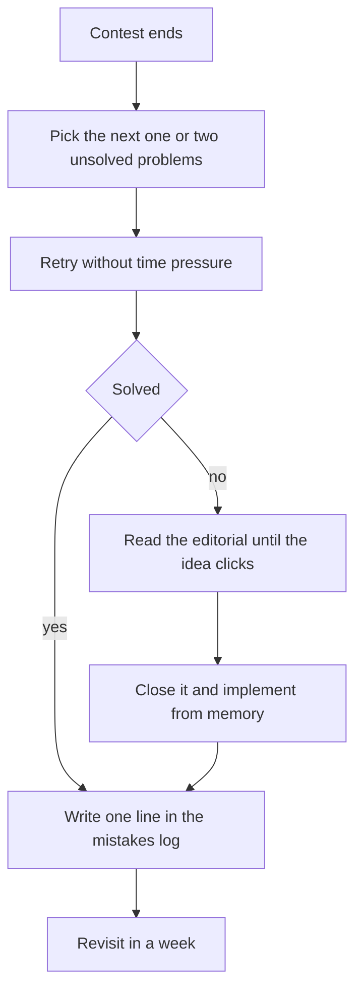

## The hook

Two students do the same number of contests in a semester. One improves steadily; the other stays flat. When you look at their weeks, the difference is not in the contests at all. It is in the hour after each one.

The first student goes back to the problem that beat them, learns why, and codes it. The second closes the tab and waits for the next round. That hour is called upsolving, and it is where most of the improvement in competitive programming actually happens. It is also the cheapest training you will ever get: the problems are already chosen for you, at exactly your edge, with a written explanation waiting once you have tried.

## The intuition

:::analogy
Football teams do not improve only by playing matches. On Monday they sit down and watch the footage of Saturday's game, pausing at every goal they conceded, asking what went wrong and drilling that exact situation in training. The match shows them their weaknesses; the footage session fixes them.
:::

A contest is the match. [[Upsolving]] is the footage session: you replay the moments you lost, understand them, and drill them until they would not beat you again.

## Let's build it up

### Choose what to upsolve

Not every problem is worth your time. Upsolve the next one or two problems beyond what you solved, typically the first unsolved one and maybe the one after. Those sit right at the edge of your ability. The hardest problems in the round are usually too far ahead to learn from yet; come back to them in a few months.

### Try again before reading

With the pressure gone, give the problem another honest attempt, about 20 to 40 minutes. Often the idea arrives once the clock stops. If it does, you learned that your knowledge was fine and your contest pacing was the issue, which is a different lesson.

### Read the editorial actively

When you do read the [[editorial]], read only until the key idea clicks, then stop. Ask yourself:

- What was the observation I missed?
- What in the statement should have pointed me to it?
- Have I seen this technique before under a different story?

### Implement it from memory

Close the editorial and write the solution yourself. This is [[active recall]], and it is the step most people skip. Reading a solution feels like understanding; writing it reveals the details you did not actually absorb.

:::insight
Rating rises when you solve one more problem per contest, and that next problem is exactly the one you upsolve. Each upsolve converts a weakness into a tool, so the next time that idea appears, it costs you minutes instead of the whole contest.
:::

### Keep a mistakes log

After every failed submission and every upsolve, write one line in a [[mistakes log]]: the problem, and the real cause. "Overflow in product", "did not see that only parity matters", "forgot to reset visited array". Read the log before each contest. Within a few weeks you will see your personal top three bugs, and a template or a checklist can usually eliminate them.

### Virtual contests as a second chance

Codeforces lets you take part in past contests "virtually", with the original timer and a simulated scoreboard. Once you have upsolved a few rounds, try a virtual contest on a round you have not seen. It recreates the pressure that ordinary practice lacks, and comparing your virtual result with the real standings shows whether your upsolving is turning into speed. Many strong contestants alternate: one live contest, one virtual contest, and upsolving after both.

### Space it out

Revisit upsolved problems after a day, a week and a month. Try to recall the key idea in one sentence before opening your old code. This [[spaced repetition]] is what turns "I saw that once" into "I recognise it immediately".

:::warning
Common misconception: "reading lots of editorials is the same as upsolving." Reading without implementing leaves you with a feeling of understanding and very little skill. The value comes from the retry, the active reading and the from-memory implementation together.
:::

## A tiny example

Arjun solves A and B in a Div. 2 round and gets stuck on C, a problem about making an array non-decreasing with a limited operation.

- **That evening:** he retries C for 30 minutes without success, then reads the editorial. The key idea: only the maximum so far matters, so a single left-to-right pass decides everything. He closes the editorial and codes it in 15 minutes.
- **Mistakes log:** "C: tried to simulate operations; missed that tracking the running maximum is enough."
- **One week later:** he sees a different problem with the same running-maximum shape and solves it in ten minutes during a virtual contest.

One upsolve, one log line, one revisit: a technique moved from "unknown" to "owned".

:::try-this
Take the last contest you did, or any recent Div. 2 or Div. 3 round. Pick the first problem you did not solve, set a 30-minute timer, and retry it. Whatever happens, write one line for your mistakes log. (If you have never done a contest, pick a 1200-rated problem from Codeforces and treat it the same way.)
:::

## Where you'll see this again

The [rating ladder](article:cp-rating-ladder) tells you which band your upsolves should come from, and [debugging in contests](article:cp-debugging-in-contest) gives the checklist your mistakes log will refine. Every technique article in this subject lists practice problems, which double as an upsolving queue for that topic.

## Key takeaways

- Upsolving the problems just beyond what you solved is where most improvement in competitive programming happens.
- Retry without time pressure before reading the editorial, because sometimes the gap was pacing, not knowledge.
- Read editorials only until the key idea clicks, then implement the solution yourself from memory.
- A one-line mistakes log reveals your recurring bugs so you can eliminate them with your template or checklist.
- Revisit upsolved problems after a day, a week and a month so the techniques move into long-term memory.
