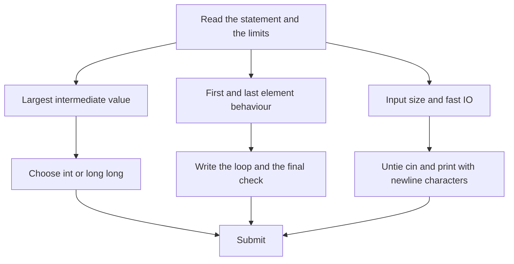

## The hook

Before a race, runners do warm-up laps. Nobody wins anything on them, but they reveal a stiff knee or a loose shoelace while it is still cheap to fix. The first problems on CSES are warm-up laps for competitive programming: each is a few lines of code, and each hides one small trap that catches beginners on a real contest day.

Solve them carefully once, understand exactly why each trap exists, and you will stop losing points to the same three mistakes: integers that overflow, loops that misread the process, and slow input.

## The problem

Four short CSES tasks, in my own words:

- **Weird Algorithm:** start from n; while n is not 1, halve it if it is even, otherwise replace it with 3n + 1; print every value, including the first and the final 1.
- **Missing Number:** the numbers 1 to n appear once each, except one; find the missing one.
- **Repetitions:** in a DNA string over A, C, G and T, find the length of the longest block of the same letter in a row.
- **Increasing Array:** you may increase any element by 1 per move; find the fewest moves that make the array non-decreasing.

## The obvious approach

Each is a direct [[simulation]] or a single scan, and the obvious code is nearly right. The bugs are in the details:

| Task | Obvious code | Hidden bug |
|---|---|---|
| Weird Algorithm | `int n;` and the loop | 3n + 1 grows past 2³¹ and wraps or misbehaves |
| Missing Number | sum 1..n with `int` | n(n + 1) / 2 is about 2 × 10¹⁰ for n = 2 × 10⁵ |
| Repetitions | count the current block | forgetting to compare the last block, or starting the best at 0 |
| Increasing Array | add the gap to a running total | storing the total in `int`; gaps add up past 2³¹ |

Each bug produces correct output on the sample tests and fails on large hidden ones, which is the most frustrating way to get Wrong Answer.

## The key insight

:::analogy
Warm-up laps are not about speed; they are about checking every part of your kit against the conditions of the real race. Here the kit check is three questions before writing any loop: how large can any value get, including intermediate ones? What exactly happens at the first and last element? How much input arrives, and is it read fast enough? Answer those, and the warm-up problems are run at full pace with no stumbles.
:::

**How large can values get?** The input bound is not the value bound. In Weird Algorithm, n ≤ 10⁶, but the sequence climbs much higher: a short program that checks every start below 10⁶ finds a largest value of 56,991,483,520, reached from n = 704,511. That needs 64 bits. Totals behave the same way: Missing Number's sum and Increasing Array's move count both exceed 2³¹ on the largest tests. Any [[overflow]] in C++ either wraps or is undefined, and the judge will find it.

**What happens at the ends?** Repetitions must count the very first [[run]] as length 1 and compare the final run after the loop. Increasing Array never changes the first element.

**Is the input fast enough?** CSES inputs reach 2 × 10⁵ numbers; with `cin` untied from `cout` and sync turned off, as in [The Thirty Lines You Paste Before Every Contest](article:cp-fast-io-template), reading is instant. Print with `'\n'`, not `endl`, which flushes on every line.

### The solutions

- **Weird Algorithm:** a `long long` loop that prints as it goes.
- **Missing Number:** n(n + 1) / 2 minus the sum of the input, in `long long`; or XOR 1..n with every input value, which cannot overflow.
- **Repetitions:** keep the current run length and the best; reset to 1 when the letter changes.
- **Increasing Array:** keep the [[running maximum]]; whenever a[i] is below it, add the gap to the answer and treat a[i] as raised to it.

Increasing Array's greedy is safe: each element must be at least the previous one, and raising it exactly to that bound is both the cheapest move now and the lowest floor for everything after.



:::insight
Easy problems are lost on details, not ideas. Before writing a loop, check the largest value any variable can reach, what the loop does on the first and last element, and how much input arrives; those three checks prevent most beginner Wrong Answers.
:::

## Walk through an example

### Weird Algorithm from 3

3 → 10 → 5 → 16 → 8 → 4 → 2 → 1. Odd 3 becomes 3 × 3 + 1 = 10, even 10 halves to 5, and so on. Small starts stay small; it is starts such as 704,511 that climb past 5 × 10¹⁰.

### Missing Number with n = 6 and 2, 5, 1, 6, 3

| Method | Calculation | Answer |
|---|---|---|
| Sum | 6 × 7 / 2 - (2 + 5 + 1 + 6 + 3) = 21 - 17 | 4 |
| XOR | (1 ^ 2 ^ 3 ^ 4 ^ 5 ^ 6) ^ (2 ^ 5 ^ 1 ^ 6 ^ 3) | 4 |

### Repetitions in ACGGGTTTTAC

| Position | Letter | Current run | Best |
|---|---|---|---|
| 0 | A | 1 | 1 |
| 1 | C | 1 | 1 |
| 2 to 4 | G G G | 1, 2, 3 | 3 |
| 5 to 8 | T T T T | 1, 2, 3, 4 | 4 |
| 9, 10 | A, C | 1, 1 | 4 |

### Increasing Array on 3, 7, 2, 9, 9, 4, 1

| Element | Running maximum before | Moves added | Running maximum after |
|---|---|---|---|
| 3 | | 0 | 3 |
| 7 | 3 | 0 | 7 |
| 2 | 7 | 5 | 7 |
| 9 | 7 | 0 | 9 |
| 9 | 9 | 0 | 9 |
| 4 | 9 | 5 | 9 |
| 1 | 9 | 8 | 9 |

Total: 18 moves. The final array is 3, 7, 7, 9, 9, 9, 9.

:::try-this
In Increasing Array, the worst case has n = 2 × 10⁵ with the first element 10⁹ and every other element 1. How many moves is that, and does it fit in an int? (Each of the other 199,999 elements needs 10⁹ - 1 moves, about 2 × 10¹⁴ in total, which is far beyond the int limit of about 2.1 × 10⁹. The answer must be a long long.)
:::

:::warning
Common misconception: "If the input fits in int, the answer does too." Inputs bound the starting values, not what the computation produces. Weird Algorithm's input is at most 10⁶ but its values pass 5 × 10¹⁰, and Increasing Array's elements fit in int while its total reaches about 2 × 10¹⁴. Decide the type from the largest intermediate value, not from the input.
:::

## The code

```pseudo
weird(n):   while n != 1: print n; n = n / 2 if n even else 3n + 1; print 1
missing(n, a): return n(n + 1)/2 - sum(a)                 # in 64-bit
repetitions(s): best = cur = 1; for i in 1..: cur = cur + 1 if s[i] == s[i-1] else 1; best = max(best, cur)
increasing(a): moves = 0; mx = a[0]
    for x in a[1..]: if x < mx: moves += mx - x else: mx = x
```

```cpp
#include <bits/stdc++.h>
using namespace std;
using ll = long long;

void weird(ll n) {                                       // 64-bit: values climb far above the input
    while (n != 1) {
        cout << n << ' ';
        n = (n % 2 == 0) ? n / 2 : 3 * n + 1;
    }
    cout << 1 << '\n';
}

ll missingNumber(ll n, const vector<ll>& a) {
    ll total = n * (n + 1) / 2;                          // about 2e10 for n = 2e5
    for (ll x : a) total -= x;
    return total;
}

int repetitions(const string& s) {
    int best = 1, cur = 1;
    for (size_t i = 1; i < s.size(); i++) {
        cur = (s[i] == s[i - 1]) ? cur + 1 : 1;
        best = max(best, cur);                           // compare every run, including the last
    }
    return best;
}

ll increasingArray(const vector<ll>& a) {
    ll moves = 0, mx = a[0];
    for (size_t i = 1; i < a.size(); i++) {
        if (a[i] < mx) moves += mx - a[i];               // raise exactly to the floor
        else mx = a[i];
    }
    return moves;
}

int main() {
    ios::sync_with_stdio(false);
    cin.tie(nullptr);
    weird(3);                                            // 3 10 5 16 8 4 2 1
    cout << missingNumber(6, {2, 5, 1, 6, 3}) << ' ' << repetitions("ACGGGTTTTAC") << ' '
         << increasingArray({3, 7, 2, 9, 9, 4, 1}) << '\n';                       // 4 4 18
    ll peak = 0;
    for (ll n = 704511; n != 1; n = (n % 2 == 0) ? n / 2 : 3 * n + 1) peak = max(peak, n);
    vector<ll> worst(200000, 1);
    worst[0] = 1000000000;
    cout << peak << ' ' << increasingArray(worst) << '\n';                        // 56991483520 199998999800001
}
```

On CSES itself, each task reads its input from standard input; the functions above are the parts that matter, called on the examples so the outputs can be checked.

## Complexity

- **Weird Algorithm: O(number of steps),** a few hundred for starts below 10⁶.
- **Missing Number, Repetitions, Increasing Array: O(n) time, O(1) extra space** beyond the input.
- **Input and output:** with fast IO, reading 2 × 10⁵ numbers takes a few milliseconds.

## Common mistakes

- **Using int for values or totals** that exceed 2³¹ along the way.
- **Printing with endl,** which flushes every line and can be slow on large outputs.
- **Forgetting the final 1** in Weird Algorithm, or printing it twice.
- **Starting the best run at 0** in Repetitions, which is wrong for a one-letter string.
- **Modifying the array in Increasing Array** and then comparing against the original values by mistake; keep the running maximum separate.
- **Writing `3 * n + 1` with n as int,** where the multiplication overflows even if the result is stored in a long long.

## Practice problems

All four tasks come first on the CSES Problem Set and are the best place to start. After them, try the rest of the Introductory Problems section. Reading statements quickly and spotting limits is practised in [The Two-Minute Read That Saves Twenty](article:cp-reading-problems-fast), and the template that sets up fast IO is in [The Thirty Lines You Paste Before Every Contest](article:cp-fast-io-template).

## Key takeaways

- Warm-up problems are lost on details: integer sizes, the first and last element, and input speed.
- Weird Algorithm needs 64-bit integers because its values pass 5 × 10¹⁰ even for starts below 10⁶.
- Missing Number is n(n + 1) / 2 minus the input sum in 64-bit, or an XOR of 1..n with the input, which cannot overflow.
- Repetitions keeps the current run and the best run, resetting the current run to 1 whenever the letter changes.
- Increasing Array raises each element exactly to the running maximum, which is both cheapest and leaves the lowest floor for later elements.
