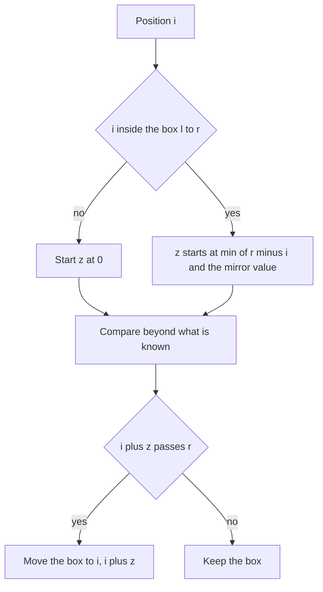

## The hook

The prefix function from [A Reader Who Never Rereads the Page](article:cp-prefix-function) looks at each position and asks: what is the longest border ending here? The Z-function flips the question: starting here, how far does the string agree with its own beginning?

Both answer the same family of problems, matching, borders and periods, in linear time. Many people find the Z-function easier to reason about, because each value is a plain "how long is the match", and its key trick, reusing a window that is already verified, shows up again in Manacher's palindrome algorithm later in this track.

## The intuition

:::analogy
Picture an inspector comparing a long ribbon against its own first few centimetres. Whenever they find a stretch that matches the start, they clip a window over it: "everything under this window is a copy of the beginning". When they move on to a spot under the window, they do not measure from scratch. They look at the matching spot near the beginning, where they already know how far the match runs, and copy that answer, at least up to the window's edge. Only past the edge do they take out the tape measure, and every new centimetre they measure pushes the window further right.
:::

The answers are the [[Z-function]]. The window is the [[Z-box]], and the matching spot near the beginning is the [[mirror position]].

## How it works

### The algorithm

```
z[0] = n; l = r = 0                        # [l, r) is the rightmost match with the prefix
for i = 1 .. n-1:
    if i < r: z[i] = min(r - i, z[i - l])  # copy from the mirror, but not past the box
    while i + z[i] < n and s[z[i]] == s[i + z[i]]: z[i] += 1
    if i + z[i] > r: l = i; r = i + z[i]
```

Three cases, depending on the mirror value z[i − l]:

| Case | What is known | Comparisons needed |
|---|---|---|
| i ≥ r, outside the box | nothing | start from 0 |
| inside, z[i − l] < r − i | the match stops before the box edge, exactly at z[i − l] | one, which fails at once |
| inside, z[i − l] ≥ r − i | the match reaches at least the box edge | continue past r; the box then moves |

**Why it is linear.** Every successful comparison in the while loop looks at a letter at position i + z[i] ≥ r, and afterwards the box extends to cover it, so r increases. r never exceeds n, so there are at most n successful comparisons in total. Each position adds at most one failed comparison. Total O(n).

### Pattern search, with or without a separator

The textbook method computes z of p + '#' + t and reports every i with z[i] = |p|; the [[separator]] stops matches from running across the join. It fails if '#' can occur in the input.

You do not need a separator at all. Compute z of p + t and, for positions i ≥ |p| in the text part, report a match whenever z[i] ≥ |p|. A z value there may run past the pattern's length into the text, but that only makes it larger; z[i] ≥ |p| says exactly that the |p| letters at i equal the pattern.

### Periods and borders

- **[[Period test]]:** p is a period of s exactly when p + z[p] = n, plus p = n. CSES *Finding Periods* is one loop.
- **Borders:** a suffix starting at i is a border exactly when i + z[i] = n; its length is n − i.
- **Repetition:** s is a whole number of copies of its first p letters when p divides n and p + z[p] = n.

### Prefix, suffix and somewhere in the middle

Codeforces *Password* asks for the longest string that is a prefix of s, a suffix of s, and also occurs somewhere else, neither at the start nor as that suffix. Scan i from 1 upwards, so suffixes come longest first, keeping the largest z value seen at positions before i:

- if i + z[i] = n, the suffix at i is a border of length z[i];
- it also occurs strictly inside if some earlier position j, with 1 ≤ j < i, has z[j] ≥ z[i].

The first i that passes both tests gives the answer.

### Z-function or prefix function?

| Task | Natural tool |
|---|---|
| matching a pattern | either |
| all borders, periods | either; Z is one loop |
| automaton for string DP | prefix function |
| "how far does position i agree with the start" | Z-function |
| streaming text, one letter at a time | prefix function |



:::insight
Inside the Z-box the string repeats its own prefix, so every answer there has already been computed once, near the start. The only new work happens past the box's right edge, and that edge only moves forward, which is the whole reason the algorithm is linear.
:::

## Walk through an example

s = "aabxaabxcaab", length 12.

| i | s[i] | Box before | Start value | Extra matches | z[i] | Box after |
|---|---|---|---|---|---|---|
| 1 | a | none | 0, outside | 1 | 1 | [1, 2) |
| 2 | b | [1, 2) | 0, outside | 0 | 0 | [1, 2) |
| 3 | x | [1, 2) | 0, outside | 0 | 0 | [3, 3), empty |
| 4 | a | empty | 0, outside | 4: "aabx" | 4 | [4, 8) |
| 5 | a | [4, 8) | min(3, z[1] = 1) = 1 | 0 | 1 | [4, 8) |
| 6 | b | [4, 8) | min(2, z[2] = 0) = 0 | 0 | 0 | [4, 8) |
| 7 | x | [4, 8) | min(1, z[3] = 0) = 0 | 0 | 0 | [4, 8) |
| 8 | c | [4, 8) | 0, outside | 0 | 0 | [4, 8) |
| 9 | a | [4, 8) | 0, outside | 3: "aab" | 3 | [9, 12) |
| 10 | a | [9, 12) | min(2, z[1] = 1) = 1 | 0 | 1 | [9, 12) |
| 11 | b | [9, 12) | min(1, z[2] = 0) = 0 | 0 | 0 | [9, 12) |

At i = 5, 6 and 7 the window [4, 8) already guarantees the letters equal "aabx", so the answers come from positions 1, 2 and 3 without fresh work beyond one failed comparison each.

**When the mirror reaches the edge.** For s = "aaaa", z[1] = 3 sets the box to [1, 4). At i = 2 the mirror says z[1] = 3, but only r − i = 2 letters are guaranteed, so z[2] starts at 2; the next comparison would be past the end, so z[2] = 2. Likewise z[3] = 1.

**Search.** For p = "aab" and t = "aabxaabxcaab", z of p + t has values of at least 3 at the text positions that correspond to 0, 4 and 9.

**Periods of "abacaba".** z = 7, 0, 1, 0, 3, 0, 1. The test p + z[p] = 7 holds at p = 4 (4 + 3) and p = 6 (6 + 1), so the periods are 4, 6 and 7, the same as from the prefix function.

:::try-this
Solve *Password* for "abcabxabcab" by hand. (The suffixes that are borders are at i = 6, length 5, "abcab", and at i = 9, length 2, "ab". For "abcab", the largest z value at positions 1 to 5 is z[3] = 2, less than 5, so it fails. For "ab", positions 1 to 8 include z[3] = 2 ≥ 2, so "ab" occurs inside, at position 3. The answer is "ab".)
:::

:::warning
Common misconception: "Inside the box, z[i] simply equals z[i − l]." The mirror is only trustworthy up to the box's edge. In "aaaa" at i = 2, the mirror value is 3, but z[2] is 2: the string ends. In general, past r the letters are unverified, so take min(r − i, z[i − l]) and keep comparing.
:::

## The code

```pseudo
z(s): l = r = 0
      for i in 1..n-1:
          if i < r: z[i] = min(r - i, z[i - l])
          while i + z[i] < n and s[z[i]] == s[i + z[i]]: z[i] += 1
          if i + z[i] > r: l, r = i, i + z[i]
occurrences(p, t): z of p + t; matches at i - |p| for i >= |p| with z[i] >= |p|
periods(s): every p with p + z[p] == n, then n
password(s): best = 0; for i = 1..n-1: if i + z[i] == n and best >= z[i]: answer z[i]; best = max(best, z[i])
```

```cpp
#include <bits/stdc++.h>
using namespace std;

vector<int> zFunction(const string& s) {                         // z[i] = longest common prefix of s and s[i..]
    int n = s.size();
    vector<int> z(n, 0);
    for (int i = 1, l = 0, r = 0; i < n; i++) {                  // [l, r) = rightmost verified match with a prefix
        if (i < r) z[i] = min(r - i, z[i - l]);                  // inside the box: copy from the mirror position
        while (i + z[i] < n && s[z[i]] == s[i + z[i]]) z[i]++;   // compare only beyond what is already known
        if (i + z[i] > r) l = i, r = i + z[i];                   // the box moves right, never left
    }
    if (n) z[0] = n;
    return z;
}

vector<int> occurrences(const string& p, const string& t) {      // no separator needed: test z >= |p| in the text part
    int m = p.size();
    auto z = zFunction(p + t);
    vector<int> res;
    for (int i = m; i + m <= (int)(p + t).size(); i++) if (z[i] >= m) res.push_back(i - m);
    return res;
}

vector<int> periods(const string& s) {                           // p is a period iff s[p..] matches a prefix to the end
    int n = s.size();
    auto z = zFunction(s);
    vector<int> res;
    for (int p = 1; p < n; p++) if (p + z[p] == n) res.push_back(p);
    res.push_back(n);
    return res;
}

string password(const string& s) {                               // longest prefix that is also a suffix and occurs inside
    int n = s.size(), bestInside = 0;
    auto z = zFunction(s);
    for (int i = 1; i < n; i++) {                                // suffixes from longest to shortest
        if (i + z[i] == n && bestInside >= z[i]) return s.substr(0, z[i]);
        bestInside = max(bestInside, z[i]);                      // longest prefix match starting in 1..i
    }
    return "";
}

int main() {
    for (int x : zFunction("aabxaabxcaab")) cout << x << ' ';
    cout << '\n';                                                // 12 1 0 0 4 1 0 0 0 3 1 0
    for (int x : zFunction("aaaa")) cout << x << ' ';
    cout << '\n';                                                // 4 3 2 1
    for (int x : occurrences("aab", "aabxaabxcaab")) cout << x << ' ';
    cout << '\n';                                                // 0 4 9
    for (int x : periods("abacaba")) cout << x << ' ';
    cout << '\n';                                                // 4 6 7
    cout << password("abcabxabcab") << ' ' << password("abcab") << '|' << '\n';   // ab |

    mt19937 rng(21);                                             // against direct comparison
    bool ok = true;
    for (int t = 0; t < 500; t++) {
        int n = 1 + rng() % 14;
        string s;
        for (int i = 0; i < n; i++) s += char('a' + rng() % 2);
        auto z = zFunction(s);
        for (int i = 1; i < n; i++) {
            int k = 0;
            while (i + k < n && s[k] == s[i + k]) k++;
            ok = ok && z[i] == k;
        }
        string best;                                             // brute force for the password task
        for (int L = n - 1; L >= 1 && best.empty(); L--) {
            if (s.compare(0, L, s, n - L, L) != 0) continue;
            for (int j = 1; j + L < n; j++) if (s.compare(j, L, s, 0, L) == 0) { best = s.substr(0, L); break; }
        }
        ok = ok && password(s) == best;
    }
    cout << (ok ? "stress ok" : "stress FAILED") << '\n';        // stress ok
}
```

The random test compares every z value with a direct character-by-character count, and the Password routine with a brute force that tries every border length and every inner position. For *Password*, print "Just a legend" when the routine returns an empty string.

## Complexity

- **Time: O(n)** for the Z-function, by the moving right edge argument.
- **Search: O(|p| + |t|)** on the concatenation.
- **Space: O(n)** for the array.

## Common mistakes

- **Copying the mirror value without the min,** which overshoots the verified region.
- **Updating the box only when z[i] > 0** instead of whenever i + z[i] > r.
- **Using a separator that can appear in the input;** testing z[i] ≥ |p| needs none.
- **Testing z[i] = |p| without a separator,** which misses matches where the value runs longer.
- **Leaving z[0] = 0** and then treating position 0 as "no match with the prefix" in period or border loops.
- **Counting the prefix itself or the suffix itself** as the inner occurrence in Password.

## Practice problems

*String Matching* is the concatenation search. *Finding Periods* is the one-line test p + z[p] = n. *Password* is the prefix, suffix and middle scan. *Prefixes and Suffixes* asks, for every border, how many times it occurs in the string, which combines the border test with counts of z values at least each length. The prefix-function view of all these tasks is in [A Reader Who Never Rereads the Page](article:cp-prefix-function).

## Key takeaways

- The Z-function gives, for every position, how far the string from there agrees with its own beginning.
- The Z-box is the rightmost verified match, and positions inside it copy their starting value from the mirror position, capped at the box's edge.
- Every successful comparison pushes the box's right edge forward, so the whole computation is linear.
- Pattern search on p + t needs no separator if matches are tested as z values of at least the pattern length.
- Periods and borders are single loops over z, using the test that the suffix at p matches the prefix all the way to the end.
