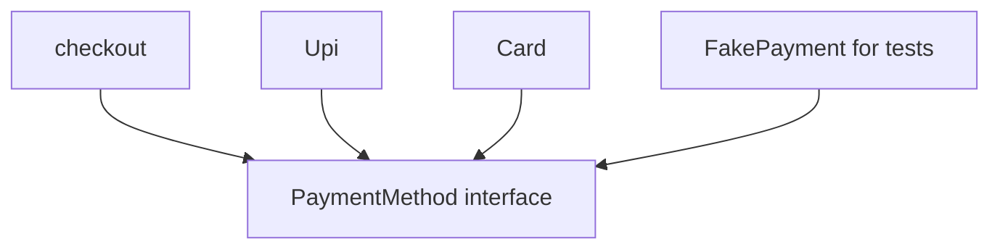

## The hook

A food-delivery app's checkout code charges customers by calling a UPI library directly. Then the business adds cards. Then wallets. Then "pay later". Each addition means editing checkout, re-testing it, and hoping nothing broke. And testing checkout at all is painful, because every test run tries to move real money.

The fix is to make checkout depend on a promise, "something that can pay", rather than on any particular way of paying. Interviewers phrase it as "what is an interface and why use one?", and in machine-coding rounds it decides whether your design bends or breaks when the requirements change. Predict how many lines of checkout change when you add a new payment method this way. (Zero.)

## The intuition

:::analogy
A company writes **a job description**: "must answer customer calls and log every ticket". It does not say who; any number of **people can be hired** to fill it, each doing the job their own way. Managers plan around the job description, not around a particular person, so replacing or adding staff does not change their plans. An interface is the job description; concrete classes are the people hired.
:::

## How it works

### The contract

An **[[interface]]** in C++ is a class with only pure virtual functions and a virtual destructor:

```cpp
#include <iostream>
#include <memory>
#include <string>
#include <vector>
using namespace std;

// The interface: a contract with no data and no implementation.
class PaymentMethod {
public:
    virtual bool pay(long long paise) = 0;
    virtual string name() const = 0;
    virtual ~PaymentMethod() = default;
};

class Upi : public PaymentMethod {
    string vpa;
public:
    explicit Upi(string v) : vpa(move(v)) {}
    bool pay(long long paise) override { cout << "UPI " << vpa << " paid " << paise << "\n"; return true; }
    string name() const override { return "upi"; }
};

class Card : public PaymentMethod {
    long long limit;
public:
    explicit Card(long long l) : limit(l) {}
    bool pay(long long paise) override {
        if (paise > limit) { cout << "card declined\n"; return false; }
        limit -= paise; cout << "card paid " << paise << "\n"; return true;
    }
    string name() const override { return "card"; }
};

// A fake for tests: records calls instead of moving money.
class FakePayment : public PaymentMethod {
public:
    vector<long long> calls;
    bool pay(long long paise) override { calls.push_back(paise); return true; }
    string name() const override { return "fake"; }
};

// Checkout depends only on the contract, never on a concrete class.
bool checkout(PaymentMethod& method, long long total) {
    return method.pay(total);
}

int main() {
    Upi upi("asha@bank");
    Card card(50000);
    cout << checkout(upi, 19900) << "\n";      // UPI asha@bank paid 19900, then 1
    cout << checkout(card, 80000) << "\n";     // card declined, then 0
    FakePayment fake;
    checkout(fake, 123);
    cout << fake.calls.size() << " " << fake.calls[0] << "\n";   // 1 123
}
```

`PaymentMethod` cannot be instantiated: adding `PaymentMethod m;` failed with "cannot declare variable 'm' to be of abstract type 'PaymentMethod'". Upi, Card and FakePayment are **[[concrete class|concrete classes]]**: they implement every pure virtual function.

### Programming to an interface

`checkout` takes a `PaymentMethod&`. It compiled once and worked with UPI, a card, and a test fake that records the amount instead of charging anyone. That is **[[programming to an interface]]**.



Notice the arrows: checkout depends on the interface, and so do the implementations. Neither depends on the other. That is **[[dependency inversion]]**, the "D" in SOLID: high-level policy and low-level details both point at an abstraction.

Wait, why is the fake such a big deal? Because it makes checkout testable without a bank: the test checks that pay was called once with 123, in microseconds and with no network. Every external dependency hidden behind an interface (payments, email, clock, database) can be replaced like this.

### Abstract class versus interface

| | **[[Abstract class]]** | Interface (convention in C++) |
|---|---|---|
| Pure virtual functions | at least one | all functions |
| Data members | allowed | none |
| Implemented helper functions | allowed | none (apart from the destructor) |
| Use | share code and state among related classes | describe a capability many unrelated classes can offer |
| Multiple inheritance | risky with state | safe and common |

Java and C# have an `interface` keyword; C++ expresses the same idea with an abstract class that has no state.

:::insight
A pure virtual function turns a class into a contract that cannot be instantiated, and concrete classes fulfil it. Code that depends only on the contract keeps working when new implementations appear, and can be tested with fakes, because high-level logic and low-level details both depend on the abstraction instead of on each other.
:::

## Trade-offs

| Choice | Gain | Cost |
|---|---|---|
| Interface per external dependency | Swappable implementations, easy testing | More types; an indirect call per use |
| Concrete classes everywhere | Less code, direct calls | Changes ripple; testing needs real services |
| Abstract base with shared code | Reuse across related classes | Couples implementations to the base |
| Templates instead (static interfaces) | No virtual call cost | Choice fixed at compile time; more complex errors |

:::warning
Common misconception: "every class should have an interface." Interfaces pay off at boundaries that vary or must be faked (payment providers, storage, notifications, time). Wrapping every small class in an interface adds indirection and files without adding flexibility anyone uses.
:::

:::try-this
Add a Wallet payment with a balance. Which files change, and what does `checkout(wallet, 500)` print for a wallet holding 300? (Only a new Wallet class implementing pay and name; checkout and the interface are untouched. With pay refusing amounts above the balance, the call returns false, printed as 0, and the balance stays 300.)
:::

## What can go wrong

- **Fat interfaces** with many unrelated methods, forcing implementations to stub what they do not support (the interface segregation principle says split them).
- **Leaking implementation details** into the interface (a method only UPI needs).
- **Forgetting the virtual destructor** on the interface.
- **Downcasting** (dynamic_cast to Upi) inside checkout, which defeats the interface.

### Interview follow-ups

**"Can an abstract class have a constructor?"** Yes, to initialise its own data; it runs when a derived object is constructed.

**"What are the SOLID principles?"** Single responsibility, open/closed, Liskov substitution, interface segregation and dependency inversion; interfaces are central to the last three.

**"How do interfaces help in machine-coding rounds?"** They let you name strategies (pricing, payment, notification) and swap them, the backbone of designs like [Design a Parking Lot](article:system-design-parking-lot); SOLID itself is covered in [Lego Bricks With Standard Studs](article:system-design-oop-solid).

## In the real world

Payment gateways, storage backends, logging sinks and clocks are typically hidden behind interfaces so they can be swapped by configuration and faked in tests. The virtual dispatch that makes this work is explained in [A Switchboard That Routes Calls by Caller Type](article:cs-core-virtual-functions-vtable).

## Further reading

- Robert C. Martin, "The Dependency Inversion Principle" (C++ Report, 1996).
- Erich Gamma, Richard Helm, Ralph Johnson and John Vlissides, *Design Patterns*, on programming to an interface.

## Key takeaways

- A pure virtual function makes a class abstract, so it cannot be instantiated and serves as a contract for derived classes.
- An interface in C++ is an abstract class with only pure virtual functions and a virtual destructor, while an abstract class may also hold data and shared code.
- Code written against an interface, such as checkout taking a PaymentMethod reference, works with new implementations without being changed.
- Hiding external dependencies behind interfaces lets tests use fakes that record calls instead of contacting real services.
- Dependency inversion means high-level logic and low-level details both depend on an abstraction rather than on each other.
