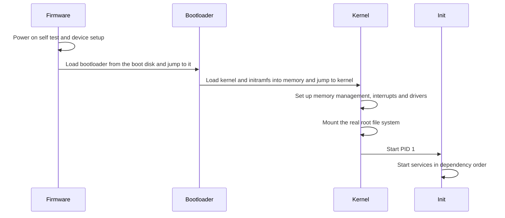

## The hook

When you press the power button, memory is empty. There is no operating system loaded, no file system mounted, no drivers. And yet, a short while later, you are looking at a login screen. Something had to load the program that loads the operating system, without an operating system to help.

The word "boot" comes from "pulling yourself up by your own bootstraps", which sounds impossible. The trick is a chain of programs, each small enough to be started by the one before and capable enough to start the next. Predict where the very first instruction comes from. (From a chip on the motherboard whose address the CPU is hard-wired to start at.)

## The intuition

:::analogy
**Opening a shop in the morning goes step by step.** The security guard unlocks the front door and checks the alarms. The manager arrives and switches on the main systems. The staff open each counter. Only then do customers come in. Nobody can skip ahead: the manager cannot get in before the door is unlocked, and counters cannot open with the power off.
:::

| Shop | Computer |
|---|---|
| Security guard unlocks and checks | **[[Firmware]]** runs **[[POST]]** |
| Guard calls the manager | Firmware starts the **[[bootloader]]** |
| Manager powers up the shop | Bootloader loads the kernel |
| Staff open the counters | The kernel starts the **[[init process]]**, which starts services |

## How it works

### 1. Firmware

At power-on the CPU starts executing at a fixed address mapped to the firmware chip. The firmware runs the power-on self-test, initialises the memory controller and essential devices, and looks for a bootable device in the configured order.

| | Legacy BIOS | UEFI |
|---|---|---|
| Finds the bootloader | first 512-byte sector of the disk (MBR) | a file on a special FAT partition (the EFI system partition) |
| Disk partitioning | MBR, limited to 2 TiB disks and 4 primary partitions | GPT, for much larger disks and many partitions |
| Security | none built in | Secure Boot checks signatures of the bootloader and kernel |

### 2. Bootloader

The bootloader (GRUB on most Linux systems, Windows Boot Manager on Windows) shows a menu if there are several choices, then loads the **kernel image** and the **[[initramfs]]** into memory and jumps to the kernel, passing a command line (such as which disk holds the root file system).

### 3. Kernel initialisation

The kernel decompresses itself, sets up page tables and virtual memory, interrupt handlers, the scheduler and built-in drivers. Then a chicken-and-egg problem appears: the real root file system might be on an encrypted volume or a RAID array, and the drivers to read it are files on that very file system.

Wait, then how does it ever mount it? Through the initramfs, a tiny temporary file system the bootloader loaded alongside the kernel. It holds just enough drivers and tools to find, unlock and mount the real root, after which the kernel switches over to it.

### 4. The first process

The kernel starts one user-space program as **PID 1**: today usually systemd (older systems used SysV init). PID 1 starts every service (networking, logging, the login manager) in dependency order, in parallel where it can, and lives until shutdown. It also adopts orphaned processes and reaps them when they exit. If PID 1 dies, the kernel panics.

:::insight
Booting is a chain of increasingly capable programs: firmware tests the hardware and finds a bootloader, the bootloader loads the kernel and an initramfs, the kernel sets up memory, interrupts and drivers and mounts the root file system, and PID 1 starts everything else. Each stage exists because the one before it is too small or too general to do the next job.
:::

## Trade-offs

| Choice | Gain | Cost |
|---|---|---|
| UEFI with Secure Boot | Blocks unsigned bootloaders and boot-level malware | Custom kernels must be signed or Secure Boot disabled |
| Large initramfs with many drivers | Boots on varied hardware | Slower boot, bigger image |
| Parallel service start (systemd) | Faster boot | Dependencies must be declared correctly |
| Minimal images (containers) | Start in a fraction of the time | Reuse the host's kernel; no firmware or kernel boot of their own |

:::warning
Common misconception: "the operating system starts when the kernel starts." By then the firmware and bootloader have already run their own code with full control of the machine. That is why boot-level malware is so dangerous, and why Secure Boot verifies each stage before handing over control.
:::

:::try-this
A server boots, shows the GRUB menu, prints kernel messages, and then stops with an error about not finding the root device. Which stage failed, and what is a likely cause? (The kernel started, but mounting the root file system failed: the root= argument may point to the wrong disk, or the initramfs lacks the storage or encryption driver needed.)
:::

## What can go wrong

- **No bootable device**: wrong boot order or a damaged boot partition.
- **Bootloader misconfigured** after a disk change, pointing at a missing kernel.
- **Missing driver in the initramfs**, so the kernel cannot reach the root disk.
- **A failing service** that others depend on, stalling boot.
- **Secure Boot rejecting** an unsigned kernel module or bootloader.

### Interview follow-ups

**"What happens when you power on a computer?"** Firmware POST, bootloader, kernel initialisation, root file system mount, PID 1 starting services, login.

**"How do containers start so much faster than virtual machines?"** A container is processes on an already running kernel, so firmware, bootloader and kernel initialisation are skipped entirely; a virtual machine boots its own kernel.

**"What is a kernel panic?"** A fatal error the kernel cannot recover from, such as failing to mount root or PID 1 exiting; the system halts or reboots.

## In the real world

Linux exposes each stage: GRUB's configuration, the kernel's log via `dmesg`, and `systemd-analyze blame` for which services slowed boot. The kernel that takes over in stage 3 is described in [The Hotel Manager Every Program Secretly Reports To](article:cs-core-what-an-os-does).

## Further reading

- The Linux kernel documentation, "Boot protocol" and the initramfs documentation.
- The UEFI specification overview from the UEFI Forum.

## Key takeaways

- Booting is a chain in which each program starts a more capable one: firmware, bootloader, kernel, then the first process.
- Firmware runs the power-on self-test and finds the bootloader, through the MBR on legacy BIOS or an EFI system partition on UEFI.
- The bootloader loads the kernel image and an initramfs into memory and passes the kernel its command line.
- The kernel sets up memory, interrupts and drivers, uses the initramfs to reach and mount the real root file system, and starts PID 1.
- PID 1, usually systemd, starts all services, adopts orphaned processes and runs until shutdown.
