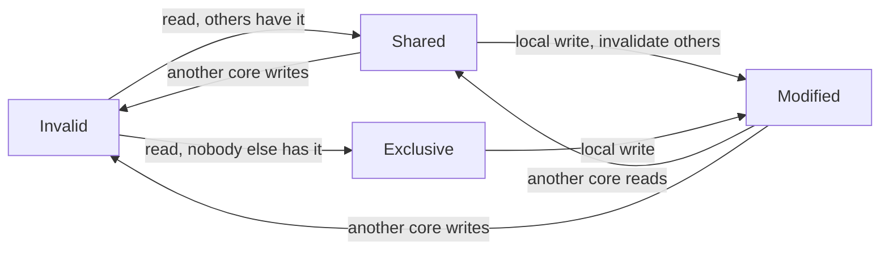

## The hook

Two threads each count their own events. They share nothing: thread 1 touches only counter a, and thread 2 touches only counter b. On the 4-core machine used for this article, the program took about 800 ms. Moving b 64 bytes away from a, with no change to the logic, cut it to about 120 ms.

The threads shared no variable, but they did share something: a cache line. Predict why that matters. (Each core keeps its own copy of the line, and the copies must agree.)

## The intuition

:::analogy
**Several people keep copies of one notebook.** Anyone may read their own copy freely. But before anyone writes on a page, everyone else must cross out their copy of that page, so nobody reads a stale version. If two people keep writing on the same page, even in different corners, the page is crossed out and recopied constantly.
:::

## How it works

Each core has a private L1 (and often L2) cache. **[[Cache coherence]]** makes sure that a write by one core is eventually seen by all the others, and that all cores agree on the order of writes to each location.

### MESI

In **[[MESI]]**, each line in each core's cache is in one of four states:

| State | Meaning | Can write without asking? |
|---|---|---|
| Modified | only copy, changed, memory is stale | yes |
| Exclusive | only copy, clean | yes (becomes Modified) |
| Shared | other cores may have copies | no: must invalidate them first |
| Invalid | not usable | no: must fetch the line |



A write to a Shared line sends an **[[invalidation]]** to the other cores; their copies become Invalid, and the next time they touch the line they must fetch it again, often from the writer's cache.

### False sharing, measured

```cpp
#include <atomic>
#include <chrono>
#include <iostream>
#include <thread>
using namespace std;

struct Packed { atomic<long> a{0}; atomic<long> b{0}; };               // same 64-byte line
struct Padded { alignas(64) atomic<long> a{0}; alignas(64) atomic<long> b{0}; };  // separate lines

template <typename T>
long long run() {
    T c;
    const long N = 20'000'000;
    auto start = chrono::steady_clock::now();
    thread t1([&] { for (long i = 0; i < N; i++) c.a.fetch_add(1, memory_order_relaxed); });
    thread t2([&] { for (long i = 0; i < N; i++) c.b.fetch_add(1, memory_order_relaxed); });
    t1.join(); t2.join();
    return chrono::duration_cast<chrono::milliseconds>(chrono::steady_clock::now() - start).count();
}

int main() {
    cout << "sizeof Packed " << sizeof(Packed) << ", Padded " << sizeof(Padded) << "\n";  // 16, 128
    cout << "same line:     " << run<Packed>() << " ms\n";    // about 750 to 900 ms on the test machine
    cout << "separate lines: " << run<Padded>() << " ms\n";   // about 120 ms
}
```

Wait, why does Packed suffer when the threads never touch each other's counter? Coherence works on whole lines, not on variables. Every increment by core 1 invalidates core 2's copy of the line holding both counters, and the other way round, so the line bounces between the cores millions of times. That is **[[false sharing]]**. Padding each counter to its own line made the same work about six times faster.

:::insight
Each core caches lines privately, and a coherence protocol such as MESI keeps the copies consistent by invalidating other copies before a write. Because this works on 64-byte lines, threads that write different variables in the same line still fight over it, so hot per-thread data should live on separate lines.
:::

## Trade-offs

| Choice | Gain | Cost |
|---|---|---|
| Pad hot per-thread data to 64 bytes | No false sharing | More memory |
| Per-thread local counters, summed at the end | No shared writes in the hot loop | The total is only exact after merging |
| Shared counter with atomics | Simple | Every write bounces the line |

:::warning
Common misconception: "coherence means threads always see each other's writes immediately, so no synchronisation is needed." Coherence keeps copies of a single location consistent, but the order in which different locations become visible is governed by the memory model. Correct concurrent code still needs atomics or locks.
:::

:::try-this
An array `long hits[4]` has one slot per thread, and each thread increments its own slot in a loop. Is there false sharing, and how would you fix it? (Yes: four 8-byte longs fit in one 64-byte line. Give each slot its own line, for example a struct with alignas(64), or count in a local variable and write the result once at the end.)
:::

## What can go wrong

- **Per-thread slots packed into one array**, causing false sharing.
- **Heavily contended shared variables**, such as a single global counter, which bounce on every write.
- **Assuming coherence replaces synchronisation.**

### Interview follow-ups

**"Snooping versus directory protocols?"** Snooping broadcasts coherence messages to all caches (fine for a few cores); directories track which caches hold each line (scales to many cores).

**"How does C++17 help with false sharing?"** std::hardware_destructive_interference_size gives the recommended padding size, often 64.

## In the real world

High-performance queues, counters and thread pools pad their hot fields to cache-line boundaries. Caches and cache lines are introduced in [Tools on Your Belt, on the Bench and in the Shed](article:cs-core-memory-hierarchy).

## Further reading

- John Hennessy and David Patterson, *Computer Architecture: A Quantitative Approach*, chapter on thread-level parallelism.
- Ulrich Drepper, "What Every Programmer Should Know About Memory" (2007).

## Key takeaways

- Each core caches lines privately, so a coherence protocol must keep the copies of each memory location consistent.
- In MESI, a line is Modified, Exclusive, Shared or Invalid, and writing to a Shared line first invalidates the other cores' copies.
- Coherence works on whole cache lines, so threads writing different variables in the same line still force it to bounce between cores.
- In the measured test, two counters sharing a line took about 750 to 900 ms, while padded counters took about 120 ms.
- Padding hot per-thread data to its own line, or using local copies merged at the end, removes false sharing.
