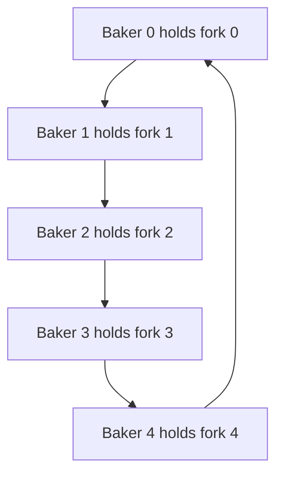

## The hook

A bakery opens at six. Two bakers slide trays onto a display shelf that holds four trays. Three counter staff take trays off it for customers. On the wall hangs the recipe board: everyone reads it constantly, and once a day the head baker wipes it and rewrites the day's specials. At noon the five bakers sit at a round staff table with one fork between each pair of plates, and each needs two forks to eat.

By lunch, one of three things has happened. A baker stood holding a tray in front of a full shelf while a counter worker stood at the empty end of the same shelf. The head baker waited all morning to rewrite the board because somebody was always reading it. Or all five bakers sat holding one fork each, waiting forever.

These are the three classic synchronisation problems: producer-consumer, readers-writers and dining philosophers. They show up in OS exams, in interviews and in real code, and each one teaches a different way a correct-looking design can jam.

## The intuition

:::analogy
Run the whole thing as **one bakery**. The **display shelf** has a fixed number of slots: bakers put trays on, counter staff take them off, and nobody may reach into the same slot at the same moment. The **recipe board** on the wall can be read by any number of staff at once, but the head baker needs it to himself while rewriting it. The **staff lunch table** is round, with one fork between each pair of neighbours, and every diner needs both of the forks beside their plate.
:::

| Bakery scene | Classic problem | What it teaches |
|---|---|---|
| Display shelf with N slots | Producer-consumer, the [[bounded buffer]] | Counting with semaphores, and the order of waits |
| Recipe board, many readers, one rewriter | The [[readers-writers problem]] | Shared versus exclusive access, and who starves |
| Round table, five diners, five forks | Dining philosophers | How a cycle of waiting becomes [[deadlock]], and how to break it |

Each scene reuses the tools from [A Key for One Room, a Bowl for the Car Park](article:cs-core-mutex-semaphore): a mutex, which has an owner, and a semaphore, which is an ownerless counter. The surprise in each scene is a different one, so keep a guess ready for each.

## How it works

### Scene 1: the display shelf

Bakers are producers, counter staff are consumers, and the shelf is a buffer with N slots. Three rules:

1. A baker with a tray must wait if every slot is full.
2. A counter worker must wait if every slot is empty.
3. Two people must never update the shelf's bookkeeping, the next free slot and the next full slot, at the same time.

Three tools, one per rule:

```pseudo
semaphore emptySlots = N      # rule 1: free slots
semaphore fullSlots  = 0      # rule 2: trays waiting
mutex     shelf               # rule 3: guards the in and out indices

baker:
    make tray
    wait(emptySlots)                  # a free slot, or sleep
    lock(shelf)
    slots[in] = tray; in = (in + 1) mod N
    unlock(shelf)
    signal(fullSlots)                 # one more tray to sell

counter worker:
    wait(fullSlots)                   # a tray, or sleep
    lock(shelf)
    tray = slots[out]; out = (out + 1) mod N
    unlock(shelf)
    signal(emptySlots)                # one more free slot
    sell tray
```

Notice the slow work, making and selling a tray, happens outside the lock. Only the bookkeeping is inside.

Now trace it with a shelf of **N = 2**, one baker B and one counter worker C. Predict: at which step does somebody first have to wait?

| Step | Event | emptySlots | fullSlots | Shelf | Who waits |
|---|---|---|---|---|---|
| 0 | Start | 2 | 0 | empty | |
| 1 | B puts tray a | 1 | 1 | a | |
| 2 | B puts tray b | 0 | 2 | a, b | |
| 3 | B tries tray c: wait(emptySlots) at 0 | 0 | 2 | a, b | B |
| 4 | C takes a; signal(emptySlots) wakes B | 0 | 1 | b | |
| 5 | B puts c; signal(fullSlots) | 0 | 2 | b, c | |
| 6 | C takes b | 1 | 1 | c | |
| 7 | C takes c | 2 | 0 | empty | |
| 8 | C tries again: wait(fullSlots) at 0 | 2 | 0 | empty | C |

Step 3 is the first wait. Notice step 4: emptySlots stays 0 because C's token went straight to the sleeping baker. At every step, emptySlots plus fullSlots plus anyone mid-handover equals 2. That invariant is how you check a bounded buffer by hand.

Wait, why do we need the mutex at all, if the semaphores already stop the shelf from overflowing? Because with **two bakers**, both can pass `wait(emptySlots)` when there are two free slots, both read `in = 0`, and both put their tray in slot 0. One tray is lost: the race condition from [Two People, One Spreadsheet Cell](article:cs-core-race-conditions). With exactly one producer and one consumer, the baker only touches `in` and the counter worker only touches `out`, and the semaphores keep them off the same slot, so that special case can drop the mutex.

:::warning
Common misconception: "the order of the two waits does not matter, as long as both are there." Swap the baker's lines so it locks the shelf before waiting for an empty slot. With a full shelf, the baker sleeps while holding the shelf lock, and the counter worker who could free a slot blocks on that same lock. That is a deadlock. Always wait on the counting semaphore first, then take the lock.
:::

### Scene 2: the recipe board

Reading the board does not change it, so any number of readers can look at once. Rewriting it does, so the writer needs the board with no readers and no other writers. A plain mutex would work, but it would make readers queue for no reason, which wastes the whole point of shared reading.

The first classic solution lets readers share by counting them:

```pseudo
int readCount = 0
mutex countLock            # protects readCount
semaphore board = 1        # held by "the readers as a group" or by one writer

reader:
    lock(countLock)
    readCount = readCount + 1
    if readCount == 1: wait(board)      # first reader locks the writers out
    unlock(countLock)
    read the board
    lock(countLock)
    readCount = readCount - 1
    if readCount == 0: signal(board)    # last reader lets writers in
    unlock(countLock)

writer:
    wait(board)
    rewrite the board
    signal(board)
```

Wait, why is `board` a semaphore and not a mutex? Look at who takes it and who returns it. Reader R1 arrives first and calls `wait(board)`.

R1 may leave early, and R3, the last to leave, calls `signal(board)`. A mutex must be released by the thread that locked it. The readers hold the board as a group, so it has to be an ownerless semaphore.

### The writer who never gets in

Now the trap from the brief, traced. The head baker W wants to rewrite the board while readers come and go, and their visits overlap. Predict what W experiences.

| Time | Event | readCount | board held by | W |
|---|---|---|---|---|
| 1 | R1 arrives, first reader, takes board | 1 | readers | |
| 2 | W arrives, wait(board) | 1 | readers | waiting |
| 3 | R2 arrives, count was not 0, walks in | 2 | readers | waiting |
| 4 | R1 leaves | 1 | readers | waiting |
| 5 | R3 arrives, walks in | 2 | readers | waiting |
| 6 | R2 leaves | 1 | readers | waiting |
| 7 | R4 arrives, walks in | 2 | readers | waiting |
| ... | the pattern repeats | never 0 | readers | waiting forever |

Nothing is stuck: readers keep reading, the bakery runs. Only W makes no progress. That is [[starvation]], not deadlock, and it is the classic weakness of this **reader-preference** solution.

### Giving the writer priority

The fix is to let a waiting writer close the door to *new* readers. Add a second semaphore, `readTry`, which every reader must pass through, and let the first waiting writer take it:

```pseudo
int readCount = 0, writeCount = 0
mutex rLock, wLock
semaphore readTry = 1, board = 1

reader:
    wait(readTry)                       # blocked while any writer is waiting
    lock(rLock)
    readCount = readCount + 1
    if readCount == 1: wait(board)
    unlock(rLock)
    signal(readTry)
    read the board
    lock(rLock)
    readCount = readCount - 1
    if readCount == 0: signal(board)
    unlock(rLock)

writer:
    lock(wLock)
    writeCount = writeCount + 1
    if writeCount == 1: wait(readTry)   # first waiting writer shuts the reader door
    unlock(wLock)
    wait(board)
    rewrite the board
    signal(board)
    lock(wLock)
    writeCount = writeCount - 1
    if writeCount == 0: signal(readTry) # last writer reopens it
    unlock(wLock)
```

Replay the trace. At time 2, W takes `readTry`, so R3 and R4 queue at the door. R2 finishes, readCount drops to 0, the board is released and W rewrites it. Writers are now safe.

Here is the catch: the same trick in reverse. If writers keep arriving, `writeCount` never drops to 0, the reader door never reopens, and now **readers** starve.

The **fair** version puts everyone through one first-come, first-served turnstile, so neither side can jump the queue:

```pseudo
semaphore turnstile = 1     # assumed to wake waiters in FIFO order
# reader: wait(turnstile), then the reader-preference entry code, then signal(turnstile)
# writer: wait(turnstile), wait(board), signal(turnstile), write, signal(board)
```

A writer holds the turnstile until it has the board, so readers who arrive after it queue behind it. Readers who arrived earlier still share the board with each other.

| Variant | Who can starve | Good when |
|---|---|---|
| Reader preference | Writers | Writes are rare and can wait |
| Writer preference | Readers | Fresh data matters more than read throughput |
| Fair, with a FIFO turnstile | Nobody, if the turnstile is FIFO | You need bounded waiting for both sides |

These policies were first written down with semaphores by Courtois, Heymans and Parnas in 1971, and every reader-writer lock you use today picks one of them.

### Scene 3: the staff lunch table

Five bakers, numbered 0 to 4, sit around a round table. Fork *i* lies between baker *i* and baker *i + 1*, with baker 4's right fork being fork 0. Each baker alternates between talking and eating, and needs both adjacent forks to eat. Edsger Dijkstra posed this puzzle in the 1960s, and the version with philosophers and spaghetti became its standard telling.

The obvious program:

```pseudo
philosopher i:
    loop:
        think
        lock(fork[i])               # left
        lock(fork[(i + 1) mod 5])   # right
        eat
        unlock both
```

Predict before looking: is there an order of events in which nobody ever eats again?

| Step | Event | Forks held | Waiting for |
|---|---|---|---|
| 1 | Baker 0 takes fork 0 | B0: f0 | |
| 2 | Baker 1 takes fork 1 | B1: f1 | |
| 3 | Baker 2 takes fork 2 | B2: f2 | |
| 4 | Baker 3 takes fork 3 | B3: f3 | |
| 5 | Baker 4 takes fork 4 | B4: f4 | |
| 6 | Everyone reaches right | all five held | B0 waits for f1, B1 for f2, B2 for f3, B3 for f4, B4 for f0 |

Each baker waits for the baker on their right, all the way round. Draw "waits for" as arrows and you get a circle:



That circle is what deadlock looks like. Each fix below works by making the circle impossible.

### Four ways to feed everyone

**Fix 1, resource ordering.** Number the forks and make everyone pick up the lower-numbered of their two forks first. Bakers 0 to 3 are unchanged, but baker 4 has forks 4 and 0, so baker 4 reaches for fork 0 first. Replay the trace:

| Step | Event | Result |
|---|---|---|
| 1 to 4 | Bakers 0, 1, 2, 3 take forks 0, 1, 2, 3 | |
| 5 | Baker 4 reaches for fork 0, held by baker 0 | Baker 4 waits, holding nothing |
| 6 | Baker 3 reaches for fork 4, which is free | Baker 3 eats |
| 7 | Baker 3 puts down forks 3 and 4 | Baker 2 can now take fork 3 and eat, and so on |

The circle cannot close, because the last link would require someone to hold a higher fork while waiting for a lower one, and nobody ever does that. This [[resource ordering]] trick is the most practical deadlock fix in real code: always take locks in one global order.

**Fix 2, at most four at the table.** A counting semaphore `seats = 4` must be taken before reaching for any fork. With five forks and four diners, some diner always gets two forks, by the pigeonhole principle, so someone always eats.

**Fix 3, both forks or none.** Pick up both forks in one step inside a monitor. Each baker has a state, thinking, hungry or eating, and becomes eating only if neither neighbour is eating. This is deadlock-free, but an unlucky baker whose two neighbours take turns eating can starve.

**Fix 4, a waiter.** A single arbitrator hands out forks. Simple and fair if the waiter queues requests, but the waiter is a bottleneck that every diner must talk to.

:::insight
All three bakery problems are the same lesson in different clothes: decide who waits for whom, and make sure those waits can never form a circle or an endless line. The circle is deadlock; the endless line is starvation.
:::

### The polite livelock

A tempting fifth fix: take the left fork, *try* the right one, and if it is busy, put the left one down and try again. Nobody ever holds a fork while blocked, so there is no deadlock.

Predict what five perfectly synchronised bakers do. They all pick up their left fork, all see the right fork taken, all put down the left fork, and all try again, forever. Everyone is busy and nobody eats. That is [[livelock]]. The usual cure is to wait a random amount of time before retrying, the same idea as [Why Your App Waits a Random Moment Before Retrying](article:famous-algos-exponential-backoff).

### The code

The resource-ordering fix in C++17. Each of the five philosophers eats 1000 times; locking the lower-numbered fork first means the program cannot deadlock no matter how the threads interleave. Compile with `-pthread`.

```cpp
#include <bits/stdc++.h>
using namespace std;

const int N = 5, MEALS = 1000;
mutex fork_[N];
int meals[N];

void philosopher(int i) {
    int a = i, b = (i + 1) % N;
    int first = min(a, b), second = max(a, b);        // global order: lower-numbered fork first
    for (int k = 0; k < MEALS; k++) {
        lock_guard<mutex> f1(fork_[first]);
        lock_guard<mutex> f2(fork_[second]);
        meals[i]++;                                   // eat
    }                                                 // both forks released at end of each iteration
}

int main() {
    vector<thread> table;
    for (int i = 0; i < N; i++) table.emplace_back(philosopher, i);
    for (auto& t : table) t.join();
    for (int i = 0; i < N; i++) cout << "philosopher " << i << " ate " << meals[i] << " times\n";
}
```

C++17 also offers `std::scoped_lock`, which locks several mutexes at once using a built-in deadlock-avoidance algorithm, so `scoped_lock both(fork_[a], fork_[b]);` is a valid alternative to ordering them yourself.

:::try-this
Six philosophers, six forks, everyone picks the lower-numbered fork first. Which philosopher picks up a different side first compared with the naive "left then right" program, and is deadlock possible? (Only philosopher 5, whose forks are 5 and 0: they reach for fork 0 first. With a global order there is no cycle, so no deadlock, for any number of philosophers.)
:::

### A fourth scene for the road: the sleeping barber

One more puzzle appears in some courses. A barber shop has one barber, one chair and a few waiting seats. With no customers, the barber sleeps; an arriving customer wakes him, sits if a seat is free, or leaves if all seats are taken. It is a bounded buffer with a twist: a full buffer turns customers away instead of blocking them. The solution uses a semaphore for waiting customers, one for the barber being ready, and a mutex around the count of free seats.

## Trade-offs

| Decision | Option A | Option B |
|---|---|---|
| Bounded buffer size | Small: little memory, producers block often | Large: smooths bursts, but hides a consumer that is permanently too slow |
| Bounded buffer locking | One mutex for the whole buffer: simple | Separate locks or lock-free ring for one producer and one consumer: faster, harder to get right |
| Readers-writers policy | Reader preference: best read throughput, writers can starve | Writer preference or fair: fresher data and bounded waits, less read parallelism |
| Reader-writer lock at all | Plain mutex: cheaper per operation | Reader-writer lock: wins only when reads are long and frequent enough to overlap |
| Philosopher fix | Lock ordering: no central component, needs a global numbering | Seat limit or waiter: easy to reason about, adds a shared bottleneck |

## What can go wrong

- **Lock before wait in the bounded buffer.** Sleeping on `emptySlots` while holding the shelf lock deadlocks the consumer, the classic interview trap.
- **Dropping the mutex with several producers.** Two producers pass the semaphore together and write the same slot.
- **Writer starvation.** Reader preference plus overlapping readers means the writer never gets in; under real load this shows up as updates that are delayed for minutes.
- **Using a mutex for the board.** The first reader locks and a different reader unlocks, which is an error or undefined behaviour for a mutex.
- **Upgrading a read lock to a write lock.** Two readers both try to upgrade, each waits for the other to leave, and both wait forever. Release the read lock and take the write lock, then re-check the data.
- **Deadlock-free is not starvation-free.** The "both forks or none" monitor never deadlocks, but a philosopher can still go hungry.
- **Livelock from symmetric retries.** Back off by a random amount.

### Interview follow-ups

**"Write producer-consumer with semaphores. What are the initial values?"** `emptySlots = N`, `fullSlots = 0`, and a mutex. Producer: wait empty, lock, put, unlock, signal full. Consumer: wait full, lock, take, unlock, signal empty. The trap is locking before waiting on the counting semaphore.

**"How would you avoid writer starvation in readers-writers?"** Make a waiting writer block new readers, with a `readTry` semaphore that the first waiting writer acquires, or send everyone through a FIFO turnstile for fairness. Then readers already inside finish, the count drops to zero, and the writer enters.

**"Why does limiting the table to four philosophers prevent deadlock?"** Four diners share five forks, so by the pigeonhole principle at least one diner can hold both of their forks. That diner eats and releases them, so the system always makes progress.

**"What is the difference between deadlock, livelock and starvation?"** In deadlock, a set of threads all block waiting on each other and nobody runs. In livelock, threads keep running and reacting to each other but make no progress. In starvation, the system makes progress but one thread is always passed over.

**"How do you solve producer-consumer with a monitor instead of semaphores?"** One mutex and two condition variables, `notFull` and `notEmpty`, with `while` loops around each wait, exactly the bounded queue in [A Waiting Room With a Bell](article:cs-core-monitors-condition-variables).

## In the real world

- **Producer-consumer** is every work queue, logging pipeline, network packet ring and message broker. Unix pipes are a bounded buffer: a writer blocks when the pipe is full, which you met in [Passing Notes or Sharing a Whiteboard](article:cs-core-ipc).
- **Readers-writers** is `pthread_rwlock_t` in C, `std::shared_mutex` in C++17 and `ReentrantReadWriteLock` in Java. Whether a waiting writer blocks new readers depends on the implementation and its options, so read the documentation before assuming fairness. Databases face the same choice, and multiversioning sidesteps much of it, as in [Readers Never Wait for Writers](article:famous-algos-mvcc).
- **Dining philosophers** is any code that needs two locks at once, such as a bank transfer locking two accounts. The standard fix is the one above: lock accounts in order of account number.

The lunch table left a question open. You broke one circle with one rule, but what exactly makes a deadlock possible, and can an operating system detect one, avoid one, or recover after one forms? That is the next stop: [Four Cars, Four Stop Signs, Nobody Moves](article:cs-core-deadlocks).

## Further reading

- *Operating System Concepts* by Silberschatz, Galvin and Gagne, the chapter on synchronisation examples.
- *Operating Systems: Three Easy Pieces*, the chapters on semaphores and common concurrency problems.
- *The Little Book of Semaphores* by Allen B. Downey, free online, with many variants of all three problems.
- P. J. Courtois, F. Heymans and D. L. Parnas, "Concurrent Control with Readers and Writers", Communications of the ACM, 1971.

## Key takeaways

- A bounded buffer needs a counting semaphore for free slots, one for filled slots and a mutex for the indices, and a thread must wait on the counting semaphore before taking the mutex.
- The reader-preference readers-writers solution lets readers share, but an unbroken stream of overlapping readers starves writers, and writer preference simply moves the starvation to readers.
- The resource shared by the readers as a group must be a semaphore, not a mutex, because the reader who releases it is often not the reader who acquired it.
- The naive dining philosophers program deadlocks when everyone holds one fork in a circle, and taking locks in one global order breaks that circle in any program that needs several locks.
- Deadlock, livelock and starvation are different failures: nobody runs, everybody runs uselessly, or one thread is always passed over.
