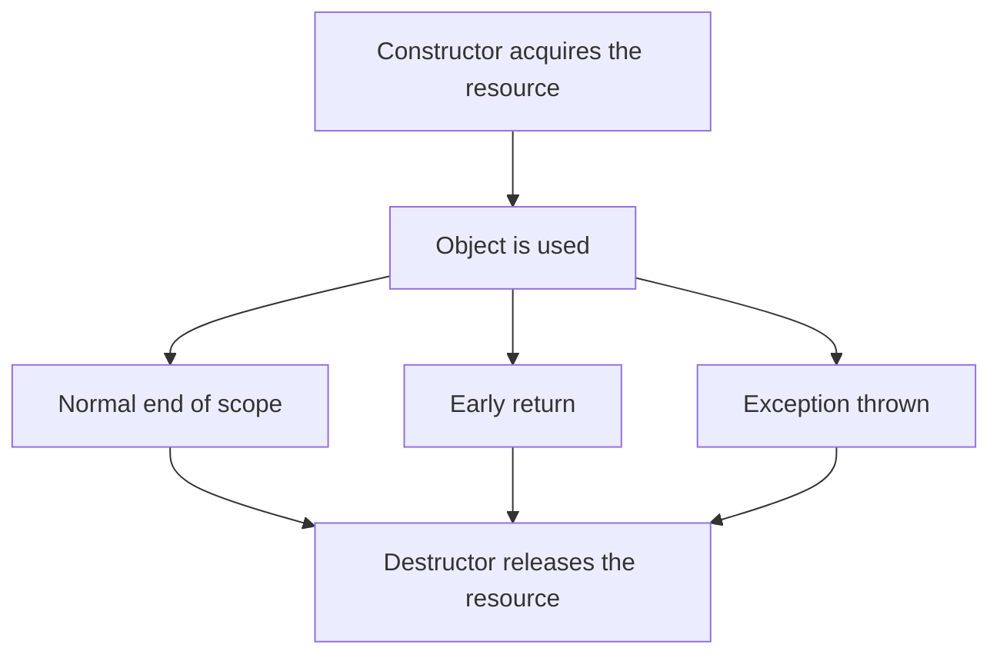

## The hook

A function opens a file, writes to it, and closes it at the end. Then someone adds an early `return` for an error case, and another person adds a call that can throw. Each new exit path skips the `fclose`. Months later the server dies with "too many open files", and nobody can find the leak, because it is spread across a dozen innocent-looking changes.

C++ has a remarkably simple answer that removes the whole class of bug: let an object own the file, and let the language guarantee the object's cleanup on *every* exit path. Predict whether that guarantee holds even when an exception flies through the function. (Yes, and the test program below shows it.)

## The intuition

:::analogy
In a good hotel, **your room is cleaned automatically when you check out**. You do not have to remember to call housekeeping, and it does not matter whether you leave calmly at noon or rush out early: checking out triggers the cleaning. A destructor is housekeeping for objects: whenever the object's stay ends, however it ends, cleanup runs.
:::

## How it works

### Constructors

A **[[constructor]]** runs when an object is created and must leave it in a valid state.

| Kind | Signature | Used when |
|---|---|---|
| Default | `Point()` | `Point r;` |
| Parameterised | `Point(int x, int y)` | `Point p(3, 4);` |
| **[[Copy constructor|Copy]]** | `Point(const Point& o)` | `Point q = p;`, passing or returning by value |
| Delegating | `Point() : Point(0, 0) {}` | reusing another constructor |

If you write no constructor, the compiler provides a default one; if you write any constructor, it stops providing the default, which is why `Point r;` can suddenly fail to compile after you add `Point(int, int)`.

### Initialiser lists

```cpp partial
Point(int x, int y) : x(x), y(y), id(x * 100 + y) {}
```

The **[[initialiser list]]** initialises members directly, before the body runs. It is required for const members, reference members and members without a default constructor, and it avoids constructing a member and then assigning to it.

The trap: members are initialised in the order they are **declared in the class**, not the order written in the list. With `int a; int b;` and `R() : b(5), a(b + 1) {}`, a is initialised first, from a b that does not have a value yet. g++ -Wall warned: "'R::b' will be initialized after 'int R::a'".

### Destructors and their order

A **[[destructor]]** `~ClassName()` runs automatically when the object's lifetime ends: at the end of its scope for local objects, at `delete` for heap objects, and when the containing object dies for members. Local objects are destroyed in **reverse order of construction**, since later objects may depend on earlier ones.

### RAII, tested

```cpp
#include <cstdio>
#include <iostream>
#include <stdexcept>
#include <string>
using namespace std;

class Logger {                       // traces construction and destruction
    string name;
public:
    Logger(string n) : name(n) { cout << "construct " << name << "\n"; }
    ~Logger() { cout << "destroy " << name << "\n"; }
};

class File {                         // RAII: the object owns the open file
    FILE* f;
public:
    explicit File(const char* path) : f(fopen(path, "w")) {
        if (!f) throw runtime_error("cannot open");
    }
    ~File() { if (f) fclose(f); cout << "file closed\n"; }
    File(const File&) = delete;      // one owner only
    File& operator=(const File&) = delete;
    void write(const string& s) { fputs(s.c_str(), f); }
};

class Point {
    int x, y;
    const int id;                    // const members must be set in the initialiser list
public:
    Point() : Point(0, 0) {}         // delegating default constructor
    Point(int x, int y) : x(x), y(y), id(x * 100 + y) {}
    Point(const Point& o) : x(o.x), y(o.y), id(o.id) { cout << "copy " << id << "\n"; }
    int getId() const { return id; }
};

void work(bool fail) {
    File out("demo.txt");
    out.write("hello\n");
    if (fail) throw runtime_error("something failed");
    cout << "work done\n";
}

int main() {
    {
        Logger a("A");
        Logger b("B");
        cout << "end of block\n";
    }                                   // destroyed in reverse order: B, then A
    Point p(3, 4), q = p, r;
    cout << p.getId() << " " << q.getId() << " " << r.getId() << "\n";
    work(false);
    try { work(true); } catch (const exception& e) { cout << "caught: " << e.what() << "\n"; }
}
```

Output, as compiled and run:

| Line | Printed | Why |
|---|---|---|
| 1–2 | construct A, construct B | in declaration order |
| 3 | end of block | |
| 4–5 | destroy B, destroy A | reverse order at the closing brace |
| 6 | copy 304 | `q = p` uses the copy constructor |
| 7 | 304 304 0 | r used the delegating default constructor |
| 8–9 | work done, file closed | normal return |
| 10–11 | file closed, caught: something failed | the exception unwound the stack, running File's destructor before the catch |

Wait, why does line 10 print "file closed" before "caught"? When an exception leaves a function, C++ destroys every fully constructed local object in that function first (stack unwinding), and only then runs the matching catch block. That is the whole trick of **[[RAII]]**: acquire in the constructor, release in the destructor, and the language guarantees the release on every path.



:::insight
Constructors establish an object's valid state and destructors release what it owns. Because C++ runs destructors automatically at the end of every object's lifetime, including during exception unwinding, tying each resource to an object (RAII) makes leaks of files, locks and memory structurally impossible rather than a matter of discipline.
:::

## Trade-offs

| Choice | Gain | Cost |
|---|---|---|
| RAII wrapper classes | Cleanup on every path, including exceptions | A small class per resource type (often already provided: fstream, lock_guard, unique_ptr) |
| Manual open and close | Nothing to write up front | Every new exit path is a potential leak |
| Deleting copy operations | Prevents two owners closing one resource | Objects cannot be copied, only moved (if move is defined) |
| explicit constructors | Prevent surprising implicit conversions | Slightly more typing at call sites |

:::warning
Common misconception: "destructors run when the program decides to free memory, like garbage collection." In C++, destruction is deterministic: a local object's destructor runs exactly at the closing brace of its scope, in reverse order of construction. That predictability is what makes RAII reliable for locks and files, not just memory.
:::

:::try-this
Predict the output order: `{ Logger x("X"); { Logger y("Y"); } Logger z("Z"); }`. (construct X, construct Y, destroy Y at the inner closing brace, construct Z, then destroy Z and destroy X at the outer brace: Z before X because it was constructed later.)
:::

## What can go wrong

- **Throwing from a destructor** during stack unwinding, which terminates the program; destructors should not throw.
- **A class that owns a raw resource but allows copying**, leading to two objects closing the same file (the rule of three, covered with copy and move semantics).
- **Initialiser list order bugs**, using a member before it is initialised.
- **Forgetting that adding any constructor removes the implicit default constructor.**
- **Calling virtual functions in constructors or destructors**, which do not dispatch to derived classes yet (or any more).

### Interview follow-ups

**"Can a constructor be virtual?"** No: the object's dynamic type does not exist yet while it is being constructed. Destructors of polymorphic base classes, however, should be virtual.

**"What standard classes use RAII?"** std::lock_guard releases a mutex, std::fstream closes files, std::unique_ptr and std::vector free memory.

**"When is the copy constructor called?"** Initialising from another object, passing by value, and returning by value (though compilers often elide the copy).

## In the real world

Modern C++ codebases rarely call fclose, unlock or delete directly; they use RAII types, so cleanup is automatic. Objects and member functions are introduced in [A Cookie Cutter and Its Cookies](article:cs-core-classes-objects), and the thread-safety uses of lock guards appear in [Concurrency in Machine Coding: Locks, Atomics and Thread Pools](article:system-design-concurrency-lld).

## Further reading

- Bjarne Stroustrup, *The C++ Programming Language*, chapters on construction, cleanup and resource management.
- The C++ Core Guidelines, section R on resource management (rule R.1: manage resources automatically using RAII).

## Key takeaways

- Constructors put a new object into a valid state, and C++ offers default, parameterised, copy and delegating forms.
- Initialiser lists initialise members before the constructor body and are required for const and reference members, but members are always initialised in declaration order.
- Destructors run automatically when an object's lifetime ends, and local objects are destroyed in reverse order of construction.
- RAII ties a resource to an object, acquiring it in the constructor and releasing it in the destructor, so cleanup happens on every exit path.
- During an exception, stack unwinding destroys all local objects before the catch block runs, which is why RAII cleanup survives errors.
