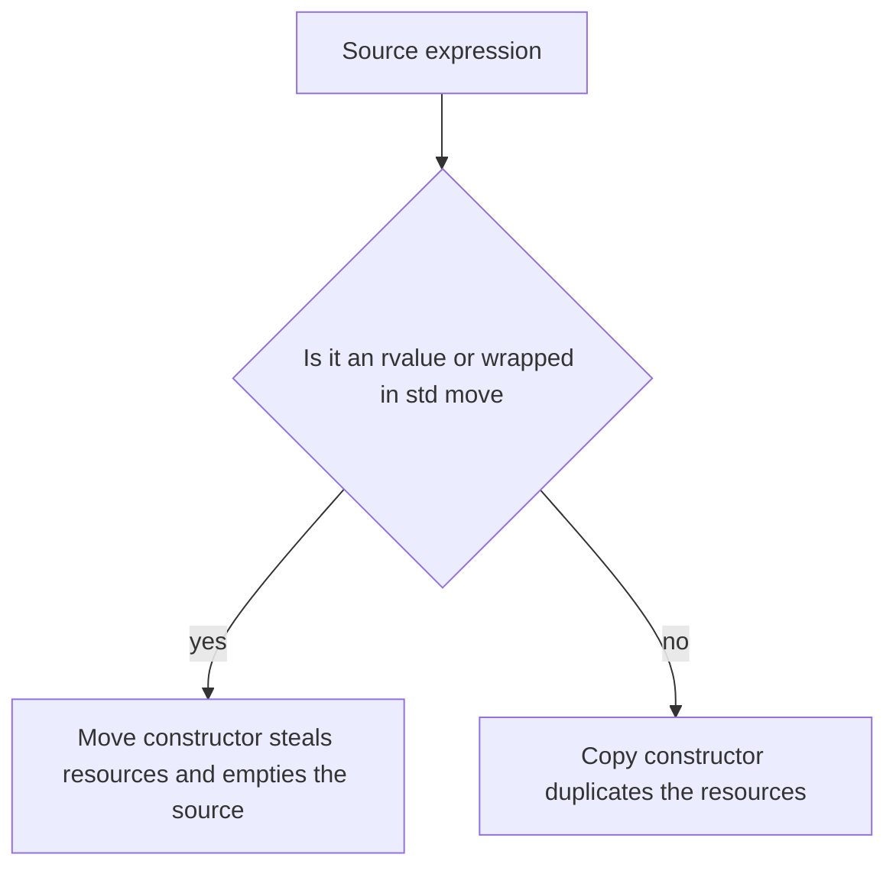

## The hook

A function builds a vector of a million strings and returns it. In early C++, that return could copy all million strings, then destroy the originals a moment later: a full photocopy of data nobody would ever use again. Meanwhile, a class with a raw pointer and the default copy constructor crashed with a "double free" the first time someone copied it.

Both problems are about what "copying" an object that owns resources should mean, and C++11 added a second option: moving. Interviews ask for deep versus shallow copy, the rule of three and five, and what std::move really does. Predict what std::move does to an object at run time on its own. (Nothing at all: it is just a cast that permits a move.)

## The intuition

:::analogy
You need to give a colleague a 500-page file. **Photocopying** it (a deep copy) leaves both of you with a full, independent file, but costs time and paper. If you will never look at it again, you simply **hand over the original** (a move): instant, and your desk is left with an empty folder. Handing over a photocopy of only the cover page that says "the file is in cabinet 3" is a shallow copy: now two people think they own the same file.
:::

## How it works

### Shallow versus deep copy

The compiler-generated copy constructor copies each member. For a raw pointer, that copies the address: a **[[shallow copy]]**. Two objects now point at one buffer, and both destructors delete it. A **[[deep copy]]** allocates a new buffer and copies the contents, so each object owns its own.

### lvalues, rvalues and rvalue references

- An **lvalue** has a name and a lasting identity: `a`, `v[3]`.
- An **rvalue** is a temporary about to disappear: `Buffer(10)`, the result of `make(500)`, `x + y`.

An **[[rvalue reference]]** `Buffer&&` binds only to rvalues. Overloading on `const Buffer&` versus `Buffer&&` lets a class copy from things that must survive, and steal from things that are about to die. `std::move(a)` is just a cast that turns the lvalue a into an rvalue, saying "you may steal from a".

### A class with all five operations, tested

```cpp
#include <algorithm>
#include <cstring>
#include <iostream>
#include <utility>
#include <vector>
using namespace std;

// Owns a heap buffer, so it needs the rule of five.
class Buffer {
    size_t n;
    char* data;
public:
    explicit Buffer(size_t size) : n(size), data(new char[size]) { memset(data, 'a', n); }
    ~Buffer() { delete[] data; }

    Buffer(const Buffer& o) : n(o.n), data(new char[o.n]) {        // deep copy
        memcpy(data, o.data, n);
        cout << "copy " << n << "\n";
    }
    Buffer& operator=(const Buffer& o) {                            // copy-and-swap
        Buffer tmp(o);
        swap(n, tmp.n); swap(data, tmp.data);
        return *this;
    }
    Buffer(Buffer&& o) noexcept : n(o.n), data(o.data) {            // steal, do not copy
        o.n = 0; o.data = nullptr;
        cout << "move " << n << "\n";
    }
    Buffer& operator=(Buffer&& o) noexcept {
        if (this != &o) { delete[] data; n = o.n; data = o.data; o.n = 0; o.data = nullptr; }
        return *this;
    }
    size_t size() const { return n; }
    char* raw() { return data; }
};

Buffer make(size_t n) { return Buffer(n); }   // returned by value: no copy

int main() {
    Buffer a(1000);
    Buffer b = a;               // copy 1000: two independent buffers
    b.raw()[0] = 'z';
    cout << a.raw()[0] << " " << b.raw()[0] << "\n";   // a z
    Buffer c = move(a);         // move 1000: c takes a's buffer, a is left empty
    cout << a.size() << " " << c.size() << "\n";       // 0 1000
    Buffer d = make(500);       // guaranteed copy elision in C++17: prints nothing
    cout << d.size() << "\n";                          // 500
    vector<Buffer> v;
    v.reserve(2);
    v.push_back(Buffer(10));    // move 10: a temporary is moved in
    v.push_back(d);             // copy 500: a named object is copied in
}
```

| Line | Printed | Why |
|---|---|---|
| `Buffer b = a;` | copy 1000 | a is an lvalue: deep copy |
| change b, print both | a z | independent buffers |
| `Buffer c = move(a);` | move 1000 | the **[[move constructor]]** steals the pointer |
| print sizes | 0 1000 | a is valid but empty |
| `Buffer d = make(500);` | nothing | **[[copy elision]]**: built directly in d |
| `push_back(Buffer(10))` | move 10 | temporary |
| `push_back(d)` | copy 500 | named object |

Wait, why does `make(500)` print neither copy nor move? Since C++17, returning a temporary (a prvalue) constructs the object directly in the caller's variable; there is no intermediate object to copy or move. Named return values (`Buffer x(n); return x;`) are usually elided too, and are moved if not.

Why `noexcept` on the move constructor? std::vector, when it grows, moves elements only if moving cannot throw; otherwise it copies them to keep its strong exception guarantee. Without noexcept, every reallocation would deep-copy.



### Rules of three, five and zero

- **Rule of three**: a class that needs a custom destructor, copy constructor or copy assignment probably needs all three, because it owns a resource.
- **[[Rule of five]]**: since C++11, add the move constructor and move assignment, or the class silently copies where it could move.
- **Rule of zero**: better still, let members that already manage themselves (std::vector, std::string, std::unique_ptr) own the resources, and write none of the five.

:::insight
Copying an object that owns a resource must duplicate the resource (deep copy), while moving transfers it and leaves the source empty. Rvalue references let a class tell the two cases apart, std::move is only a cast that allows the move, and C++17 elides copies of returned temporaries entirely. The easiest correct class follows the rule of zero by owning resources through standard types.
:::

## Trade-offs

| Choice | Gain | Cost |
|---|---|---|
| Deep copy | Independent objects | Time and memory per copy |
| Move | Constant-time transfer | Source left empty; using it carelessly is a bug |
| Deleting copy (move-only types) | Single ownership enforced, as for unique_ptr and files | Cannot be copied at all |
| Rule of zero | No hand-written resource code | Requires suitable member types |

:::warning
Common misconception: "std::move moves the object." std::move only casts to an rvalue reference; the actual move happens only if a move constructor or move assignment then receives it. `std::move` on a const object, or on a type with no move constructor, quietly falls back to copying.
:::

:::try-this
After `Buffer c = move(a);`, which of these are safe: `a.size()`, `a = Buffer(5);`, `a.raw()[0]`? (a.size() is safe and returns 0, and assigning a new value to a is safe, because a moved-from object is valid. a.raw()[0] dereferences a null pointer here, which is undefined behaviour: do not read the contents of a moved-from object.)
:::

## What can go wrong

- **Shallow copies of owning raw pointers**, causing double frees and dangling pointers.
- **Forgetting noexcept on move operations**, making containers copy on growth.
- **Using an object after moving from it**, expecting its old contents.
- **`return std::move(local);`**, which can prevent copy elision; return the local by name.
- **Self-assignment bugs** in hand-written assignment operators; copy-and-swap avoids them.

### Interview follow-ups

**"When is the copy constructor called versus the copy assignment operator?"** The constructor creates a new object (`Buffer b = a;`); assignment overwrites an existing one (`b = a;`).

**"What is copy-and-swap?"** Implementing assignment by copying the source into a temporary and swapping, which handles self-assignment and gives the strong exception guarantee.

**"What is perfect forwarding?"** Passing arguments through a template with `T&&` and std::forward so lvalues stay lvalues and rvalues stay rvalues, used by emplace_back and make_unique.

## In the real world

std::vector, std::string and std::unique_ptr all implement moves, which is why returning large containers by value is cheap in modern C++. Constructors and destructors, and RAII, the foundation for all of this, are in [A Hotel Room Cleaned Automatically When You Check Out](article:cs-core-constructors-raii).

## Further reading

- Scott Meyers, *Effective Modern C++*, chapter 5, "Rvalue References, Move Semantics, and Perfect Forwarding".
- The C++ Core Guidelines, rules C.20 and C.21 (the rules of zero and five).

## Key takeaways

- The default copy constructor copies members, so a class owning a raw pointer gets a shallow copy and a double free unless it defines a deep copy.
- An rvalue reference binds to temporaries, letting a class distinguish objects that must survive, which it copies, from objects about to die, which it may move from.
- A move constructor steals the source's resources and leaves it valid but empty, and std::move is only a cast that permits this.
- Since C++17, returning a temporary constructs it directly in the caller, so neither a copy nor a move happens.
- A class managing a resource needs all five special operations, but the rule of zero avoids writing any by using standard owning types.
