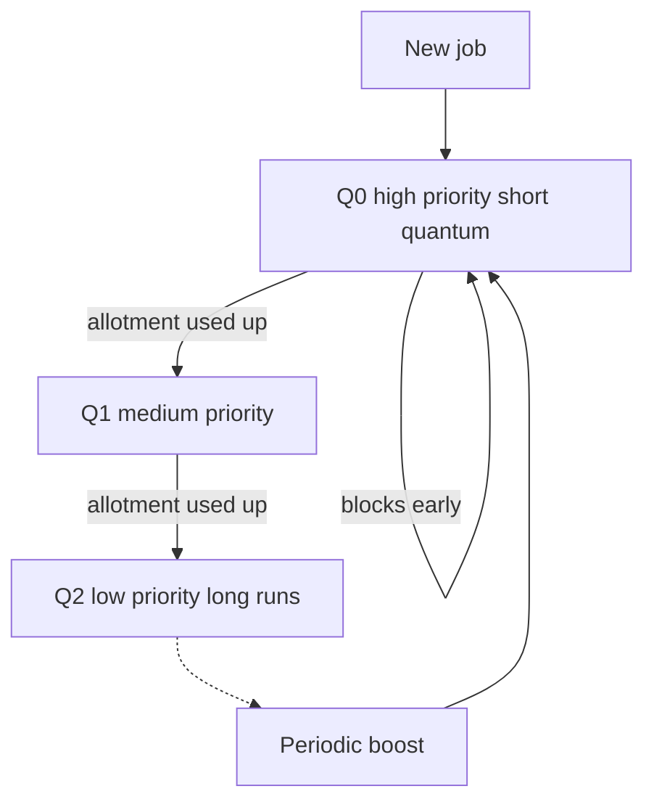

## The hook

A clinic opens at 9. Four patients walk in within three minutes of each other. One needs a full check-up. One needs a two-minute prescription renewal. The doctor takes them strictly in arrival order, and the prescription patient sits for most of an hour behind a check-up that had nothing to do with them.

Change only the **order** and the same doctor, working equally hard, cuts the average wait by a huge margin. Change it once more and the one patient with a long check-up might never be seen at all.

Your CPU makes this decision thousands of times a second. In placement tests it shows up as "draw the Gantt chart and compute the average waiting time", and in interviews as "which scheduler would you pick and why". By the end you will do both, using one set of four patients for every algorithm.

## The intuition

:::analogy
A **doctor's clinic** has one doctor, a receptionist and a waiting room. Each patient needs a different amount of the doctor's time. The **receptionist decides who goes in next**: first come first served, shortest consultation first, everyone gets five minutes then rejoins the queue, or emergencies first. Every rule helps some patients and hurts others.
:::

| Clinic | CPU scheduling |
|---|---|
| The doctor | One CPU core |
| Patients in the waiting room | Processes in the ready queue |
| Length of each consultation | [[Burst time]] |
| The receptionist's rule | The scheduling algorithm |
| "Five minutes each, then back in line" | Round robin with a [[time quantum]] |
| Emergencies first | Priority scheduling |
| The patient nobody ever calls | [[Starvation]] |

### The scorecard: four numbers per patient

Every question about schedulers reduces to these:

- **[[Turnaround time]]** = completion time − arrival time. How long from walking in to walking out.
- **[[Waiting time]]** = turnaround time − burst time. Time spent sitting in the waiting room.
- **[[Response time]]** = first time on the CPU − arrival time. How long until the doctor first sees you.
- **Throughput** = processes finished per unit time, and **CPU utilisation** = fraction of time the CPU is busy.

Batch jobs care about turnaround. Interactive apps care about response: a text editor that answers your keypress in a blink feels fast even if the total work takes longer.

## How it works

### The running example

Every algorithm below uses these four processes. Lower priority number means more urgent.

| Process | Arrival | Burst | Priority |
|---|---|---|---|
| P1 | 0 | 6 | 3 |
| P2 | 1 | 3 | 1 |
| P3 | 2 | 8 | 4 |
| P4 | 3 | 2 | 2 |

Total burst is 19, so with no idle gaps everything finishes at time 19.

### 1. First come, first served (FCFS)

Run in arrival order, never interrupt. Simple, fair in a queue sense, and non-preemptive.

**Gantt chart**

| P1 | P2 | P3 | P4 |
|---|---|---|---|
| 0 to 6 | 6 to 9 | 9 to 17 | 17 to 19 |

| Process | Completion | Turnaround | Waiting | Response |
|---|---|---|---|---|
| P1 | 6 | 6 − 0 = 6 | 6 − 6 = 0 | 0 |
| P2 | 9 | 9 − 1 = 8 | 8 − 3 = 5 | 5 |
| P3 | 17 | 17 − 2 = 15 | 15 − 8 = 7 | 7 |
| P4 | 19 | 19 − 3 = 16 | 16 − 2 = 14 | 14 |
| **Average** | | **11.25** | **6.5** | **6.5** |

Poor P4: a 2-unit job waited 14 units. That is the **convoy effect**: short jobs stuck behind long ones, like the prescription patient behind the check-up.

### 2. Shortest job first (SJF, non-preemptive)

Whenever the CPU becomes free, pick the ready process with the smallest burst. Once started, a process runs to completion.

Predict before reading: at time 6, when P1 finishes, P2 (3), P3 (8) and P4 (2) are all waiting. Who goes?

| P1 | P4 | P2 | P3 |
|---|---|---|---|
| 0 to 6 | 6 to 8 | 8 to 11 | 11 to 19 |

P4, the shortest. Wait, why does P1 run first at all, when it is not the shortest job? Because at time 0 it is the *only* job. Non-preemptive SJF chooses only among processes that have arrived, and never interrupts.

| Process | Completion | Turnaround | Waiting |
|---|---|---|---|
| P1 | 6 | 6 | 0 |
| P2 | 11 | 10 | 7 |
| P3 | 19 | 17 | 9 |
| P4 | 8 | 5 | 3 |
| **Average** | | **9.5** | **4.75** |

Average waiting fell from 6.5 to 4.75 with the same total work. In fact, when all jobs are available together, SJF gives the **minimum possible average waiting time**. The reason is an exchange argument: if a longer job runs just before a shorter one, swapping them makes the short job wait less by more than the long job's wait grows, so the average can only fall.

### 3. Shortest remaining time first (SRTF, preemptive SJF)

Same idea, but whenever a new process arrives, compare its burst with the **remaining** time of the running process. If the newcomer is shorter, preempt.

| Time | Event | Remaining times | Decision |
|---|---|---|---|
| 0 | P1 arrives | P1 6 | Run P1 |
| 1 | P2 arrives | P1 5, P2 3 | 3 < 5: preempt, run P2 |
| 2 | P3 arrives | P1 5, P2 2, P3 8 | P2 still shortest |
| 3 | P4 arrives | P1 5, P2 1, P3 8, P4 2 | P2 still shortest |
| 4 | P2 finishes | P1 5, P3 8, P4 2 | Run P4 |
| 6 | P4 finishes | P1 5, P3 8 | Run P1 |
| 11 | P1 finishes | P3 8 | Run P3 |
| 19 | P3 finishes | | Done |

| P1 | P2 | P4 | P1 | P3 |
|---|---|---|---|---|
| 0 to 1 | 1 to 4 | 4 to 6 | 6 to 11 | 11 to 19 |

| Process | Completion | Turnaround | Waiting | Response |
|---|---|---|---|---|
| P1 | 11 | 11 | 5 | 0 |
| P2 | 4 | 3 | 0 | 0 |
| P3 | 19 | 17 | 9 | 9 |
| P4 | 6 | 3 | 1 | 1 |
| **Average** | | **8.5** | **3.75** | **2.5** |

Notice P1's waiting time: it ran 0 to 1, then sat from 1 to 6. Waiting = turnaround − burst = 11 − 6 = 5 counts *all* the time it sat in the queue, including after it had started. That is exactly where people make mistakes.

:::warning
Common misconception: "SJF" means one thing. Non-preemptive SJF never interrupts a running job; preemptive SJF, called SRTF, interrupts whenever a newcomer's burst is shorter than the running job's *remaining* time. On this example they give average waits of 4.75 and 3.75. Read the question for the word "preemptive" before drawing anything, and compare against remaining time, not original burst.
:::

### The catch: nobody knows the burst in advance

SJF needs the future. Real schedulers **predict** the next burst from past ones with an exponential average:

$$\tau_{n+1} = \alpha \, t_n + (1 - \alpha)\, \tau_n$$

Here $t_n$ is the length of the burst that just happened, $\tau_n$ was our previous prediction, and $\alpha$ between 0 and 1 says how much to trust recent history. With $\alpha = 0.5$, a starting guess of 10, and actual bursts 6, 4, 6, the predictions go 8, then 6, then 6. Each new guess is halfway between the last guess and what really happened.

### 4. Round robin (RR)

Give each process at most one time quantum, then send it to the back of the queue. This is the "five minutes each" clinic. Convention used here: a process that arrives at the same moment another's quantum expires joins the queue first.

With quantum 2, here is the queue at each decision:

| Time | Runs | Queue after this slice |
|---|---|---|
| 0 to 2 | P1 (left 4) | P2, P3, P1 |
| 2 to 4 | P2 (left 1) | P3, P1, P4, P2 |
| 4 to 6 | P3 (left 6) | P1, P4, P2, P3 |
| 6 to 8 | P1 (left 2) | P4, P2, P3, P1 |
| 8 to 10 | P4 done | P2, P3, P1 |
| 10 to 11 | P2 done | P3, P1 |
| 11 to 13 | P3 (left 4) | P1, P3 |
| 13 to 15 | P1 done | P3 |
| 15 to 19 | P3 done | |

| Process | Completion | Turnaround | Waiting | Response |
|---|---|---|---|---|
| P1 | 15 | 15 | 9 | 0 |
| P2 | 11 | 10 | 7 | 1 |
| P3 | 19 | 17 | 9 | 2 |
| P4 | 10 | 7 | 5 | 5 |
| **Average** | | **12.25** | **7.5** | **2.0** |

Guess which number got better and which got worse compared with SRTF. Waiting and turnaround got **worse** (7.5 versus 3.75), the worst so far. Response got *better* than even SRTF (2.0 versus 2.5), and far better than FCFS (6.5). Round robin does not try to finish jobs fast; it tries to make everyone *start* soon. That is the right goal for interactive systems, and the wrong one for batch work.

The quantum is the dial. With quantum 4 on the same example, the averages become 12.0 turnaround, 7.25 waiting and 4.0 response. Make the quantum huge and nobody is ever preempted: round robin turns into FCFS. Make it tiny and the doctor spends more time swapping patients than treating them, because each switch costs time, as you saw in [An Actor Stepping Off Stage](article:cs-core-process-states).

:::insight
Every scheduler trades the same three things: average waiting (SJF and SRTF win), response time (round robin wins), and fairness or freedom from starvation (FCFS and round robin win). No single algorithm wins all three, which is why real systems layer several together.
:::

### 5. Priority scheduling

Each process has a priority; the most urgent ready process runs. Non-preemptive here, with our priorities (P2 = 1 is the most urgent):

| P1 | P2 | P4 | P3 |
|---|---|---|---|
| 0 to 6 | 6 to 9 | 9 to 11 | 11 to 19 |

Average waiting is (0 + 5 + 9 + 6) / 4 = **5.0** and average turnaround **9.75**. SJF is just priority scheduling where priority = predicted burst.

Here is the catch with priorities. If urgent processes keep arriving, a low-priority one can wait forever. That is starvation. The standard cure is **[[aging]]**: every so often, raise the priority of everyone still waiting, so even P3 eventually becomes the most urgent patient in the room.

### 6. Multilevel feedback queue (MLFQ)

What if you want SRTF's good waiting times and round robin's good response, without knowing burst times? MLFQ **learns** each process's behaviour by watching it. The rules, as presented in the OSTEP textbook:

1. There are several queues, from high to low priority. A higher queue always runs first.
2. Within one queue, use round robin.
3. A new job starts in the top queue.
4. Once a job uses up its time allotment at a level, it moves down one level.
5. Every so often, move every job back to the top (a priority boost).



Short and interactive jobs finish or block before using their allotment, so they stay high and get fast service. CPU-hungry jobs sink to the bottom, where they run when nothing interactive needs the CPU.

Trace it with three levels: Q0 with quantum 2, Q1 with quantum 4, Q2 first come first served. A newcomer in a higher queue preempts a job in a lower one.

| Time | Runs | Level | What happens |
|---|---|---|---|
| 0 to 2 | P1 | Q0 | Uses its quantum, drops to Q1 |
| 2 to 4 | P2 | Q0 | Uses its quantum, drops to Q1 with 1 left |
| 4 to 6 | P3 | Q0 | Drops to Q1 with 6 left |
| 6 to 8 | P4 | Q0 | Finishes inside its first quantum |
| 8 to 12 | P1 | Q1 | Finishes its remaining 4 |
| 12 to 13 | P2 | Q1 | Finishes |
| 13 to 17 | P3 | Q1 | Uses quantum 4, drops to Q2 with 2 left |
| 17 to 19 | P3 | Q2 | Finishes |

Averages: turnaround 11.5, waiting 6.75, response **1.5**, the best response time of every algorithm here, without knowing a single burst in advance.

Wait, why do rule 4's words say "time allotment at a level" and not "if it uses a whole quantum"? Because a crafty program could run for 99% of the quantum, make a tiny I/O call to give up the CPU, and stay at the top forever. Counting total time used at the level closes that loophole. Rule 5 then rescues long jobs from starvation and lets a job that turns interactive climb back up.

### All six on one page

| Algorithm | Preemptive? | Avg turnaround | Avg waiting | Avg response |
|---|---|---|---|---|
| FCFS | No | 11.25 | 6.5 | 6.5 |
| SJF | No | 9.5 | 4.75 | 4.75 |
| SRTF | Yes | 8.5 | 3.75 | 2.5 |
| Round robin, q = 2 | Yes | 12.25 | 7.5 | 2.0 |
| Priority | No | 9.75 | 5.0 | 5.0 |
| MLFQ, q = 2, 4, then FCFS | Yes | 11.5 | 6.75 | 1.5 |

### The code

Round robin is the one people most often simulate wrongly, so here it is. The subtle line is the order: admit new arrivals *before* re-queuing the preempted process.

```pseudo
queue = processes arriving at time 0
while some process is unfinished:
    if queue is empty: jump time to the next arrival and admit it
    p = pop front of queue
    if p never ran: record its first run time
    run p for min(quantum, p.remaining)
    advance time; admit everyone who arrived meanwhile
    if p has work left: push p to the back
    else: record p's completion time
```

```cpp
#include <bits/stdc++.h>
using namespace std;

struct Proc { string name; int arrival, burst; };

int main() {
    vector<Proc> ps = {{"P1", 0, 6}, {"P2", 1, 3}, {"P3", 2, 8}, {"P4", 3, 2}};
    const int quantum = 2;
    int n = ps.size(), t = 0, next = 0, done = 0;
    vector<int> left(n), finish(n), first(n, -1);
    for (int i = 0; i < n; i++) left[i] = ps[i].burst;
    deque<int> ready;
    auto admit = [&] {                      // queue everyone who has arrived by time t
        while (next < n && ps[next].arrival <= t) ready.push_back(next++);
    };
    admit();
    while (done < n) {
        if (ready.empty()) { t = ps[next].arrival; admit(); continue; }
        int i = ready.front(); ready.pop_front();
        if (first[i] < 0) first[i] = t;
        int run = min(quantum, left[i]);
        cout << t << "-" << t + run << " " << ps[i].name << "\n";
        t += run; left[i] -= run;
        admit();                            // arrivals join before the preempted process
        if (left[i] > 0) ready.push_back(i);
        else { finish[i] = t; done++; }
    }
    double tat = 0, wait = 0, resp = 0;
    for (int i = 0; i < n; i++) {
        tat += finish[i] - ps[i].arrival;
        wait += finish[i] - ps[i].arrival - ps[i].burst;
        resp += first[i] - ps[i].arrival;
    }
    // prints: avg turnaround 12.25, waiting 7.5, response 2
    cout << "avg turnaround " << tat / n << ", waiting " << wait / n << ", response " << resp / n << "\n";
}
```

:::try-this
Three processes arrive at time 0 with bursts 4, 3 and 2 (in that order). Run round robin with quantum 2. What is the average waiting time? (Gantt: P1 0 to 2, P2 2 to 4, P3 4 to 6 done, P1 6 to 8 done, P2 8 to 9 done. Completions 8, 9 and 6, so waits are 8 − 4 = 4, 9 − 3 = 6 and 6 − 2 = 4, averaging 14/3, about 4.67.)
:::

## Trade-offs

| Algorithm | Strength | Weakness | Fits |
|---|---|---|---|
| FCFS | Simple, no starvation | Convoy effect, poor response | Batch queues, print spoolers |
| SJF and SRTF | Minimum average waiting | Needs burst prediction; long jobs can starve | Batch systems with known job sizes |
| Round robin | Good response, fair | Worse turnaround; quantum tuning; switch overhead | Time-sharing, interactive systems |
| Priority | Expresses importance | Starvation without aging; priority inversion | Real-time and mixed workloads |
| MLFQ | Learns behaviour, good response and decent throughput | Many knobs; can be gamed without the allotment rule | General-purpose desktops and servers |

### Preemptive versus non-preemptive

A **non-preemptive** scheduler only decides when the running process finishes or blocks. A **preemptive** one can take the CPU away at a timer tick or when a more urgent process arrives. Preemption gives better response and protects against one process hogging the CPU, at the cost of more context switches and the need for locking in code that can be interrupted mid-update.

## What can go wrong

- **Starvation.** SRTF and priority scheduling can postpone long or low-priority jobs forever under steady load. Fix: aging.
- **Priority inversion.** A high-priority task waits for a lock held by a low-priority task, while a medium-priority task keeps the low one off the CPU. The urgent task is effectively stuck behind the medium one. Fix: priority inheritance, covered in [A Key for One Room, a Bowl for the Car Park](article:cs-core-mutex-semaphore).
- **Quantum too small.** Throughput collapses into context switching.
- **Quantum too large.** Round robin degenerates into FCFS and interactive response suffers.
- **Gaming.** A program that yields just before its quantum ends can stay at high priority unless the scheduler counts total time used.
- **Arithmetic slips in exams.** Forgetting arrival time when computing turnaround, using original burst instead of remaining time in SRTF, and putting the preempted process ahead of a simultaneous arrival in RR (state your convention).

### Interview follow-ups

**"Which algorithm minimises average waiting time, and why is it not used everywhere?"** SJF (and SRTF in the preemptive case), by the exchange argument. It needs burst lengths in advance, which are only predictions, and it can starve long jobs.

**"How would you choose a time quantum?"** Large compared with the context-switch cost, so overhead stays small, but small enough that interactive tasks respond quickly. A common rule of thumb is that most CPU bursts should finish within one quantum, so interactive work rarely gets preempted.

**"What is the difference between response time and turnaround time, and which matters for a text editor?"** Response is time to first service; turnaround is time to completion. An editor cares about response, since each keypress is a tiny burst that must start soon.

**"How does scheduling change with multiple cores?"** Each core usually has its own run queue, to avoid one shared lock; the kernel periodically balances load between them, and tries to keep a thread on the same core (affinity) so its cache stays warm. Spreading work over servers raises the same balance question, as in [Pick Two Lines at Random, Join the Shorter](article:famous-algos-power-of-two-choices).

**"Why can't round robin starve anyone?"** Every ready process is in one queue and each one ahead of it gets at most one quantum, so with $n$ processes and quantum $q$, a process waits at most $(n-1)q$ (plus switch overheads) for its next turn.

## In the real world

- Linux's long-time default, the Completely Fair Scheduler, tracks how much weighted CPU time each task has received and always runs the task that has received the least, keeping tasks in a red-black tree ordered by that value. Newer kernels replaced it with a scheduler based on EEVDF (earliest eligible virtual deadline first), built on the same fairness idea.
- General-purpose desktop systems use priority-based preemptive scheduling with boosts for threads that just woke from waiting on input, the same instinct as MLFQ.
- Real-time systems use strict priority scheduling with priority inheritance, because missing a deadline matters more than average waiting.
- Picking "the most urgent ready item" is a priority queue, the structure behind [The Triage Nurse Who Always Knows Who Is Next](article:dsa-heap-basics) and [An Airport Gate Calling the Next Ready Plane](article:dsa-heap-scheduling).

So far each patient sees the doctor alone. Real processes also need to talk to each other: pass data, share results, signal "done". How do separate houses send parcels? That is [Passing Notes or Sharing a Whiteboard](article:cs-core-ipc).

## Further reading

- *Operating Systems: Three Easy Pieces*, the chapters on scheduling, the multilevel feedback queue and proportional share.
- *Operating System Concepts* by Silberschatz, Galvin and Gagne, the CPU scheduling chapter, for many more Gantt chart exercises.

## Key takeaways

- Turnaround time is completion minus arrival, waiting time is turnaround minus burst, and response time is first run minus arrival; every scheduling question is built from these.
- SJF and its preemptive form SRTF minimise average waiting time but need burst predictions and can starve long jobs.
- Round robin gives good response time and fairness at the cost of worse turnaround, and its quantum must be large relative to context-switch cost but small enough for interactivity.
- Priority scheduling can starve low-priority processes, and aging fixes this by raising the priority of processes that wait a long time.
- MLFQ learns which jobs are interactive by watching how they use the CPU, combining good response for short jobs with throughput for long ones.
