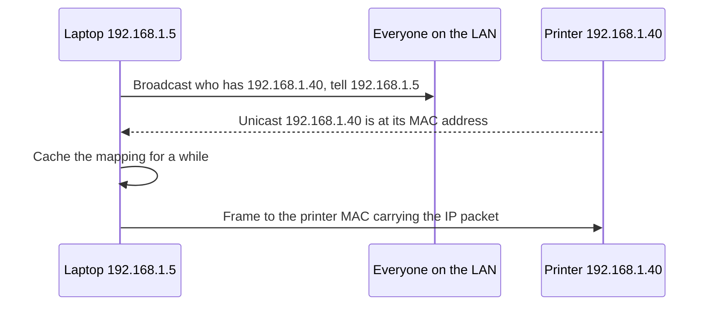

## The hook

Your laptop knows the IP address of the printer down the corridor: 192.168.1.40. But the Ethernet cable and the Wi-Fi radio do not speak IP. They deliver frames to hardware addresses, and your laptop has never been told the printer's. How does the very first frame find its way?

And in the switch cupboard, a box with 48 ports somehow sends each frame only to the right cable, even though nobody ever typed in which computer is plugged in where. Predict how the switch finds out. (It reads the sender's address on every frame that passes through and remembers which port it came from.)

## The intuition

:::analogy
A large office building has **an internal mail room**. Mail inside the building is addressed by desk number, not street address. The mail room clerk learns where each desk is by noticing which corridor each outgoing letter comes from. When the clerk does not know a desk yet, they send a copy down every corridor. And if you know a colleague's name but not their desk, you shout the name across the floor and they shout back.
:::

## How it works

### Frames and MAC addresses

The data link layer moves a **[[frame]]** across one link, to the next device. An Ethernet frame carries a destination MAC address, a source MAC address, a type field (such as IPv4 or IPv6), the payload, and a CRC trailer for error detection, explained in [The Remainder That Notices Smudges](article:famous-algos-crc).

A **[[MAC address]]** is 48 bits, written as six hex pairs. The first three bytes traditionally identify the manufacturer. The all-ones address ff:ff:ff:ff:ff:ff means "everyone on this network" (broadcast). MAC addresses only mean something on the local link: at every router the frame is unwrapped, and a new frame with new addresses is built for the next link.

### How a switch learns

A **[[switch]]** keeps a table of MAC address → port. For every frame, it:

1. records the source MAC against the port the frame arrived on, and
2. looks up the destination MAC: if known, forwards to that port only; if unknown or broadcast, floods to every port except the incoming one.

Four hosts, A to D, on ports 1 to 4, starting with an empty table:

| Frame | Switch learns | Action | Table afterwards |
|---|---|---|---|
| A → B | A is on port 1 | B unknown: flood to ports 2, 3, 4 | A:1 |
| B → A | B is on port 2 | forward to port 1 | A:1, B:2 |
| C → A | C is on port 3 | forward to port 1 | A:1, B:2, C:3 |
| A → C | (already known) | forward to port 3 | A:1, B:2, C:3 |
| D → broadcast | D is on port 4 | flood to ports 1, 2, 3 | A:1, B:2, C:3, D:4 |

Entries expire after a period of silence, so a laptop that moves to another port is relearned.

### ARP: from IP address to MAC address

To send an IP packet on the local network, a host needs the MAC address of the next hop: the destination itself if it is on the same subnet, otherwise the default gateway. **[[ARP]]** finds it:

Wait, why does the printer's reply not need a broadcast? The request already contained the laptop's IP and MAC addresses, so the printer can answer directly, and usually caches the laptop's mapping at the same time.

### Domains and shared media

| Device | Layer | Collision domain | Broadcast domain |
|---|---|---|---|
| Hub | 1 | one for all ports | one |
| Switch | 2 | one per port | one for all ports (unless VLANs split it) |
| Router | 3 | one per port | one per port |

Old shared Ethernet used **CSMA/CD**: listen before sending, detect collisions while sending, back off randomly and retry. Full-duplex switched Ethernet has no collisions, so CSMA/CD is effectively retired there. Wi-Fi cannot reliably detect collisions while transmitting, so it uses **CSMA/CA**: listen, wait a random backoff, send, and expect an acknowledgement.

:::insight
The data link layer delivers frames to the next device using MAC addresses. Switches learn which port each address lives on from source addresses and flood when unsure, and ARP bridges the gap between IP addresses and MAC addresses with a broadcast question and a direct answer. Everything here stays inside one **[[broadcast domain]]**; routers connect domains.
:::

## Trade-offs

| Choice | Gain | Cost |
|---|---|---|
| One big flat LAN | Simple, everything reachable at layer 2 | Broadcast traffic grows; one fault spreads |
| VLANs | Separate broadcast domains on the same switches | Routing needed between VLANs |
| Static ARP entries | Immune to ARP spoofing for key hosts | Manual upkeep |
| Learning switches | Zero configuration | Flooding until learned; loops need spanning tree |

:::warning
Common misconception: "a switch sends every frame to everyone, like a hub." A switch floods only unknown and broadcast destinations; once it has learned a destination's port, it forwards the frame only there. A hub really does repeat everything to every port.
:::

:::try-this
Continue the table: B sends a frame to D, then a new host E plugs into port 5 and sends a frame to A. What does the switch do each time? (B → D: D is known on port 4, so forward only to port 4. E → A: learn E on port 5, and A is known on port 1, so forward to port 1.)
:::

## What can go wrong

- **Switching loops**: two cables between switches make broadcast frames circulate forever; the spanning tree protocol blocks redundant paths.
- **ARP spoofing**: an attacker answers ARP requests with its own MAC address to intercept traffic; dynamic ARP inspection and encryption defend against it.
- **MAC table overflow attacks**, filling the table so the switch floods everything.
- **Stale ARP caches** after an IP address moves to a new machine.

### Interview follow-ups

**"What is the difference between a MAC address and an IP address?"** A MAC address identifies an interface on the local link and changes at each hop; an IP address identifies a host across networks and stays the same end to end (apart from NAT).

**"What is gratuitous ARP?"** A host announcing its own IP-to-MAC mapping unprompted, used after failover so neighbours update their caches.

**"What does a VLAN do?"** It divides one physical switch into several logical LANs, each its own broadcast domain.

## In the real world

`ip neigh` (or `arp -a`) shows your ARP cache, and managed switches display their MAC tables. The layers above and below this one are mapped in [Sending a Parcel Through Layers of Packaging](article:cs-core-osi-tcpip).

## Further reading

- RFC 826, "An Ethernet Address Resolution Protocol" (1982).
- James Kurose and Keith Ross, *Computer Networking: A Top-Down Approach*, chapter on the link layer.

## Key takeaways

- The data link layer delivers frames to the next device on a link, using 48-bit MAC addresses that are rewritten at every router.
- A switch learns MAC-to-port mappings from the source address of each frame and floods frames whose destination is unknown or broadcast.
- ARP finds a MAC address for an IP address on the local network by broadcasting a request and receiving a direct reply, which is then cached.
- Switches give each port its own collision domain but share one broadcast domain, while routers and VLANs separate broadcast domains.
- Wired switched Ethernet is collision-free, while Wi-Fi shares the air using CSMA/CA with random backoff and acknowledgements.
