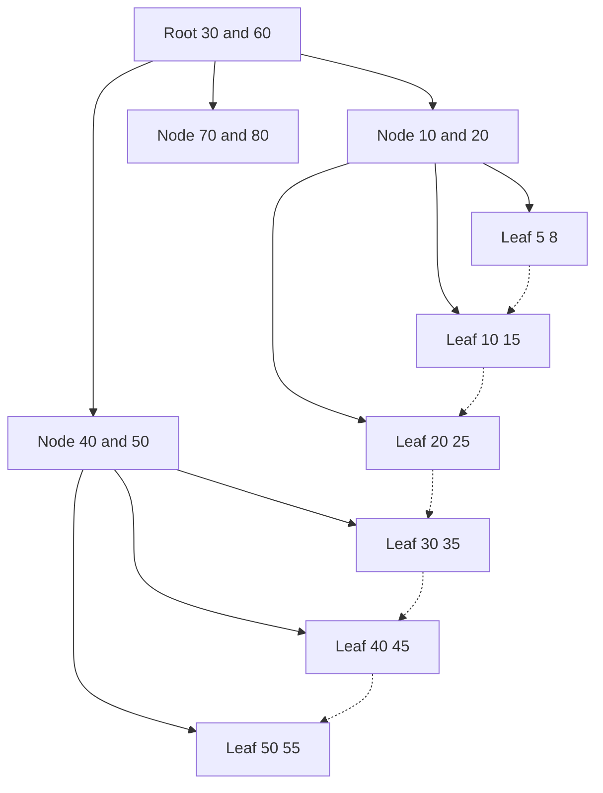

## The hook

A table of a billion rows, at about 100 rows per block, lives on disk in roughly ten million blocks. Find the row for roll number 21CS042 without an index, and the database reads blocks until it gets lucky: on average, five million of them.

With a B+ tree index, the same lookup reads about four blocks, and the top two or three are usually already in memory. That is not a small speed-up; it is the difference between minutes and a millisecond. Predict where the number four comes from. (Each tree node fills one disk block and holds about 256 children, and 256 multiplied by itself four times passes four billion.)

## The intuition

:::analogy
**A book index** at the back lists only important words, each with a page number; you jump to the page and read nearby. **A phone directory** lists every single person in sorted order. The first is sparse and relies on the book being in page order; the second is dense and works on its own. Database indexes come in both styles, and a B+ tree is a phone directory with a directory of its own on top.
:::

## How it works

### Dense versus sparse

Take 1,000,000 records stored 100 per block, sorted by roll number: 10,000 blocks.

| Index | Entries | Lookup |
|---|---|---|
| **[[Dense index]]** | one per record: 1,000,000 | find the entry, follow the pointer |
| **[[Sparse index]]** | one per block: 10,000 | find the largest entry ≤ key, then scan that block |

Sparse is 100 times smaller, but only works when the file is sorted on that key.

### Primary, clustered and secondary

| Kind | File sorted by this key? | Dense or sparse | How many per table |
|---|---|---|---|
| Primary index (on the sort key, unique) | yes | can be sparse | one |
| **[[Clustered index]]** (sort key, may repeat) | yes | can be sparse | one |
| **[[Secondary index]]** | no | must be dense | many |

Wait, why only one clustered index? Because the rows can be physically sorted in only one order. Every other index points into that order from outside, and a range scan through a secondary index may touch a different block for every row.

### The B+ tree

A **[[B+ tree]]** is balanced (all leaves at the same depth). Internal nodes hold only keys and child pointers to route the search; leaves hold every key with its record pointer, and are linked left to right.

**Point lookup of 45**: at the root, 30 ≤ 45 < 60, go to the middle child; there, 40 ≤ 45 < 50, go to the leaf holding 40 and 45. Three node reads.

**Range query 25 to 45**: find 25 as above, then follow the leaf links right (25, 30, 35, 40, 45) without going back up. This is why databases use B+ trees rather than plain B-trees: all keys sit in linked leaves, and internal nodes, holding no records, fit more keys.

### Order and height: the exam calculation

With 4096-byte blocks and 8-byte keys and pointers:

| Node | Constraint | Capacity |
|---|---|---|
| Internal: p pointers, p − 1 keys | 8p + 8(p − 1) ≤ 4096 | p = 256 |
| Leaf: n (key, record pointer) pairs plus one next-leaf pointer | 16n + 8 ≤ 4096 | n = 255 |

With **[[fanout]]** about 256, three levels reach 256³ ≈ 16.8 million entries and four levels reach 256⁴ ≈ 4.3 billion. So a billion keys need about **4 levels**, and since the root and the level below take only a few hundred kilobytes, they stay cached: a lookup typically costs one or two actual disk reads.

### Inserts and deletes keep it balanced

Insert into the right leaf; if it overflows, **split** it into two half-full leaves and push the middle key up to the parent, splitting upward if needed. A split at the root creates a new root, which is the only way the tree grows taller, so all leaves stay at the same depth. Deletes **merge** or **borrow** from a sibling when a node falls below half full. Every node except the root stays at least half full.

### Hash indexes

A hash index sends key k to bucket h(k): a point lookup costs about one bucket read, independent of table size.

| Query | B+ tree | Hash index |
|---|---|---|
| `WHERE roll = 'X'` | a few node reads | about one bucket read |
| `WHERE marks BETWEEN 60 AND 80` | find 60, scan leaves | useless: hashing scatters neighbouring keys |
| `ORDER BY marks` | read leaves in order | useless |
| `WHERE name LIKE 'Pri%'` | prefix range scan | useless |

:::insight
Indexes trade space and slower writes for fast reads. The B+ tree wins in general-purpose databases because high fanout keeps it three or four levels deep even at a billion rows, and its linked leaves serve range queries, sorting and prefix searches that hash indexes cannot.
:::

## Trade-offs

| Choice | Gain | Cost |
|---|---|---|
| More indexes | Faster reads on more queries | Every insert, update and delete must update each index; more storage |
| Clustered index on a range-queried column | Range scans read consecutive blocks | Only one per table; inserts may split pages |
| Secondary index | Fast lookups on other columns | Range scans may jump to a new block per row |
| Hash index | Fastest equality lookups | No ranges, no ordering |
| Composite index (a, b) | Serves filters on a, or on a and b | Does not help a filter on b alone |

:::warning
Common misconception: "an index always makes a query faster." If a query matches a large fraction of the table, following a secondary index row by row costs more random reads than scanning the whole table sequentially, and the optimiser rightly ignores the index. Indexes shine for selective queries.
:::

:::try-this
Blocks are 1024 bytes, keys 12 bytes, pointers 4 bytes. What is the internal node order p, and roughly how many levels for 10 million keys? (4p + 12(p − 1) ≤ 1024 gives 16p ≤ 1036, so p = 64. 64³ = 262,144 is too few, and 64⁴ ≈ 16.8 million is enough, so 4 levels.)
:::

## What can go wrong

- **Indexing every column**, slowing writes and wasting memory for indexes no query uses.
- **Wrong column order in a composite index**, so the common filter cannot use it.
- **Functions on indexed columns** (`WHERE LOWER(email) = …`) preventing plain index use, unless an expression index exists.
- **Low-selectivity indexes** (a boolean column) that the optimiser never uses.
- **Random primary keys** (such as random UUIDs) scattering inserts across the B+ tree and causing many page splits.

### Interview follow-ups

**"B-tree versus B+ tree?"** A B-tree stores records in internal nodes too, so some lookups end early, but range scans must walk the tree. A B+ tree keeps all records in linked leaves, giving higher fanout and simple range scans.

**"What is a covering index?"** An index that contains every column a query needs, so the query is answered from the index alone without touching the table.

**"Why are LSM trees used instead in some databases?"** They turn random writes into sequential ones, which suits write-heavy workloads, as explained in [Why Some Queries Are Instant and Others Take Minutes](article:system-design-database-indexing).

## In the real world

PostgreSQL, MySQL InnoDB, SQL Server, Oracle and SQLite use B+ tree variants as their default index; InnoDB stores the table itself as a clustered B+ tree on the primary key. The SQL these indexes speed up is in [Asking a Well-Organised Spreadsheet Questions](article:cs-core-sql-basics).

## Further reading

- Douglas Comer, "The Ubiquitous B-Tree" (ACM Computing Surveys, 1979).
- Markus Winand, *SQL Performance Explained* (also at use-the-index-luke.com).

## Key takeaways

- A dense index has an entry per record and works on any column, while a sparse index has an entry per block and needs the file sorted on that key.
- A table has one clustered index matching its physical order and possibly many secondary indexes, which must be dense.
- A B+ tree keeps routing keys in internal nodes and all records in linked leaves, so point lookups take a few node reads and range scans follow the leaf links.
- With block-sized nodes and a fanout around 256, a billion keys fit in about four levels, with the top levels cached in memory.
- Hash indexes give the fastest equality lookups but cannot serve ranges or ordering, and every index speeds reads at the cost of slower writes and extra space.
