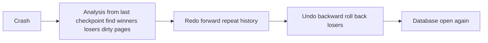

## The hook

A database tells you "committed" for a ₹30 transfer. A millisecond later the power fails. The data page with your new balance was still in memory, never written to disk. When the server restarts, is your transfer there?

It must be: that is durability. And another transaction that was half-way through when the power went must leave no trace: that is atomicity. Both promises are kept by one humble file, the log, and an algorithm that reads it after the crash. Predict the one rule that makes this possible. (Write the description of a change to the log on disk *before* the change itself reaches the data file.)

## The intuition

:::analogy
A ship's captain writes every order in **the ship's log** before it is carried out. After a storm knocks out the crew, **the events are rebuilt from the log**: finished orders that the damage erased are carried out again, and orders that were half-done when the storm hit are reversed. The log is small and written in order, so it survives when the rest of the ship is in chaos.
:::

## How it works

### The log and the WAL rule

Each update appends a record `<T, item, old value, new value>`, plus `<T start>`, `<T commit>` and `<T abort>` records. The **[[write-ahead logging]]** rule has two parts:

1. A data page may go to disk only after the log records for its changes are on disk.
2. A transaction commits only after all its log records, including the commit record, are on disk.

With the old value you can **undo**; with the new value you can **redo** (see **[[undo and redo]]**).

### Why both are needed: buffer policies

The buffer manager decides when dirty pages go to disk:

| Policy | Meaning | Consequence after crash |
|---|---|---|
| Steal | Uncommitted changes may be written to disk | Undo needed |
| No-steal | They may not | No undo needed, but memory fills up |
| Force | All changed pages written at commit | No redo needed, but commits are slow random writes |
| No-force | Commit only flushes the log | Redo needed |

Real databases choose **[[steal and no-force]]**, the fastest combination, and pay for it by doing both undo and redo during recovery.

### Checkpoints

Without help, recovery would scan the log from the beginning of time. A **[[checkpoint]]** record lists the transactions active at that moment (and, in ARIES, the dirty pages), so recovery can start its work near the last checkpoint.

### A recovery, traced

Here is a log at the moment of a crash. A simulator replayed it, assuming the worst: the disk still holds all the old values.

| LSN | Record |
|---|---|
| 10 | T1 start |
| 20 | T1 updates A from 100 to 70 |
| 30 | T2 start |
| 40 | T2 updates B from 50 to 80 |
| 50 | checkpoint, active T1 and T2 |
| 60 | T1 commit |
| 70 | T3 start |
| 80 | T3 updates C from 10 to 15 |
| 90 | T2 updates D from 5 to 0 |
| | crash |

**Analysis**: from the checkpoint forward, find who committed. T1 has a commit record: a **winner**. T2 and T3 do not: **losers**.

**Redo**: repeat history, reapplying every logged update in order. Now A = 70, B = 80, C = 15, D = 0, exactly the state at the crash.

**Undo**: walk backwards, restoring old values of losers' updates: LSN 90 sets D back to 5, LSN 80 sets C back to 10, LSN 40 sets B back to 50.

Final state: A = 70 (T1 durable), B = 50, C = 10, D = 5 (T2 and T3 erased).

Wait, why redo the losers' changes only to undo them a moment later? Repeating history makes the redo pass simple and exact (the database is precisely as it was at the crash), and undo then works the same way as a normal abort. ARIES chose this simplicity deliberately.

### What ARIES adds

ARIES, the algorithm behind many commercial databases, refines the trace above:

- Every page stores the **[[LSN]]** of the last change applied to it, so redo skips a record when the page already has it (page LSN ≥ record LSN). Redo is **idempotent**: crashing during recovery and restarting is safe.
- The analysis pass rebuilds a dirty page table and a transaction table from the checkpoint, so redo starts at the oldest change that might be missing from disk.
- Each undo step writes a **compensation log record** (CLR), so if the system crashes during undo, it does not undo the same change twice.

:::insight
Write-ahead logging makes the log the source of truth: commit flushes only the sequential log, while data pages are written lazily. After a crash, recovery repeats history from the log (redo) and then rolls back the transactions that never committed (undo), delivering both durability and atomicity.
:::

## Trade-offs

| Choice | Gain | Cost |
|---|---|---|
| Steal and no-force with WAL | Fast commits, flexible memory use | Recovery needs undo and redo |
| Frequent checkpoints | Shorter recovery | More I/O during normal running |
| Group commit | One log flush for many commits | Slightly higher latency per commit |
| Shadow paging (copy pages, swap a root pointer) | No undo or redo log | Scattered data, expensive commits; rare in modern engines |

:::warning
Common misconception: "durability means the data file is updated at commit." At commit, only the log is guaranteed to be on disk. The data pages may stay in memory for a long time; the log alone is enough to rebuild them, which is exactly why commits can be fast.
:::

:::try-this
Change the trace: T2 writes a commit record at LSN 95, just before the crash. What is the final state? (T2 becomes a winner, so its changes stay: B = 80, D = 0. Only T3 is undone, so C = 10. A = 70 as before.)
:::

## What can go wrong

- **Disks that lie about flushing** (volatile write caches), which break the WAL rule and lose committed data.
- **Turning off synchronous commit** without understanding that the last moments of commits can vanish.
- **Infrequent checkpoints**, leading to long recovery times after a crash.
- **Undo without compensation records**, which could undo a change twice after a crash during recovery.

### Interview follow-ups

**"How is media failure (a dead disk) handled?"** Restore the last backup and replay archived logs forward to the desired point; this is point-in-time recovery.

**"How do replicas use the log?"** Streaming replication ships the same write-ahead log to replicas, which replay it, as in [A Teacher Dictating Notes to the Class](article:system-design-replication).

**"What is the difference between undo logging and redo logging alone?"** Undo-only logging needs force (write data before commit); redo-only logging needs no-steal (do not write uncommitted data). Undo/redo logging allows steal and no-force.

## In the real world

PostgreSQL's WAL, MySQL InnoDB's redo and undo logs, and SQL Server's transaction log all follow write-ahead logging, and ARIES-style recovery is the textbook basis for them. The ACID promises this protects are introduced in [A Bank Transfer That Happens Completely or Not at All](article:cs-core-transactions-acid).

## Further reading

- C. Mohan and colleagues, "ARIES: A Transaction Recovery Method Supporting Fine-Granularity Locking and Partial Rollbacks Using Write-Ahead Logging" (ACM TODS, 1992).
- Silberschatz, Korth and Sudarshan, *Database System Concepts*, chapter on recovery.

## Key takeaways

- Write-ahead logging requires a change's log record to reach stable storage before the data page and before commit, making the log the source of truth.
- Undo restores old values for uncommitted transactions, and redo reapplies new values for committed ones whose pages never reached disk.
- Steal and no-force buffer policies give fast commits and flexible memory, at the cost of needing both undo and redo during recovery.
- Checkpoints record active transactions and dirty pages so recovery starts near the end of the log instead of at the beginning.
- ARIES recovers in three passes (analysis, redo that repeats history, undo of losers), using page LSNs for idempotent redo and compensation records for safe undo.
