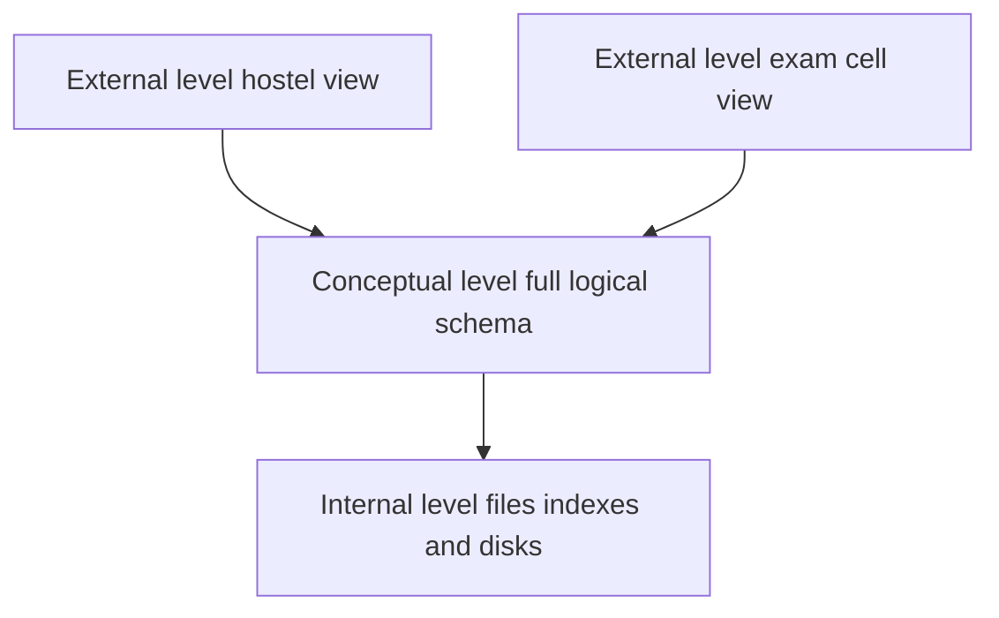

## The hook

Your college office keeps student records in spreadsheets. The admissions office has one, the hostel office another, the exam cell a third. A student changes her phone number. Admissions updates it; nobody tells the hostel. Two weeks later the hostel cannot reach her in an emergency.

Meanwhile two clerks open the fees sheet at the same time, both add a payment, both save. One payment vanishes. And when the office PC's disk dies, a term's worth of edits goes with it.

None of these are spreadsheet bugs. They are what happens whenever many people share data through plain files. Predict how many of the three problems a database fixes. (All of them, and that is exactly why every interview's fundamentals round starts here.)

## The intuition

:::analogy
A pile of books in a room is "storage". **A librarian** turns it into a library: one catalogue, no duplicate copies drifting apart, rules for who may borrow what, a sign-out sheet so two people do not grab the same book at once, and a backup register if a shelf collapses. Readers ask the librarian; they do not need to know which shelf holds what.
:::

A **[[DBMS]]** is that librarian for data. Programs ask it for data with a query language (usually SQL); it decides how to find, store, protect and recover it.

## Let's build it up

### What goes wrong with plain files

| Problem | What happens | What a DBMS provides |
|---|---|---|
| **[[Data redundancy]]** and inconsistency | The same fact in many files disagrees | Store once, share everywhere; constraints |
| Hard queries | Every new question needs a new program | A query language (SQL) and an optimiser |
| Integrity | Nothing stops "age = −5" | Constraints: types, keys, checks |
| Concurrent access | Two edits overwrite each other | Transactions and concurrency control |
| Failures | A crash mid-update leaves half-written data | Atomicity and crash recovery |
| Security | Anyone with the file sees everything | Users, roles and permissions per table or view |

### Schema and data

The **[[schema]]** describes the structure (a Students table with roll number, name, phone); the data is the actual rows. Schemas change rarely; data changes constantly.

### Three levels, and why they matter



The **[[three-schema architecture]]**:

- **External** level: what each user group sees, through views (the hostel sees name, room and phone, not marks).
- **Conceptual** level: the complete logical schema, all tables and relationships.
- **Internal** level: how data is physically stored: files, pages, indexes.

Wait, why bother with three levels? Because they give **[[data independence]]**:

- **Physical** data independence: change storage (add an index, move to SSDs) without changing the logical schema or programs.
- **Logical** data independence: change the logical schema (add a column, split a table) while external views, and the programs using them, keep working.

:::insight
A DBMS turns shared files into managed data: one consistent copy, a query language, enforced rules, safe concurrent updates and recovery after crashes. Separating what users see, what the data means, and how it is stored is what lets each layer change without breaking the others.
:::

:::warning
Common misconception: "a database is just a big file with tables in it." The tables are the easy part. The value is in what the DBMS guarantees around them: transactions, concurrency control, constraints, recovery, security and query optimisation. Those are exactly the topics interviewers ask about.
:::

## A tiny example

The college moves to one database. The hostel's view is defined over the shared Students table:

```pseudo
TABLE Students(roll_no PRIMARY KEY, name, phone, programme, marks)

VIEW HostelContacts AS
    SELECT roll_no, name, phone FROM Students
```

| Event | Before (files) | After (DBMS) |
|---|---|---|
| Phone number changes | Updated in admissions only | Updated once in Students; HostelContacts shows it immediately |
| Two clerks record fees | One payment overwritten | Each payment is a transaction; both are kept |
| Disk failure | Edits lost | Restore from backup and replay the log |
| Hostel sees marks? | Yes, it is in the file | No, the view hides them |

:::try-this
The exam cell adds a column `grace_marks` to Students. Which users need to change their programs: the hostel (using HostelContacts) or the exam cell? (Only the exam cell, which uses the new column. HostelContacts still selects the same three columns, so the hostel's programs keep working: that is logical data independence.)
:::

### Interview follow-ups

**"Why not just use files for a small app?"** For single-user, small, rarely changing data, files can be fine. Once several users or programs share data, need queries, integrity or crash safety, you end up reimplementing a weaker DBMS.

**"What are DDL and DML?"** Data definition language creates and changes schemas (CREATE, ALTER, DROP); data manipulation language reads and changes data (SELECT, INSERT, UPDATE, DELETE).

**"Name some DBMS responsibilities."** Storage management, query processing and optimisation, transaction management (concurrency and recovery), integrity enforcement, security and authorisation.

## Where you'll see this again

Every topic in this track builds on these guarantees: modelling data, keys, SQL, normalisation, transactions, concurrency control, indexing and recovery. The system design view of choosing a database is in [Filing Cabinet, Labelled Boxes or Giant Spreadsheet?](article:system-design-sql-vs-nosql).

## Key takeaways

- Sharing data through plain files causes redundancy and inconsistency, hard ad-hoc queries, missing integrity rules, lost concurrent updates, data loss on crashes and weak security.
- A DBMS stores data once and manages access to it, providing a query language, constraints, transactions, recovery and permissions.
- The three-schema architecture separates external views, the conceptual schema and internal storage.
- Physical data independence lets storage change without touching the logical schema; logical data independence lets the schema change without breaking views and the programs that use them.
