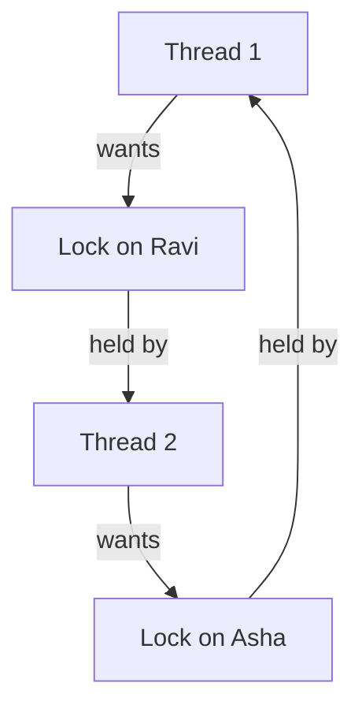

## The hook

Two customers of your bank app press "send" at the same instant. Asha transfers money to Ravi; Ravi transfers money to Asha. The code is simple: lock the sender's account, lock the receiver's account, move the money, unlock both.

Thread 1 locks Asha's account and reaches for Ravi's. Thread 2 has just locked Ravi's account and reaches for Asha's. Neither thread crashes. Neither thread errors. Both just wait, forever, and so does every later request that touches either account.

Your monitoring shows CPU usage near zero and a queue that keeps growing. What exactly went wrong, could the system have seen it coming, and how do you get out once you are in?

## The intuition

:::analogy
Four cars arrive at a **four-way intersection** at the same moment, one from each direction, and each driver has already **nosed into the middle**. Each car occupies one quarter of the box and needs the quarter in front of it to get through. The car from the north waits for the car from the west, which waits for the car from the south, which waits for the car from the east, which waits for the car from the north. Nobody reverses, nobody can pass through another car, and nobody moves.
:::

The intersection contains all four ingredients of a deadlock. Remove any one and traffic flows again.

| At the intersection | Coffman condition | In the bank app |
|---|---|---|
| A quarter of the box fits one car at a time | **Mutual exclusion**: a resource is held by one process at a time | An account lock admits one thread |
| Each car keeps its quarter while waiting for the next | **Hold and wait**: a process holds some resources while waiting for others | Thread 1 holds Asha's lock while waiting for Ravi's |
| Nobody can push a car out of its quarter | **No preemption**: a resource is released only voluntarily | No one can take a lock from the thread that holds it |
| North waits for west, west for south, south for east, east for north | **Circular wait**: a cycle of processes, each waiting for the next | Thread 1 waits for thread 2, which waits for thread 1 |

These are the [[Coffman conditions]], named after the 1971 paper by Coffman, Elphick and Shoshani that set them out. All four are **necessary**: if even one is missing, deadlock is impossible. That single fact organises the whole subject.

## How it works

### Drawing the jam: resource allocation graphs

A [[resource allocation graph]] has a circle for each process, a box for each resource type with a dot per instance, and two kinds of arrow:

- **Request edge**, process to resource: "I am waiting for this."
- **Assignment edge**, resource to process: "this instance is held by that process."

The bank transfer, drawn as a graph:



Follow the arrows and you come back to where you started. With **one instance per resource**, as with locks, a cycle in this graph means a deadlock, and a deadlock always shows up as a cycle.

Predict the next case before reading on. A printer pool has **two** printers. P1 holds one printer and waits for the scanner; P2 holds the scanner and waits for a printer; P3 holds the other printer and is not waiting for anything. Draw it: P1 to scanner to P2 to printers to P1 is a cycle. Is the system deadlocked?

No. P3 is not stuck. When it finishes and releases its printer, P2 takes it, finishes, releases the scanner, and P1 proceeds. With **several instances** of a resource, a cycle is necessary for deadlock but not sufficient.

| Graph has | Single-instance resources | Multi-instance resources |
|---|---|---|
| No cycle | No deadlock | No deadlock |
| A cycle | Deadlock | Deadlock possible, check further |

When every resource has one instance, you can drop the resource nodes and keep only "P waits for Q" edges. That [[wait-for graph]] is what databases and debuggers actually search, using the directed cycle detection from [When the Rumour Comes Back to You](article:dsa-cycle-detection).

### Four strategies, one per attitude

| Strategy | Idea | Cost |
|---|---|---|
| **Prevention** | Design the system so one Coffman condition can never hold | Usually lower utilisation or awkward rules |
| **Avoidance** | Check every request and refuse any that could lead to deadlock | Needs to know maximum demands in advance |
| **Detection and recovery** | Let deadlocks happen, find them, then break them | Running the detector, and the damage of recovery |
| **Ignore it** | Assume deadlocks are rare and let a human or a timeout deal with them | An occasional hang |

The last row is not a joke. General-purpose operating systems do not check every application lock request for deadlock; they leave that to the programs, which mostly use prevention by lock ordering. Databases, where deadlocks between transactions are routine, use detection.

### Prevention: break one of the four

Picture the intersection again and ask, for each condition, "what rule would make this impossible?"

**Break mutual exclusion.** Make the resource shareable. Read-only files can be shared by everyone, and a print spooler lets many processes "print" at once by queueing jobs to disk. But a lock exists precisely to be exclusive, so this rarely helps.

**Break hold and wait.** A process must request everything it needs at once, before starting, or must release everything it holds before asking for more. The bank transfer would lock both accounts in a single atomic step. The cost: resources sit idle while held "just in case", and a process that needs many popular resources may [[starvation|starve]] waiting for all of them to be free together.

**Break no preemption.** If a process cannot get what it asks for, it gives up what it already holds and retries later. In code this is `try_lock`: lock the first account, *try* the second, and on failure release the first and back off. It works for resources whose state can be saved and restored, like CPU registers and memory pages, and is useless for a half-printed page. Retrying in lockstep risks the livelock-style dance from [Three Ways a Busy Bakery Can Jam](article:cs-core-classic-sync-problems), so add a random delay.

**Break circular wait.** Number every resource and require that each process requests them in increasing order. A cycle would need someone to hold a higher number while waiting for a lower one, which the rule forbids. For the bank, lock the account with the smaller account number first. This is the fix used in real code, because it costs almost nothing at run time.

:::insight
Deadlock needs all four Coffman conditions at once, so prevention only has to break one. In practice that one is circular wait: pick a global order for your locks and never acquire them out of order.
:::

### Avoidance: a banker who never runs out of cash

Prevention restricts how programs are *written*. Avoidance lets programs ask for anything, in any order, but checks each request at run time. The idea comes from a banker with limited cash and several customers who each have a credit limit. The banker grants a loan only if, afterwards, there is still *some* order in which every customer could be paid up to their limit and repay. Edsger Dijkstra designed this [[Banker's algorithm]] in the 1960s.

The key definition is a [[safe state]]: there is at least one sequence of processes such that each one, in turn, can get all the resources it might still need from what is available plus what the earlier ones in the sequence will release.

The data, for n processes and m resource types:

| Name | Shape | Meaning |
|---|---|---|
| Available | m numbers | Free instances of each resource type right now |
| Max | n by m | The most each process may ever hold, declared up front |
| Allocation | n by m | What each process holds now |
| Need | n by m | Max minus Allocation: what each process may still ask for |

The safety check, in plain steps:

```pseudo
safety_check(Available, Allocation, Need):
    Work = copy of Available
    Finish[i] = false for every process i
    repeat:
        find a process i with Finish[i] == false and Need[i] <= Work   # every resource type
        if none found: stop
        Work = Work + Allocation[i]        # i can finish and give everything back
        Finish[i] = true
    return true if every Finish[i] is true, else false

on request(i, Request):
    if Request > Need[i]: error, the process exceeded its declared maximum
    if Request > Available: process i waits
    pretend: Available -= Request; Allocation[i] += Request; Need[i] -= Request
    if safety_check(...) is true: grant it
    else: undo the pretend step, and process i waits
```

Each pass scans up to n processes and compares m numbers, and there are at most n passes, so the check costs about $O(m \times n^2)$ per request.

### The Banker's algorithm, worked by hand

Five processes, three resource types. The system owns 7 instances of A, 4 of B and 6 of C.

| Process | Allocation A B C | Max A B C | Need = Max minus Allocation |
|---|---|---|---|
| P0 | 1 0 1 | 4 2 3 | 3 2 2 |
| P1 | 2 1 0 | 3 2 2 | 1 1 2 |
| P2 | 0 1 1 | 2 3 3 | 2 2 2 |
| P3 | 1 1 0 | 2 2 1 | 1 1 1 |
| P4 | 0 0 2 | 3 1 4 | 3 1 2 |
| Total allocated | 4 3 4 | | |

Available = total minus allocated = (7 − 4, 4 − 3, 6 − 4) = **(3, 1, 2)**.

Before scrolling, try it yourself: which process can finish first? Scan from P0 each time, and take the first process whose Need fits in Work.

| Step | Work before | Candidate that fits | Its Need | Why others fail | Work after = Work + its Allocation |
|---|---|---|---|---|---|
| 1 | 3 1 2 | P1 | 1 1 2 | P0 needs 2 of B, only 1 free | 5 2 2 |
| 2 | 5 2 2 | P0 | 3 2 2 | | 6 2 3 |
| 3 | 6 2 3 | P2 | 2 2 2 | | 6 3 4 |
| 4 | 6 3 4 | P3 | 1 1 1 | | 7 4 4 |
| 5 | 7 4 4 | P4 | 3 1 2 | | 7 4 6 |

Every process finishes, so the state is **safe**, with safe sequence ⟨P1, P0, P2, P3, P4⟩. A good self-check: Work ends at (7, 4, 6), the system total, because everything has been given back.

**Request 1: P1 asks for (1, 0, 1).** It is within P1's Need (1, 1, 2) and within Available (3, 1, 2). Pretend to grant it: Available becomes (2, 1, 1), P1's Allocation becomes (3, 1, 1) and its Need (0, 1, 1).

| Step | Work before | Fits | Need | Work after |
|---|---|---|---|---|
| 1 | 2 1 1 | P1 | 0 1 1 | 5 2 2 |
| 2 | 5 2 2 | P0 | 3 2 2 | 6 2 3 |
| 3 | 6 2 3 | P2 | 2 2 2 | 6 3 4 |
| 4 | 6 3 4 | P3 | 1 1 1 | 7 4 4 |
| 5 | 7 4 4 | P4 | 3 1 2 | 7 4 6 |

Safe, so the request is **granted**.

**Request 2, starting again from the original state: P2 asks for (0, 1, 1).** Again it is within P2's Need (2, 2, 2) and within Available. Predict: the resources are sitting right there, so surely the banker says yes?

Pretend to grant it: Available becomes **(3, 0, 1)** and P2's Need becomes (2, 1, 1). Now check every Need against Work = (3, 0, 1):

| Process | Need | Fits in 3 0 1 |
|---|---|---|
| P0 | 3 2 2 | No, needs B |
| P1 | 1 1 2 | No, needs B |
| P2 | 2 1 1 | No, needs B |
| P3 | 1 1 1 | No, needs B |
| P4 | 3 1 2 | No, needs B |

Nobody can be guaranteed to finish, so the state would be **unsafe**. The banker undoes the pretend step and **P2 waits**, even though the resources exist. The last free B is the problem: every process might still need one.

Wait, why refuse? Nobody is deadlocked yet. True: an unsafe state is not a deadlock.

The processes might never actually ask for their full maximum, and then everything would be fine. But in an unsafe state the system can no longer *guarantee* that, and the Banker's algorithm only promises safety by never stepping into one. In intersection terms, the banker is the traffic officer who will not wave a fourth car into the box unless he can see a way for every car to get out.

:::warning
Common misconception: "unsafe means deadlocked." Every deadlocked state is unsafe, but an unsafe state may never turn into a deadlock, because processes might release resources or never claim their full maximum. Safe guarantees no deadlock; unsafe only removes the guarantee.
:::

### Why the Banker's algorithm is rare in practice

It needs every process to declare its maximum need in advance, a fixed number of processes and resources, and a check on every single request. General-purpose systems have none of those. It is an exam and interview favourite because it captures the safe-state idea exactly, and the same idea appears in admission control, where a system accepts a new job only if it can still meet its commitments to the existing ones.

### Detection: let it happen, then look

Detection drops the "declare your maximum" requirement. The system grants requests freely and runs a check from time to time, or when a request has waited too long.

For single-instance resources, build the wait-for graph and look for a cycle. For multiple instances, run the safety check with one change: use each process's **current Request** instead of its Need, and treat a process holding nothing as already finished. Any process left unfinished at the end is deadlocked.

A tiny case. Resources A (3 instances) and B (2). Everything is allocated, so Available = (0, 0).

| Process | Allocation A B | Current request A B |
|---|---|---|
| P0 | 1 0 | 0 1 |
| P1 | 1 1 | 1 0 |
| P2 | 1 1 | 0 0 |

P2 requests nothing, so it can finish: Work = (1, 1). Now P0's request (0, 1) fits: Work = (2, 1). Then P1's (1, 0) fits: Work = (3, 2). No deadlock. Change P2's request to (1, 0) and nobody fits at the start, so P0, P1 and P2 are all reported deadlocked.

How often to run it is a trade-off. Every request catches a deadlock at once but costs the most. Every few minutes, or when CPU use drops suspiciously low, is cheaper but lets a deadlock sit longer and makes it harder to tell which request closed the cycle.

### Recovery: someone has to reverse out of the box

Once a deadlock is found, the cycle must be broken.

- **Terminate processes.** Kill all of them, which is simple and wasteful, or kill one at a time and re-run detection until the cycle is gone.
- **Preempt resources.** Take a resource from a victim and roll the victim back to a safe point, which only works if its state can be saved and restored.
- **Choosing the victim.** Prefer the one with the least work done, the fewest resources held, or the cheapest to restart. Count how many times each process has been chosen, or the same one may be sacrificed forever: starvation again.

Databases do exactly this. When two transactions each hold a row lock the other wants, systems such as PostgreSQL and MySQL's InnoDB detect the cycle, abort one transaction with a deadlock error and let the other proceed. The application is expected to retry the aborted one.

:::try-this
Three threads and three single-instance locks. T1 holds L1 and wants L2. T2 holds L2 and wants L3. T3 holds L3 and wants nothing else. Is there a deadlock, and what happens if T3 now asks for L1? (No deadlock at first: T3 can finish and release L3, then T2 and T1 follow. If T3 asks for L1, the wait-for graph becomes T1 to T2 to T3 to T1, a cycle with single-instance locks, so all three are deadlocked.)
:::

## Trade-offs

| Approach | Run-time cost | Utilisation | Needs advance knowledge | Typical home |
|---|---|---|---|---|
| Lock ordering | Almost none | High | A global numbering of locks | Application and kernel code |
| Request everything up front | Low | Low, resources idle while held | Full list of needs | Simple batch jobs |
| `try_lock` and back off | Retries | Medium | No | Code that cannot impose an order |
| Banker's algorithm | A safety check per request | Medium | Maximum claims, fixed process set | Textbooks, admission control |
| Detection and recovery | Periodic graph search plus lost work | High | No | Databases |
| Timeouts | A timer per wait | High | No | Distributed systems, where detection is hard |
| Ignore | None | High | No | General-purpose OS for application locks |

## What can go wrong

- **Opposite lock order in two code paths.** The bank-transfer bug. It is invisible in testing because both threads must interleave at exactly the wrong moment.
- **Locking the same non-recursive mutex twice.** A single thread can deadlock with itself, waiting for a lock it already holds.
- **Calling unknown code while holding a lock.** A callback or virtual method may take another lock in the wrong order. Release your lock before calling out.
- **Ordering by something unstable.** Ordering locks by memory address works only if the objects never move; ordering by account number is safer.
- **Timeouts that hide the bug.** A timeout turns a permanent hang into intermittent failures, which can be harder to diagnose.
- **Recovery that starves one victim.** Always picking the cheapest transaction can mean the same one is aborted every time.
- **Confusing deadlock with starvation or livelock.** Deadlock: everyone in the set is blocked. Starvation: the system progresses, one process does not. Livelock: everyone is busy but no one progresses.

### Interview follow-ups

**"State the four necessary conditions for deadlock."** Mutual exclusion, hold and wait, no preemption and circular wait. All four must hold at the same time, so preventing any one prevents deadlock.

**"How would you fix a deadlock between two threads transferring money in opposite directions?"** Impose a global order: always lock the account with the smaller id first, whichever direction the money moves. That breaks circular wait at no run-time cost. `try_lock` with back-off also works but can waste work.

**"Is an unsafe state a deadlock?"** No. Unsafe means the system cannot guarantee every process will finish if they all claim their maximum. Deadlock is one possible outcome, not a certainty.

**"Given Allocation, Max and Available, is the system safe, and can this request be granted?"** Compute Need = Max − Allocation. Repeatedly find an unfinished process whose Need fits in Work, add its Allocation to Work and mark it done. If everyone finishes, the state is safe. For a request, check it against Need and Available, pretend to grant it, and run the same check.

**"Does a cycle in a resource allocation graph always mean deadlock?"** Only if every resource in the cycle has a single instance. With multiple instances, a process outside the cycle may release an instance and break it.

## In the real world

- **Application code** prevents deadlocks by lock ordering and by keeping critical sections short. C++17's `std::scoped_lock` locks several mutexes at once with a built-in avoidance algorithm.
- **Debuggers and runtimes** help you find them. A Java thread dump, for example, reports Java-level deadlocks it finds among threads blocked on monitors.
- **Databases** detect deadlocks with a wait-for graph and abort a victim transaction, and some systems avoid many lock waits altogether with versioning, as in [Readers Never Wait for Writers](article:famous-algos-mvcc).
- **Kernels** use strict lock-ordering rules, and Linux includes a lock validator, lockdep, that records the order in which locks are taken and warns when it sees two orders that could form a cycle.
- **Distributed systems** usually fall back to timeouts and retries, because building a global wait-for graph across machines is slow and itself unreliable.

Every deadlock so far was about locks and devices. The resource that every process fights over most is memory, and handing it out turns out to have its own failure: plenty of free space, and still no room. That is [Parking Odd-Sized Cars Along One Kerb](article:cs-core-memory-basics).

## Further reading

- *Operating System Concepts* by Silberschatz, Galvin and Gagne, the deadlocks chapter, including the Banker's algorithm.
- *Operating Systems: Three Easy Pieces*, the chapter on common concurrency problems.
- E. G. Coffman, M. J. Elphick and A. Shoshani, "System Deadlocks", ACM Computing Surveys, 1971.
- The PostgreSQL documentation on explicit locking, which describes how deadlocks between transactions are detected and resolved.

## Key takeaways

- A deadlock requires all four Coffman conditions at once, mutual exclusion, hold and wait, no preemption and circular wait, so breaking any one of them prevents it.
- With single-instance resources, a cycle in the resource allocation graph means deadlock, but with multiple instances a cycle is only a warning sign.
- Lock ordering is the practical prevention technique, because a global order on lock acquisition makes circular wait impossible at almost no cost.
- The Banker's algorithm grants a request only if the resulting state is safe, meaning some order exists in which every process can obtain its remaining need, finish and release.
- Detection lets deadlocks happen, finds them with a wait-for graph or a Request-based safety check, and recovers by aborting or rolling back a victim, which is how databases handle them.
