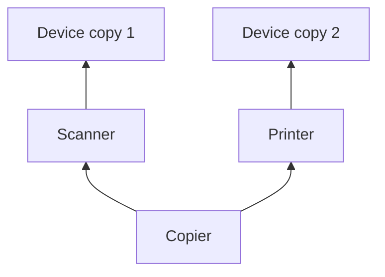

## The hook

An office machine is both a scanner and a printer. In code, that looks natural: `class Copier : public Scanner, public Printer`. Both Scanner and Printer are kinds of Device, each with a device id. Now ask the copier for its id. The compiler refuses: which id?

The inheritance diagram has the shape of a diamond, and this is the most famous trap of multiple inheritance, asked in nearly every C++ OOP interview. Predict how many times Device's constructor runs when you create one Copier. (Twice, unless you use virtual inheritance.)

## The intuition

:::analogy
**Two parents inherit from the same grandparent**, and each was handed a copy of the family's address book. Their child inherits from both parents and ends up with two address books. Ask the child "what is the family's phone number?" and the honest answer is "which book?", especially if the parents updated their copies differently. The fix is for the family to agree to keep one shared book.
:::

## How it works

### The diamond, without the fix



With ordinary **[[multiple inheritance]]**, each path creates its own Device **[[subobject]]**. A Copier holds two ids; `copier.id` is ambiguous and does not compile, and converting a Copier* to a Device* is ambiguous too. You can still reach each copy explicitly, `copier.Scanner::id`, and they can drift apart: that is the **[[diamond problem]]**.

### The fix: virtual inheritance

Before you read the program, predict the two lines it prints for the plain version. Declaring the shared base as virtual on the middle classes makes every path share one Device:

```cpp
#include <iostream>
using namespace std;

namespace plain {
struct Device { int id = 0; Device() { cout << "Device\n"; } };
struct Scanner : Device { };
struct Printer : Device { };
struct Copier : Scanner, Printer { };     // two Device subobjects
}

namespace fixed {
struct Device { int id = 0; Device(int i = 0) : id(i) { cout << "Device(" << id << ")\n"; } };
struct Scanner : virtual Device { Scanner() : Device(1) {} };
struct Printer : virtual Device { Printer() : Device(2) {} };
struct Copier : Scanner, Printer { Copier() : Device(7) {} };   // most-derived class builds the shared base
}

int main() {
    plain::Copier a;                          // prints Device twice
    // a.id = 5;                              // error: request for member 'id' is ambiguous
    a.Scanner::id = 5;                        // must say which copy
    cout << a.Scanner::id << " " << a.Printer::id << " " << sizeof(a) << "\n";   // 5 0 8
    fixed::Copier b;                          // prints Device(7) once
    b.id = 9;                                 // one shared Device: no ambiguity
    cout << b.id << " " << b.Scanner::id << " " << b.Printer::id << "\n";        // 9 9 9
}
```

| Version | Device constructed | `id` access | Copies of id |
|---|---|---|---|
| plain | twice | ambiguous; Scanner's copy set to 5, Printer's still 0 | 2 (sizeof was 8: two ints) |
| **[[virtual inheritance]]** | once, as Device(7) | unambiguous | 1: all three views print 9 |

### Who builds the shared base?

Wait, Scanner asks for Device(1) and Printer asks for Device(2). Which wins? Neither: with virtual inheritance, the **most-derived** class (the one actually being created, Copier) constructs the virtual base directly, before any other base, and the intermediate classes' requests are ignored. The program printed Device(7). If Copier did not mention Device, its default constructor would be used.

The cost: virtual bases are reached through an extra indirection (an offset stored via the vptr in common implementations), objects get somewhat larger, and constructor rules become less obvious.

:::insight
Inheriting the same base along two paths gives the most-derived object two copies of that base, which makes its members ambiguous and lets the copies disagree. Virtual inheritance on the middle classes makes all paths share one base subobject, which the most-derived class constructs itself.
:::

## Trade-offs

| Choice | Gain | Cost |
|---|---|---|
| Plain multiple inheritance | Simple layout | Duplicate bases and ambiguity in diamonds |
| Virtual inheritance | One shared base | Extra indirection, larger objects, unusual constructor rules |
| Interfaces without state | Diamonds are harmless: nothing to duplicate | Shared code must live elsewhere |
| Composition | No diamond at all | Forwarding methods to the parts |

:::warning
Common misconception: "virtual inheritance is related to virtual functions." They share a keyword, not a meaning. Virtual functions choose which function runs at run time; virtual inheritance decides how many copies of a base class an object contains. A class can use either without the other.
:::

:::try-this
In the plain version, after `a.Scanner::id = 5;`, what does `static_cast<Printer&>(a).id` print, and why? (0. Converting to Printer& selects the Printer path, whose Device copy was never changed. The two copies have silently diverged.)
:::

## What can go wrong

- **Accidental duplicate bases** when two libraries' classes share a common root.
- **Forgetting virtual on one of the middle classes**, which still leaves two copies.
- **Expecting an intermediate class's base initialiser to run** under virtual inheritance.
- **Deep hierarchies** combining diamonds, which become hard to reason about.

### Interview follow-ups

**"How do Java and C# avoid the diamond problem?"** Classes may inherit from only one class but implement many interfaces; interfaces historically had no state, so nothing is duplicated (default methods add rules for conflicts).

**"Where does the standard library use virtual inheritance?"** The iostream hierarchy: basic_iostream derives from basic_istream and basic_ostream, which both derive virtually from basic_ios, so a stream has one shared state.

**"When is multiple inheritance a good idea?"** For combining stateless interfaces or small mix-ins; avoid it for classes with significant shared state.

## In the real world

Most modern C++ designs avoid diamonds with state, using multiple inheritance mainly for interfaces. Ordinary single and multilevel inheritance, and constructor order, are covered in [Children Inheriting Family Traits](article:cs-core-inheritance).

## Further reading

- Bjarne Stroustrup, *The C++ Programming Language*, section on virtual base classes.
- Scott Meyers, *Effective C++*, item 40, "Use multiple inheritance judiciously".

## Key takeaways

- When two base classes share a common base, ordinary multiple inheritance gives the derived object two copies of that base.
- Two copies make member access ambiguous, which the compiler rejects, and they can hold different values if accessed through different paths.
- Declaring the shared base virtual in the middle classes makes every path share a single base subobject.
- With virtual inheritance, the most-derived class constructs the shared base, and the middle classes' initialisers for it are ignored.
- Virtual inheritance is unrelated to virtual functions, and stateless interfaces or composition avoid the problem altogether.
