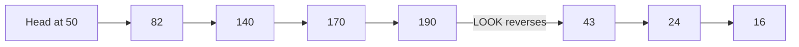

## The hook

A hard disk can transfer a block in a tiny fraction of a millisecond once its head is in place. Getting the head there, a mechanical arm swinging across the platter, takes several milliseconds. When a hundred requests are waiting, the order in which you serve them can decide whether the disk spends its time reading or mostly travelling.

Operating system exams love this topic because it is pure arithmetic: given a head position and a queue, compute the total head movement for each algorithm. Predict which ordering travels least, serving requests in arrival order or always going to the nearest. (Nearest usually wins on distance, and then loses on fairness.)

## The intuition

:::analogy
**A lift picks up passengers floor by floor.** If it served calls strictly in the order they were pressed, it would shoot from floor 2 to 17 and back to 3. A sensible lift keeps moving in one direction, stopping at every requested floor on the way, and only then turns around. That is exactly the SCAN algorithm, which is why it is called the elevator algorithm.
:::

Access time = **[[seek time]]** (move the arm) + **[[rotational latency]]** (wait for the sector) + transfer time. Schedulers reduce seek time, measured in exams as total cylinders travelled.

## How it works

One example for every algorithm: cylinders 0 to 199, head at **50** moving towards higher numbers, queue **82, 170, 43, 140, 24, 16, 190** (in arrival order). Every total below was computed by a short program.

| Algorithm | Order served | Total movement |
|---|---|---|
| FCFS | 50 → 82 → 170 → 43 → 140 → 24 → 16 → 190 | 642 |
| **[[SSTF]]** | 50 → 43 → 24 → 16 → 82 → 140 → 170 → 190 | 208 |
| **[[SCAN]]** | 50 → 82 → 140 → 170 → 190 → 199 → 43 → 24 → 16 | 332 |
| LOOK | 50 → 82 → 140 → 170 → 190 → 43 → 24 → 16 | 314 |
| **[[C-SCAN]]** | 50 → 82 → 140 → 170 → 190 → 199 → 0 → 16 → 24 → 43 | 391 (192 if the return sweep is not counted) |
| C-LOOK | 50 → 82 → 140 → 170 → 190 → 16 → 24 → 43 | 341 (167 if the jump is not counted) |

**FCFS** is fair and simple but zigzags across the disk.

**SSTF** picks the nearest request each time. From 50, 43 is 7 away and 82 is 32 away, so it goes down first. Wait, why is SSTF not simply the best, with the lowest total here? Because it is greedy: under a steady stream of requests near the head, a request at cylinder 190 may wait forever. That is **[[starvation]]**.

**SCAN** sweeps up to the end of the disk (199), then reverses. **LOOK** reverses at the last request (190) instead, saving the 18-cylinder trip to the edge.

**C-SCAN** serves only on the upward sweep, then jumps back to cylinder 0 and sweeps up again. **C-LOOK** jumps from the highest request straight to the lowest. Textbooks differ on whether to count the return jump, so always state your convention.

Why do the circular variants exist if they travel further? Fairness. With SCAN, a request just behind the head waits for a full sweep out and back, while one just ahead is served at once; cylinders in the middle get visited twice as often as those at the edges. C-SCAN treats the disk as a circle, so waiting times are more uniform.

:::insight
Disk scheduling trades total movement against fairness. FCFS is fair but wasteful, SSTF minimises movement greedily but can starve distant requests, and the elevator family (SCAN, LOOK and their circular versions) sweeps in order, giving good throughput with bounded waiting.
:::

## Trade-offs

| Algorithm | Throughput | Fairness | Starvation |
|---|---|---|---|
| FCFS | poor | high | none |
| SSTF | high | low | possible |
| SCAN / LOOK | good | medium (middle favoured) | none |
| C-SCAN / C-LOOK | good | high (uniform waits) | none |

:::warning
Common misconception: "disk scheduling still matters the same way on SSDs." SSDs have no moving head, so seek distance means nothing. Linux uses simple schedulers (such as none or mq-deadline) for fast SSDs, and the concern shifts to merging requests, fairness between processes, and limiting latency.
:::

:::try-this
Same queue and head at 50, but the head is moving towards lower numbers. What is the LOOK order and total? (Down first: 50 → 43 → 24 → 16, then reverse up: 82 → 140 → 170 → 190. Movement is 34 down plus 174 up, 208 in total.)
:::

## What can go wrong

- **Ignoring the initial direction** in SCAN and LOOK questions, which changes the answer.
- **Inconsistent counting** of the C-SCAN return trip.
- **Using SSTF in a busy system** and starving distant requests.
- **Tuning seek order on SSDs**, where it brings no benefit.

### Interview follow-ups

**"Which scheduler does Linux use?"** Modern Linux uses the multi-queue block layer with schedulers such as mq-deadline, BFQ and Kyber, or none for fast NVMe devices.

**"How does a deadline scheduler prevent starvation?"** It sorts requests for efficiency but also gives each one an expiry time, serving expired requests first.

**"Why does seek time dominate?"** It is mechanical movement measured in milliseconds, while transfers after positioning are far shorter.

## In the real world

The disk scheduler sits below the file system described in [A Library Catalogue Pointing to the Shelves](article:cs-core-file-systems), and the same ideas of greedy choice versus fairness appear in CPU scheduling, in [Who Sees the Doctor Next?](article:cs-core-cpu-scheduling).

## Further reading

- Remzi and Andrea Arpaci-Dusseau, *Operating Systems: Three Easy Pieces*, chapter "Hard Disk Drives" (free online).
- Silberschatz, Galvin and Gagne, *Operating System Concepts*, chapter on mass-storage structure.

## Key takeaways

- Disk access time is dominated by mechanical seek time, so the order of requests determines how much time is spent moving the head.
- FCFS is fair but zigzags, while SSTF chooses the nearest request and minimises movement greedily at the risk of starving distant requests.
- SCAN sweeps to the end of the disk and reverses, and LOOK reverses at the last pending request, saving the trip to the edge.
- C-SCAN and C-LOOK serve in one direction and jump back, giving more uniform waiting times at the cost of extra travel.
- On SSDs there is no seek, so schedulers focus on merging, fairness and latency instead of head movement.
