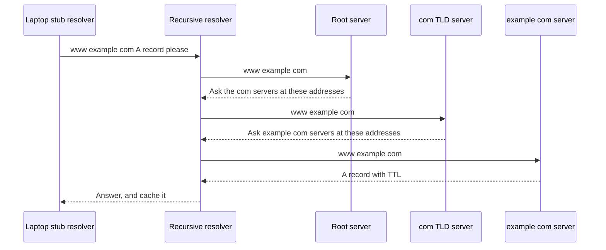

## The hook

Computers route packets to numbers like 203.0.113.10 or 2001:db8::10 (the addresses in this article come from ranges reserved for documentation). People type names like example.com. Somewhere between your keyboard and the first packet, a name has to become a number, and it usually happens in a few milliseconds, without any single computer knowing every name on the internet.

That system is DNS, and two questions about it come up again and again: "what happens when you type a URL?" and "why did my DNS change take an hour to show up?". Both are answered by the same two ideas, a hierarchy and caching. Predict how many servers might be asked to resolve a name nobody nearby has looked up recently. (Up to four kinds: your resolver, a root server, a top-level-domain server and the site's own server.)

## The intuition

:::analogy
DNS is **a phone book with local copies everywhere**. No single book lists everyone; instead, a national directory says which city book to check, the city book says which building's directory to check, and the building's directory has the actual number. Your college reception keeps copies of numbers it was recently asked for, so most questions never leave the building. Each copy has an expiry date, so stale numbers eventually get refreshed.
:::

## How it works

### The name hierarchy

Names are read right to left: `www.example.com.` sits under `example`, under `com`, under the unnamed root (the final dot). Each level delegates to the next:

| Level | Who answers | Knows |
|---|---|---|
| Root | 13 named root server identities, each served by many machines worldwide | where the .com, .in, .org servers are |
| Top-level domain (TLD) | .com servers | where example.com's servers are |
| **[[Authoritative server|Authoritative]]** for the **[[zone]]** | example.com's name servers | the actual records for www.example.com |

### Resolution, step by step

Your device asks the **[[resolver]]** a **[[recursive query]]**: "give me the final answer". The resolver then asks root, TLD and authoritative servers **[[iterative query|iterative queries]]**: each replies with the answer or a referral ("ask these servers instead"), and the resolver follows the referrals.

Wait, if every lookup starts at the root, why don't root servers collapse under the load? Because almost no lookup starts there. The resolver caches the .com referral for a long time (often days), and popular names stay cached too. A cold lookup takes several round trips; a warm one is answered from the resolver's memory, or even from your browser's or operating system's own cache before any packet leaves your machine.

### Records

| Type | Maps | Example use |
|---|---|---|
| A | name → IPv4 address | www → 203.0.113.10 |
| AAAA | name → IPv6 address | www → 2001:db8::10 |
| CNAME | name → another name (alias) | shop.example.com → stores.cdn-provider.net |
| MX | domain → mail server (with priority) | where to deliver @example.com mail |
| NS | zone → its authoritative servers | delegation from .com to example.com |
| TXT | name → text | domain ownership checks, email anti-spoofing (SPF) |
| PTR | IP → name (reverse DNS) | logging, mail server checks |
| SOA | zone metadata | serial number, default timers |

### Caching and TTL

This is the part that explains the second hook question, the change that took an hour to show up. Every record carries a **[[TTL]]** in seconds. Caches at the browser, operating system and resolver keep it until the TTL expires. Long TTLs mean fewer lookups and faster responses; short TTLs mean changes spread quickly. Failed lookups ("no such name") are cached too, for a time set in the zone's SOA record (negative caching).

### UDP, and when TCP

A typical query and answer each fit in one small UDP datagram on port 53: one round trip, no handshake, no per-client state on the server. If an answer is too large for the UDP message size in use, the server marks it truncated and the client retries over TCP, and zone transfers between servers use TCP. Newer options carry DNS inside encrypted channels: DNS over TLS and DNS over HTTPS.

:::insight
DNS scales because it is split and cached. The hierarchy delegates each zone to its own authoritative servers, resolvers walk the hierarchy with iterative queries on your behalf, and every level caches answers for their TTL. Most lookups are answered from a nearby cache in one UDP round trip; the cost is that changes spread only as caches expire.
:::

## Trade-offs

| Choice | Gain | Cost |
|---|---|---|
| Long TTL | Fewer lookups, resilience if authoritative servers are down | Slow changes and failovers |
| Short TTL | Fast changes, DNS-based failover | More queries, more latency on cache misses |
| UDP transport | One round trip, stateless servers | Spoofing risk, size limits, no encryption |
| Encrypted DNS (DoT, DoH) | Privacy from on-path observers | Shifts trust to the resolver operator |

:::warning
Common misconception: "my browser asks the root servers for every new website." Your device asks one recursive resolver, and that resolver asks the root only when it has no cached referral for the top-level domain, which is rare. Root servers see a tiny fraction of the world's lookups.
:::

:::try-this
www.shop.example.com is a CNAME to shop.cdn-provider.net, which has an A record. Your resolver has nothing cached. Which authoritative zones does it consult? (example.com's servers return the CNAME; the resolver then resolves shop.cdn-provider.net through the .net servers and cdn-provider.net's servers, and returns both the CNAME and the final A record. Root and TLD referrals are needed for both names if they are not cached.)
:::

## What can go wrong

- **Cache poisoning**: forged responses inserted into a resolver's cache; random source ports, query IDs and DNSSEC defend against it.
- **Slow propagation** when a high TTL hides a change; lower the TTL well before migrations.
- **A CNAME at the zone apex** (example.com itself), which the standard forbids; providers offer ALIAS-style records instead.
- **Single-provider outages**: if the authoritative DNS provider fails, the whole site disappears; some companies use two providers.
- **Amplification attacks** using open resolvers to flood a victim with large UDP answers.

### Interview follow-ups

**"What is DNSSEC?"** Signatures on DNS records, chained from the root, so resolvers can verify answers are authentic. It provides integrity, not privacy.

**"How do CDNs use DNS?"** The authoritative server returns different addresses depending on where the resolver is, steering users to a nearby edge, as in [Local Warehouses for the Whole Internet](article:system-design-cdn).

**"Where does DNS fit in loading a page?"** It is the first network step, before TCP and TLS; the system-design deep dive is [The Phone Book That Holds the Internet Together](article:system-design-dns-deep-dive).

## In the real world

`dig example.com` and `nslookup` show answers and TTLs, and `dig +trace` walks the hierarchy from the root, just like the diagram above. DNS rides on UDP, introduced in [Postcards Versus Registered Letters](article:cs-core-udp).

## Further reading

- RFC 1034 and RFC 1035 (1987), the original DNS concepts and specification.
- Cricket Liu and Paul Albitz, *DNS and BIND*.

## Key takeaways

- DNS translates names to addresses through a hierarchy of root, top-level-domain and authoritative servers, each delegating the next level.
- Your device sends a recursive query to a resolver, which walks the hierarchy using iterative queries that return answers or referrals.
- A and AAAA map names to IPv4 and IPv6 addresses, CNAME aliases names, MX names mail servers, NS delegates zones and PTR does reverse lookups.
- Browsers, operating systems and resolvers cache records for their TTL, which makes lookups fast and means changes spread only as caches expire.
- Queries normally use UDP on port 53 in one round trip, falling back to TCP for large or truncated answers and zone transfers.
