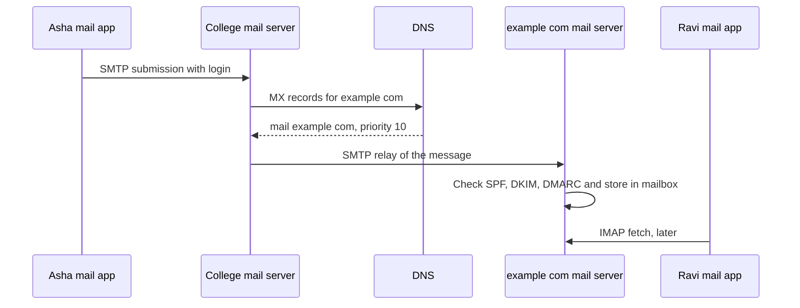

## The hook

You send an email from your college account to a friend at a company. Your laptop is not talking to your friend's laptop: your friend's machine may be switched off, and they may read the message tomorrow on a phone. So where does the message wait, who carries it there, and how does the company's server know it really came from your college and not an impostor?

Email is one of the oldest internet applications and still a neat lesson in protocol design: different protocols for sending and reading, DNS to find the way, and security added decades later. Predict how many different protocols touch one message from your outbox to your friend's screen. (At least three: SMTP, DNS and IMAP.)

## The intuition

:::analogy
Email works like **postal sorting offices**. You drop a letter at your local post office (your mail server), which looks up the destination town's office (DNS MX records) and sends the letter there. That office keeps it in your friend's post box (the mailbox), and your friend collects it whenever they like (IMAP or POP3). If the destination office is closed, yours keeps the letter and tries again later.
:::

## How it works

### Sending: SMTP

**[[SMTP]]** pushes mail. Your app submits the message to your own server (on port 587 with login, encrypted with STARTTLS, or 465 with TLS from the start). Your server then relays it to the recipient's server, traditionally on port 25. An SMTP conversation is plain text commands: HELO or EHLO, MAIL FROM, RCPT TO, DATA, then the message, then QUIT.

### Finding the destination: MX records

The sending server asks DNS for the **[[MX record]]** of the recipient's domain. Each record has a priority; the lowest number is tried first, and others are backups. This is why a company's email can be handled by a provider entirely separate from its website.

### Store and forward

**[[Store and forward]]** means every hop keeps the message until the next hop accepts it. If the receiving server is down, the sender queues the message and retries for hours or days before giving up with a bounce. Wait, is that why email can arrive late but rarely vanishes? Yes: each server holds responsibility for the message until another one takes it.

### Reading: IMAP and POP3

| | **[[IMAP]]** | **[[POP3]]** |
|---|---|---|
| Where mail lives | on the server | downloaded to the device |
| Multiple devices | in sync (folders, read status) | each device sees a different picture |
| Offline | caches copies | everything local |
| Typical today | almost all clients | legacy setups |

Webmail and phone apps often use the provider's own HTTP APIs instead, but the idea is the same: the mailbox lives on the server.

### Fighting spoofing: SPF, DKIM and DMARC

SMTP originally trusted whatever "From" address the sender wrote. Three DNS-published mechanisms let receivers check:

| Check | Question it answers |
|---|---|
| SPF | Is the sending server's IP address on the domain's published list of allowed senders? |
| DKIM | Is the message signed with a key whose public half is published in the domain's DNS, and is the signature intact? |
| DMARC | Does the visible From domain align with SPF or DKIM, and what should be done (none, quarantine, reject) if not? |

:::insight
Email separates pushing from pulling: SMTP pushes a message from server to server, located through DNS MX records and held by each server until the next accepts it, while IMAP or POP3 lets the recipient pull it later. Spoofing protection was added afterwards through SPF, DKIM and DMARC records published in DNS.
:::

## Trade-offs

| Design | Gain | Cost |
|---|---|---|
| Store and forward | Works even when receivers are offline; resilient | Delivery can be delayed |
| Open relaying between any servers | Anyone can email anyone | Spam and spoofing, needing later fixes |
| IMAP | Multi-device sync | Mail lives on, and depends on, the server |
| Strict DMARC (reject) | Blocks impersonation | Misconfigured legitimate senders get rejected |

:::warning
Common misconception: "SMTP is used to read email." SMTP only sends and relays. Reading uses IMAP, POP3 or a provider's own API. In interviews, "sending versus retrieving" is exactly the distinction being tested.
:::

:::try-this
example.com publishes two MX records: mail1 with priority 10 and mail2 with priority 20. mail1 is down. What does a sending server do? (It tries mail1 first, since the lower number wins, fails to connect, then delivers to mail2. If both are down, it queues the message and retries later.)
:::

## What can go wrong

- **Open relays** that forward anyone's mail and get blacklisted for spam.
- **Missing SPF, DKIM or DMARC**, so a domain's mail lands in spam or the domain is easy to impersonate.
- **Phishing** with look-alike domains, which these checks do not catch.
- **Bounces and queues** filling up when a destination is down for long.

### Interview follow-ups

**"Which transport does SMTP use?"** TCP, since every byte of the message matters, as in [A Phone Call Where Both Sides Confirm They Can Hear](article:cs-core-tcp-deep-dive).

**"How is an email attachment sent if SMTP is text?"** MIME encodes binary attachments as text (base64) inside a multipart message.

**"Where does DNS appear in email?"** MX records for routing, and TXT records for SPF, DKIM keys and DMARC policy, as in [A Phone Book With Local Copies Everywhere](article:cs-core-dns-cs).

## In the real world

Large providers run the sending and receiving servers for most organisations, and they enforce SPF, DKIM and DMARC strictly. The "show original" or "view headers" option in a mail client shows every server hop and the results of these checks.

## Further reading

- RFC 5321, "Simple Mail Transfer Protocol", and RFC 9051, "IMAP Version 4rev2".
- RFC 7208 (SPF), RFC 6376 (DKIM) and RFC 7489 (DMARC).

## Key takeaways

- SMTP pushes mail from a client to its server and from server to server, while IMAP and POP3 let recipients retrieve mail later.
- The sending server finds the recipient's server through the domain's DNS MX records, trying the lowest priority number first.
- Store and forward lets each server hold a message and retry until the next server accepts it, so sender and recipient never need to be online together.
- IMAP keeps mail on the server and synchronises devices, while POP3 downloads mail to a single device.
- SPF, DKIM and DMARC, published in DNS, let receivers check that mail claiming to come from a domain was really sent by it.
