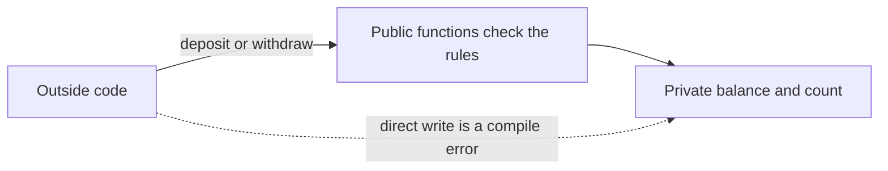

## The hook

A bug report: a customer's wallet balance is −₹4,000. The withdraw function checks for sufficient funds, so how? A search finds the culprit in a refund script written by another team: `wallet.balance -= amount;`, writing straight into the field and skipping every check.

When any code anywhere can write an object's data, every rule about that data is only a hope. Encapsulation turns the hope into a guarantee the compiler enforces. Predict how many places in a large codebase can break the "balance is never negative" rule once balance is private. (Only the class's own member functions.)

## The intuition

:::analogy
Medicine comes in **a capsule that protects what is inside**. You cannot reach in and adjust the dose; you swallow the capsule, and it releases its contents in the controlled way it was designed to. A class's private data is the medicine; its public functions are the only way in, and they keep the dose right.
:::

## How it works

### Access specifiers

| **[[Access specifier]]** | Who can name the member |
|---|---|
| public | anyone |
| protected | the class, its friends, and classes derived from it |
| private | the class itself and its friends only |

The rules are checked at compile time. Trying `w.balance = 5;` from outside the class failed to compile with g++: "'long long int Wallet::balance' is private within this context".

### Encapsulation protects an invariant



Before reading the code, predict what the program prints for `withdraw(500)` on a wallet holding 300. (0, meaning false: the request is refused and nothing changes.)

```cpp
#include <iostream>
#include <stdexcept>
using namespace std;

// Invariant: 0 <= balance, and every change is recorded in the count.
class Wallet {
    long long balance = 0;
    int transactions = 0;
public:
    bool withdraw(long long amount) {
        if (amount <= 0 || amount > balance) return false;   // refuse, invariant kept
        balance -= amount;
        ++transactions;
        return true;
    }
    void deposit(long long amount) {
        if (amount <= 0) throw invalid_argument("deposit must be positive");
        balance += amount;
        ++transactions;
    }
    long long getBalance() const { return balance; }      // read-only view
    int getTransactions() const { return transactions; }
};

int main() {
    Wallet w;
    w.deposit(300);
    cout << w.withdraw(500) << " " << w.withdraw(120) << "\n";       // 0 1
    cout << w.getBalance() << " " << w.getTransactions() << "\n";   // 180 2
    try { w.deposit(-50); } catch (const invalid_argument& e) { cout << "rejected: " << e.what() << "\n"; }
    cout << w.getBalance() << " " << w.getTransactions() << "\n";   // 180 2
}
```

The **[[invariant]]** is "balance ≥ 0, and the count matches the changes". Because balance is private, only deposit and withdraw can change it, and both check before acting. Proving the invariant now means reading two functions, not the whole codebase. That is **[[encapsulation]]**.

### protected, for derived classes

```cpp
#include <iostream>
using namespace std;
class Account {
public:    int id = 1;
protected: int balance = 100;
private:   int pin = 1234;
};
class Savings : public Account {
public:
    int interest() const { return balance / 10; }   // protected: visible to derived classes
    // int leak() const { return pin; }             // error: private to Account
};
int main() {
    Savings s;
    cout << s.id << " " << s.interest() << "\n";   // 1 10
    // cout << s.balance;                          // error: protected outside the hierarchy
}
```

Wait, if protected members are visible to every derived class you or anyone else writes, is protected data really hidden? Only partly: anyone can derive a class and touch it. Many style guides therefore keep data private even in base classes and give derived classes protected *functions* instead.

### Getters and setters: helpful or a leak?

A **[[getter and setter|getter or setter]]** is only as good as the rule it enforces:

| Interface | Verdict |
|---|---|
| `getBalance()` returning a copy | fine: read-only view |
| `deposit(amount)` and `withdraw(amount)` that check | good: operations that keep the invariant |
| `setBalance(x)` with no checks | a public field in disguise |
| `getTransactions()` returning a non-const reference to an internal vector | a leak: callers can modify internals |

Design the public interface around what callers need to *do*, not around the fields you happen to store. That is **[[abstraction]]**: callers see deposit and withdraw, not how the balance is stored, so you can later change the storage (paise instead of rupees, a ledger instead of a number) without breaking them.

:::insight
Encapsulation makes data private and exposes operations that maintain the object's invariants, so only the class's own functions can break them. Access specifiers are enforced by the compiler, and a good interface describes behaviour, not fields, which also lets the implementation change freely.
:::

## Trade-offs

| Choice | Gain | Cost |
|---|---|---|
| Private data, operation-based interface | Invariants guaranteed; implementation can change | More thought when designing the interface |
| Public data (plain structs) | Simple for passive data bundles | No invariants can be enforced |
| Protected data | Easy access for subclasses | Every subclass can break the base's invariants |
| Trivial getters and setters everywhere | Looks encapsulated | Exposes the representation anyway |

:::warning
Common misconception: "private means secure." Access control is a compile-time rule that prevents accidental misuse, not a security boundary: any code in the process can still read the bytes through pointers, and the private data is visible in memory dumps. Never treat private as protection for secrets.
:::

:::try-this
A Temperature class stores kelvin and must never go below 0 K. Which public functions would you offer, and what should `setCelsius(−300)` do? (Offer getCelsius, getKelvin and setCelsius, all converting from the private kelvin value. setCelsius(−300) would mean −26.85 K, which breaks the invariant, so it must refuse: throw an exception or return false, leaving the stored value unchanged.)
:::

## What can go wrong

- **Returning non-const references or pointers** to internal data, letting callers bypass the checks.
- **Setters with no validation**, which make private fields public in all but name.
- **Protected data in base classes**, broken by subclasses written later.
- **Checks spread across callers** instead of inside the class, so one forgotten check corrupts state.

### Interview follow-ups

**"What is the difference between encapsulation and abstraction?"** Encapsulation hides data and controls access to it; abstraction hides complexity behind a simple interface. Encapsulation is one way to achieve abstraction.

**"Can a friend function access private members?"** Yes: friend explicitly grants a function or class access, covered in the article on static and friend members.

**"Do access specifiers work per object or per class?"** Per class: a member function of Wallet can access the private members of another Wallet object, such as in a transfer function.

## In the real world

Well-designed libraries expose small interfaces and keep representation private: std::vector hides its pointer and capacity behind push_back, size and reserve. Objects and the this pointer are introduced in [A Cookie Cutter and Its Cookies](article:cs-core-classes-objects).

## Further reading

- Bjarne Stroustrup, *A Tour of C++*, chapter on classes.
- Scott Meyers, *Effective C++*, item 22, "Declare data members private".

## Key takeaways

- Encapsulation bundles data with the functions that use it and hides the data, so outside code can change it only through those functions.
- public members are visible to everyone, protected members to the class and its derived classes, and private members only to the class and its friends, all checked at compile time.
- Keeping data private means an invariant such as a non-negative balance can only be broken by the class's own member functions.
- Good interfaces offer operations that keep invariants, such as deposit and withdraw, rather than unchecked setters or references to internal data.
- Access control prevents accidental misuse but is not a security mechanism, since the data still sits in ordinary memory.
