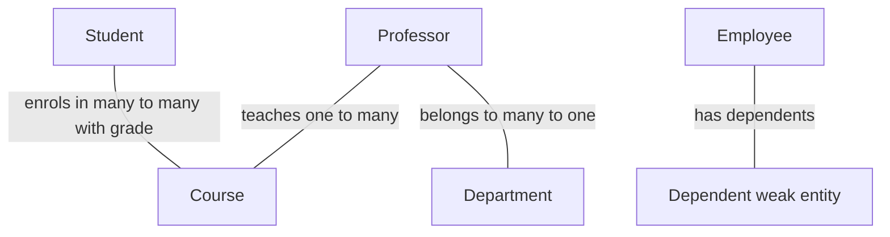

## The hook

Your team builds a college management app. Day one, someone creates a table: `Students(roll_no, name, course1, course2, course3, professor1, …)`. It works until a student takes a fourth course, a professor changes department, or two students need the same course data typed twice.

The fix is not a better table. It is drawing the world before building tables: who are the things, and how are they connected? Predict how many tables a correct design needs for "students take courses taught by professors in departments, with a grade per course". (Five, and you will see exactly why.)

## The intuition

:::analogy
Before writing anyone's address on an envelope, a family **draws the family tree**: who exists, who is whose parent, who married whom. Only then do they decide which address book each name goes in. An ER diagram is the family tree of your data; tables are the address books.
:::

The entity-relationship (ER) model describes three things:

- **[[Entity|Entities]]**: the nouns (Student, Course, Professor, Department).
- **[[Attribute]]s**: their properties (name, credits, salary).
- **[[Relationship]]s**: the verbs connecting them (enrols in, teaches, belongs to).

## How it works

### Attributes come in kinds

| Kind | Example | How it is stored |
|---|---|---|
| Simple | roll_no | One column |
| Composite | address (street, city, pin) | Several columns |
| Multivalued | phone numbers | A separate table (student_id, phone) |
| Derived | age from date of birth | Computed, usually not stored |
| Key | roll_no | Primary key |

### Cardinality and participation

**[[Cardinality]]** says how many:

- One-to-one: a student has one ID card.
- One-to-many: a department has many professors; a professor is in one department.
- Many-to-many: students and courses.

**[[Participation]]** says whether every entity must take part: every professor must belong to a department (total participation); not every student has a hostel room (partial).

### Weak entities

A **[[weak entity]]** has no key of its own. An employee's dependent "Riya" is only unique among that employee's dependents. It is identified by the owner's key plus its partial key: (employee_id, name). If the employee is deleted, the dependents go too.

## Trade-offs

### From diagram to tables

| ER element | Becomes |
|---|---|
| Strong entity | A table with its attributes; key becomes the primary key |
| One-to-many relationship | Foreign key on the "many" side (professor.dept_id) |
| One-to-one relationship | Foreign key on either side, usually the side with total participation |
| Many-to-many relationship | A new table with both foreign keys (and relationship attributes) |
| Multivalued attribute | A separate table (owner key, value) |
| Weak entity | A table whose key is (owner key, partial key), with a foreign key to the owner |

The answer to the hook's five tables: Student, Course, Professor, Department, and Enrolment(roll_no, course_id, grade). The grade belongs to the relationship, not to Student or Course.

Wait, why can't the grade live in Student? Because a student has one grade *per course*. Put it in Student and you are back to course1_grade, course2_grade columns.

:::insight
Model the world first: entities become tables, one-to-many relationships become foreign keys on the many side, and many-to-many relationships become their own tables carrying any attributes of the relationship itself, such as a grade.
:::

:::warning
Common misconception: "a many-to-many relationship can be stored as a list of ids in a column." A comma-separated list of course ids cannot be indexed, joined or constrained properly and breaks first normal form. Many-to-many always needs its own junction table.
:::

:::try-this
Model "a professor can advise many students; each student has at most one advisor; some students have none". Which table gets the foreign key, and can it be NULL? (Student gets advisor_id referencing Professor, because many students point to one professor. It is nullable, since participation is partial: some students have no advisor.)
:::

## What can go wrong

- **Repeating groups** (course1, course2, course3) instead of a relationship table.
- **Attributes on the wrong side**, such as grade in Student.
- **Missing weak-entity keys**, producing duplicate or orphaned dependents.
- **Modelling a relationship as an entity's attribute**, losing the ability to store relationship data.
- **Ignoring participation**, so required links are allowed to be missing.

### Interview follow-ups

**"How do you represent a ternary relationship, such as a supplier supplying a part to a project?"** A table with three foreign keys (supplier, part, project), because the fact involves all three at once.

**"What is generalisation or specialisation?"** An is-a hierarchy, such as Person specialised into Student and Professor. Map it as one table with a type column, a table per subtype, or a parent table plus subtype tables, depending on queries and how many attributes differ.

**"ER diagram or tables first?"** In interviews, sketch entities and relationships first, then derive tables with the mapping rules; it shows reasoning and avoids repeating-group mistakes.

## In the real world

ER-style modelling underpins relational schema design in tools and design reviews. Peter Chen introduced the entity-relationship model in a 1976 paper. The next step, choosing keys and constraints, is in the relational keys article, and checking a design for redundancy is the job of normalisation. The bigger picture of why databases exist is in [The Librarian and the Pile of Books](article:cs-core-dbms-intro).

## Further reading

- Peter Chen, "The Entity-Relationship Model: Toward a Unified View of Data" (ACM TODS, 1976).
- Silberschatz, Korth and Sudarshan, *Database System Concepts*, chapter on the entity-relationship model.

## Key takeaways

- The ER model describes data as entities, their attributes and the relationships between them, before any tables are built.
- Cardinality (one-to-one, one-to-many, many-to-many) and participation (total or partial) describe how entities connect.
- One-to-many relationships become a foreign key on the many side, and many-to-many relationships become their own table with any relationship attributes.
- Weak entities are identified by their owner's key plus a partial key, and multivalued attributes become separate tables.
- Modelling first prevents repeating groups and misplaced attributes that make schemas hard to change.
