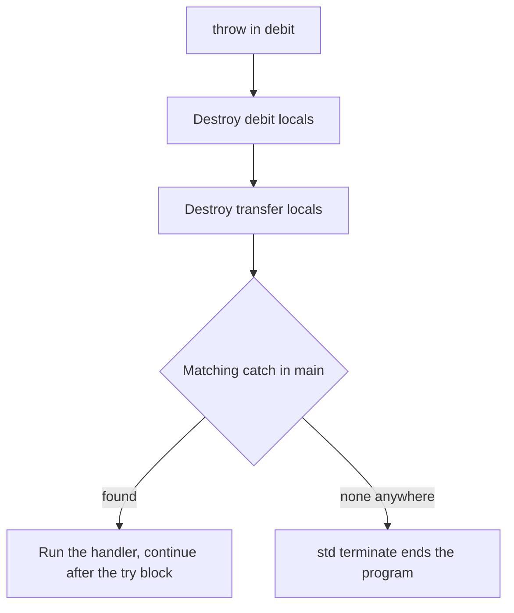

## The hook

A transfer function calls debit, which calls a balance check deep inside, and the check discovers the account is short by ₹150. The check cannot fix that; neither can debit. Only the code at the top, which can show a message or offer a smaller amount, knows what to do. With error codes, every function in between must check, pass the code upward and clean up; one forgotten check and the error vanishes.

Exceptions carry the error straight to the code that can handle it, and on the way they clean up everything they pass, in order. Predict what happens to objects created inside debit and transfer when the error flies past them. (Their destructors run, innermost first, before the handler starts.)

## The intuition

:::analogy
A **fire alarm walks everyone out in order**. When it sounds, nobody finishes their current task; each room is closed and emptied on the way out, starting with the room nearest the fire, until everyone reaches the assembly point where the fire warden takes over. The alarm is the throw, the rooms closing are destructors, and the warden is the catch block.
:::

## How it works

```cpp
#include <iostream>
#include <stdexcept>
#include <string>
using namespace std;

struct Guard {                                  // RAII object to watch unwinding
    string name;
    explicit Guard(string n) : name(move(n)) { cout << "enter " << name << "\n"; }
    ~Guard() { cout << "leave " << name << "\n"; }
};

class InsufficientFunds : public runtime_error {
public:
    long long shortBy;
    InsufficientFunds(long long s) : runtime_error("insufficient funds"), shortBy(s) {}
};

void debit(long long balance, long long amount) {
    Guard g("debit");
    if (amount > balance) throw InsufficientFunds(amount - balance);
    cout << "debited\n";
}

void transfer(long long balance, long long amount) {
    Guard g("transfer");
    debit(balance, amount);
    cout << "transfer complete\n";              // skipped when debit throws
}

int main() {
    try {
        transfer(100, 250);
    } catch (const InsufficientFunds& e) {      // most specific handler first
        cout << "caught: " << e.what() << ", short by " << e.shortBy << "\n";
    } catch (const exception& e) {
        cout << "other: " << e.what() << "\n";
    }
    try {
        string s = "abc";
        cout << s.at(10);                       // std::out_of_range from the library
    } catch (const out_of_range&) {
        cout << "out_of_range\n";
    }
}
```

Output, as compiled and run:

| Printed | What happened |
|---|---|
| enter transfer, enter debit | normal calls |
| leave debit, leave transfer | **[[stack unwinding]]**: locals destroyed innermost first |
| caught: insufficient funds, short by 150 | the matching handler runs |
| out_of_range | `at()` checks bounds and throws a standard exception |

"debited" and "transfer complete" never printed: an **[[exception]]** abandons the rest of every function it passes through.



### Catching well

- **Throw by value, catch by const reference.** Catching by value copies the exception and slices a derived exception down to the caught type.
- **Order handlers from specific to general.** The first matching handler wins, so `catch (const exception&)` before `catch (const InsufficientFunds&)` would swallow it.
- **Derive from std::exception** (often runtime_error or logic_error) so callers can catch everything with one handler and call what().
- `throw;` inside a handler rethrows the same exception upward; `catch (...)` catches anything.

### noexcept

**[[noexcept]]** promises a function will not throw. If one escapes anyway, the program does not look for a handler: it calls std::terminate. A test function marked noexcept that threw was not caught by its caller's `catch (...)`; it printed "terminate called after throwing an instance of 'std::runtime_error'". Destructors are noexcept by default, and move constructors should be, so containers can move elements safely.

Wait, why must destructors not throw? During unwinding, destructors are running *because* an exception is already in flight. A second exception escaping a destructor at that moment has nowhere to go, so the language calls terminate.

### Exception safety guarantees

| Guarantee | Promise if an exception is thrown | Example |
|---|---|---|
| No-throw | it never throws | destructors, swap, noexcept moves |
| **[[Strong guarantee|Strong]]** | state unchanged, as if never called | vector::push_back when the element's move is noexcept or copying is used |
| **[[Basic guarantee|Basic]]** | no leaks, objects valid, values may have changed | most operations at minimum |
| None | anything may be broken | code to avoid |

RAII gives the basic guarantee almost for free; copy-and-swap gives the strong one.

:::insight
Throwing an exception abandons the current work, destroys every local object between the throw and the handler in reverse order, and resumes at the first matching catch. RAII makes that unwinding clean up resources automatically, catching by const reference preserves the exception's real type, and noexcept functions that throw end the program instead.
:::

## Trade-offs

| Approach | Gain | Cost |
|---|---|---|
| Exceptions | Errors cannot be silently ignored; clean separation of error handling | Hidden control flow; some cost when thrown; disabled in some codebases (games, embedded) |
| Error codes or std::optional/expected | Explicit, cheap, visible in signatures | Every caller must check and propagate |
| Assertions | Catch programmer bugs in testing | Not for expected run-time failures |

:::warning
Common misconception: "exceptions are for any unusual situation, including normal control flow." Throwing is relatively expensive and makes flow hard to follow. Use exceptions for errors the immediate caller cannot handle, and ordinary return values for expected outcomes such as "item not found".
:::

:::try-this
Change the call to `transfer(500, 250)`. What prints now? (enter transfer, enter debit, debited, leave debit, transfer complete, leave transfer. No exception, so both functions finish and their guards are destroyed at their normal closing braces, debit's first.)
:::

## What can go wrong

- **Catching by value**, slicing derived exceptions.
- **Catching too broadly** (`catch (...)` that hides real bugs) or too early.
- **Throwing from destructors**, which terminates during unwinding.
- **Raw new without RAII** leaking when an exception skips delete.
- **Exceptions crossing C or library boundaries** that are not designed for them.

### Interview follow-ups

**"What happens if no handler matches?"** std::terminate is called; whether the stack is unwound first is implementation-defined.

**"What does a function-try-block on a constructor do?"** It catches exceptions from member and base initialisers; the constructor still fails and the exception is rethrown, since the object was never fully built.

**"Do constructors that throw leak memory?"** Members and bases already constructed are destroyed, and memory from `new` for the object is freed, but resources acquired in the body without RAII are not released.

## In the real world

The standard library throws std::bad_alloc, std::out_of_range, std::invalid_argument and others; many large codebases use exceptions, while some game and embedded projects disable them and use error codes. The RAII technique that makes unwinding safe is in [A Hotel Room Cleaned Automatically When You Check Out](article:cs-core-constructors-raii).

## Further reading

- Herb Sutter, *Exceptional C++*, on exception safety.
- David Abrahams, "Exception-Safety in Generic Components" (1998), which defined the basic and strong guarantees.

## Key takeaways

- An exception transfers control from the throw to the nearest matching catch block up the call stack, skipping the rest of every function in between.
- Stack unwinding destroys the local objects of each exited function in reverse order before the handler runs, so RAII cleanup always happens.
- Throw by value, catch by const reference, and order handlers from specific to general so the first match is the right one.
- A noexcept function that throws calls std::terminate, and destructors must not throw because they run during unwinding.
- Exception safety guarantees range from no-throw through strong (state unchanged) to basic (no leaks, objects valid).
