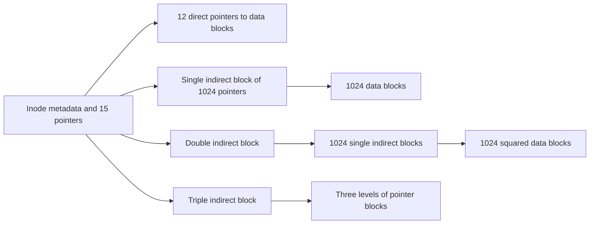

## The hook

A disk is a long row of numbered blocks, nothing more. It has no idea what a "file" is, or a "folder", or that report.pdf is 3 MB. Yet you save, rename and delete files all day, and after a power cut most of them are still there.

Something has to keep the catalogue: which blocks belong to which file, in what order, what the file is called, and who may read it. Get the catalogue wrong in a crash, and blocks belong to two files, or to none. Predict where Unix keeps a file's name. (Not with the file. The name lives in the directory; the file itself is a numbered record called an inode, and that one fact explains links.)

## The intuition

:::analogy
A large library has **a catalogue pointing to the shelves**. Each catalogue card describes one book (size, owner, where its pages are shelved) and has a number. The reading-room lists that say "Database Systems: card 690019" are separate from the cards. Several lists can name the same card, and a book is removed only when no list names it any more.
:::

The catalogue card is the **[[inode]]**; the lists are directories; the shelves are disk **[[block|blocks]]**.

## How it works

### Allocation: where do a file's blocks go?

| Method | Idea | Strengths | Weaknesses |
|---|---|---|---|
| Contiguous | All blocks in one run: store start and length | Fast sequential and random access | External fragmentation; files cannot grow easily |
| Linked | Each block points to the next | No fragmentation; easy growth | Random access walks the chain; one bad pointer loses the rest |
| FAT (linked, table in memory) | The chain is stored in a separate table | Random access walks the table, not the disk | Table grows with disk size |
| **[[Indexed allocation]]** | An index block lists all block numbers | Fast random access, no external fragmentation | Index overhead; large files need multi-level indexes |

Modern file systems also use **extents** (start block plus length runs), combining contiguous speed with indexed flexibility; ext4 uses them.

### The Unix inode

An inode holds metadata (type, permissions, owner, size, timestamps, link count) and pointers: in the classic design, 12 direct pointers plus one single-, one double- and one triple-indirect pointer.

**The exam calculation**, with 4 KiB blocks and 4-byte pointers (1024 pointers per block):

| Part | Data blocks | Data addressed |
|---|---|---|
| 12 direct | 12 | 48 KiB |
| single indirect | 1024 | 4 MiB |
| double indirect | 1024² | 4 GiB |
| triple indirect | 1024³ | 4 TiB |
| total | | about 4 TiB |

Wait, why mix direct and indirect pointers instead of one big index? Most files are small. Twelve direct pointers serve them with no extra reads, while the indirect levels let rare huge files grow without bloating every inode.

### Directories and path lookup

A directory is a file whose content is a list of (name → inode number) entries. Opening `/home/asha/notes.txt` reads the root directory's inode, finds `home`, reads its inode, finds `asha`, and so on: one lookup per path component, which is why the OS caches directory entries.

### Hard and soft links, tested

In a shell: create notes.txt, then `ln notes.txt hard.txt` and `ln -s notes.txt soft.txt`.

| Check | Result |
|---|---|
| `stat` on notes.txt and hard.txt | same inode number, link count 2 |
| `ls -l soft.txt` | `soft.txt -> notes.txt`, a separate small file |
| after `rm notes.txt`: `cat hard.txt` | prints the content; link count now 1 |
| after `rm notes.txt`: `cat soft.txt` | No such file or directory |

A **[[hard link]]** is just another directory entry for the same inode; `rm` removes one entry and decrements the link count, and the data is freed only at zero (and when no process still has it open). A **[[soft link]]** stores a path, so it can cross file systems and point to directories, but it dangles when the path disappears. Hard links cannot cross file systems, because inode numbers are only unique within one.

### Crash consistency and journaling

Appending one block to a file touches three structures: the free-space bitmap, the inode and the data block. A crash between those writes can leave a block marked used but owned by nobody, or an inode pointing at garbage. Older systems ran a full-disk check (fsck) after crashes, which took ages on big disks.

**[[Journaling]]** writes the intended changes to a log first, then a commit record, then applies them. After a crash, committed journal entries are replayed and uncommitted ones ignored, which takes seconds. ext4's default mode journals metadata and writes data blocks before the metadata that points to them.

:::insight
A file system is a catalogue: inodes describe files and point to their blocks, directories map names to inode numbers, and a journal makes multi-step updates safe across crashes. Because names live in directories and not in inodes, one file can have many names (hard links), and deleting a name is not the same as deleting the data.
:::

## Trade-offs

| Choice | Gain | Cost |
|---|---|---|
| Larger blocks | Fewer pointers, faster sequential I/O | More wasted space inside the last block of small files |
| Extents | Compact metadata for large contiguous files | Fragmented files need many extents |
| Metadata-only journaling | Fast, consistent structure | Recently written data may be lost or stale after a crash |
| Full data journaling | Strongest guarantees | Every block written twice |
| Copy-on-write file systems (btrfs, ZFS) | Snapshots, no in-place overwrites | Fragmentation, more complex |

:::warning
Common misconception: "rm deletes the file." rm removes one directory entry. The data stays until the link count reaches zero and no process holds the file open. This is why deleting a huge log file that a running program still writes to frees no disk space until the program closes it.
:::

:::try-this
With 1 KiB blocks, 4-byte pointers, 10 direct pointers and one single-indirect pointer, what is the largest file? (Each block holds 1024 / 4 = 256 pointers. 10 × 1 KiB + 256 × 1 KiB = 266 KiB.)
:::

## What can go wrong

- **Running out of inodes** with free space remaining, when a disk holds millions of tiny files.
- **Dangling soft links** after files move.
- **Assuming write() reached the disk**: data sits in the page cache until flushed; durable writes need fsync.
- **Deleted but open files** silently holding disk space.
- **Fragmentation** slowing large sequential reads on nearly full disks.

### Interview follow-ups

**"What does fsync do?"** It forces a file's dirty data and metadata from the page cache to stable storage, which databases call at commit; see [Rebuilding Events From the Ship's Log After a Storm](article:cs-core-db-recovery).

**"What is a virtual file system (VFS)?"** A kernel layer giving one interface (open, read, write) over many file systems, so ext4, NFS and /proc look the same to programs.

**"Why can't you hard-link a directory?"** It could create cycles in the directory tree, breaking traversal and reference counting.

## In the real world

Linux commonly uses ext4 or XFS, macOS uses APFS, and Windows uses NTFS; all use some form of indexing or extents and journaling or copy-on-write. How programs ask the kernel for files is in [Asking the Teller to Open the Vault](article:cs-core-system-calls), and the OS's overall role is in [The Hotel Manager Every Program Secretly Reports To](article:cs-core-what-an-os-does).

## Further reading

- Remzi and Andrea Arpaci-Dusseau, *Operating Systems: Three Easy Pieces*, chapters on file system implementation and crash consistency (free online).
- Marshall Kirk McKusick and colleagues, "A Fast File System for UNIX" (ACM TOCS, 1984).

## Key takeaways

- A file system maps files to fixed-size disk blocks using contiguous, linked, FAT, indexed or extent-based allocation, each trading speed, fragmentation and flexibility.
- A Unix inode holds a file's metadata and block pointers but not its name, and direct plus multi-level indirect pointers let it address files of several terabytes.
- Directories map names to inode numbers, so a hard link is another name for the same inode, while a soft link stores a path and breaks when that path is removed.
- Data is freed only when the link count reaches zero and no process has the file open.
- Journaling logs intended changes before applying them, so a crash needs a quick replay instead of a full disk check.
