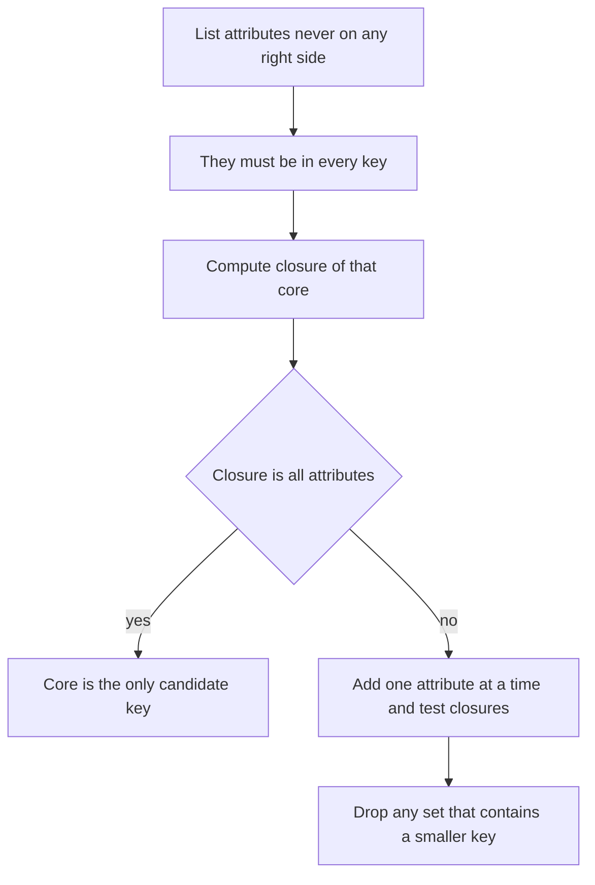

## The hook

The exam cell keeps one huge sheet: roll number, name, course, instructor, instructor's department, grade. A student takes five courses, so their name is typed five times. One day it is corrected in three rows and not the other two. Now the database says the same roll number belongs to two different names.

The sheet itself was not "wrong"; it simply ignored a fact everybody knows: **if you know the roll number, you know the name**. Functional dependencies write such facts down, and once written, a short mechanical procedure finds every key of a table. Predict how many candidate keys a five-column table can have. (The example below has four.)

## The intuition

:::analogy
At college, **if you know the roll number, you know the name**: the office can look it up, and there is only one answer. Knowing a course tells you its instructor, and knowing the instructor tells you their department. Chain such facts and you can tell how far one piece of information reaches.
:::

A **[[functional dependency]]** X → Y says: two rows that agree on X always agree on Y. For the exam sheet:

| Dependency | Read it as |
|---|---|
| roll → name | the roll number fixes the name |
| course → instructor | each course has one instructor |
| instructor → dept | each instructor belongs to one department |
| (roll, course) → grade | a student gets one grade per course |

Note the direction. roll → name does not mean name → roll: two Priyas can share a name.

## How it works

### Attribute closure: how far does X reach?

The **[[attribute closure]]** X⁺ is everything X determines. The algorithm is a loop:

```pseudo
closure(X, F):
    result = X
    repeat until result stops changing:
        for each dependency L -> R in F:
            if L is inside result: add R to result
    return result
```

For the exam sheet, {roll}⁺ = {roll, name} and {course}⁺ = {course, instructor, dept}. Neither reaches grade. Together, {roll, course}⁺ is every column, so (roll, course) is a key, which matches common sense.

### A worked example with letters

Exams use letters, so practise on R(A, B, C, D, E) with A → B, B → C, CD → E, E → A.

Trace {A, D}⁺:

| Step | Dependency used | Result |
|---|---|---|
| start | | A D |
| 1 | A → B | A B D |
| 2 | B → C | A B C D |
| 3 | CD → E | A B C D E |

{A, D} reaches everything, so it is a super key. Neither A nor D alone works: {A}⁺ = {A, B, C} and {D}⁺ = {D}. So AD is a **candidate key**.

### Finding every candidate key

Wait, why stop at AD? Look at the right-hand sides: B, C, E and A all appear there, but **D never does**. Nothing can produce D, so D must be in every key. Now try D with each other attribute, as the program that checked this example did:

| Candidate | Closure | Key? |
|---|---|---|
| AD | ABCDE | yes |
| BD | ABCDE (B → C, CD → E, E → A) | yes |
| CD | ABCDE (CD → E, E → A, A → B) | yes |
| DE | ABCDE (E → A, A → B, B → C) | yes |

Four candidate keys, and every attribute is a **[[prime attribute]]**. That fact matters in the next topic, normal forms.



The shortcut used above: attributes only on left sides (or in no dependency at all) are in every key; attributes only on right sides are in no key; only the "both sides" attributes need trying.

### Armstrong's axioms

Closures work because of **[[Armstrong's axioms]]**, three rules that derive every implied dependency:

| Rule | Statement | Example |
|---|---|---|
| Reflexivity | if Y ⊆ X, then X → Y | (roll, name) → name |
| Augmentation | if X → Y, then XZ → YZ | roll → name gives (roll, course) → (name, course) |
| Transitivity | if X → Y and Y → Z, then X → Z | course → instructor → dept gives course → dept |

Useful consequences: **union** (X → Y and X → Z give X → YZ), **decomposition** (X → YZ gives X → Y), and **pseudotransitivity** (X → Y and WY → Z give WX → Z).

:::insight
To test whether a dependency X → Y follows from a set F, do not search through axioms: compute X⁺ and check whether Y is inside it. Closure turns every "is this implied?" and "is this a key?" question into one mechanical loop.
:::

### Minimal cover

A **[[minimal cover]]** is a cleaned-up equivalent set: single attributes on the right, no extra attributes on the left, no dependency implied by the others. For example, in {A → B, B → C, A → C}, the last one follows by transitivity, so the minimal cover is {A → B, B → C}. Normalisation algorithms (such as 3NF synthesis) start from a minimal cover.

## Trade-offs

| Approach | Good for | Cost |
|---|---|---|
| Compute closures by hand | Exams, small schemas | Error-prone beyond about six attributes |
| Use the left/right/both shortcut | Pruning candidates fast | Still exponential in the worst case |
| Derive with Armstrong's axioms | Proofs | Slow; closure is the practical test |
| Declare keys and unique constraints | Enforcing the important FDs in a real database | Other FDs are only enforced by good design |

:::warning
Common misconception: "a functional dependency can be read off the current data." Data can only disprove a dependency: if two rows have the same roll number and different names, roll → name fails. Agreement in today's rows does not prove it; dependencies come from the meaning of the data, such as the college rule that roll numbers are unique.
:::

:::try-this
R(P, Q, R, S) with P → Q, Q → R, R → P. Which attributes must be in every key, and what are all the candidate keys? (S never appears on a right side, so it is in every key. {S}⁺ = {S}. PS, QS and RS each reach everything because P, Q and R determine each other in a cycle. Candidate keys: PS, QS, RS.)
:::

## What can go wrong

- **Reading FDs backwards**: roll → name does not give name → roll.
- **Stopping the closure loop too early**: a new attribute can enable a dependency you already skipped, so loop until a full pass adds nothing.
- **Reporting super keys as candidate keys**: ABD reaches everything but contains AD.
- **Missing keys**: after finding one key, test the other combinations; cycles such as E → A often create several.
- **Trusting sample data** to prove a dependency.

### Interview follow-ups

**"How do you check whether two sets of FDs are equivalent?"** Each must imply every dependency of the other: for every X → Y in one set, compute X⁺ under the other set and check Y is inside.

**"What is a trivial dependency?"** X → Y where Y ⊆ X, such as (roll, name) → name. It always holds and carries no information.

**"Why do FDs matter in practice?"** They are what normalisation uses to split tables so each fact is stored once, which removes the update anomaly from the hook.

## In the real world

Real databases do not take a list of FDs; designers express the important ones as primary keys, unique constraints and separate tables. The vocabulary of keys used here is in [ID Cards That Uniquely Identify People](article:cs-core-relational-keys). The next step is normalisation: using these dependencies to split the exam sheet into tidy tables, one fact per place.

## Further reading

- Silberschatz, Korth and Sudarshan, *Database System Concepts*, chapter on relational database design.
- W. W. Armstrong, "Dependency Structures of Data Base Relationships" (IFIP Congress, 1974).

## Key takeaways

- A functional dependency X → Y means rows that agree on X must agree on Y, and it comes from the meaning of the data, not from a sample of rows.
- The closure X⁺ is found by repeatedly applying dependencies whose left side is already inside, until nothing new is added.
- X is a super key if X⁺ contains every attribute, and a candidate key if, in addition, no proper subset of X is a super key.
- Attributes that never appear on a right side belong to every candidate key, which prunes the search quickly.
- Armstrong's axioms (reflexivity, augmentation, transitivity) derive every implied dependency, but computing a closure is the practical test.
