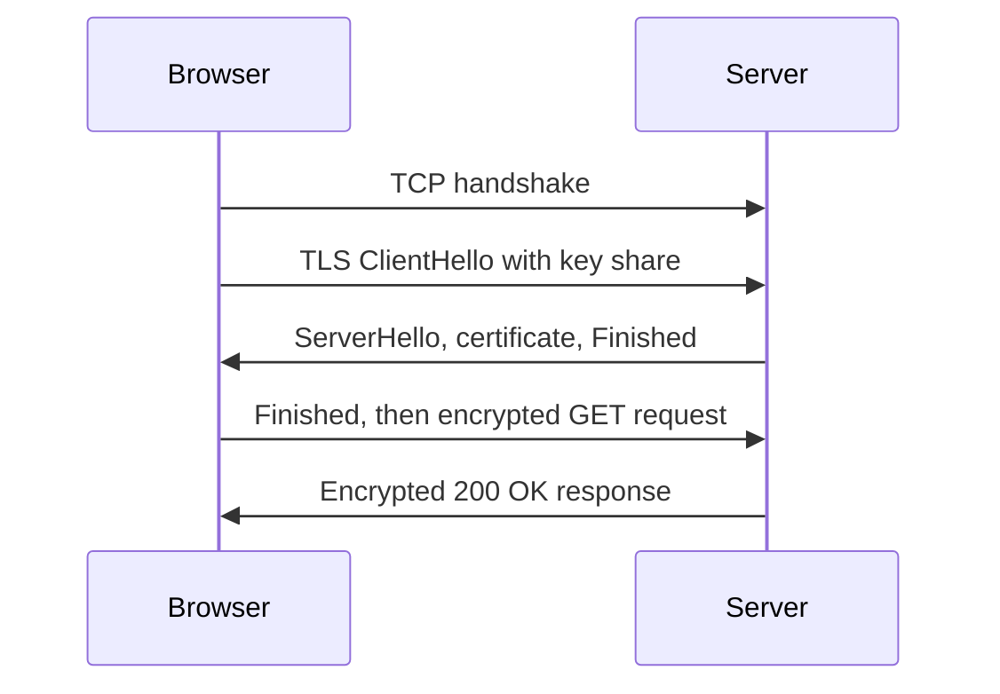

## The hook

Every time you open an app, it sends dozens of short text messages that start with words like GET and POST and receive replies that start with numbers like 200 and 404. That is HTTP: a conversation format simple enough to type by hand, yet carrying almost everything on the web, including the APIs between the services behind your app.

Interviews test it in two ways: definitions (methods, status codes, cookies, HTTPS) and judgement ("is it safe to retry this request?"). The second is where people slip. Predict which of GET, POST, PUT and DELETE is *not* safe to retry blindly. (POST: sending it twice can create two orders.)

## The intuition

:::analogy
HTTP is **ordering at a counter with a standard form**. You fill in what you want (the method and path), add notes in fixed boxes (headers), attach anything extra (the body), and hand it over. The counter returns a slip with a result code at the top, notes, and maybe your item. The clerk does not remember you between visits, so you show a token (a cookie) each time.
:::

## How it works

### A real exchange, line by line

A request typed over a raw socket to a small local web server:

```http
GET /index.html HTTP/1.1
Host: localhost
User-Agent: demo
Accept: text/html
```

The server's reply (its first line says HTTP/1.0, which is what Python's simple test server speaks):

```http
HTTP/1.0 200 OK
Server: SimpleHTTP/0.6 Python/3.13.18
Content-type: text/html
Content-Length: 12

<h1>Hi</h1>
```

A request line (method, path, version), headers as `Name: value` lines, a blank line, then an optional body. The response swaps the request line for a status line. Asking the same server for /nope returned `404 File not found`.

### Methods

| [[HTTP method|Method]] | Meaning | Safe (read-only) | [[Idempotent]] |
|---|---|---|---|
| GET | read a resource | yes | yes |
| HEAD | GET without the body | yes | yes |
| POST | create, or submit for processing | no | no |
| PUT | replace a resource fully | no | yes |
| PATCH | modify part of a resource | no | not guaranteed |
| DELETE | remove a resource | no | yes |

Wait, why is DELETE idempotent if the second call fails with 404? Idempotency is about the **state of the server**, not the response: after one DELETE or five, the resource is gone. That is what makes retrying safe.

### Status codes

| Class | Common codes |
|---|---|
| 2xx success | 200 OK, 201 Created, 204 No Content |
| 3xx redirection | 301 Moved Permanently, 302 Found, 304 Not Modified (use your cache) |
| 4xx client error | 400 Bad Request, 401 Unauthorized (not authenticated), 403 Forbidden (not allowed), 404 Not Found, 409 Conflict, 429 Too Many Requests |
| 5xx server error | 500 Internal Server Error, 502 Bad Gateway, 503 Service Unavailable, 504 Gateway Timeout |

### Headers, statelessness and cookies

HTTP is **stateless**: each request stands alone. Headers carry everything else: `Host` (which site, since one IP serves many), `Content-Type`, `Authorization`, `Cache-Control`, `ETag` with `If-None-Match` (for 304 responses).

To remember a login, the server sends `Set-Cookie: session=abc; HttpOnly; Secure; SameSite=Lax`, and the browser returns `Cookie: session=abc` on later requests to that site. A **[[cookie]]**'s flags matter: HttpOnly hides it from JavaScript (limits XSS theft), Secure sends it only over HTTPS, SameSite limits cross-site sending (limits CSRF).

### HTTP/1.1, HTTP/2, HTTP/3

| Version | Transport | Key idea | Remaining problem |
|---|---|---|---|
| HTTP/1.1 | TCP | Keep-alive connections; one request at a time per connection | Browsers open several connections; slow responses block later ones |
| HTTP/2 | TCP | Binary frames, **[[multiplexing]]** many streams on one connection, header compression | One lost TCP packet stalls every stream |
| HTTP/3 | QUIC over UDP | Streams recover from loss independently; faster setup with TLS built in | UDP blocked or throttled on some networks |

### HTTPS

HTTPS is HTTP inside **[[TLS]]**. Before any HTTP is sent, the TLS handshake lets the server prove its identity with a certificate signed by a trusted authority, and both sides derive fresh session keys. After that, every request and response is encrypted and tamper-evident.



An eavesdropper sees the server's IP address and, usually, the site name (sent in the clear during the handshake), but not paths, headers, cookies or bodies.

:::insight
HTTP is a stateless request-response text format: method, path, headers and body in; status, headers and body out. Methods carry meaning that clients rely on, especially idempotency for safe retries, while cookies add memory on top. Newer versions change how messages travel, not what they say, and HTTPS wraps it all in TLS for identity and secrecy.
:::

## Trade-offs

| Choice | Gain | Cost |
|---|---|---|
| Statelessness | Any server can handle any request; easy scaling | State must travel in cookies or tokens, or live in a shared store |
| HTTP/2 multiplexing | Fewer connections, less latency | Still TCP head-of-line blocking |
| HTTP/3 over QUIC | Independent streams, faster setup | Newer, more CPU per byte, middlebox issues |
| HTTPS everywhere | Privacy and integrity | Certificate management, a little handshake cost |

:::warning
Common misconception: "HTTPS hides which website you visit." The destination IP address is visible, and the site name is normally visible in the TLS handshake (Encrypted Client Hello is an extension designed to hide it). HTTPS protects the content of the conversation, not the fact that it happened.
:::

:::try-this
A client sends `PATCH /cart` with "add one more pen", the response is lost, and it retries. Is that safe? Then redesign it. (Not safe: two PATCHes add two pens, so this PATCH is not idempotent. Use PUT with the full desired quantity, `PUT /cart/items/pen` with quantity 3, or send an idempotency key the server uses to ignore duplicates.)
:::

## What can go wrong

- **Retrying POSTs** and creating duplicate orders or payments.
- **Using GET for actions** (GET /delete?id=5) that crawlers and prefetchers then trigger.
- **Cookies without HttpOnly, Secure and SameSite**, inviting theft and cross-site attacks.
- **Mixed content**: an HTTPS page loading scripts over HTTP.
- **Returning 200 with an error body**, which breaks clients and caches that trust status codes.

### Interview follow-ups

**"What happens on a 301 versus a 302?"** 301 is permanent (browsers and search engines remember it); 302 is temporary.

**"How do sessions work over a stateless protocol?"** With a cookie holding a session ID looked up on the server, or a signed token (such as a JWT) carrying the claims itself.

**"What does a TLS certificate prove?"** That a certificate authority the browser trusts has verified that the key belongs to that domain name; the handshake proves the server holds the matching private key.

## In the real world

Browsers, mobile apps and microservices all speak HTTP; REST and gRPC (over HTTP/2) APIs are built on it. TCP, which carries HTTP/1.1 and HTTP/2, is explained in [A Phone Call Where Both Sides Confirm They Can Hear](article:cs-core-tcp-deep-dive), and the system-design view of a request is in [Everything That Happens Before a Page Appears](article:system-design-client-server-http).

## Further reading

- RFC 9110, "HTTP Semantics" (2022), and RFC 9114, "HTTP/3".
- MDN Web Docs, "An overview of HTTP".

## Key takeaways

- An HTTP request is a method, path, headers and optional body, and a response is a status code, headers and optional body.
- GET, PUT and DELETE are idempotent and safe to retry, while POST is not unless the API adds an idempotency key.
- Status codes group into 2xx success, 3xx redirection, 4xx client errors and 5xx server errors, and 401 means unauthenticated while 403 means not permitted.
- HTTP is stateless, so cookies with HttpOnly, Secure and SameSite flags, or tokens, carry session state between requests.
- HTTP/2 multiplexes streams over one TCP connection, HTTP/3 moves to QUIC to avoid head-of-line blocking, and HTTPS adds TLS for server identity, encryption and integrity.
