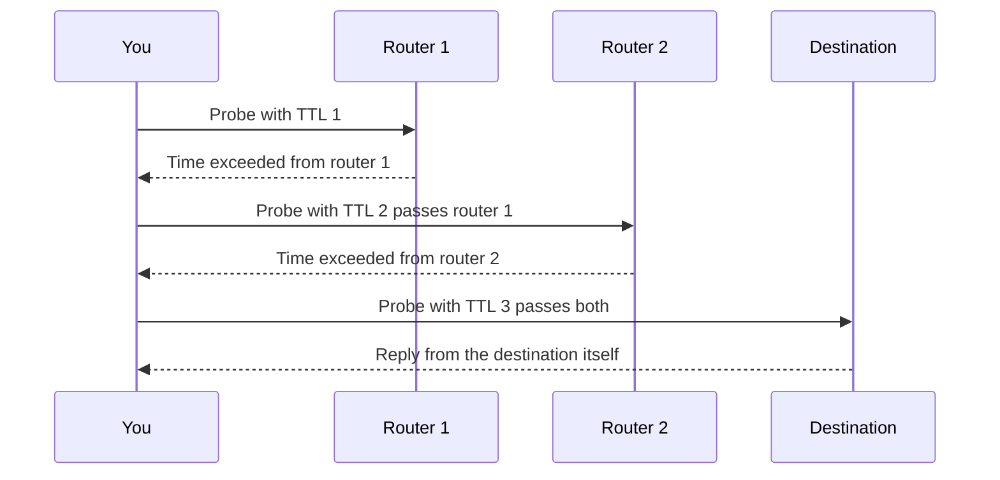

## The hook

"The site is slow." Is it your Wi-Fi, your ISP, a congested link halfway across the world, or the server? Two commands that every engineer types in the first minute of an investigation, ping and traceroute, start answering that, and neither one was designed as a tool. Both cleverly reuse error messages that routers send anyway.

Traceroute in particular is a lovely trick: it learns the path by deliberately making packets die, one hop further each time. Predict what field it changes to do that. (The TTL, the "hop budget" in every IP packet.)

## The intuition

:::analogy
Standing at the edge of a canyon, you **shout and time the echo**: if it comes back, something is there, and the delay tells you how far. Now imagine shouting with a voice that only carries one cliff, then two, then three, and noting which cliff answers each time. That is ping and traceroute.
:::

## How it works

### ICMP

IP itself has no way to say "that failed". **[[ICMP]]** carries those messages, inside IP packets:

| Type | Name | Sent when |
|---|---|---|
| 8 / 0 | **[[Echo request]]** / echo reply | someone pings / the target answers |
| 3 | Destination unreachable | no route, port closed (for UDP), or "fragmentation needed" |
| 11 | **[[Time exceeded]]** | a router dropped a packet whose TTL reached zero |
| 5 | Redirect | a router tells a host a better next hop on the same network |

### ping

ping sends echo requests and measures the round trip time of each reply. Its output gives you reachability, the RTT (with minimum, average, maximum and variation), and the percentage of packets lost. Rising RTT points to congestion or queuing; loss points to a congested or faulty link (or to ICMP being rate-limited).

### The TTL and traceroute

Every IP packet carries a **[[TTL]]** (an 8-bit counter, set to a value such as 64 by the sender). Each router decrements it; at zero, the router drops the packet and sends a time-exceeded message back to the sender, including its own address. This exists to stop packets looping forever.

traceroute turns that safety net into a map:

Each hop is probed (usually three times) and the RTTs are printed. Linux traceroute sends UDP probes to high, unlikely ports by default, so the destination answers with port unreachable; Windows tracert uses ICMP echo. Wait, does every hop in the output lie on the same path? Not necessarily: each probe is routed independently, so load-balanced paths can show different routers at the same hop, and the return path of the replies may differ from the outgoing path.

### Path MTU discovery

When a packet is bigger than a link's MTU and marked "do not fragment", the router drops it and sends destination unreachable with code "fragmentation needed", including the allowed size. The sender lowers its packet size. If a firewall blocks these ICMP messages, large packets vanish silently while small ones work: the classic "page starts loading, then hangs" problem known as a PMTU black hole.

:::insight
ICMP is IP's feedback channel. ping uses echo request and reply to test reachability and measure round trips, and traceroute sends probes with increasing TTL so each router on the path reveals itself with a time-exceeded message. Blocking ICMP carelessly breaks path MTU discovery and hides useful diagnostics.
:::

## Trade-offs

| Choice | Gain | Cost |
|---|---|---|
| Allow ICMP echo | Easy monitoring and debugging | Hosts can be discovered by scanners |
| Block all ICMP | Slightly less exposure | Breaks path MTU discovery; harder troubleshooting |
| Rate-limit ICMP on routers | Protects router CPUs | ping and traceroute may show misleading loss |

:::warning
Common misconception: "loss shown at a middle hop of traceroute means packets are being dropped there." Routers often rate-limit or de-prioritise generating ICMP replies, so a hop can show loss or high latency while traffic passing through it is fine. Only loss that continues to the final destination matters.
:::

:::try-this
A traceroute shows hops 1 to 4 with RTTs around 5 ms, hop 5 jumping to 120 ms, and hops 6 to 12 all around 120 ms. What does that suggest? (A long link between hops 4 and 5, such as an undersea cable to another continent. The latency stays high afterwards because every later hop includes it, so it is distance, not a problem at hop 5.)
:::

## What can go wrong

- **Concluding a host is down** because ping fails while ICMP is filtered.
- **Misreading middle-hop loss** caused by ICMP rate limiting.
- **PMTU black holes** from blocked "fragmentation needed" messages.
- **ICMP floods** used as a simple denial-of-service attack; rate limits help.

### Interview follow-ups

**"Which layer is ICMP?"** It is carried inside IP packets but is part of the network layer's control functions, not a transport protocol.

**"Why does ping not use ports?"** ICMP has no port numbers; it uses type and code fields, plus an identifier to match replies.

**"What else uses the TTL idea?"** DNS caching has a TTL in seconds, a different field with the same idea of an expiry budget, as in [A Phone Book With Local Copies Everywhere](article:cs-core-dns-cs).

## In the real world

`ping`, `traceroute` (`tracert` on Windows) and `mtr` (a continuous traceroute) are standard first steps in network debugging. Routing, which decides the path traceroute reveals, is in [Road Signs Versus a Full City Map](article:cs-core-routing-algorithms).

## Further reading

- RFC 792, "Internet Control Message Protocol" (1981), and RFC 1191, "Path MTU Discovery".
- The man pages for ping, traceroute and mtr.

## Key takeaways

- ICMP carries IP's error and diagnostic messages, including echo request and reply, destination unreachable and time exceeded.
- ping sends echo requests and reports reachability, round-trip times and packet loss, but a failed ping may only mean ICMP is filtered.
- Every IP packet has a TTL that routers decrement, and a router that drops a packet at zero sends back a time-exceeded message.
- traceroute sends probes with TTL 1, 2, 3 and onward so each router on the path identifies itself, though paths can vary between probes.
- Path MTU discovery depends on ICMP "fragmentation needed" messages, so blocking all ICMP can make large transfers hang.
