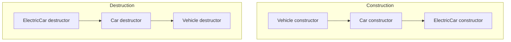

## The hook

A fleet app models cars, electric cars, trucks and bikes. Every one has a number plate, a description and a wheel count; electric cars also have a battery. Copying the plate logic into four classes means four places to fix every bug. Inheritance lets you write the shared part once in a Vehicle class and have the others build on it.

But inheritance also has some of the most-asked trick questions in C++ interviews: which constructor runs first, what private inheritance means, and why a "redefined" function sometimes does not run. Predict what prints when you call describe() on an electric car through a Vehicle reference. (The Vehicle version, unless describe is virtual.)

## The intuition

:::analogy
**Children inherit family traits**: eye colour, surname, the family recipes. They can add their own skills, and they can do a recipe differently. But before a child exists, the parents must; and a family tree records who inherited from whom. A derived class is the child: it gets the base's members, adds its own, and is always built after its base.
:::

## How it works

### The is-a test

Public inheritance means "is a": an ElectricCar is a Car is a Vehicle, so an ElectricCar can be used anywhere a Vehicle is expected. If that sentence sounds wrong ("a Stack is a Vector"?), use **[[composition]]** instead: give the class a member of the other type (a Stack *has a* vector).

### Kinds of inheritance

| Kind | Shape | Example |
|---|---|---|
| Single | one base | Car : Vehicle |
| Multilevel | a chain | ElectricCar : Car : Vehicle |
| Hierarchical | one base, many derived | Car, Truck, Bike : Vehicle |
| Multiple | several bases | FlyingCar : Car, Aircraft |
| Hybrid | a mix, which can create a diamond | covered in the diamond problem article |

### Access through inheritance

How a **[[base class]]** member appears inside the **[[derived class]]**:

| Base member | public inheritance | protected inheritance | private inheritance |
|---|---|---|---|
| public | public | protected | private |
| protected | protected | protected | private |
| private | not accessible | not accessible | not accessible |

Private members of the base are still *inside* every derived object (they take up space); the derived class just cannot name them. Public inheritance is the is-a kind; private inheritance means "implemented in terms of", and outside code cannot treat the derived object as a base.

### Construction and destruction order, tested

```cpp
#include <iostream>
#include <string>
using namespace std;

class Vehicle {
protected:
    string plate;
public:
    Vehicle(string p) : plate(p) { cout << "Vehicle(" << plate << ")\n"; }
    ~Vehicle() { cout << "~Vehicle\n"; }
    void describe() const { cout << "vehicle " << plate << "\n"; }
    int wheels() const { return 4; }
};

class Car : public Vehicle {                 // single inheritance: a Car is a Vehicle
    int seats;
public:
    Car(string p, int s) : Vehicle(p), seats(s) { cout << "Car\n"; }
    ~Car() { cout << "~Car\n"; }
    int getSeats() const { return seats; }
};

class ElectricCar : public Car {             // multilevel: ElectricCar -> Car -> Vehicle
    int batteryKwh;
public:
    ElectricCar(string p, int kwh) : Car(p, 5), batteryKwh(kwh) { cout << "ElectricCar\n"; }
    ~ElectricCar() { cout << "~ElectricCar\n"; }
    void describe() const {                   // hides Vehicle::describe (not virtual)
        cout << "electric " << plate << " " << batteryKwh << " kWh\n";
    }
};

int main() {
    {
        ElectricCar e("KA01", 40);
        e.describe();                         // electric KA01 40 kWh
        e.Vehicle::describe();                // vehicle KA01: the hidden version is reachable
        cout << e.getSeats() << " seats, " << e.wheels() << " wheels\n";   // 5 seats, 4 wheels
        Vehicle& v = e;
        v.describe();                         // vehicle KA01: static type decides
    }                                         // ~ElectricCar, ~Car, ~Vehicle
}
```



The output began Vehicle(KA01), Car, ElectricCar and ended ~ElectricCar, ~Car, ~Vehicle. Bases are constructed first because the derived constructor may use base members; destructors run in reverse because the derived part may still use the base while cleaning up. A derived constructor passes arguments up through its initialiser list (`: Car(p, 5)`); if it does not, the base's default constructor is used.

### Name hiding

Wait, ElectricCar "redefined" describe(), so why did `v.describe()` print the Vehicle version? Because describe() is not virtual. A same-named function in the derived class **hides** the base one only for calls made through the derived type; a call through a Vehicle reference is resolved at compile time from the reference's type. **[[Name hiding]]** also hides *all* base overloads of that name, which surprises people; `using Vehicle::describe;` brings them back. Making the call follow the actual object is the job of virtual functions, coming next.

:::insight
Public inheritance models is-a: the derived class reuses the base's members, adds its own, and can be used wherever the base is expected. Objects are built base-first and destroyed derived-first, access specifiers combine with the inheritance mode, and without virtual a same-named derived function merely hides the base one instead of replacing it at run time.
:::

## Trade-offs

| Choice | Gain | Cost |
|---|---|---|
| Public inheritance | Reuse plus substitutability | Tight coupling: base changes ripple into every derived class |
| Composition (has-a) | Flexible, swappable parts, looser coupling | A little forwarding code |
| Deep hierarchies | Lots of reuse | Hard to follow and to change |
| Multiple inheritance | Combine independent capabilities | Ambiguity and the diamond problem |

:::warning
Common misconception: "a derived class does not contain the base's private members." It does: they are part of every derived object and are used by the base's own functions; the derived class simply cannot name them. That is why sizeof a derived class includes the base's private data.
:::

:::try-this
class Truck : public Vehicle declares its own `int wheels() const { return 6; }`. What do `Truck t("MH12"); t.wheels();` and `Vehicle& v = t; v.wheels();` return? (6 and 4. The Truck version hides Vehicle's for calls through a Truck, but through a Vehicle reference the non-virtual Vehicle::wheels runs.)
:::

## What can go wrong

- **Inheriting for code reuse when is-a does not hold**, such as Square deriving from Rectangle and breaking setWidth.
- **Expecting overriding without virtual**, as in the hook.
- **Deleting a derived object through a base pointer without a virtual destructor**, which skips the derived destructor.
- **Hidden overloads** after defining one function of the same name in the derived class.
- **Fragile base classes**: a harmless-looking base change breaks derived classes.

### Interview follow-ups

**"Which is preferred, inheritance or composition?"** Composition, unless the is-a relationship and substitutability genuinely hold; it couples classes less.

**"Is a constructor inherited?"** Not by default; `using Base::Base;` inherits constructors explicitly. Destructors and assignment operators are not inherited either.

**"What is object slicing?"** Copying a derived object into a base object by value keeps only the base part, losing the derived data and behaviour.

## In the real world

Standard library streams use inheritance (ifstream is an istream), while most modern designs favour composition plus interfaces. Access specifiers themselves are explained in [A Capsule That Protects the Medicine Inside](article:cs-core-encapsulation-access).

## Further reading

- Scott Meyers, *Effective C++*, items 32 to 39 on inheritance and object-oriented design.
- Barbara Liskov and Jeannette Wing, "A Behavioral Notion of Subtyping" (ACM TOPLAS, 1994), the substitution principle.

## Key takeaways

- Public inheritance models an is-a relationship, so a derived object can be used wherever a base object is expected, and composition fits has-a relationships.
- Inheritance can be single, multilevel, hierarchical or multiple, and mixing them can create diamonds.
- Public, protected and private inheritance change how the base's public and protected members appear in the derived class, while base private members are never accessible.
- Base constructors run before derived constructors, and destructors run in the reverse order.
- Without virtual, a derived function with the same name only hides the base version, so calls through a base reference still use the base function.
