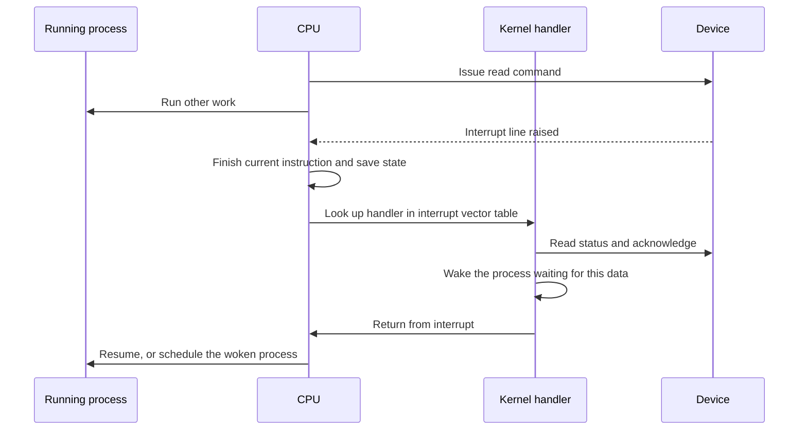

## The hook

You call `read()` on a file. Somewhere a disk controller begins fetching data that will take a long time by CPU standards. What should the processor do meanwhile? Stand at the device asking "done yet? done yet?" billions of times? Or go and run other programs, and somehow find out when the data arrives?

And when the data arrives, who copies 4096 bytes into memory, one word at a time? If the CPU does it, a fast network card could keep it busy doing nothing but copying. Predict the two hardware features that solve these two problems. (Interrupts, so the device can announce itself, and DMA, so the device can move data itself.)

## The intuition

:::analogy
Waiting for a parcel, you could **check the door every minute** (polling): simple, but you get nothing else done. Or install **a doorbell** (an interrupt) and carry on with your work until it rings. Better still, ask the courier to carry the boxes into the storeroom themselves and ring once when everything is inside: that is DMA.
:::

## How it works

### Talking to a device

Each device has a **[[device controller]]** with a few registers: **status** (busy, ready, error), **command** (what to do) and **data** (bytes in or out). The CPU reaches them through special port instructions (port-mapped I/O) or, more commonly today, as ordinary memory addresses (memory-mapped I/O).

### Polling

```pseudo
write command "read block 42" to the command register
while status register says busy:      // the CPU spins here
    do nothing
copy data register into memory, word by word
```

**[[Polling]]** is simple and has no overhead when the device is almost always ready. When the device is slow, every loop iteration is wasted CPU time. Keep polling in mind, though: by the end of this article you will see the fastest network cards deliberately going back to it.

### Interrupts

With an **[[interrupt]]**, the CPU issues the command and goes back to running other processes. When the device finishes, it raises an interrupt line:



The **[[interrupt handler]]** must be short. While it runs, the interrupted program is paused and interrupts of the same or lower priority may be held off. So kernels split the work: a **top half** acknowledges the device and grabs the essentials, and a **bottom half** (in Linux, softirqs, tasklets or workqueues) does the heavy processing later with interrupts enabled.

Wait, how is this different from a system call or an exception? All three switch the CPU into the kernel through a table of handlers. An interrupt comes from a device, asynchronously. An exception (such as a page fault or a divide by zero) is caused by the current instruction. A system call is a deliberate trap requested by the program.

### DMA

Interrupts free the CPU from waiting, but with programmed I/O the CPU still copies every word. Before reading on, guess how many interrupts you would need for a 4 KiB block if the device interrupted once per word. (About a thousand with 4-byte words: far too many.) **[[DMA]]** removes that too:

| Step | Who |
|---|---|
| 1. Write the memory address, byte count and direction into the DMA controller | CPU |
| 2. Move the data between device and memory over the bus | DMA controller |
| 3. Raise one interrupt when the whole transfer is done | device |
| 4. Mark the request complete, wake the waiting process | CPU, in the handler |

For a 4 KiB block, the CPU's involvement shrinks from copying every word to a setup and one interrupt. The cost is **cycle stealing**: the DMA controller competes with the CPU for the memory bus, and the OS must keep the target memory pages fixed in place (pinned) during the transfer.

### Device drivers

You never write to a disk's command register yourself; a **[[device driver]]** does it for you. It contains the device-specific knowledge: which registers to write, in what order, and how to interpret status. Above it, the kernel offers uniform interfaces, such as block devices, character devices and network interfaces, so `read()` works the same on an SSD, a USB stick or a pipe.

:::insight
Interrupts let the CPU do other work while a device is busy, and DMA lets the device move bulk data without the CPU touching each word. Drivers hide each device's details behind standard interfaces. Together they turn slow, varied hardware into the simple read and write calls programs use.
:::

## Trade-offs

| Technique | Best for | Cost |
|---|---|---|
| Polling | Very fast devices, very high event rates | Burns CPU when the device is slow |
| Interrupts | Slow or occasional events (keyboard, disk completion) | Per-interrupt overhead; storms under heavy load |
| Hybrid (interrupt, then poll while busy) | High-speed networking and storage | More complex drivers |
| DMA | Bulk transfers (disk, network, GPU) | Setup cost, bus contention, pinned memory |

:::warning
Common misconception: "interrupts are always better than polling." Under a flood of network packets, one interrupt per packet can leave the CPU doing nothing but entering and leaving handlers (receive livelock). Linux's NAPI disables the device's interrupts while busy and polls a batch of packets, re-enabling interrupts once traffic slows.
:::

:::try-this
A keyboard produces a few events per second. A modern NVMe SSD can complete an I/O very quickly. Which would you poll and which would you handle by interrupt? (Keyboard: interrupts, since polling would waste nearly every check. Fast SSD at high queue depth: polling or hybrid can win, because the device is ready again almost immediately and interrupt overhead becomes a large share of each I/O; Linux supports polled I/O for this.)
:::

## What can go wrong

- **Long-running interrupt handlers** that delay other interrupts and make the system stutter.
- **Interrupt storms** from a misbehaving device, starving normal work.
- **DMA into unpinned or wrong memory**, corrupting data; IOMMUs restrict which memory a device can reach.
- **Buggy drivers**, which run in kernel mode and can crash the whole system.

### Interview follow-ups

**"What is an interrupt vector table?"** A table indexed by interrupt number, giving the address of each handler; the CPU looks up the handler there when an interrupt arrives.

**"What is the difference between maskable and non-maskable interrupts?"** Maskable interrupts can be temporarily disabled by the kernel; non-maskable ones (such as certain hardware errors) cannot.

**"How does a blocking read() put the process to sleep?"** The driver starts the I/O, the kernel marks the process blocked and schedules another; the completion interrupt wakes it, as in the process states of [An Actor Stepping Off Stage](article:cs-core-process-states).

## In the real world

On Linux, /proc/interrupts shows the count of each interrupt per CPU, and network cards spread interrupts across cores with multiple queues. Every disk read in [A Library Catalogue Pointing to the Shelves](article:cs-core-file-systems) ends with a DMA transfer and a completion interrupt.

## Further reading

- Remzi and Andrea Arpaci-Dusseau, *Operating Systems: Three Easy Pieces*, chapter "I/O Devices" (free online).
- Jonathan Corbet, Alessandro Rubini and Greg Kroah-Hartman, *Linux Device Drivers*, third edition (free online).

## Key takeaways

- The CPU controls devices by reading and writing controller registers, through port instructions or memory-mapped addresses.
- Polling repeatedly checks a status register and suits very fast devices, while interrupts let the CPU work until the device signals completion.
- An interrupt handler saves state, does minimal work in a top half, and defers heavy processing to a bottom half.
- DMA lets a controller copy whole blocks to or from memory and interrupt once, freeing the CPU from copying each word.
- Device drivers hide device-specific details behind standard kernel interfaces, and high-speed I/O often mixes interrupts with polling.
