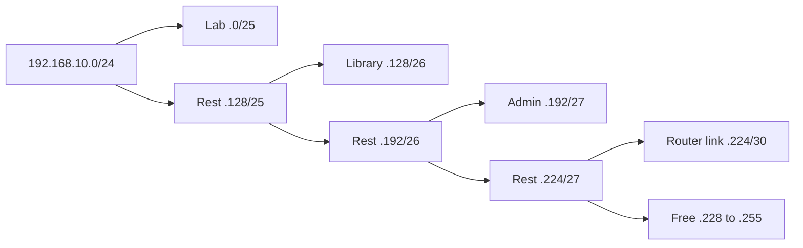

## The hook

Your college gets the block 192.168.10.0/24 for its labs: 256 addresses. The computer lab needs 100 machines, the library 50, the admin office 20, and a link between two routers needs just 2. Can one block serve all four, each on its own network? And when a packet arrives for 192.168.10.77, which network is it for?

This is subnetting, and it appears in almost every networking exam and many placement tests, always as arithmetic on bits. Once you see the binary, it is quick. Predict the trick for finding a subnet without converting all 32 bits. (Only the byte where the mask "breaks" matters: the subnets go up in fixed-size blocks there.)

## The intuition

:::analogy
An IP address is **a street address with a postcode**. The postcode (the network part) gets the letter to the right area, and the post office there only reads the house number (the host part). A shorter postcode covers a bigger area with more houses. Subnetting is drawing new, more specific postcodes inside an area you own.
:::

## How it works

### Addresses and prefixes

An **[[IPv4 address]]** is 32 bits written as four bytes. In CIDR notation, 192.168.10.77/26 means the first 26 bits are the network and the last 6 are the host. The **[[prefix length]]** fixes the **[[subnet mask]]**:

| Prefix | Mask | Host bits | Addresses | Usable hosts |
|---|---|---|---|---|
| /24 | 255.255.255.0 | 8 | 256 | 254 |
| /25 | 255.255.255.128 | 7 | 128 | 126 |
| /26 | 255.255.255.192 | 6 | 64 | 62 |
| /27 | 255.255.255.224 | 5 | 32 | 30 |
| /30 | 255.255.255.252 | 2 | 4 | 2 |

Usable hosts = 2^(host bits) − 2, because two addresses are reserved: the **[[network address]]** (all host bits 0) and the **[[broadcast address]]** (all host bits 1).

### Finding the subnet of an address

Take 192.168.10.77/26. The mask's last byte is 192 = 11000000, so in the last byte, blocks are 256 − 192 = **64** addresses wide: .0, .64, .128, .192.

| Step | Value |
|---|---|
| 77 in binary | 01001101 |
| AND with mask 11000000 | 01000000 = 64 |
| Network address | 192.168.10.64 |
| Broadcast (host bits all 1) | 192.168.10.127 |
| Usable hosts | .65 to .126, 62 hosts |

Python's ipaddress module gave exactly these values. The block-size trick works in any byte: 10.1.37.200/20 has mask 255.255.240.0, block size 256 − 240 = 16 in the third byte, and 37 lies in the block 32 to 47. So the network is 10.1.32.0 and the broadcast is 10.1.47.255.

### Classes, and why CIDR replaced them

Originally, the first bits of an address fixed its size: class A (/8, first byte 0 to 127), class B (/16, 128 to 191), class C (/24, 192 to 223). A company needing 2,000 addresses had to take a class B of 65,536, wasting most of it. **[[CIDR]]** (1993) allows any prefix length, so blocks fit needs and routers can aggregate many networks into one route.

### VLSM: the hook, solved

Variable-length subnet masks give each network the smallest block that fits. Allocate the largest first, so blocks stay aligned:

| Need | Smallest block | Prefix | Allocated | Usable range |
|---|---|---|---|---|
| Lab, 100 hosts | 128 (126 usable) | /25 | 192.168.10.0/25 | .1 to .126 |
| Library, 50 | 64 (62) | /26 | 192.168.10.128/26 | .129 to .190 |
| Admin, 20 | 32 (30) | /27 | 192.168.10.192/27 | .193 to .222 |
| Router link, 2 | 4 (2) | /30 | 192.168.10.224/30 | .225 to .226 |

All four fit in the /24, with 192.168.10.228 to .255 left over. And 192.168.10.77 belongs to the lab's /25.

Wait, why allocate the largest first? A /25 must start on a multiple of 128. If the /30 had taken .0 to .3, no aligned 128-block would remain in the lower half, and the lab would not fit.

### Private ranges

Three ranges are reserved for private networks and never routed on the public internet (RFC 1918):

| Range | CIDR | Size |
|---|---|---|
| 10.0.0.0 to 10.255.255.255 | 10.0.0.0/8 | 16,777,216 addresses |
| 172.16.0.0 to 172.31.255.255 | 172.16.0.0/12 | 1,048,576 |
| 192.168.0.0 to 192.168.255.255 | 192.168.0.0/16 | 65,536 |

Homes and offices use these internally and share a public address through NAT. Also special: 127.0.0.0/8 is loopback (127.0.0.1 is "this machine") and 169.254.0.0/16 is link-local (self-assigned when DHCP fails).

### IPv6 in brief

IPv4 has about 4.3 billion addresses, not enough for every device. IPv6 uses 128 bits, written as eight groups of four hex digits (2001:db8::1, where :: compresses a run of zeros), giving 2¹²⁸ ≈ 3.4 × 10³⁸ addresses. A typical LAN is a /64, hosts can configure their own addresses (SLAAC), and the header is simpler, with no fragmentation by routers.

:::insight
An address is network bits plus host bits, split by the prefix length. AND the address with the mask to get the network, set the host bits to 1 for the broadcast, and subtract 2 for usable hosts. In the byte where the mask is not 0 or 255, subnets come in blocks of 256 minus the mask value, which makes most exam questions mental arithmetic.
:::

## Trade-offs

| Choice | Gain | Cost |
|---|---|---|
| Large subnets | Simple, room to grow | Bigger broadcast domains, wasted addresses |
| Small subnets (VLSM) | Efficient, isolated networks | More routes and planning |
| Private addresses with NAT | Saves public IPv4 space | Breaks end-to-end reachability; complicates peer-to-peer |
| IPv6 | Abundant addresses, no NAT needed | Dual-stack operation during the long transition |

:::warning
Common misconception: "a /24 has 256 hosts." It has 256 addresses but 254 usable hosts, because the network and broadcast addresses are reserved. (The /31 for point-to-point links, defined by RFC 3021, is a special exception that uses both addresses.)
:::

:::try-this
For 172.20.130.9/18, find the network address, broadcast address and number of usable hosts. (The mask is 255.255.192.0, so blocks of 64 in the third byte: 130 lies in 128 to 191. Network 172.20.128.0, broadcast 172.20.191.255, and 2¹⁴ − 2 = 16,382 usable hosts.)
:::

## What can go wrong

- **Overlapping subnets** when two teams pick the same private range, which breaks VPNs and network peering later.
- **Forgetting the two reserved addresses** and planning one host too many.
- **Misaligned allocations** in VLSM by placing small blocks first.
- **Confusing 172.16.0.0/12 with all of 172.x.x.x**: only 172.16 to 172.31 is private.
- **Running out of addresses in a cloud subnet** chosen too small, which is hard to change later.

### Interview follow-ups

**"How does a host decide whether a destination is local?"** It ANDs both its own address and the destination with its mask; if the networks match, it delivers directly (using ARP for the MAC), otherwise it sends to the default gateway.

**"What is supernetting?"** Combining adjacent networks into one shorter prefix for routing, such as four /24s into one /22.

**"How many /26 subnets fit in a /24?"** 2^(26 − 24) = 4: .0, .64, .128 and .192.

## In the real world

Cloud networks (VPCs) are planned with CIDR blocks per subnet, home routers hand out 192.168.x.x addresses, and the internet's routing tables are built from CIDR prefixes. The layers these addresses belong to are introduced in [Sending a Parcel Through Layers of Packaging](article:cs-core-osi-tcpip).

## Further reading

- RFC 4632, "Classless Inter-domain Routing (CIDR)", and RFC 1918, "Address Allocation for Private Internets".
- RFC 8200, "Internet Protocol, Version 6 (IPv6) Specification".

## Key takeaways

- An IPv4 address is 32 bits split by the prefix length into network bits and host bits, and the subnet mask writes that prefix as ones followed by zeros.
- The network address has all host bits 0, the broadcast address has all host bits 1, and usable hosts number 2 to the power of the host bits, minus 2.
- In the byte where the mask is neither 0 nor 255, subnets come in blocks of 256 minus the mask value, which locates any address's subnet quickly.
- CIDR replaced fixed classes with any prefix length, and VLSM allocates the largest subnets first so every block stays aligned.
- The private ranges 10/8, 172.16/12 and 192.168/16 are not routed publicly, and IPv6's 128-bit addresses remove the shortage that made NAT necessary.
