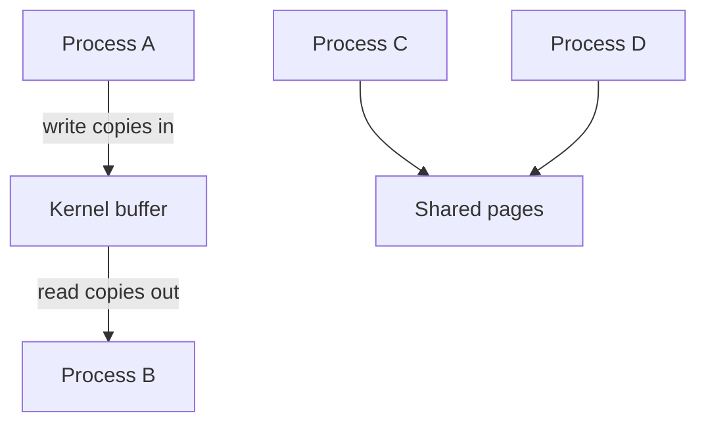

## The hook

Type `cat access.log | grep " 500 " | wc -l` and press enter. Three separate programs start, each in its own process with its own private memory. None of them knows the others exist. Yet the output of the first streams into the second, whose output streams into the third, and you get a count.

Now a harder case. A video app decodes frames in one process and displays them in another. Each frame is several megabytes, many times a second. Copying every frame through the kernel would burn CPU just moving bytes around.

Separate houses cannot reach into each other's kitchens. So how do they cooperate, and why are there five different ways to do it? Each one answers a different question about speed, structure and safety, and picking the right one is a classic interview probe.

## The intuition

:::analogy
Two students in a silent exam hall want to work together. They can **pass notes**: write a note, hand it to the invigilator, who checks it and passes it on. Every note is copied by hand and delivered in order, and nobody can scribble over someone else's note. Or they can **share a whiteboard**: both write on the same board, instantly, as much as they like. Much faster, but if both write in the same spot at once the board becomes nonsense, so they need a rule, like "only the one holding the marker may write".
:::

Every kind of [[inter-process communication]] is one of these two:

| Exam hall | IPC model | Mechanisms |
|---|---|---|
| Passing notes through the invigilator | [[Message passing]]: the kernel copies data from sender to receiver | Pipes, FIFOs, message queues, sockets, signals |
| Sharing a whiteboard | [[Shared memory]]: the kernel maps the same memory into both processes once | POSIX or System V shared memory, shared memory-mapped files |
| The invigilator | The kernel | |
| "Only the one holding the marker writes" | Synchronisation | Semaphores, process-shared mutexes |



The top path is passing notes: two copies per message, and the kernel enforces order. The bottom path is the whiteboard: no copies, and no rules unless you add them.

## How it works

### Pipes: a tube between two desks

A **[[pipe]]** is the simplest note-passing tube. The `pipe()` system call returns two file descriptors: one for the read end, one for the write end. Bytes written at one end come out of the other in the same order.

- **One-way.** Data flows from the write end to the read end. For two-way talk you need two pipes.
- **A byte stream.** There are no message boundaries: two writes of 5 bytes may be read as one read of 10, or as reads of 3 and 7.
- **A bounded kernel buffer.** On Linux the default capacity is 64 KiB. A writer blocks when it is full; a reader blocks when it is empty. That built-in blocking gives you flow control for free.
- **Related processes only.** An anonymous pipe has no name, so the only way to share it is to create it *before* `fork`, letting the child inherit the descriptors.

That last point is how your shell built the pipeline in the hook: create a pipe, fork twice, and in each child move the right end onto standard input or output before calling `exec`. `grep` never knows it is reading from a pipe.

### Tracing a pipe, byte by byte

Predict as you go: what does `read` return in the last row?

| Step | Action | Buffer contents | Returns |
|---|---|---|---|
| 1 | Writer: `write("hello", 5)` | `hello` | 5 |
| 2 | Reader: `read(buf, 3)` | `lo` | 3, got `hel` |
| 3 | Writer: `write("!", 1)` | `lo!` | 1 |
| 4 | Reader: `read(buf, 100)` | (empty) | 3, got `lo!` |
| 5 | Reader: `read(buf, 100)` | (empty) | Blocks: the writer might still send more |
| 6 | Writer closes its end | (empty) | The blocked read wakes up |
| 7 | (the read from step 5) | (empty) | **0**, meaning end of file |

`read` returning 0 is how a reader learns the conversation is over. But here is the catch: the kernel reports end of file only when **every** write end is closed. After `fork`, both parent and child hold both ends. If the reader forgets to close its own copy of the write end, step 7 never comes, and it blocks forever waiting for itself. That bug, a hung pipeline, is the most common pipe mistake there is.

```cpp
#include <bits/stdc++.h>
#include <sys/wait.h>
#include <unistd.h>
using namespace std;

int main() {
    int fd[2];                        // fd[0] = read end, fd[1] = write end
    if (pipe(fd) < 0) { perror("pipe"); return 1; }
    pid_t pid = fork();
    if (pid == 0) {                   // child: the reader
        close(fd[1]);                 // without this, read never returns 0
        char buf[64];
        string got;
        ssize_t n;
        while ((n = read(fd[0], buf, sizeof buf)) > 0) got.append(buf, n);
        cout << "child read: " << got << endl;  // flush: _exit skips it
        _exit(0);
    }
    close(fd[0]);                     // parent: the writer
    string msg = "hello through the pipe";
    if (write(fd[1], msg.data(), msg.size()) < 0) perror("write");
    close(fd[1]);                     // signals end of file to the reader
    waitpid(pid, nullptr, 0);
}
```

Two more pipe rules worth knowing. Writing to a pipe whose readers have all closed raises the `SIGPIPE` signal, which by default kills the writer; that is why `yes | head -1` stops instead of running forever. And writes of at most `PIPE_BUF` bytes (4,096 on Linux) are atomic, so several writers sending small messages to one pipe will not have their bytes interleaved.

### FIFOs: a tube with a name on the wall

A **[[FIFO]]**, or named pipe, is a pipe with a name in the file system, created with `mkfifo`. Any process with permission can open it by path, so unrelated processes can use it. Opening for reading typically blocks until someone opens it for writing, and the data still flows through a kernel buffer, never touching the disk.

### Message queues: a pigeonhole for whole notes

A **message queue** keeps discrete messages, not a byte stream. Each `send` puts one complete message in the queue, and each `receive` takes exactly one out. POSIX message queues also let each message carry a priority, and higher-priority messages come out first.

Wait, why would you want boundaries if a pipe moves bytes faster? Because with a byte stream, the *reader* must reassemble messages: "read 4 bytes of length, then read exactly that many more, handling short reads". A queue does it for you. And the queue lives in the kernel independently of any process, so a sender can post a message and exit before the receiver even starts.

### Shared memory: the whiteboard

With **shared memory**, one process creates a named memory object (`shm_open` then `mmap` in POSIX, or `shmget` and `shmat` in System V), and others map the same object. From then on, a write by one process is visible to the others **with no system call at all**. They are writing on the same physical pages.

That is the answer to the video app in the hook. The decoder writes a frame into the shared region; the display process reads it in place. No copy through the kernel.

But remember the whiteboard rule. Shared memory gives you **no synchronisation**. If the display process reads while the decoder is halfway through writing a frame, it shows half of one frame and half of the previous one. You must add a marker: a semaphore or a mutex placed in the shared region and marked process-shared, usually around a ring buffer of slots. That is the producer-consumer problem, and the tools to solve it are in [A Key for One Room, a Bowl for the Car Park](article:cs-core-mutex-semaphore).

:::insight
Message passing is slower but safe by construction: the kernel copies each message and delivers it whole and in order. Shared memory is fastest because nothing is copied after setup, but every bit of coordination becomes your job. You are choosing who carries the burden of correctness, the kernel or you.
:::

### Sockets: a phone line that reaches other buildings

A **[[socket]]** is a two-way endpoint. Two flavours matter:

- **Unix domain sockets** connect processes on one machine through a path in the file system. They support stream and datagram modes, and they can even pass open file descriptors from one process to another.
- **Network sockets** (TCP for reliable streams, UDP for datagrams) connect processes on different machines.

Because the programming interface is almost the same, a local service built on a Unix domain socket can later move to another machine with TCP and little code change. That is why databases, container runtimes and desktop services commonly expose a local socket. The network path is the one [Everything That Happens Before a Page Appears](article:system-design-client-server-http) walks through.

### Signals: a tap on the shoulder

A signal is a tiny notification identified by a number, like `SIGTERM` or `SIGCHLD`. It carries no data beyond "this happened". It is used for control (stop, terminate, your child exited), not for moving data.

### Counting the copies

Here is the cost difference, traced. Send 1 MiB from process A to process B.

| Mechanism | Kernel copies per byte | System calls (illustrative) | Synchronisation |
|---|---|---|---|
| Pipe, 64 KiB writes | 2: user to kernel, kernel to user | At least 16 writes and 16 reads, more if reads return short | Built in: blocking on full and empty |
| Message queue, 8 KiB messages | 2 | 128 sends and 128 receives | Built in |
| Unix domain socket | 2 | Similar to a pipe | Built in |
| Shared memory | 0 after setup | A few to set up, then none for data | Yours: for example a semaphore wait and post per chunk |

Where do those counts come from? 1 MiB is 1,048,576 bytes. Divided into 64 KiB pieces that is 16 writes; divided into 8 KiB messages it is 128.

:::warning
Common misconception: "shared memory is always the best IPC because it is fastest." It is fastest at moving *large* data. For small, infrequent messages the setup and the synchronisation dominate, and the bugs are much harder: a crashed process can leave a lock held or a structure half-written. Pipes and sockets are simpler, safer and fast enough for most traffic.
:::

:::try-this
A logging daemon receives short log lines from 20 unrelated processes on the same machine and must never see two lines mixed together. Which mechanism, and why not an anonymous pipe? (A message queue, or a Unix domain datagram socket, since each line arrives as one whole message. An anonymous pipe needs a common parent to share it; a FIFO would work for lines under PIPE_BUF bytes, which are written atomically, but a message-oriented mechanism states the intent directly.)
:::

## Trade-offs

| Mechanism | Direction | Boundaries | Related processes only? | Across machines? | Speed | Sync |
|---|---|---|---|---|---|---|
| Anonymous pipe | One-way | Byte stream | Yes | No | Good | Built in |
| FIFO (named pipe) | One-way | Byte stream | No | No | Good | Built in |
| Message queue | Many to many | Whole messages, with priorities in POSIX | No | No | Good | Built in |
| Shared memory | Any | None, you design the layout | No | No | Best for bulk data | You add it |
| Unix domain socket | Two-way | Stream or datagram | No | No | Good | Built in |
| TCP or UDP socket | Two-way | Stream or datagram | No | Yes | Network bound | Built in |
| Signal | One-way | Just a number | No | No | Tiny payload | n/a |

Rules of thumb:

- Parent and child streaming data: a **pipe**.
- Unrelated local processes with request and reply: a **Unix domain socket**.
- Discrete jobs with priorities between local processes: a **message queue**.
- Large data at high rates on one machine: **shared memory** plus a semaphore.
- Anything that may cross machines: a **socket**, or at larger scale a message broker.

## What can go wrong

- **Hung readers.** A pipe reader never sees end of file because some process still holds the write end. Close every unused end right after fork.
- **Killed writers.** Writing to a pipe or socket with no reader raises `SIGPIPE`. Handle or ignore it and check the `EPIPE` error instead.
- **Deadlock with two pipes.** Parent writes a lot to the child and waits; child writes a lot back and waits; both buffers fill and both block forever. Read and write concurrently, or bound the messages.
- **Pointers in shared memory.** The shared region may be mapped at different addresses in each process, so a raw pointer stored by one is garbage to the other. Store offsets from the start of the region.
- **Torn reads in shared memory.** Reading while another process writes yields a mix of old and new data. Synchronise every access.
- **Leftover objects.** Named FIFOs, message queues and shared memory objects outlive the processes that made them. Remove them (`unlink`, `mq_unlink`, `shm_unlink`) or they accumulate.

### Interview follow-ups

**"Which IPC is fastest and why?"** Shared memory, because after the mapping exists, data moves with plain loads and stores and no kernel copy. Then add the caveat: you must synchronise, and for small messages the difference rarely matters.

**"Pipe versus FIFO versus message queue?"** A pipe is anonymous and needs a common ancestor; a FIFO is a pipe with a file-system name so unrelated processes can use it; a message queue preserves message boundaries and can order by priority. Pipes and FIFOs are byte streams.

**"How does the shell implement `a | b`?"** It creates a pipe, forks twice, makes the first child's standard output the write end and the second child's standard input the read end with `dup2`, closes all unused ends in every process, execs `a` and `b`, and waits for both.

**"How would two processes share a counter safely?"** Put the counter in shared memory together with a process-shared mutex or a semaphore, and wrap every update in lock and unlock. Or avoid sharing entirely: one process owns the counter and the others send it "increment" messages.

**"When would you choose a socket over shared memory on one machine?"** When you want a simple request and reply protocol, isolation if one side crashes, and the option of moving a service to another machine later.

## In the real world

- Every shell pipeline you type is anonymous pipes plus fork, dup2 and exec.
- Databases and container daemons commonly listen on a Unix domain socket for local clients, because it skips the network stack and file permissions can control access.
- Browsers and media apps move large buffers such as images and video frames between their processes through shared memory, and use message channels for the small control messages around them.
- Between machines, the same choice reappears one level up: a message queue between services is note-passing at data-centre scale, as in [The Ticket Rail Between Waiters and Cooks](article:system-design-message-queues), while a shared cache cluster is the whiteboard, as in [A Shared Whiteboard the Whole Fleet Can Read](article:system-design-distributed-cache).

The whiteboard left an open question. Two writers, one board, no rule: what *exactly* goes wrong, and why does a single line like `count++` break? That is [Two People, One Spreadsheet Cell](article:cs-core-race-conditions).

## Further reading

- The Linux manual pages `pipe(7)`, `fifo(7)`, `mq_overview(7)`, `shm_overview(7)` and `unix(7)`.
- *The Linux Programming Interface* by Michael Kerrisk, the chapters on pipes, FIFOs, POSIX IPC and sockets.

## Key takeaways

- Processes cannot read each other's memory, so they communicate either by message passing through the kernel or by sharing memory the kernel maps into both.
- A pipe is a one-way byte stream through a bounded kernel buffer, and its reader sees end of file only when every write end is closed, so unused ends must be closed after fork.
- A FIFO is a named pipe usable by unrelated processes, and a message queue preserves message boundaries instead of delivering a byte stream.
- Shared memory is fastest for large data because nothing is copied after setup, but the processes must add their own synchronisation.
- Sockets give two-way communication that works on one machine through Unix domain sockets or across machines through TCP and UDP.
