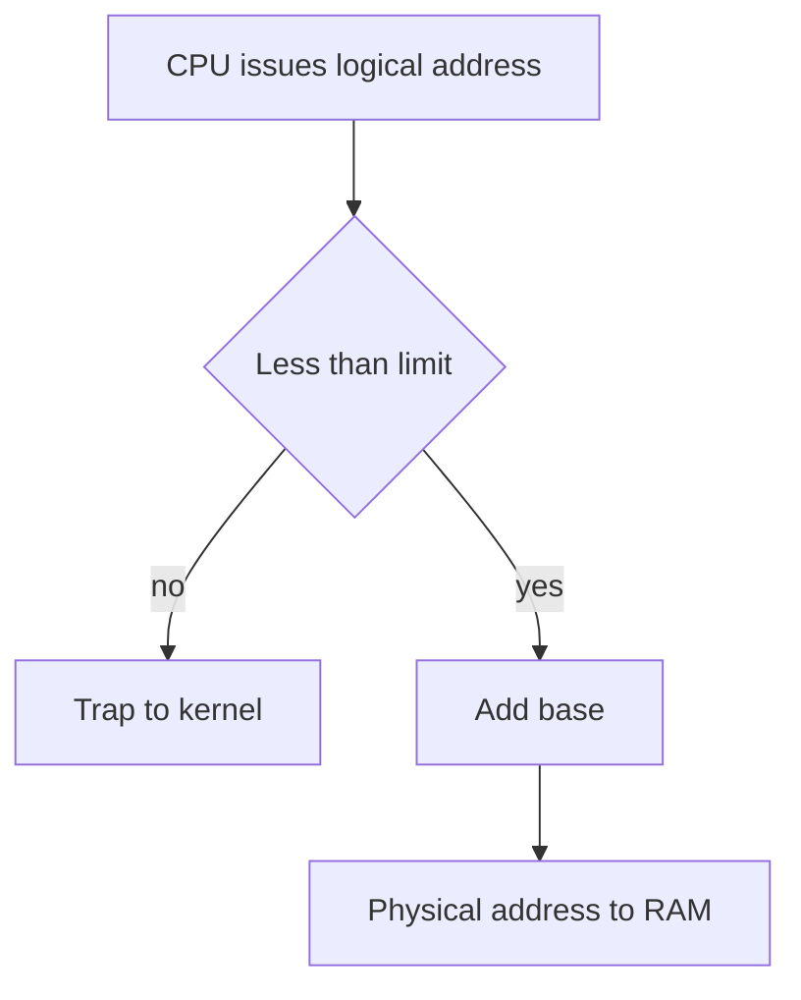

## The hook

A machine has 1750 KB of memory for user programs. Four programs arrive, asking for 210, 420, 120 and 450 KB. That is 1200 KB in total, comfortably less than what is available.

Run the simplest allocator, and the fourth program is refused. At that moment, the machine has **1000 KB free**. More than twice what the program wanted.

Nothing leaked. No program misbehaved. The memory is free, just in the wrong shape. To see why, and why a different allocator succeeds on the same input, you only need to think about parking.

## The intuition

:::analogy
Picture one long **kerb** where cars park in a single line, bumper to bumper, with no markings. Cars come in **different lengths**: a hatchback, a van, a bus. When a car leaves, it leaves a **gap** exactly its own length. A newly arriving car can only use a gap at least as long as itself. After a morning of arrivals and departures, the kerb is dotted with gaps of every size, and a bus can drive the whole street without finding one long enough, even though the gaps add up to three buses' worth.
:::

| On the kerb | In memory |
|---|---|
| The kerb | Physical memory available for user processes |
| A car | A process, which must occupy one contiguous block |
| A car's length | The process's memory size |
| A gap | A [[hole]]: a free contiguous block |
| Choosing which gap to park in | The placement policy: first, best or worst fit |
| Gaps too small to use | [[External fragmentation]] |
| A marked bay longer than your car | [[Internal fragmentation]] |
| Asking everyone to shuffle up | [[Compaction]] |

Everything below comes back to one rule: **each car must sit in one piece**. That is what "contiguous allocation" means, and it is the source of every problem below.

## How it works

### Where a program thinks it lives

Every program is written as if its memory starts at address 0. The addresses it uses are [[logical address|logical addresses]]. Physical memory, the actual RAM chips, is shared by the kernel and many processes, so a program almost never really sits at physical address 0.

When does the translation from one to the other happen? There are three choices, called binding times:

| Binding time | How | Can the program move later |
|---|---|---|
| Compile time | The compiler writes physical addresses into the code | No, it must load at that exact place |
| Load time | The loader patches addresses when the program is loaded | No, not once it is running |
| Execution time | Hardware translates every address on every access | Yes, the kernel just changes the translation |

Modern systems use execution-time binding. The simplest hardware that does it is a pair of [[base and limit registers]] inside the CPU's memory management unit, the MMU.

### Base and limit: one car, one stretch of kerb

The kernel loads the running process's base, where its block starts in physical memory, and limit, how long the block is. On every memory access:

```pseudo
translate(logical):
    if logical >= limit: trap to the kernel    # outside your own block
    return base + logical
```



Say a process is loaded with base 14000 and limit 3000. Its legal logical addresses are 0 to 2999.

| Logical address | Check against limit 3000 | Result |
|---|---|---|
| 0 | OK | Physical 14000 |
| 2500 | OK | Physical 16500 |
| 2999 | OK | Physical 16999 |
| 3000 | Not less than 3000 | Trap: the process tried to touch memory that is not its own |

This one comparison is the memory protection from [The Hotel Manager Every Program Secretly Reports To](article:cs-core-what-an-os-does): a process physically cannot form an address outside its block. Only the kernel, in kernel mode, may change the base and limit registers. On a context switch, it reloads them for the next process.

And because translation happens at run time, the kernel can move a process to a new place by copying its memory and changing one register. Hold that thought; it is what makes compaction possible later.

### Fixed partitions: painted bays

The oldest scheme paints the kerb into fixed bays before anyone arrives, say, every bay 512 KB long. Each process gets one bay.

Easy to manage, but a 300 KB process in a 512 KB bay wastes 212 KB that nobody else can use. That waste sits *inside* an allocated block, which is internal fragmentation. And a 600 KB process can never run at all, however empty the machine.

### Variable partitions: park anywhere

Remove the paint. Each process gets a block exactly its own size, carved out of whichever hole the allocator chooses. The kernel keeps a list of holes; on allocation it splits a hole into "used" and "leftover"; when a process exits, its block becomes a hole and merges with any neighbouring holes.

No internal fragmentation now. But which hole should a new process go into? There are three classic answers:

| Policy | Rule | Kerb version |
|---|---|---|
| **First fit** | The first hole, from the start of the list, that is big enough | Drive down the street, park in the first gap that fits |
| **Best fit** | The smallest hole that is big enough | Find the tightest gap, to leave big gaps for big cars |
| **Worst fit** | The largest hole | Park in the biggest gap, so the leftover is still useful |

A variant, **next fit**, is first fit that resumes scanning from where the last search ended instead of from the start.

### The hook, traced

The 1750 KB of user memory currently has five holes, in address order: **H1 = 200, H2 = 500, H3 = 150, H4 = 300, H5 = 600 KB**. Requests arrive in order: **A = 210, B = 420, C = 120, D = 450 KB**.

Before reading the tables, take a guess: which policy will fit all four? Most people pick worst fit, "because it keeps leftovers big".

**First fit:**

| Request | Holes before | Chosen | Holes after |
|---|---|---|---|
| A 210 | 200, 500, 150, 300, 600 | H2 (500), first that fits | 200, 290, 150, 300, 600 |
| B 420 | 200, 290, 150, 300, 600 | H5 (600) | 200, 290, 150, 300, 180 |
| C 120 | 200, 290, 150, 300, 180 | H1 (200) | 80, 290, 150, 300, 180 |
| D 450 | 80, 290, 150, 300, 180 | none is 450 or more | **fails**, with 1000 KB free |

**Best fit:**

| Request | Chosen | Leftover in that hole | Holes after |
|---|---|---|---|
| A 210 | H4 (300), the tightest fit | 90 | 200, 500, 150, 90, 600 |
| B 420 | H2 (500) | 80 | 200, 80, 150, 90, 600 |
| C 120 | H3 (150) | 30 | 200, 80, 30, 90, 600 |
| D 450 | H5 (600) | 150 | 200, 80, 30, 90, 150 |

All four fit, with 550 KB left over, which checks out: 1750 − 1200 = 550.

**Worst fit:**

| Request | Chosen | Holes after |
|---|---|---|
| A 210 | H5 (600), the largest | 200, 500, 150, 300, 390 |
| B 420 | H2 (500) | 200, 80, 150, 300, 390 |
| C 120 | H5 (390), still the largest | 200, 80, 150, 300, 270 |
| D 450 | none is 450 or more | **fails**, with 1000 KB free |

Worst fit lost, not won. It kept chopping the biggest hole, which was exactly the one the bus needed. Best fit protected the 600 KB hole by placing small cars in tight gaps.

Wait, so is best fit simply the best? No. Best fit leaves behind slivers, here 30, 80 and 90 KB, too small for almost anything; over a long run, the kerb fills with useless crumbs. Try this input instead.

:::try-this
Holes of 200 and 150 KB, in that order. Requests 140, 60, 150 arrive. Run best fit and first fit. Which one places all three? (Best fit puts 140 in the 150 hole, leaving 10, then 60 in the 200 hole, leaving 140; the 150 request then fails. First fit puts 140 in the 200 hole, leaving 60, then 60 exactly fills it, and 150 takes the 150 hole. First fit wins.)
:::

No placement policy is best on every input. Simulation studies in the classic literature found first fit and best fit similar in how well they use memory, with first fit usually faster, since it can stop at the first hole that fits, while best fit must check every hole unless the list is kept sorted by size. Worst fit generally does worse on both counts.

:::insight
Contiguous allocation always loses memory to the gaps between blocks, whatever placement policy you use. The policies only change how fast you find a gap and which gaps you leave behind.
:::

### Two kinds of waste, one picture each

These two terms are the most-asked definitions in the topic, so make them concrete:

| | Internal fragmentation | External fragmentation |
|---|---|---|
| Where the waste is | Inside an allocated block | Between allocated blocks |
| Cause | Blocks come in fixed or rounded sizes larger than the request | Variable-sized blocks come and go and leave scattered holes |
| Kerb picture | A painted bay longer than your car | Gaps between cars, each too short for the next car |
| Example | A 300 KB process in a 512 KB partition wastes 212 KB | 1000 KB free in five holes, none of them 450 KB |
| Who suffers | Fixed partitions, the buddy system, paging (last page) | Variable partitions, segmentation |
| Cure | Smaller allocation units | Compaction, or non-contiguous allocation such as paging |

How bad is external fragmentation in practice? Knuth's analysis of first fit, known as the **50-percent rule**, says that when the system settles down with N allocated blocks, about 0.5N more blocks are lost to fragmentation. That means up to a third of memory can be unusable.

:::warning
Common misconception: "internal fragmentation means unused memory inside a process, like a big array the program never fills." Internal fragmentation is about the allocator: the block it handed out is larger than the size that was requested. A program that asks for 1 MB and uses 10 KB of it has a wasteful program, not internal fragmentation.
:::

### Compaction: everyone shuffle up

Back to the failed first-fit run, with 1000 KB free in five holes. What if every parked car rolled forward until it touched the car in front? All the gaps would slide to the end of the kerb and merge into one 1000 KB gap, and D's 450 KB fits easily.

That is compaction. It needs execution-time binding, because every moved process must keep running at a new physical address, which the kernel arranges by updating its base register. It is also expensive:

- Copying hundreds of megabytes takes real time, and processes must pause while their memory moves.
- A buffer that a device is writing into directly cannot move mid-transfer, so some blocks are pinned in place.
- Moving everything is overkill; a smart compactor moves only enough to create one hole big enough for the waiting request.

### A tidier kerb: the buddy system

The [[buddy system]] sits between the two extremes. Memory is handed out only in power-of-two sizes. To serve a request, take the smallest power of two that fits; if no free block of that size exists, split a larger block in half, again and again.

Start with one free 1024 KB block:

| Step | Request | Rounded to | Action | Free blocks after |
|---|---|---|---|---|
| 1 | 300 KB | 512 | Split 1024 into two 512 buddies, give one | 512 |
| 2 | 120 KB | 128 | Split 512 into 256 + 256, split one 256 into 128 + 128, give one 128 | 256, 128 |
| 3 | 300 KB is freed | | Its buddy, the other 512, is not entirely free, so no merge | 512, 256, 128 |

Internal fragmentation here: 512 − 300 = 212 KB plus 128 − 120 = 8 KB, so 220 KB. In exchange, finding a block and merging free buddies back together are very fast, because a block's buddy is at an address you can compute directly. Linux's physical page allocator is a buddy allocator.

## Trade-offs

| Choice | You gain | You give up |
|---|---|---|
| Fixed partitions | Trivial bookkeeping | Internal fragmentation, and a hard cap on process size |
| Variable partitions | No internal fragmentation | External fragmentation, and a hole list to search |
| First fit | Fast, stops early | Small holes pile up near the start of the list |
| Best fit | Keeps large holes intact longer | Full scan unless sorted, and many tiny useless slivers |
| Worst fit | Leftovers stay medium-sized | Destroys the large holes that large requests need |
| Compaction | Recovers external fragmentation | Copying cost, pauses, needs run-time relocation |
| Buddy system | Very fast split and merge | Internal fragmentation from rounding up to powers of two |

The deeper trade-off is the contiguity rule itself. As long as each process must sit in one piece, some memory will always be lost to gaps.

## What can go wrong

- **Out of memory with memory free.** The hook: external fragmentation can refuse a request while total free space is far larger.
- **Assuming worst fit keeps memory flexible.** It does the opposite on most inputs, as the trace showed.
- **Assuming best fit is optimal.** It leaves slivers and can fail where first fit succeeds, as in the try-this.
- **Compacting too often.** The copying cost can exceed what the recovered space is worth.
- **Forgetting to merge neighbouring holes on free.** Two adjacent 100 KB holes must become one 200 KB hole, or fragmentation gets worse for no reason.
- **Mixing up the two fragmentations in an exam.** Inside an allocated block is internal; between blocks is external.

### Interview follow-ups

**"What is the difference between internal and external fragmentation?"** Internal fragmentation is waste inside an allocated block, because the block is bigger than the request, as with fixed partitions or rounding. External fragmentation is free memory split into holes between allocated blocks, none large enough for a request even though their total is.

**"Which is better, first fit or best fit?"** Neither wins on every input. In simulations they use memory about equally well, and first fit is usually faster because it stops at the first match. Worst fit is generally worse than both.

**"Does compaction fix internal fragmentation?"** No. Compaction merges the holes between blocks; the wasted space inside each block moves along with the block.

**"Why can't a system compact memory if addresses are bound at load time?"** Because the program's code already contains physical addresses. Moving it would break every pointer. Only execution-time binding, where hardware adds a base on every access, lets the kernel move a process by changing a register.

**"How do you get rid of external fragmentation entirely?"** Drop the requirement that a process occupies one contiguous block. Paging cuts memory into equal-sized pieces so any free piece fits any request, at the cost of a little internal fragmentation in each process's last page.

## In the real world

- **Kernels** use the buddy system for physical pages, plus caching allocators on top for small, frequently used kernel objects.
- **User-space allocators** such as `malloc` face the same kerb inside a process's heap. They usually group requests into size classes, accepting a little internal fragmentation in exchange for speed and fewer scattered holes.
- **Garbage-collected runtimes** such as the JVM can compact the heap, because the runtime knows where every pointer is and can update them when objects move.
- **Early systems** really did use fixed and variable partitions with base and limit registers. Today, plain contiguous allocation of whole processes survives mostly in small embedded systems without an MMU that supports paging.
- How costly a trip to memory is compared with the CPU's own work is put on a human scale in [If a CPU Cycle Took One Second](article:system-design-latency-numbers).

The kerb's real problem is that a bus refuses to be cut in half. What if every program were cut into equal, small pieces, so any free gap fits any piece, and a little table remembered where each piece was parked? That is [The Index That Tells You Which Shelf](article:cs-core-paging-tlb).

## Further reading

- *Operating System Concepts* by Silberschatz, Galvin and Gagne, the main memory chapter on contiguous allocation and fragmentation.
- *Operating Systems: Three Easy Pieces*, the chapters on address translation and free-space management.
- Donald Knuth, *The Art of Computer Programming*, Volume 1, the section on dynamic storage allocation.

## Key takeaways

- Programs use logical addresses, and with execution-time binding the MMU translates each one, in the simplest case by checking it against a limit register and adding a base register.
- Contiguous allocation requires each process to occupy one unbroken block, which is why free memory ends up scattered into holes.
- First fit, best fit and worst fit choose different holes, none is best on every input, and worst fit tends to destroy the large holes that large requests need.
- Internal fragmentation is wasted space inside an allocated block, while external fragmentation is enough total free space split into holes that are each too small.
- Compaction merges the holes by moving processes, which needs run-time relocation and costs copying time, while paging removes external fragmentation by giving up contiguity altogether.
