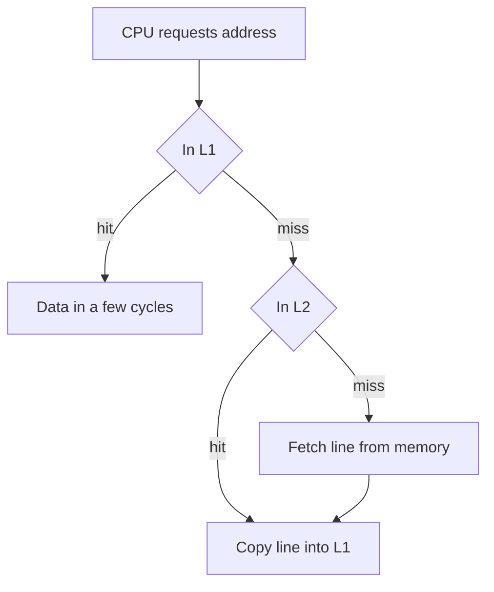

## The hook

Two loops add up the same 16.7 million integers and produce the same sum. The only difference is the order: one walks the grid row by row, the other column by column. On the machine used for this article, the first took about 33 ms and the second about 170 ms. Same work, same answer, five times the time.

Nothing in the code is "slow". The difference is entirely in where the data was when the processor asked for it. Understanding why is the key to the memory hierarchy, a favourite of architecture questions and of performance interviews. Predict how many ints the processor gets each time it fetches from memory. (Sixteen: a 64-byte cache line holds sixteen 4-byte ints.)

## The intuition

:::analogy
A carpenter keeps the few tools in constant use **on a belt**, the day's tools **on the bench**, and everything else **in the shed** across the yard. Reaching to the belt is instant; walking to the shed takes minutes. A good carpenter fetches a whole box of related tools from the shed in one trip and keeps the ones in use close by. Processors do exactly this with data.
:::

## How it works

### The levels

| Level | Typical size | Typical access time | Managed by |
|---|---|---|---|
| Registers | under a kilobyte | under a cycle | compiler |
| L1 cache | tens of KB per core | a few cycles | hardware |
| L2 cache | hundreds of KB to a few MB | around ten cycles | hardware |
| L3 cache | several to tens of MB, shared | tens of cycles | hardware |
| Main memory (DRAM) | gigabytes | around 100 ns | OS and hardware |
| SSD / disk | terabytes | microseconds to milliseconds | OS |

(Sizes and times vary by processor; these are typical orders of magnitude.) Each level is smaller, faster and more expensive per byte than the one below it. The hierarchy works only because programs have **locality**.

### Locality

- **[[Temporal locality]]**: a loop counter, a frequently called function, a hot table entry are used again and again.
- **[[Spatial locality]]**: after a[i], a[i+1] is usually next.

So caches keep recently used data (temporal) and fetch a whole **[[cache line]]**, 64 bytes on the test machine, at a time (spatial).

### The hook, explained

The grid is stored row by row, so a row is 4096 consecutive ints (16 KB).

| Order | Consecutive accesses are | Use of each 64-byte line | Time on the test machine |
|---|---|---|---|
| Row by row | 4 bytes apart | all 16 ints used before moving on | about 33 ms |
| Column by column | 16 KB apart | 1 int used; the line is often evicted before its neighbours are needed | about 170 ms |

Wait, the column loop eventually touches every int in every line, so why is it slow? By the time it returns to a line for the next column, 4,096 other lines have been loaded in between, far more than L1 holds, so the line has usually been evicted and must be fetched again. Same data, sixteen times the traffic.

### Where can a line go? Mapping

| Mapping | A memory block can go in | Trade-off |
|---|---|---|
| Direct-mapped | exactly one cache slot (block number mod number of slots) | simple and fast, but two hot blocks mapping to the same slot evict each other |
| Fully associative | any slot | no conflict misses, but every slot must be searched |
| k-way set associative | any of the k slots in one set | the usual compromise (L1 is often 8-way or so) |

An address is split into **tag | index | offset**: the offset picks the byte within the line, the index picks the set, and the tag checks it is the right block. With 64-byte lines, the offset is the low 6 bits.

### Hit ratio and AMAT

The **[[hit ratio]]** is the fraction of accesses found at a level. **[[AMAT]]** combines levels:

AMAT = hit time + miss rate × miss penalty

applied recursively. Worked example (illustrative numbers): L1 hit 1 ns with a 5% miss rate, L2 hit 10 ns with a 20% local miss rate, memory 100 ns.

| Step | Value |
|---|---|
| L2's effective time = 10 + 0.2 × 100 | 30 ns |
| AMAT = 1 + 0.05 × 30 | **2.5 ns** |
| same, with no L2: 1 + 0.05 × 100 | 6 ns |
| L1 miss rate rising to 10%: 1 + 0.10 × 30 | 4 ns |

The three Cs of misses: **compulsory** (first touch), **capacity** (the working set is bigger than the cache), **conflict** (blocks competing for the same set).

:::insight
Each level of the hierarchy is a cache for the one below, and it pays off because programs reuse data (temporal locality) and use neighbouring data (spatial locality). Data moves in 64-byte lines, so access order matters as much as the amount of work, and AMAT shows how a small change in miss rate multiplies into a large change in average speed.
:::

## Trade-offs

| Design choice | Gain | Cost |
|---|---|---|
| Bigger cache | Fewer capacity misses | Slower hit time, more area and power |
| Larger lines | Better spatial locality | More wasted bytes when access is scattered; more conflicts |
| Higher associativity | Fewer conflict misses | Slower, more complex lookup |
| More levels | Bridges the processor–memory speed gap | Complexity, coherence work |

:::warning
Common misconception: "Big-O tells you which of two loops is faster." Both loops above are O(n²) with identical operation counts, yet one is five times slower. Constant factors from memory access patterns often dominate real performance, which is why arrays usually beat linked structures in practice.
:::

:::try-this
A cache has 64-byte lines and 64 sets, and addresses are 32 bits. How many bits are the offset, the index and the tag? (Offset: log₂ 64 = 6 bits. Index: log₂ 64 = 6 bits. Tag: 32 − 6 − 6 = 20 bits.)
:::

## What can go wrong

- **Column-order traversal** of row-major arrays (or the reverse in column-major languages).
- **Linked structures** scattering nodes so every step is a cache miss.
- **Working sets slightly bigger than a cache level**, causing a sudden performance cliff.
- **Power-of-two strides** mapping many accesses to the same set, causing conflict misses.
- **False sharing** between threads, covered in the cache coherence article.

### Interview follow-ups

**"Write-through versus write-back?"** Write-through updates memory on every write (simple, more traffic); write-back updates memory only when a dirty line is evicted (less traffic, needs a dirty bit).

**"What is the difference between a cache and virtual memory's TLB?"** A data cache holds memory contents; the TLB caches address translations, as in the paging article of the OS track.

**"How does this relate to system-design caching?"** Same idea at another scale: keep hot data in a faster, smaller store and accept misses.

## In the real world

High-performance code (databases, game engines, numerical libraries) is designed around cache lines: arrays of structures versus structures of arrays, blocking matrix multiplication into cache-sized tiles, and keeping hot data compact. The OS-level counterpart, keeping pages in RAM, is in [A Desk That Holds Only Today's Books](article:cs-core-virtual-memory).

## Further reading

- John Hennessy and David Patterson, *Computer Architecture: A Quantitative Approach*, chapter on memory hierarchy design.
- Ulrich Drepper, "What Every Programmer Should Know About Memory" (2007).

## Key takeaways

- The memory hierarchy runs from registers through L1, L2 and L3 caches to main memory and storage, each level larger and slower than the one above.
- Caches work because of temporal locality (reuse soon) and spatial locality (use neighbours soon), and data moves in cache lines, typically 64 bytes.
- Summing a row-major grid column by column took about five times longer than row by row on the test machine, purely because of how cache lines were used.
- AMAT equals hit time plus miss rate times miss penalty, applied level by level, so the worked example gives 1 + 0.05 × (10 + 0.2 × 100) = 2.5 ns.
- Misses are compulsory, capacity or conflict misses, and associativity, cache size and line size trade these against hit time.
