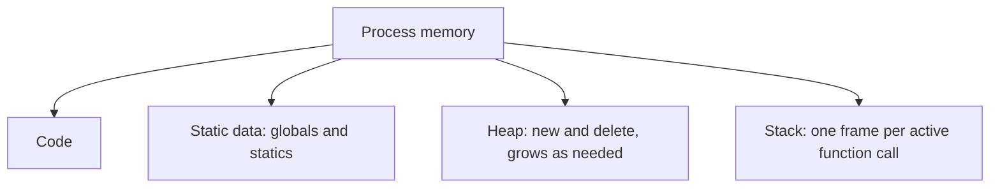

## The hook

Three bug reports land on the same day. A long-running service slowly eats all the memory on its machine until it is killed. A function sometimes returns garbage values, but only in release builds. A program crashes inside the memory allocator, nowhere near the code that is actually wrong.

They are the three classic C++ memory bugs: a leak, a dangling pointer, and a double free (or use after free). All three come from not knowing, or not following, where an object lives and who ends its life. Predict which one the compiler can catch by itself, with no extra tools. (Returning the address of a local variable: g++ warns about it.)

## The intuition

:::analogy
Your college gives you **a desk you clear daily**: whatever you put on it is swept away automatically at the end of the day, with no effort from you. It also rents you **a storage unit you must empty yourself**: you can keep things there as long as you like, but nobody clears it for you, and forgetting about it means paying rent forever. And there is the **notice board in the corridor**, which stays up all year. Those are the stack, the heap and static storage.
:::

## How it works

### Three kinds of storage

| Storage | Where | Lifetime | Created by |
|---|---|---|---|
| **[[Automatic storage|Automatic]]** | stack (usually) | from declaration to the end of the block | local variables |
| **[[Dynamic storage|Dynamic]]** | heap | from new until delete | new, make_unique, containers |
| **[[Static storage|Static]]** | data segment | the whole program | globals, static members, static locals |



The stack is fast (allocating is moving a pointer) and automatic, but limited in size (often a few megabytes per thread) and tied to scope. The heap is large and flexible, but each allocation costs more, and lifetime is your responsibility.

### new and delete

```cpp
#include <iostream>
using namespace std;

int globalCounter = 0;                 // static storage: lives for the whole program

void leak() {
    int* p = new int[1000];            // dynamic storage: lives until delete[]
    p[0] = 1;
}                                      // p (the pointer) dies; the 4000 bytes do not

int main() {
    static int calls = 0;              // static local: initialised once, keeps its value
    ++calls; ++globalCounter;
    int onStack = 7;                   // automatic storage
    int* onHeap = new int(9);          // dynamic storage
    cout << onStack << " " << *onHeap << " " << calls << "\n";   // 7 9 1
    delete onHeap;
    onHeap = nullptr;                  // avoid a dangling pointer
    leak();
}
```

`new T` allocates and constructs; `delete p` destructs and frees. Arrays use `new T[n]` and `delete[] p`. Mixing forms (new with delete[], malloc with delete) is undefined behaviour.

### The three classic bugs, caught for real

| Bug | Example | How it was caught |
|---|---|---|
| **[[Memory leak]]** | `leak()` above: the pointer dies, the block does not | AddressSanitizer at exit: "Direct leak of 4000 byte(s) in 1 object(s)" |
| **[[Dangling pointer]]** to a local | `int local = 42; return &local;` | g++ -Wall: "address of local variable 'local' returned" |
| Use after free | `int* p = new int(5); delete p; return *p;` | AddressSanitizer: "heap-use-after-free" |
| Double free | `delete p; delete p;` | AddressSanitizer reports it, or the allocator aborts |

Wait, if using a dangling pointer is so wrong, why does the program often still print the right value? Freed memory is usually not wiped immediately; the old bytes sit there until something reuses the space. That is exactly why these bugs are dangerous: they pass tests, then fail in production when timing or allocation patterns change. **[[AddressSanitizer]]** (`-fsanitize=address`) makes them fail loudly during testing.

### The modern fix: do not write delete

The bugs above come from manual lifetime management. RAII types end it: `std::vector<int> v(1000);` instead of `new int[1000]`, `std::make_unique<T>()` instead of `new T`, `std::string` instead of `new char[]`. Their destructors free memory on every path, including exceptions.

:::insight
Automatic objects die at the end of their scope, static objects at the end of the program, and dynamic objects only when someone deletes them. Leaks, dangling pointers and double frees all come from getting dynamic lifetimes wrong, which is why modern C++ hands dynamic memory to RAII owners such as vector and unique_ptr, and uses sanitizers to catch the rest.
:::

## Trade-offs

| Choice | Gain | Cost |
|---|---|---|
| Stack allocation | Fastest, automatic cleanup | Limited size; lifetime fixed to scope |
| Heap allocation | Large, flexible lifetime | Allocation cost, fragmentation, manual or RAII cleanup |
| Static storage | Always available | Hidden global state, initialisation-order issues |
| Sanitizers in testing | Catch memory bugs early | Slower runs (roughly 2x for AddressSanitizer), more memory |

:::warning
Common misconception: "setting a pointer to nullptr after delete fixes dangling pointers." It fixes *that* pointer only. Any other copies of the address still dangle. The real fix is clear ownership: one owner (such as a unique_ptr), and everyone else holding references whose lifetimes are shorter than the owner's.
:::

:::try-this
A function does `char* name = new char[20]; ... if (bad) return false; ... delete[] name; return true;`. What is the bug, and what is the simplest fix? (The early return skips delete[], leaking 20 bytes every time it fails. Replace the array with std::string or std::vector<char>, whose destructor frees the memory on every path.)
:::

## What can go wrong

- **Leaks on early returns and exceptions** with manual delete.
- **Returning pointers or references to locals.**
- **Iterator or pointer invalidation** when a vector reallocates and old pointers into it dangle.
- **Stack overflow** from huge local arrays or very deep recursion.
- **Static initialisation order**: one global using another from a different file before it is constructed.

### Interview follow-ups

**"Stack versus heap: which is faster and why?"** Stack allocation is a pointer adjustment and memory is likely cached; heap allocation involves the allocator's bookkeeping and possibly a system call.

**"What is the difference between new and malloc?"** new allocates and calls the constructor, returns a typed pointer and throws on failure; malloc returns raw untyped memory and returns null on failure.

**"How do you find a memory leak?"** Run with AddressSanitizer or Valgrind in tests, and prevent leaks by design with RAII owners.

## In the real world

Large C++ codebases run their test suites under sanitizers, and memory-safety bugs are a major reason some teams adopt languages with enforced ownership. The OS-level picture of a process's memory is in [Parking Odd-Sized Cars Along One Kerb](article:cs-core-memory-basics), and RAII is in [A Hotel Room Cleaned Automatically When You Check Out](article:cs-core-constructors-raii).

## Further reading

- The Clang documentation for AddressSanitizer and LeakSanitizer.
- Bjarne Stroustrup, *A Tour of C++*, chapter on resource management.

## Key takeaways

- Automatic objects live until the end of their block, static objects for the whole program, and dynamic objects from new until delete.
- The stack is fast and automatic but small and tied to scope, while the heap is large and flexible but needs explicit or RAII-managed cleanup.
- Leaks, dangling pointers, use after free and double frees all come from mismanaging dynamic lifetimes.
- The compiler warns about returning addresses of locals, and AddressSanitizer catches leaks and use-after-free errors at run time.
- Modern C++ avoids writing delete by using RAII owners such as vector, string and unique_ptr.
