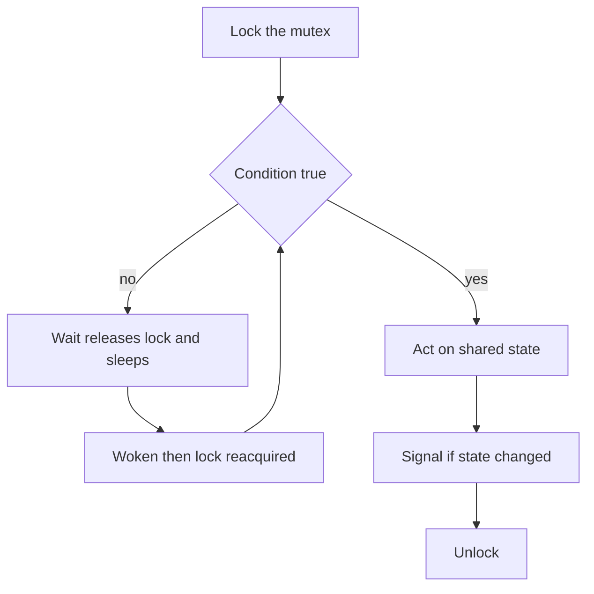

## The hook

You are building a thread pool. Eight worker threads wait for jobs, and a web handler pushes jobs into a shared queue. The workers must not burn CPU checking an empty queue a million times a second. They must sleep, and wake up the moment a job arrives.

A mutex alone cannot do this: it only says "one at a time", not "sleep until the queue is non-empty". A semaphore can count jobs, but your next requirement, "sleep until the queue has room *and* the server is not shutting down", is not a number at all.

So you reach for a condition variable, write `if (queue.empty()) cv.wait(lock);`, and it passes every test. Three weeks later, under load, a worker pops from an empty queue and the server crashes. The fix is a single word. By the end of this piece you will know exactly which word, and why the bug can only appear under load.

## The intuition

:::analogy
Picture a small office with **one counter room** that only one customer may stand in at a time, and a **waiting room with a bell** next door. You walk into the counter room and look at the tray. If what you came for is not there, you do not block the counter by standing around: you walk into the waiting room and sit down, leaving the counter free. When someone changes the tray, they **ring the bell**. One sleeper wakes, and must queue up to walk back into the counter room. By the time they get there, someone else may already have taken the thing. So the rule of the office is: **when the bell wakes you, look at the tray again**.
:::

Every piece of the picture has a technical name.

| In the office | In code | What it means |
|---|---|---|
| The counter room, one person at a time | The [[monitor]]'s lock | Mutual exclusion over the shared data |
| The tray | Shared state, such as a queue | What the threads actually care about |
| Walking into the waiting room | `wait(cv, lock)` | Release the lock and sleep, as one atomic step |
| The waiting room | A [[condition variable]] | A queue of sleeping threads |
| Ringing the bell once | `signal` or `notify_one` | Wake one sleeper, if any |
| Ringing it for everyone | [[Broadcast]] or `notify_all` | Wake every sleeper |
| Looking at the tray again | `while (!condition) wait(...)` | Re-check after every wake-up |

Notice what the waiting room is *not*. It is not a count of jobs, and it does not remember a bell that rang while it was empty. It is just a place to sleep. All the truth lives on the tray.

## How it works

### What a monitor is

A monitor is a language-level package of three things:

1. **Private shared data**, such as the job queue.
2. **Procedures** that are the only way to touch that data, such as `submit` and `take`.
3. **One lock**, acquired automatically on entry to any procedure and released on exit, so at most one thread is ever inside.

Plus zero or more condition variables, so a thread inside can wait for the data to reach some state.

Monitors were proposed in the early 1970s by Per Brinch Hansen and Tony Hoare as a safer structure than raw semaphores, where a single misplaced `wait` or `signal` breaks everything.

Java is the familiar modern case: every object has an intrinsic lock, a `synchronized` method acquires it, and `wait`, `notify` and `notifyAll` are the object's built-in condition variable. In C and C++, you assemble the same thing by hand from a mutex and condition variables.

### The three operations

```pseudo
wait(cv, lock):           # caller must hold lock
    atomically: release lock and go to sleep on cv's queue
    ...later, after being woken...
    reacquire lock         # may block here behind other threads
    return                 # lock held again

signal(cv):               # also notify_one
    if some thread sleeps on cv: move one of them to the ready queue
    else: do nothing       # the signal is lost

broadcast(cv):            # also notify_all
    move every thread sleeping on cv to the ready queue
```

Wait, why must "release the lock" and "go to sleep" be one atomic step? Try splitting them. A worker sees the queue empty, unlocks, and is about to sleep.

In that gap, a submitter locks, pushes a job, signals (nobody is asleep yet, so the signal is lost) and unlocks. The worker now goes to sleep, with a job sitting in the queue and no bell coming. That is the [[lost wakeup]], and making `wait` atomic closes the gap.

### The canonical pattern

Every correct use of a condition variable looks like this, in every language:

```pseudo
# the waiter
lock(m)
while not condition_on_shared_state:
    wait(cv, m)
act on shared state           # condition is guaranteed true here
unlock(m)

# the changer
lock(m)
change shared state
signal(cv)                    # or broadcast
unlock(m)
```



The arrow from D back to B is the whole article. A wake-up is a hint that the condition *might* be true, never a promise.

### Hoare versus Mesa: who runs after the bell?

There are two possible rules for what happens at the moment of a signal.

| | Hoare semantics | [[Mesa semantics]] |
|---|---|---|
| After signal | The signaller hands the lock straight to the woken thread and pauses | The signaller keeps the lock and keeps running |
| Woken thread | Runs immediately, with the condition still true | Goes to the ready queue and competes for the lock later |
| Can the condition be false when it resumes | No | Yes |
| `if` around wait | Correct | **Wrong** |
| Used by | Mostly textbooks | POSIX threads, Java, C++, and most real systems |

Mesa semantics take their name from the Mesa language at Xerox PARC, whose designers chose signal-and-continue because it is simpler to implement and avoids extra context switches. The price is that the woken thread has to look at the tray again. In the office picture: the bell does not escort you to the counter; it just wakes you up, and you join the line.

### The bug from the hook, traced

Predict it before reading the table. The queue is empty. Worker W1 is asleep inside `if (queue.empty()) wait(...)`. A submitter pushes one job. Can anything go wrong?

| Step | Submitter S | Worker W1 (uses `if`) | Worker W2 (just arriving) | Queue |
|---|---|---|---|---|
| 1 | | Asleep in wait | | empty |
| 2 | lock, push job J, signal | Woken: moved to ready, needs the lock | | J |
| 3 | unlock | Waiting for the lock | | J |
| 4 | | | lock wins the race, sees J, pops it | empty |
| 5 | | | unlock | empty |
| 6 | | Gets the lock, `if` already passed, pops | | **empty: crash** |

W2 was never asleep. It simply arrived at the counter while W1 was still walking back from the waiting room, which is exactly what happens under load and almost never in a quiet unit test. Change `if` to `while` and step 6 becomes "re-check, queue empty, wait again". That is the one-word fix.

:::insight
A wake-up from a condition variable only means "the world changed, go and look". Always wait inside `while (!condition)`, so that a stolen item, a spurious wake-up and a broadcast all become harmless.
:::

### Spurious wakeups

There is a second reason for the loop. POSIX allows `pthread_cond_wait` to return even when nobody signalled, and C++'s `std::condition_variable` inherits the same permission. These are [[spurious wakeup|spurious wakeups]]. The specification allows them so that implementations on multiprocessors can be simpler and faster; the cost is pushed onto the caller, who must re-check anyway.

In office terms, the bell sometimes rings by itself. If you walk back to the counter and the tray is empty, you shrug and sit down again. The `while` loop already does exactly that, so a correct program never notices.

:::warning
Common misconception: "the while loop is only there for spurious wakeups, which are so rare that `if` is fine in practice." The main reason is not spurious wakeups. Under Mesa semantics, any thread that reaches the lock before the woken thread can change the state, as in the traced crash above. That happens routinely under load, on every platform.
:::

### One bell, two kinds of waiter

Now a bounded buffer with room for **one** item, one producer P, two consumers C1 and C2, `while` loops everywhere, but only **one** condition variable shared by producers and consumers, with `notify_one`. Guess: can all three threads end up asleep?

| Step | Event | Buffer | Asleep on the one cv |
|---|---|---|---|
| 1 | C1: buffer empty, waits | 0 | C1 |
| 2 | C2: buffer empty, waits | 0 | C1, C2 |
| 3 | P: puts item, notify_one wakes C1 | 1 | C2 |
| 4 | P: buffer full, waits | 1 | C2, P |
| 5 | C1: re-checks, takes item, notify_one wakes **C2** | 0 | P |
| 6 | C2: re-checks, empty, waits | 0 | P, C2 |
| 7 | C1: loops, empty, waits | 0 | P, C2, C1 |

Everyone is asleep and nobody will ring. C1's bell woke the wrong kind of waiter: a consumer instead of the producer. The `while` loops kept the program correct but not alive.

Two fixes:

- **One condition variable per condition**: `notFull` for producers, `notEmpty` for consumers. A consumer that frees a slot signals `notFull`, which only producers sleep on. This is the standard design.
- **Broadcast** on the single condition variable. Everyone wakes, the wrong ones re-check and go back to sleep, and the right one proceeds. Correct, but wasteful with many waiters.

### Signal or broadcast?

Use `notify_one` when any single waiter can make progress with the change and all waiters on that variable wait for the same thing. Use `notify_all` when:

- Different waiters on the same variable wait for different conditions, as in the trace above.
- One change can satisfy several waiters, such as freeing a large block that many small requests could share.
- You are shutting down and every waiter must see the `stopping` flag.

Waking too many threads costs CPU; waking too few can hang the program. When in doubt, correctness first: broadcast, then optimise.

### Condition variables versus semaphores

| | Semaphore | Condition variable |
|---|---|---|
| Holds state | Yes, an integer count | No, only a queue of sleepers |
| Signal with nobody waiting | Remembered: count goes up | Lost |
| Waits for | "count above zero" only | Any condition you can write as code |
| Needs a separate lock | No | Yes, always used with a mutex |
| Typical bug | Stray signal adds a permit | `if` instead of `while`, or waiting without checking state |

They are equally powerful. [A Key for One Room, a Bowl for the Car Park](article:cs-core-mutex-semaphore) builds a semaphore out of a mutex, a counter and a condition variable, and you can go the other way too. In practice, use a semaphore when the condition really is a count, and a condition variable when it is anything richer.

### The code

Here is a bounded job queue written as a monitor class: the data is private, every public method takes the lock, and there is one condition variable per condition. Two producers push the numbers 1 to 100 between them; two consumers pop 50 each.

```cpp
#include <bits/stdc++.h>
using namespace std;

// A monitor: private state, one lock, one condition variable per condition.
class BoundedQueue {
    mutex m;
    condition_variable notFull, notEmpty;
    deque<int> q;
    const size_t cap;
public:
    explicit BoundedQueue(size_t c) : cap(c) {}
    void put(int x) {
        unique_lock<mutex> lk(m);
        while (q.size() == cap) notFull.wait(lk);   // the waiting room, re-checked on every wake
        q.push_back(x);
        notEmpty.notify_one();                       // ring the bell consumers sleep on
    }
    int take() {
        unique_lock<mutex> lk(m);
        notEmpty.wait(lk, [&] { return !q.empty(); }); // same while loop, written as a predicate
        int x = q.front(); q.pop_front();
        notFull.notify_one();                        // ring the bell producers sleep on
        return x;
    }
};

int main() {
    BoundedQueue jobs(4);
    atomic<long long> total{0};
    auto producer = [&](int from, int to) { for (int i = from; i <= to; i++) jobs.put(i); };
    auto consumer = [&]() { for (int k = 0; k < 50; k++) total += jobs.take(); };
    thread p1(producer, 1, 50), p2(producer, 51, 100), c1(consumer), c2(consumer);
    p1.join(); p2.join(); c1.join(); c2.join();
    cout << "sum of all jobs = " << total << "\n";   // 1 + 2 + ... + 100 = 5050
}
```

Compile with `-pthread`. The predicate form `cv.wait(lk, pred)` is defined to behave exactly like `while (!pred()) cv.wait(lk);`, so you cannot accidentally write the `if` version.

:::try-this
A monitor has `int tickets = 0`, a condition variable `cv`, and `notify_one`. Three threads call `take()`, which waits while `tickets == 0` and then decrements. Then one thread calls `add(3)`: tickets = 3, notify_one. How many takers finish, and what is the fix? (Only one: notify_one woke a single taker, who takes a ticket and leaves 2 tickets with two takers still asleep. Use notify_all in add, or call notify_one once per ticket added.)
:::

## Trade-offs

| Choice | You gain | You give up |
|---|---|---|
| Monitor built into the language, as with Java's `synchronized` | Locking cannot be forgotten on entry or exit | One condition per object, so producers and consumers share a bell unless you use explicit locks and conditions |
| Mutex plus explicit condition variables | Several conditions per lock, precise wake-ups | Discipline: you must lock, loop and signal correctly yourself |
| Semaphores instead | State is remembered, no separate lock for simple counts | Awkward for conditions that are not a count |
| `notify_one` | Fewer wasted wake-ups | Can hang if waiters wait for different things |
| `notify_all` | Always safe when combined with `while` | The thundering herd: many threads wake to find nothing to do |
| Signal while holding the lock | Simple, and the order of events is easy to reason about | The woken thread may wake only to block on the lock you still hold |
| Signal after unlocking | Can avoid that extra block | Easier to get subtly wrong; correct only if the state change was made under the lock |

## What can go wrong

- **`if` instead of `while`.** The traced crash: another thread changes the state between the signal and the woken thread reacquiring the lock.
- **Waiting without checking state first.** If the event already happened, the signal was lost and the thread sleeps forever. Always test the shared state under the lock before calling wait.
- **Changing the state without the lock.** If the submitter pushes without holding `m`, the waiter can check, find nothing, and miss the signal in the gap. The lock and the condition must protect the same data.
- **Calling wait without holding the lock.** Undefined in POSIX; Java throws `IllegalMonitorStateException`.
- **One condition variable for different conditions, with `notify_one`.** The everyone-asleep trace above.
- **Doing slow work inside the monitor.** Every other thread queues at the counter while you hold it. Take the job out, unlock, then process it.
- **Forgetting to wake waiters on shutdown.** Workers asleep on `notEmpty` never see `stopping = true` unless you set it under the lock and broadcast.
- **Nested monitor calls.** Waiting inside monitor B while still holding monitor A's lock leaves A locked while you sleep, and anyone who could wake you may need A first.

### Interview follow-ups

**"Why must wait be called in a while loop?"** Because under Mesa semantics a signal only makes the waiter ready. Another thread may reach the lock first and consume what the signal was about, and the system may also wake a thread spuriously. The loop re-checks the condition with the lock held, so the code after it can trust the condition.

**"Why does wait take the mutex as an argument?"** So it can release the lock and put the thread to sleep as one atomic step, and reacquire the lock before returning. If the program released the lock itself and then slept, a signal could slip into the gap and be lost.

**"What is the difference between a condition variable and a semaphore?"** A semaphore holds a count, so a signal with no waiter is remembered as an extra permit. A condition variable holds nothing; a signal with no waiter is lost, and the real state lives in variables you protect with a mutex. Condition variables can wait for any condition, not just "count above zero".

**"Print odd and even numbers alternately with two threads."** Shared `int n = 1`, a mutex and one condition variable. The odd thread loops: lock; `while (n is even) wait`; print n; n++; notify_all; unlock. The even thread is the same with "while n is odd". Since each thread waits for a different condition on one variable, `notify_all` (or two condition variables) avoids waking the wrong thread.

**"Hoare or Mesa semantics: which does Java use, and does it matter?"** Mesa, as do POSIX threads and C++. It matters because Hoare semantics would let you use `if`; Mesa semantics require `while`.

## In the real world

- **Thread pools and job queues** are exactly the bounded queue above. Java's `ArrayBlockingQueue` is documented as a classic bounded buffer, built from a lock and two conditions.
- **Java** gives every object one implicit monitor (`synchronized`, `wait`, `notify`, `notifyAll`), and `java.util.concurrent.locks` adds explicit `Lock` objects with any number of `Condition`s for the two-bell design.
- **POSIX threads** offer `pthread_cond_wait`, `pthread_cond_signal` and `pthread_cond_broadcast`, always used with a `pthread_mutex_t`. C++ wraps them as `std::condition_variable`.
- **Go** offers `sync.Cond`, though idiomatic Go code more often reaches for channels, which hide a monitor inside.
- **Databases** wait on conditions all the time: a transaction blocked on a row lock sleeps until the holder commits. [Readers Never Wait for Writers](article:famous-algos-mvcc) shows how multiversioning lets readers skip much of that waiting.

The waiting room with a bell is the general tool. Next, you will use it, and semaphores, to solve the three puzzles every OS course and interviewer returns to: a shelf between bakers and customers, a board many can read but only one can rewrite, and five diners sharing five forks. That is [Three Ways a Busy Bakery Can Jam](article:cs-core-classic-sync-problems).

## Further reading

- *Operating Systems: Three Easy Pieces*, the chapter on condition variables, which traces the single-condition producer-consumer failure in detail.
- *Operating System Concepts* by Silberschatz, Galvin and Gagne, the section on monitors.
- C. A. R. Hoare, "Monitors: An Operating System Structuring Concept", Communications of the ACM, 1974.
- Butler Lampson and David Redell, "Experience with Processes and Monitors in Mesa", Communications of the ACM, 1980.
- The manual pages `pthread_cond_wait(3p)` and `pthread_cond_signal(3p)`.

## Key takeaways

- A monitor bundles shared data, the procedures that touch it and one lock, so at most one thread is inside, and condition variables let a thread inside sleep until the data reaches some state.
- Wait atomically releases the lock and sleeps, then reacquires the lock before returning, which closes the gap where a signal could otherwise be lost.
- Under Mesa semantics, used by POSIX threads, Java and C++, a woken thread must re-check its condition, so every wait belongs inside a while loop, never an if.
- A condition variable remembers nothing, so a signal with no waiter is lost, and the waiter must always check real shared state under the lock before waiting.
- Use one condition variable per condition, or broadcast, because a single notify_one on a shared condition variable can wake the wrong kind of waiter and leave every thread asleep.
