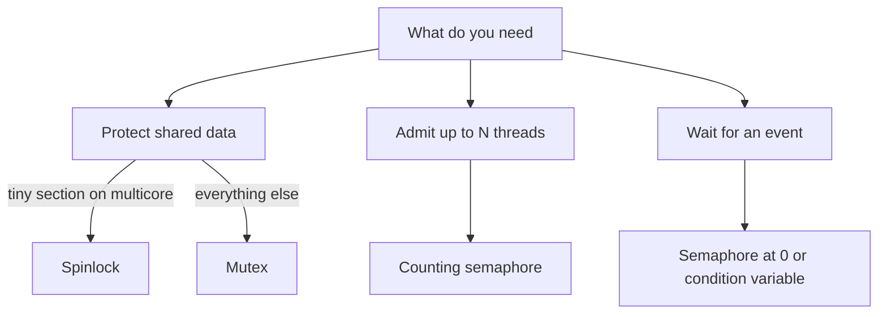

## The hook

Your service has 10 worker threads and a pool of exactly 3 database connections. Opening a fourth would crash the database. One rule: at most three workers may hold a connection at once.

A teammate reaches for a lock. But a lock lets in **one** thread, not three. Another teammate says "use a binary semaphore, it is the same as a mutex", and a week later a thread unlocks a lock it never took, letting two threads into code that only one should run. Nobody can reproduce the bug.

There are three tools here, and they look alike in pseudocode: the mutex, the semaphore and the spinlock. They differ in two questions: **who is allowed to release it**, and **what does a waiting thread do while it waits**? Get those two answers right and every interview question on this topic becomes easy.

## The intuition

:::analogy
A **mutex** is the **key to a single room**. Whoever takes the key from the hook goes in and holds it; only they bring it back. A **semaphore** is a **bowl of tokens at a car park entrance**. The bowl starts with one token per parking space. Each car takes a token to enter, and if the bowl is empty, the car waits at the gate. Any car leaving drops *a* token back in the bowl. Tokens have no names, and the guard never checks who returns one.
:::

| Picture | Concurrency tool | What it means |
|---|---|---|
| Key to one room | [[Mutex]] | One thread inside; the holder, and only the holder, releases |
| Bowl with one token per parking space | [[Counting semaphore]] | Up to N threads inside at once |
| A bowl that holds at most one token | [[Binary semaphore]] | One thread inside, but **anyone** may put the token back |
| Taking a token, waiting if the bowl is empty | `wait`, also called P or down | Decrement, or block while the value is 0 |
| Dropping a token in | `signal`, also called V or up | Increment, and wake one waiting thread |
| Pacing at the door, rattling the handle | [[Spinlock]] | Waiting by looping instead of sleeping |

The hook's connection pool is a car park with three spaces. The bug in the hook came from treating a bowl as if it were a key.

## How it works

### The mutex: a key with an owner

A mutex has two operations:

- **lock**: if the mutex is free, take it and become its owner. If not, sleep until it is released.
- **unlock**: only the owner may call it. Release the mutex and wake one waiting thread.

Wait, why does it matter who unlocks, if the result is "unlocked" either way? Because ownership is information the system can use:

- **Error checking**: unlocking a mutex you do not own is a bug, and some mutex types report it instead of silently letting another thread in.
- **Priority inheritance**: when an urgent thread waits on a mutex, the system knows exactly which thread to boost so it finishes and releases sooner. More on why that matters in a moment.
- **Recursive locking**: a recursive mutex lets its owner lock it again without deadlocking itself, counting the depth, because it knows the owner.

A thread that cannot get the mutex usually **sleeps**: it moves to the waiting state, as in [An Actor Stepping Off Stage](article:cs-core-process-states), and costs no CPU until it is woken. On Linux, mutexes are built on a "fast user-space mutex" (futex): when nobody is competing, lock and unlock are just atomic instructions in user space, and the kernel is involved only when a thread actually has to sleep or be woken.

### The semaphore: a counter with a waiting room

Edsger Dijkstra introduced the [[semaphore]] in the 1960s, naming its operations P and V. Today they are usually called `wait` and `signal`:

```pseudo
semaphore S = initial count

wait(S):                       # also P, down, acquire
    atomically:
        if S > 0: S = S - 1; return
        else: put this thread in S's waiting queue and sleep

signal(S):                     # also V, up, release
    atomically:
        if some thread waits on S: wake one of them
        else: S = S + 1
```

The initial value decides what the semaphore is *for*:

| Initial value | Use | Car park picture |
|---|---|---|
| N | Admit up to N threads to a pool of N resources | N spaces, N tokens |
| 1 | Mutual exclusion (a binary semaphore) | One space |
| 0 | Signalling: thread B waits until thread A says "done" | Empty bowl; B waits at the gate until A drops a token in |

That last row is where "no owner" becomes a **feature**. Thread A, which never called `wait`, calls `signal` to tell B that the data is ready. A mutex cannot do this, because unlocking requires ownership.

### Tracing the car park

Three spaces, five cars. Predict the gate's behaviour before reading the table: who waits, and in what order are they let in?

| Step | Event | S before | S after | Inside | Waiting at gate |
|---|---|---|---|---|---|
| 1 | A arrives, wait | 3 | 2 | A | |
| 2 | B arrives, wait | 2 | 1 | A, B | |
| 3 | C arrives, wait | 1 | 0 | A, B, C | |
| 4 | D arrives, wait | 0 | 0 | A, B, C | D |
| 5 | E arrives, wait | 0 | 0 | A, B, C | D, E |
| 6 | B leaves, signal: wakes D | 0 | 0 | A, C, D | E |
| 7 | A leaves, signal: wakes E | 0 | 0 | C, D, E | |
| 8 | C leaves, signal: nobody waiting | 0 | 1 | D, E | |

Notice steps 6 and 7. The value stays 0, because the token goes straight to a waiting car instead of into the bowl. And B's token let D in: tokens are interchangeable. At no step are more than 3 cars inside.

Some textbooks use a variant where `wait` always decrements and the value may go negative; then a value of −2 means "two threads are waiting". Same behaviour, different bookkeeping.

### Mutex versus binary semaphore

This is the most-asked question in the topic, and the answer is ownership.

| | Mutex | Binary semaphore |
|---|---|---|
| Owner | Yes, the thread that locked it | No |
| Who may release | Only the owner | Any thread |
| Typical purpose | Protect shared data (mutual exclusion) | Signal an event between threads, or simple exclusion |
| Priority inheritance possible | Yes, the owner is known | Generally no, there is no owner to boost |
| Recursive variant | Common | Not meaningful |
| Bug if misused | Unlocking from the wrong thread is detected or undefined | A stray signal silently lets an extra thread in |

:::warning
Common misconception: "a mutex is just a binary semaphore." They share a value that is 0 or 1, but a mutex has an owner and a binary semaphore does not. That one difference decides who may release it, whether priority inheritance can work, and whether a stray release is caught or silently breaks mutual exclusion. Use a mutex to protect data, and a semaphore to count resources or signal events.
:::

### Spinlocks: waiting by pacing

A sleeping lock costs a trip into the kernel to sleep and another to be woken, plus two context switches. If the lock will be free in a few hundred instructions, that is overkill. A spinlock just loops on an atomic instruction until it wins, as in the test-and-set lock from [Two People, One Spreadsheet Cell](article:cs-core-race-conditions):

```pseudo
spin_lock(L):
    while test_and_set(L) == true:
        pause                       # a CPU hint that we are spinning
spin_unlock(L):
    L = false
```

Predict when spinning beats sleeping, before reading on.

Spinning wins only when **both** hold: the lock is held for a very short time, *and* the holder is running right now on another core. Then the waiter gets the lock within moments and never pays for sleeping and waking.

Spinning is a disaster when the holder is not running. On a single core, the spinner burns its entire time slice while the holder, which needs that very CPU to finish, sits in the ready queue. That is why operating system kernels disable preemption while holding a spinlock, and why many user-space mutexes are **adaptive**: spin briefly in case the holder is about to release, then fall back to sleeping.

:::insight
The two questions decide everything. "Who may release it?" separates a mutex (only the owner) from a semaphore (anyone). "What does a waiter do?" separates sleeping locks (free while waiting, costly to wake) from spinlocks (instant hand-off, but they burn CPU). Choose by answering both, not by which name sounds right.
:::



### The classic: a bounded buffer

A producer puts items into a buffer with N slots; a consumer takes them out. The producer must wait when the buffer is full, the consumer when it is empty, and the buffer's indices must be updated by one thread at a time. Three tools, one job each:

- `emptySlots`, a counting semaphore starting at N: free slots.
- `fullSlots`, a counting semaphore starting at 0: filled slots.
- A mutex guarding the buffer's indices.

```pseudo
producer:                         consumer:
    wait(emptySlots)                  wait(fullSlots)
    lock(m)                           lock(m)
    put item in buffer                take item from buffer
    unlock(m)                         unlock(m)
    signal(fullSlots)                 signal(emptySlots)
```

Here is the catch, and it is a favourite interview trap. Swap the first two lines of the producer, so it locks the mutex *before* waiting for a slot. Trace it with a full buffer:

| Step | Producer | Consumer | State |
|---|---|---|---|
| 1 | lock(m): gets it | | Producer owns m |
| 2 | wait(emptySlots): 0, sleeps **holding m** | | Buffer full |
| 3 | | wait(fullSlots): gets one | |
| 4 | | lock(m): blocks, the producer holds it | |
| 5 | asleep until a slot frees | asleep until m frees | **Deadlock** |

The producer waits for the consumer to free a slot; the consumer waits for the producer to release the lock. Neither ever will. The rule: **wait on the counting semaphore first, take the lock second**, and never sleep while holding a lock someone else needs to wake you.

Here is the correct version as a runnable C++17 program. C++17 has no standard semaphore (C++20 adds `std::counting_semaphore`), so it builds one from a mutex and a condition variable. Compile with `-pthread`.

```cpp
#include <bits/stdc++.h>
using namespace std;

// A counting semaphore built from a mutex and a condition variable (C++20 has std::counting_semaphore).
class Semaphore {
    mutex m;
    condition_variable cv;
    int count;
public:
    explicit Semaphore(int n) : count(n) {}
    void wait() {                                   // P: take a token, sleep if the bowl is empty
        unique_lock<mutex> lk(m);
        cv.wait(lk, [&] { return count > 0; });     // re-checks after every wake-up
        count--;
    }
    void signal() {                                 // V: drop a token in, wake one sleeper
        { lock_guard<mutex> lk(m); count++; }
        cv.notify_one();
    }
};

const int SLOTS = 3, ITEMS = 10;
int buffer[SLOTS], in = 0, out = 0;
Semaphore emptySlots(SLOTS), fullSlots(0);
mutex bufLock;                                      // guards buffer, in and out

int main() {
    thread producer([] {
        for (int item = 1; item <= ITEMS; item++) {
            emptySlots.wait();                      // wait for space FIRST
            { lock_guard<mutex> g(bufLock); buffer[in] = item; in = (in + 1) % SLOTS; }
            fullSlots.signal();
        }
    });
    long long sum = 0;
    thread consumer([&] {
        for (int k = 0; k < ITEMS; k++) {
            fullSlots.wait();                       // wait for an item FIRST
            int item;
            { lock_guard<mutex> g(bufLock); item = buffer[out]; out = (out + 1) % SLOTS; }
            emptySlots.signal();
            sum += item;
        }
    });
    producer.join(); consumer.join();
    cout << "consumed sum = " << sum << "\n";       // 1 + 2 + ... + 10 = 55
}
```

Two details worth copying. `lock_guard` releases the mutex automatically when the block ends, even if an exception is thrown, so you cannot forget to unlock. And `cv.wait` takes a condition and re-checks it after every wake-up, because a condition variable can wake a thread spuriously or after another thread already took the token.

:::try-this
A semaphore starts at 2. Four threads call wait in the order T1, T2, T3, T4. Then T2 calls signal, then T1 calls signal. Which threads are inside, which are waiting, and what is the value at the end? (T1 and T2 enter, value 0; T3 and T4 wait. T2's signal wakes T3; T1's signal wakes T4. Inside: T3 and T4, nobody waiting, value 0.)
:::

## Trade-offs

| Tool | Waiting cost | Hand-off speed | Ownership | Best for |
|---|---|---|---|---|
| Mutex (sleeping) | None while asleep | Slower: wake-up and context switch | Yes | Protecting shared data in general |
| Spinlock | Burns a core | Fastest when the holder is on another core | Usually, by convention | Very short sections in kernels and on multicore |
| Adaptive mutex | Spins briefly, then sleeps | Good in both cases | Yes | Default choice in many libraries |
| Counting semaphore | None while asleep | Like a mutex | No | Pools of N resources, producer-consumer |
| Binary semaphore | None while asleep | Like a mutex | No | Signalling events between threads |

The connection pool from the hook is a counting semaphore initialised to 3. Rate limiting at a larger scale uses the same token-bowl idea, refilled over time, in [The Punch Card That Says Slow Down](article:famous-algos-token-bucket).

## What can go wrong

- **Wrong order of waits.** Taking the lock before waiting on a counting semaphore deadlocks a bounded buffer, as traced above.
- **Forgetting to unlock.** An early return or exception leaves the mutex locked forever. Use scoped guards (`lock_guard`, `unique_lock`).
- **Unlocking from the wrong thread.** Undefined or an error for a mutex. If you need cross-thread signalling, you wanted a semaphore or a condition variable.
- **A stray signal.** An extra `signal` on a semaphore permanently adds a token, so one more thread than intended gets in. Nothing reports it.
- **Spinning on one core.** The spinner starves the very holder it is waiting for.
- **Holding a lock during slow work.** Disk or network I/O inside a critical section makes every other thread queue behind it. Copy what you need, unlock, then do the slow part.
- **Priority inversion.** A low-priority thread holds a mutex; a high-priority thread waits for it; medium-priority threads keep the low one from running. The urgent thread is stuck behind unrelated work. The fix is **priority inheritance**: while a high-priority thread waits on a mutex, its owner temporarily runs at the waiter's priority. NASA's Mars Pathfinder lander in 1997 suffered repeated resets from exactly this, and the fix was to enable priority inheritance on the mutex involved. It needs an owner to boost, which is one more reason ownership matters.
- **Deadlock across several locks.** Two threads taking two mutexes in opposite orders can each wait for the other forever. That deserves an article of its own.

### Interview follow-ups

**"What is the difference between a mutex and a binary semaphore?"** Ownership. A mutex is released only by the thread that locked it, which enables error checking, recursion and priority inheritance. A binary semaphore can be signalled by any thread, which makes it right for signalling events and wrong for protecting data you want ownership checks on.

**"When would you use a spinlock instead of a mutex?"** When the critical section is tiny, the code runs on multiple cores, and sleeping is either too costly or not allowed, as in interrupt handlers inside a kernel. Never on a single core in user space, and never around anything slow.

**"How do you implement a semaphore using a mutex and a condition variable?"** Keep an integer count guarded by the mutex. `wait` locks, waits on the condition variable while count is 0 (in a loop, to handle spurious wake-ups), then decrements. `signal` locks, increments and notifies one waiter. That is the `Semaphore` class above.

**"Solve producer-consumer with semaphores, and what is the classic mistake?"** `emptySlots = N`, `fullSlots = 0`, plus a mutex for the buffer. Producer: wait empty, lock, put, unlock, signal full. Consumer: wait full, lock, take, unlock, signal empty. The mistake is locking before waiting on the counting semaphore, which deadlocks when the buffer is full or empty.

**"Can a semaphore's value be negative?"** In the definition used here it never goes below 0, and waiters sit in a queue. In the common textbook variant, `wait` always decrements, and a negative value's magnitude is the number of waiting threads. Both describe the same behaviour.

## In the real world

- Thread libraries such as POSIX threads offer mutexes with optional error checking, recursion and priority inheritance, plus POSIX semaphores that can live in shared memory between processes, which is how the shared-memory whiteboard in [Passing Notes or Sharing a Whiteboard](article:cs-core-ipc) gets its marker.
- Operating system kernels use spinlocks for very short sections and sleeping locks elsewhere, and disable preemption while a spinlock is held.
- Connection pools, thread pools and download limiters are counting semaphores, whether or not the code calls them that.
- Real-time systems turn on priority inheritance for mutexes shared between tasks of different priorities, the lesson of priority inversion in [Who Sees the Doctor Next?](article:cs-core-cpu-scheduling)

One trap is still open. Two threads, two mutexes, opposite order: each holds one key and waits forever for the other. That is deadlock, the next stop in this Operating Systems track. Until then, notice how databases sidestep many of these waits entirely in [Readers Never Wait for Writers](article:famous-algos-mvcc).

## Further reading

- *Operating Systems: Three Easy Pieces*, the chapters on locks, condition variables and semaphores.
- *Operating System Concepts* by Silberschatz, Galvin and Gagne, the synchronisation tools chapter and the bounded-buffer problem.
- The Linux manual pages `pthread_mutex_lock(3p)`, `sem_overview(7)` and `futex(7)`.

## Key takeaways

- A mutex is a lock with an owner, so only the thread that locked it may unlock it, which enables error checking, recursive locking and priority inheritance.
- A semaphore is an ownerless counter where wait takes a token or blocks and signal returns a token or wakes a waiter; starting at N it guards a pool, at 1 it gives exclusion, and at 0 it signals events.
- A binary semaphore is not a mutex, because any thread may signal it, which suits signalling but silently breaks exclusion if misused.
- Spinlocks busy-wait instead of sleeping, which pays off only for very short critical sections when the holder runs on another core.
- In producer-consumer, always wait on the counting semaphore before taking the lock, because sleeping while holding the lock deadlocks the thread that could wake you.
