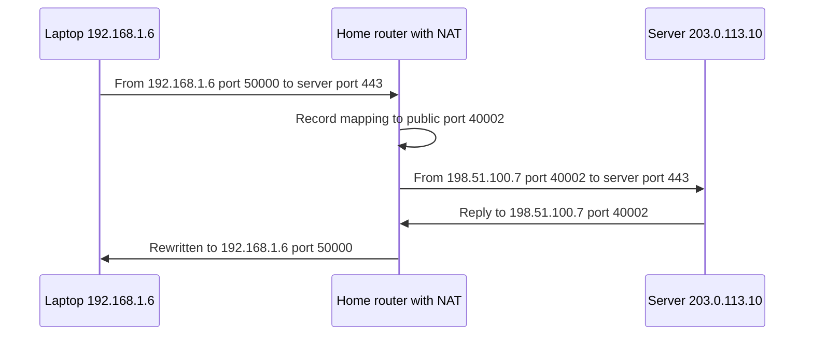

## The hook

Your hostel has three hundred phones and laptops online, all browsing at the same time. The internet provider gave the hostel one public IPv4 address. Every reply from every website comes back to that single address, yet each one reaches the right phone.

And when your phone joined the hostel Wi-Fi, nobody typed in an address for it: within a second it had an IP address, a gateway and a DNS server. Two small protocols make both of these work, and both appear in "what happens when you connect to Wi-Fi?" questions. Predict what the router uses to tell three hundred devices apart behind one address. (Port numbers.)

## The intuition

:::analogy
A company has one public phone number and a receptionist. **The receptionist forwards calls to extensions**: when an employee makes an outgoing call, the receptionist notes which extension it came from, so the return call goes to the right desk. A stranger calling the main number for no reason gets nowhere, because the receptionist has no note about them. And a new employee is handed an extension number, a desk and the office directory on their first morning.
:::

## How it works

### NAT: many private addresses, one public address

Devices inside use private addresses (192.168.x.x, 10.x.x.x), which are not routable on the internet. The router does **[[NAT]]**, specifically port address translation: on the way out it rewrites the source address and port, and records the change in its **[[NAT table]]**.

Two laptops talk to the same web server, 203.0.113.10:443; the router's public address is 198.51.100.7:

| Inside (private) | Outside (public) | Remote |
|---|---|---|
| 192.168.1.5:50000 | 198.51.100.7:40001 | 203.0.113.10:443 |
| 192.168.1.6:50000 | 198.51.100.7:40002 | 203.0.113.10:443 |

When a reply arrives for 198.51.100.7:40002, the router looks up the table, rewrites the destination to 192.168.1.6:50000, and delivers it. The two laptops even used the same source port; the router gave them different public ports.

Wait, what about traffic nobody inside asked for? An incoming connection to 198.51.100.7:8080 matches no table entry, so the router drops it. NAT therefore acts as an accidental firewall, and breaks the internet's original end-to-end model: inside devices can call out but cannot easily be called. **[[Port forwarding]]** adds a manual rule ("public port 8080 goes to 192.168.1.5:8080"), UPnP lets devices request such rules, and peer-to-peer apps use NAT traversal tricks with outside helper servers.

Carriers also run NAT at scale (carrier-grade NAT), so even your router's "public" address may be shared with other customers.

### DHCP: getting an address automatically

A device joining a network needs an IP address, a subnet mask, a default gateway and DNS servers. **[[DHCP]]** provides them in four messages, remembered as **DORA**:

| Step | Message | From → to | Content |
|---|---|---|---|
| 1 | Discover | client → broadcast | "Is there a DHCP server? I have no address yet." |
| 2 | Offer | server → client | "You can have 192.168.1.23, mask /24, gateway .1, DNS, for 24 hours." |
| 3 | Request | client → broadcast | "I accept the offer from that server." |
| 4 | Acknowledge | server → client | "Confirmed; the lease starts now." |

DHCP runs over UDP (server port 67, client port 68). The client starts with no address, so it sends from 0.0.0.0 to the broadcast address 255.255.255.255. Why broadcast the Request too, when the client already knows the server? Several servers may have made offers; the broadcast tells all of them which one was accepted, so the others can release theirs.

The address is a **[[lease]]**: the client renews it, typically at half the lease time, directly with the server. If DHCP fails entirely, many systems self-assign a link-local address in 169.254.0.0/16, a tell-tale sign of "no DHCP server answered".

:::insight
NAT lets many private devices share one public address by rewriting addresses and ports on the way out and keeping a table to reverse the change for replies, which also blocks unsolicited incoming connections. DHCP hands each joining device its address, mask, gateway and DNS servers through Discover, Offer, Request and Acknowledge, for a renewable lease.
:::

## Trade-offs

| Choice | Gain | Cost |
|---|---|---|
| NAT | Saves scarce IPv4 addresses; hides inside hosts | Breaks end-to-end connectivity; complicates peer-to-peer, VoIP and hosting |
| Port forwarding | Allows inbound services | Manual, exposes the inside host |
| IPv6 without NAT | Every device globally addressable | Needs a real firewall for protection |
| Short DHCP leases | Addresses recycled quickly on busy guest networks | More renewal traffic |
| DHCP reservations | A device always gets the same address | Manual configuration |

:::warning
Common misconception: "NAT is a security feature." Blocking unsolicited inbound connections is a side effect of not knowing where to send them. It does not inspect traffic, stop malware a user downloads, or protect against attacks over connections the inside device opened. Real protection comes from firewalls and patched software.
:::

:::try-this
A third laptop, 192.168.1.7, opens a connection from port 50000 to the same server. The NAT table already uses public ports 40001 and 40002. What new row might appear, and what happens when the server replies? (Something like 192.168.1.7:50000 ↔ 198.51.100.7:40003 ↔ 203.0.113.10:443. A reply to port 40003 is rewritten to 192.168.1.7:50000.)
:::

## What can go wrong

- **Rogue DHCP servers** handing out a malicious gateway or DNS server; switches can block DHCP offers from untrusted ports.
- **Address pool exhaustion** on busy networks with long leases.
- **NAT table timeouts** silently dropping idle connections; long-lived connections send keep-alives.
- **Double NAT** (a home router behind a carrier's NAT) breaking port forwarding.
- **Two devices with the same static address**, conflicting with each other and with DHCP.

### Interview follow-ups

**"What is the difference between SNAT and DNAT?"** Source NAT rewrites the source (outgoing traffic, as above); destination NAT rewrites the destination (port forwarding and load balancers).

**"How do video-call apps connect two people behind NATs?"** Both contact an outside server to learn their public address and port (STUN), try to connect directly, and fall back to relaying through a server (TURN) if that fails.

**"Where does DHCP fit when you join Wi-Fi?"** After the link connects, DHCP provides the address and gateway; then ARP finds the gateway's MAC, as in [A Building's Internal Mail Room](article:cs-core-data-link).

## In the real world

Almost every home and office router does both NAT and DHCP. Cloud networks use NAT gateways so private servers can reach the internet without being reachable from it. The private address ranges NAT relies on are in [Street Addresses With Postcodes](article:cs-core-ip-addressing).

## Further reading

- RFC 3022, "Traditional IP Network Address Translator", and RFC 2131, "Dynamic Host Configuration Protocol".
- RFC 8489, "Session Traversal Utilities for NAT (STUN)".

## Key takeaways

- NAT lets many devices with private addresses share one public address by rewriting the source address and port of outgoing packets.
- The NAT table maps each public port back to a private address and port, so replies reach the right device even when inside devices use the same ports.
- Unsolicited incoming connections match no NAT entry and are dropped, so hosting a service behind NAT needs port forwarding or traversal techniques.
- DHCP assigns an address, mask, gateway and DNS servers through Discover, Offer, Request and Acknowledge, using UDP broadcasts because the client starts with no address.
- DHCP addresses are leases that the client renews, and a 169.254.x.x address usually means no DHCP server answered.
