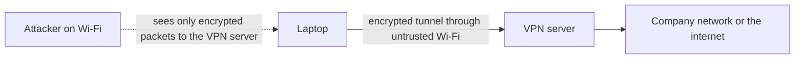

## The hook

You connect to the café's free Wi-Fi, called "Cafe_Free". So does the person at the next table, except their laptop is broadcasting "Cafe_Free" too, and your phone picked theirs because the signal was stronger. Every packet you send now passes through a stranger's machine.

What can they see? What can they change? The answer depends almost entirely on the layers you learned in this track: whether your traffic is encrypted, what is authenticated, and what the network blindly trusts. Predict which of these the attacker can still learn if you only visit HTTPS sites: the sites' names, your passwords, or the pages you read. (Usually the names; not the passwords or pages.)

## The intuition

:::analogy
Securing a network is like securing an office: **locks** on the doors (encryption and authentication), **guards** at the entrances checking who comes in and why (firewalls), and **private corridors** between buildings so staff never walk through the public street (VPN tunnels). Attackers look for an unlocked door, a guard who believes any ID card, or a crowd big enough to block the entrance.
:::

## How it works

### Firewalls

A **[[firewall]]** applies a list of rules, usually checked top to bottom with the first match winning, ending in a default deny:

| # | Rule |
|---|---|
| 1 | allow TCP to port 443 from anywhere |
| 2 | allow TCP to port 22 from 10.0.0.0/8 |
| 3 | deny everything else |

| Packet | Matches | Result |
|---|---|---|
| 198.51.100.9 → port 443 | rule 1 | allowed |
| 10.2.3.4 → port 22 | rule 2 | allowed |
| 198.51.100.9 → port 22 | rule 3 | denied |
| 198.51.100.9 → port 3306 (database) | rule 3 | denied |

A stateless firewall judges each packet alone, so to let replies back in it would need broad rules. A **[[stateful firewall]]** tracks connections: when a server inside opens a connection out, the replies are recognised as part of it and admitted, while unsolicited packets are still blocked. Application-layer firewalls (such as web application firewalls) go further and inspect HTTP requests for attacks.

### VPN tunnels

A **[[VPN]]** wraps your packets inside encrypted packets addressed to a VPN server; the server unwraps them and sends them onward as if you were inside its network.

Uses: reaching a company's private network from home, and hiding your traffic from the local network. The VPN provider, though, now sees what the café network used to see. IPsec and WireGuard are common tunnel protocols.

### Attacks and their defences

| Attack | How it works | Defence |
|---|---|---|
| IP **[[spoofing]]** | forge the source address of packets | ingress filtering by ISPs; protocols that require a handshake (TCP) |
| ARP spoofing | answer ARP requests with the attacker's MAC to sit in the path | dynamic ARP inspection on switches; encryption above |
| Rogue Wi-Fi or DNS | a fake access point or forged DNS answers | HTTPS with certificate checks; DNSSEC; trusted resolvers |
| **[[Man-in-the-middle]]** | relay and possibly alter traffic between two parties | TLS with certificate validation; HSTS |
| SYN flood | send many SYNs and never finish the handshake | SYN cookies, larger backlogs |
| Amplification **[[DDoS]]** | spoofed small UDP queries trigger large replies sent to the victim | close open resolvers; rate limiting; filtering spoofed traffic |
| Volumetric DDoS | flood the victim's bandwidth from many machines | absorb with CDNs and scrubbing services; anycast |

Wait, why does the café attacker in the hook learn site names but not passwords? With HTTPS, the attacker sees IP addresses and, usually, the site name in the TLS handshake, but the content is encrypted, and the attacker cannot impersonate the site without its private key: the browser would reject the certificate. The danger is a user clicking through the warning, or a site that is not HTTPS at all.

:::insight
Network security is layered. Firewalls control which connections may exist, VPNs and TLS make the traffic on untrusted networks unreadable and tamper-evident, and certificate checks stop impersonation. Most classic attacks exploit something the network trusts blindly, such as a source address, an ARP reply or a DNS answer, and the defence is to stop trusting it or to authenticate it.
:::

## Trade-offs

| Control | Gain | Cost |
|---|---|---|
| Default-deny firewall rules | Small attack surface | Every new service needs a rule |
| Stateful inspection | Simple rules, replies handled automatically | Connection tables can be flooded |
| Full-tunnel VPN | All traffic protected on untrusted networks | Latency; the VPN provider sees your traffic |
| Zero-trust (authenticate every request, not the network location) | Protection even inside the network | More identity infrastructure |
| DDoS scrubbing and CDN | Absorbs huge attacks | Cost; traffic routed through a third party |

:::warning
Common misconception: "a VPN makes me anonymous and secure." A VPN moves trust from the local network to the VPN provider, who can see your connections. It does not stop phishing, malware or tracking by the websites you log into. HTTPS already protects the contents of most traffic.
:::

:::try-this
Add a rule so the office's monitoring server, 10.9.9.9, can reach a database on port 5432, without opening the database to anyone else. Where should it go in the list? (Insert "allow TCP to port 5432 from 10.9.9.9/32" anywhere above rule 3, the deny-all. Below it, the rule would never be reached, because the first match wins.)
:::

## What can go wrong

- **Overly broad rules** such as "allow any from any" added during debugging and never removed.
- **Rule order mistakes**, with an allow or deny shadowed by an earlier rule.
- **Clicking through certificate warnings**, inviting man-in-the-middle attacks.
- **Exposed management ports** (SSH, databases, admin panels) on the internet.
- **Trusting the internal network**, so one compromised laptop can reach everything.

### Interview follow-ups

**"What is the difference between IDS and IPS?"** An intrusion detection system alerts on suspicious traffic; an intrusion prevention system also blocks it inline.

**"How does TLS stop a man in the middle?"** The server proves possession of the private key for a certificate signed by a trusted authority for that name; an attacker without that key cannot complete the handshake as the server, as in [Ordering at a Counter With a Standard Form](article:cs-core-http-https).

**"What is a DMZ?"** A separate network zone for public-facing servers, firewalled from both the internet and the internal network.

## In the real world

Cloud security groups are stateful firewalls attached to each server, companies use VPNs or zero-trust access proxies for remote staff, and large sites sit behind CDNs that absorb DDoS attacks. The link-layer tricks behind ARP spoofing are in [A Building's Internal Mail Room](article:cs-core-data-link).

## Further reading

- NIST Special Publication 800-41, "Guidelines on Firewalls and Firewall Policy".
- Ross Anderson, *Security Engineering*, third edition, chapters on network attack and defence.

## Key takeaways

- Firewalls check rules in order with the first match winning and a default deny, and stateful firewalls admit replies to connections opened from inside.
- VPNs carry packets through encrypted tunnels across untrusted networks, shifting trust from the local network to the VPN provider.
- Spoofing attacks forge source addresses, ARP replies or DNS answers, and defences stop trusting those fields or authenticate them.
- TLS with certificate validation defeats most man-in-the-middle attacks, leaving attackers on the path only addresses and usually site names.
- DDoS attacks exhaust bandwidth or connection state, often using spoofed UDP amplification, and are countered by SYN cookies, filtering, rate limits and large absorbing networks.
