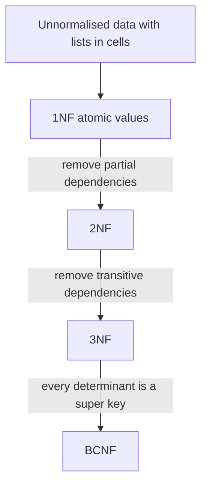

## The hook

Back to the exam cell's sheet from the last article: roll, name, course, instructor, instructor's department, grade, all in one table. It looks convenient. Then three things happen in one week.

Asha's name is corrected in three of her five rows (an **update anomaly**). A new course with an assigned instructor cannot be entered until a student enrols, because the key needs a roll number (an **insertion anomaly**). The only student in the Compilers course drops it, and the fact that Professor Iyer teaches Compilers vanishes with the row (a **deletion anomaly**).

All three have one cause: several facts are stored in one row, so each fact is repeated or tied to unrelated facts. Predict the fix before reading on. (Split the table so each fact lives in exactly one place, and make sure the split loses nothing.)

## The intuition

:::analogy
A student's notebook has class notes, phone numbers and expenses scribbled on the same pages. **Splitting the messy notebook into tidy ledgers** means one ledger per kind of fact: a contacts ledger, a timetable, an expenses book. Each fact is written once, and a page number links ledgers when you need them together.
:::

Normal forms are a checklist for "is every fact in its own ledger?". Each form removes one kind of mixing, defined with the functional dependency ideas from the previous article.

## How it works

The sheet: Exam(roll, name, course, instructor, dept, grade), with

- roll → name
- course → instructor
- instructor → dept
- (roll, course) → grade

The only candidate key is (roll, course).

### 1NF: one value per cell

First normal form needs atomic values: no lists like "DBMS, OS" in one cell, and no repeating column groups like course1, course2, course3. Put one course per row. The sheet above is already in 1NF.

### 2NF: no partial dependencies

A **[[partial dependency]]** is a non-prime attribute depending on part of a composite key. Here roll → name and course → instructor (and so dept) are partial. 2NF moves them out:

| Table | Columns | Key |
|---|---|---|
| Student | roll, name | roll |
| CourseInfo | course, instructor, dept | course |
| Enrol | roll, course, grade | (roll, course) |

Asha's name is now stored once. Wait, why is CourseInfo still not tidy? Because dept depends on instructor, not directly on course.

### 3NF: no transitive dependencies

A **[[transitive dependency]]** is a non-prime attribute determined by another non-key attribute: course → instructor → dept. If Iyer moves department, every course row of Iyer must change. 3NF splits it:

| Table | Columns | Key |
|---|---|---|
| Student | roll, name | roll |
| Course | course, instructor | course |
| Instructor | instructor, dept | instructor |
| Enrol | roll, course, grade | (roll, course) |

The formal rule: for every non-trivial X → A, either X is a super key or A is a **prime** attribute (part of some candidate key). All three anomalies from the hook are gone: names are stored once, a course can exist with no students, and dropping the last student keeps the course row.

### BCNF: every determinant is a key

**[[BCNF]]** is stricter: for every non-trivial X → Y, X must be a super key, with no exception for prime attributes.

The classic case where 3NF and BCNF differ: Teaches(student, course, instructor), where each instructor teaches one course (instructor → course) and a student has one instructor per course ((student, course) → instructor). Candidate keys: (student, course) and (student, instructor). Every attribute is prime, so the table is in 3NF. But instructor → course has a determinant that is not a super key, so it is **not** in BCNF: the fact "Rao teaches DBMS" is repeated for every student of Rao.

### Splitting safely: lossless joins

A split is a **[[lossless decomposition]]** if joining the parts gives back exactly the original rows. The test for two parts: their common attributes must be a key of at least one part.

On four Teaches rows (Asha–DBMS–Rao, Asha–OS–Iyer, Ravi–DBMS–Rao, Meera–DBMS–Sen), a program checked both possible splits:

| Split | Common column | Key of a part? | Rows after join |
|---|---|---|---|
| (instructor, course) + (student, instructor) | instructor | yes, of the first | 4, exactly the original |
| (student, course) + (course, instructor) | course | no | 7, with 3 spurious rows such as Asha–DBMS–Sen |

The second split is lossy: the join invents enrolments that never happened. "Lossy" means losing *information*, even though you get *more* rows.

### The price: dependency preservation

The good split has a cost. **[[Dependency preservation]]** means every original dependency can be checked in one table. (student, course) → instructor spans both new tables, so nothing stops inserting (Ravi, Sen) into the student–instructor table: each table looks fine, but the join now says Ravi has two DBMS instructors.

:::insight
3NF decomposition can always be made both lossless and dependency-preserving. BCNF can always be made lossless, but sometimes only by giving up dependency preservation. That trade-off is why 3NF is the usual practical target and BCNF is preferred when it costs nothing.
:::

## Trade-offs

| Choice | Gain | Cost |
|---|---|---|
| Normalise to 3NF or BCNF | Each fact stored once; no anomalies; smaller updates | More tables and joins for reads |
| Stop at 3NF when BCNF loses a dependency | All constraints checkable per table | Some redundancy remains |
| Denormalise on purpose | Fast reads, fewer joins (reports, read-heavy feeds) | Must keep copies in sync; anomalies return |

:::warning
Common misconception: "higher normal forms are always better." Over-normalising a read-heavy system can turn every page view into a five-table join. Real systems normalise the source of truth and then denormalise deliberately (caches, materialised views, read models) where reads dominate, accepting the cost of keeping copies consistent.
:::

:::try-this
R(A, B, C) with A → B and B → C; key A. Which normal form is it in, and how do you fix it? (No partial dependencies, since the key is a single attribute, so it is in 2NF. B → C is transitive with C non-prime, so it is not in 3NF. Split into (A, B) and (B, C): B is the key of (B, C), so the join is lossless, and both dependencies stay inside one table each, so they are preserved.)
:::

## What can go wrong

- **Lossy splits** that create spurious rows, from splitting on a column that is not a key of either part.
- **Calling a table 2NF-violating when the key is a single column**: partial dependencies need a composite key.
- **Forgetting prime attributes** when checking 3NF, and wrongly declaring a 3NF table non-3NF.
- **Chasing BCNF and losing a dependency** that then needs an application check or trigger.
- **Normalising analytics tables** that would be faster as wide, denormalised tables.

### Interview follow-ups

**"Explain 1NF, 2NF, 3NF and BCNF in one line each."** 1NF: atomic values. 2NF: 1NF plus no non-prime attribute depending on part of a key. 3NF: 2NF plus no non-prime attribute depending on a non-key. BCNF: every determinant is a super key.

**"What are 4NF and 5NF?"** 4NF removes independent multi-valued facts stored together (a student's hobbies and languages in one table); 5NF removes join dependencies. They are rarely asked beyond definitions.

**"When would you denormalise?"** When a read path is hot and joins are the bottleneck, as in [Filing Cabinet, Labelled Boxes or Giant Spreadsheet?](article:system-design-sql-vs-nosql), accepting the cost of keeping copies in sync.

## In the real world

Transactional databases (orders, users, payments) are typically designed in 3NF or BCNF. Data warehouses deliberately use denormalised star schemas for fast reporting. Finding the keys and dependencies that normalisation needs is covered in [If You Know the Roll Number, You Know the Name](article:cs-core-functional-dependencies).

## Further reading

- E. F. Codd, "Further Normalization of the Data Base Relational Model" (1971).
- Silberschatz, Korth and Sudarshan, *Database System Concepts*, chapter on relational database design.

## Key takeaways

- Storing several facts in one row causes update, insertion and deletion anomalies; normalisation removes them by storing each fact once.
- 1NF needs atomic values, 2NF removes partial dependencies on a composite key, and 3NF removes transitive dependencies of non-prime attributes.
- BCNF requires every determinant to be a super key; a table can be in 3NF but not BCNF when a non-key attribute determines a prime attribute.
- A split is lossless when the common attributes are a key of one part; otherwise the join creates spurious rows.
- 3NF can always be lossless and dependency-preserving, while BCNF sometimes loses a dependency, and read-heavy systems may denormalise on purpose.
