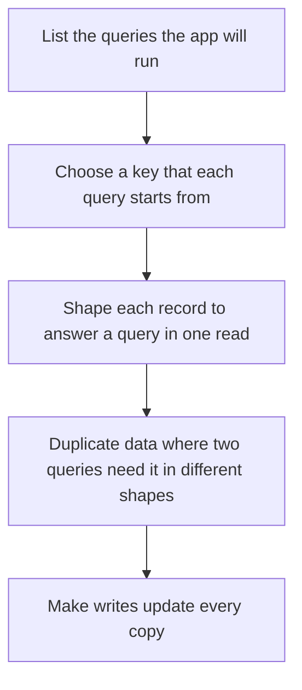

## The hook

You have spent the whole DBMS track normalising tables, splitting facts so each is stored once, and joining them back with keys. Then an interviewer asks: "Your app stores shopping carts for a hundred million users, read and written constantly, and nobody ever joins a cart with anything. Would you still normalise it into five tables?"

That question is where NoSQL comes from. Not "SQL is bad", but "some data has a shape where tables, joins and strict transactions cost more than they give". Predict what you give up when you drop joins. (Flexible queries: you must know your access patterns up front.)

## The intuition

:::analogy
Moving house, you use **different shapes of storage boxes**: a numbered locker for one item you fetch by number, a labelled folder holding a whole document, a long filing drawer sorted by date, and a pinboard with strings connecting photos. A relational database is a set of perfectly squared shelves that fit everything reasonably. Each NoSQL family is a box shaped for one kind of item and one way of fetching it.
:::

## How it works

### The four families

One example throughout: a shopping cart for user 42 containing two items.

| Family | How the cart is stored | Fast at | Weak at | Examples |
|---|---|---|---|---|
| **[[Key-value store]]** | key `cart:42` → blob of both items | get or put by key | any query by contents | Redis, DynamoDB (also document-like) |
| **[[Document store]]** | `{user: 42, items: [{sku: "pen", qty: 2}, {sku: "book", qty: 1}]}` | whole-object reads; queries on fields | multi-document joins and transactions (support varies) | MongoDB, Couchbase |
| **[[Wide-column store]]** | partition key 42; one column per item, clustered by sku | huge write volumes, range reads within a partition | queries not by partition key | Cassandra, HBase, Bigtable |
| **[[Graph database]]** | node User 42, edges IN_CART to Product nodes | multi-hop relationships | bulk aggregates over everything | Neo4j, Amazon Neptune |

Wait, why does the key-value version store both items in one blob? Because the only question it can answer is "give me the value for this key", so you store the value in exactly the shape you will read it. That is **[[denormalisation]]**, and it is the core habit of NoSQL modelling.

### Modelling by access pattern

Relational design starts from the data (normalise, then write any query). NoSQL design starts from the queries:

A wide-column table for "messages in a chat, newest first" uses chat id as the partition key and timestamp as the clustering key; the query "latest 20 messages in chat 7" is one sequential read. The same table cannot efficiently answer "all messages by user 42"; you would keep a second table keyed by user.

### ACID versus BASE

| Property | Typical relational database | Typical distributed NoSQL store |
|---|---|---|
| Transactions | Multi-row, multi-table ACID | Often single-key or single-document atomicity; some offer more |
| Consistency | Reads see committed data immediately | Often eventual, with tunable stronger options |
| Scaling | Mostly vertical, plus read replicas; sharding is manual work | Built-in partitioning across many machines |
| Schema | Fixed, enforced | Flexible, enforced by the application |

**[[BASE]]** (basically available, soft state, eventually consistent) describes the looser promise many distributed stores make to stay available during network partitions, a trade-off framed by the CAP theorem in [When the Phone Line Between Branches Goes Dead](article:system-design-cap-pacelc).

:::insight
NoSQL families trade the relational model's flexibility (any query via joins, multi-row transactions) for scale and speed on known access patterns. You design the records around the queries, accept duplication, and often accept eventual consistency. The decision is about access patterns and guarantees, not about which technology is newer.
:::

## Trade-offs

| Need | Lean towards |
|---|---|
| Complex queries, joins, reporting, money | Relational |
| Simple lookups by key at very high rates (sessions, caches) | Key-value |
| Nested, varying objects read whole (catalogues, profiles) | Document |
| Massive writes of time-ordered data (logs, messages, sensor readings) | Wide-column |
| Deep relationships (social graphs, recommendations, fraud rings) | Graph |

:::warning
Common misconception: "NoSQL means no schema, so no design work." The schema moves from the database into your code and your key choices, and changing access patterns later can mean rewriting every record. Modelling a NoSQL store well needs more up-front thought about queries than a relational one.
:::

:::try-this
An app shows a user's last 50 notifications, newest first, and writes thousands per second across all users. Which family and which keys would you choose? (A wide-column store with user id as the partition key and timestamp, descending, as the clustering key. "Latest 50 for user 42" reads one partition in order, and writes spread across users.)
:::

## What can go wrong

- **Choosing NoSQL for relational data**, then re-implementing joins and transactions badly in application code.
- **A bad partition key** (such as country) creating hot partitions that overload one node.
- **Forgetting to update every denormalised copy**, so the same fact disagrees across records.
- **Assuming reads are fresh** in an eventually consistent store, then showing users stale or vanished data.
- **Unbounded documents** (an array that grows forever) hitting size limits and slowing every read.

### Interview follow-ups

**"Can a relational database store JSON?"** Yes: PostgreSQL's jsonb and MySQL's JSON types store and index documents, so one database can serve both styles for many apps.

**"Is MongoDB ACID?"** Single-document operations are atomic, and recent versions support multi-document transactions, at a performance cost; the details belong to the specific version.

**"How do you answer SQL or NoSQL in a design round?"** List the access patterns, the consistency needs and the scale, then pick per data set, as in [Filing Cabinet, Labelled Boxes or Giant Spreadsheet?](article:system-design-sql-vs-nosql).

## In the real world

Large systems commonly use several stores side by side: a relational database for orders and payments, a key-value cache for sessions, a wide-column store for activity feeds, and a search index. The normalised design these stores deliberately bend is in [Splitting a Messy Notebook Into Tidy Ledgers](article:cs-core-normalization).

## Further reading

- Martin Kleppmann, *Designing Data-Intensive Applications*, chapter 2 on data models.
- Giuseppe DeCandia and colleagues, "Dynamo: Amazon's Highly Available Key-value Store" (SOSP, 2007).

## Key takeaways

- Key-value stores answer lookups by key, document stores hold nested records queryable by field, wide-column stores handle huge partitioned writes, and graph databases follow relationships cheaply.
- NoSQL modelling starts from the queries and shapes each record to answer one in a single read, duplicating data where needed.
- Many distributed NoSQL stores give BASE guarantees, with single-key atomicity and eventual consistency, in exchange for availability and easy scaling.
- Relational databases remain the better fit for complex queries, joins and multi-row transactions such as payments.
- The choice depends on access patterns, consistency needs and scale, and real systems often combine several stores.
