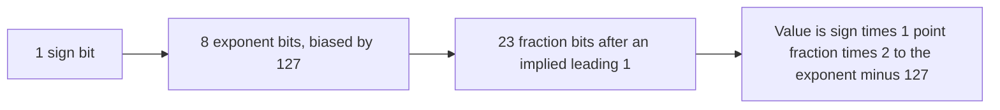

## The hook

Type `0.1 + 0.2` into almost any programming language and you get 0.30000000000000004. A shopping cart that adds prices in floating point can be off by a paisa. In 1996, a European rocket was destroyed shortly after launch partly because a 64-bit floating-point value was converted to a 16-bit integer that could not hold it.

These are not bugs in the languages. They follow directly from storing numbers in a fixed number of bits. Interviews and OAs probe exactly these edges: two's complement, overflow, floating-point comparisons and byte order. Predict the 8-bit pattern for −1. (All ones: 11111111.)

## The intuition

:::analogy
You must **write every number on a fixed number of tiles**, each showing 0 or 1. With 8 tiles you can show only 256 different patterns, so you must decide which numbers they mean: 0 to 255, or −128 to 127. For fractions, you use some tiles for the digits and some for "where the point goes", which means most fractions can only be approximated, like writing one third as 0.333 on a fixed number of decimal tiles.
:::

## How it works

### Unsigned and two's complement integers

With n bits, unsigned values run from 0 to 2ⁿ − 1. For signed values, **[[two's complement]]** stores −x as 2ⁿ − x. To negate, invert all bits and add 1:

| Value | 8-bit pattern | How |
|---|---|---|
| 5 | 00000101 | binary |
| −5 | 11111011 | invert 00000101 to 11111010, add 1 |
| −1 | 11111111 | 256 − 1 = 255 |
| −128 | 10000000 | the most negative value |
| 127 | 01111111 | the most positive value |

The range of n-bit two's complement is −2ⁿ⁻¹ to 2ⁿ⁻¹ − 1: −128 to 127 in 8 bits, −2,147,483,648 to 2,147,483,647 in 32 bits.

Wait, why did two's complement beat simpler schemes such as a sign bit plus magnitude? Two reasons. There is only one zero (sign-magnitude has +0 and −0). And the same adder circuit works for signed and unsigned numbers: 5 + (−5) is 00000101 + 11111011 = 1 00000000, and dropping the carry leaves 0. No special subtraction hardware is needed.

### Overflow

**[[Overflow]]** happens when a result needs more bits than exist. Unsigned arithmetic in C++ wraps around modulo 2ⁿ (255 + 1 becomes 0 in 8 bits). Signed overflow in C++ is **undefined behaviour**: the compiler may assume it never happens. In competitive programming, a sum of two values near 10⁹ already exceeds the 32-bit limit, which is why `long long` is the habit.

### IEEE 754 floating point

A 32-bit float is laid out as 1 sign bit, 8 exponent bits (stored with a bias of 127) and 23 fraction bits, and represents (−1)^sign × 1.fraction × 2^(exponent − 127). A 64-bit double uses 1, 11 and 52 bits, with a bias of 1023.

Decode −6.25 as a float:

| Step | Value |
|---|---|
| 6.25 in binary | 110.01 |
| normalise | 1.1001 × 2² |
| sign | 1 (negative) |
| exponent | 2 + 127 = 129 = 10000001 |
| fraction | 1001 followed by zeros |
| bits | 1 10000001 10010000000000000000000 = 0xC0C80000 |

Python's struct module produced exactly 0xC0C80000.

### Why 0.1 + 0.2 is not 0.3

0.1 in binary is 0.000110011001100… repeating forever, like 1/3 in decimal. A float stores it as 0x3DCCCCCD, which is really 0.10000000149011612. Doubles are much closer but still not exact, and the rounding errors of 0.1 and 0.2 add up to a double that prints as 0.30000000000000004, which is a different double from the nearest one to 0.3. Hence:

- compare floats with a tolerance: `fabs(a - b) < 1e-9` (scaled to the magnitudes involved);
- never use floating point for money: use integers in the smallest unit (paise) or decimal types;
- beyond 2²⁴ = 16,777,216, a float cannot represent every integer: 16,777,217 stored as a float comes back as 16,777,216.

The gap between 1.0 and the next double, **[[machine epsilon]]**, is about 2.2 × 10⁻¹⁶; the gaps grow with the magnitude of the number.

### Byte order

A 32-bit value 0x12345678 occupies 4 bytes. **[[Endianness]]** decides their order in memory:

| Order | Bytes from the lowest address | Used by |
|---|---|---|
| Little-endian | 78 56 34 12 | x86, most ARM systems (the test machine reported little) |
| Big-endian | 12 34 56 78 | network protocols ("network byte order"), some older processors |

That is why socket code converts with htons and htonl before sending multi-byte integers.

:::insight
Integers use two's complement so one adder handles signed and unsigned values and there is a single zero, with a fixed range beyond which values overflow. Floating-point numbers store a sign, an exponent and a fraction, so most decimal fractions are approximations, and comparisons need tolerances. Byte order is a separate question about how those bits are laid out in memory.
:::

## Trade-offs

| Representation | Gain | Cost |
|---|---|---|
| 32-bit int | Fast, compact | Overflows around 2.1 × 10⁹ |
| 64-bit long long | Range around 9.2 × 10¹⁸ | Twice the memory |
| float | Small, fast, wide range | About 7 significant decimal digits |
| double | About 15 to 16 significant digits | Still inexact for most decimals |
| Fixed-point or integer paise | Exact for money | Must track the scale yourself |

:::warning
Common misconception: "double is precise enough, so == is fine." Precision is not exactness: 0.1 + 0.2 == 0.3 is false even in double. Comparing computed floating-point values for exact equality is almost always a bug; use a tolerance, or use integers when exact answers matter.
:::

:::try-this
In 8-bit two's complement, compute 100 + 50 and interpret the result as signed. What happened? (100 + 50 = 150, which is 10010110 in binary. As a signed 8-bit value that pattern means 150 − 256 = −106: the sum overflowed the range −128 to 127 and wrapped to a negative number.)
:::

## What can go wrong

- **Integer overflow** in sums, products and midpoints, such as (lo + hi) / 2 in binary search; use lo + (hi − lo) / 2.
- **Exact equality on floats**, failing on values that look equal when printed.
- **Money in floating point**, accumulating rounding errors.
- **Mixing signed and unsigned** in comparisons and loop bounds.
- **Byte-order mismatches** when writing binary files or network packets.

### Interview follow-ups

**"How do you detect overflow before it happens?"** Check bounds first (for a + b with b > 0, overflow if a > INT_MAX − b), use wider types, or compiler builtins such as __builtin_add_overflow.

**"What are NaN and infinity?"** Special IEEE 754 values: dividing a non-zero number by zero gives ±infinity, and invalid operations such as 0/0 give NaN, which is not equal even to itself.

**"How do you check the endianness of a machine in C++?"** Store 1 in an int and inspect its first byte through an unsigned char pointer: 1 means little-endian. C++20 adds std::endian.

## In the real world

Financial systems store amounts as integers or decimals, graphics and machine learning trade precision for speed with 32-bit and even 16-bit floats, and network code converts byte order at every boundary. Where these values sit while the processor works on them is in [Tools on Your Belt, on the Bench and in the Shed](article:cs-core-memory-hierarchy).

## Further reading

- David Goldberg, "What Every Computer Scientist Should Know About Floating-Point Arithmetic" (ACM Computing Surveys, 1991).
- Randal Bryant and David O'Hallaron, *Computer Systems: A Programmer's Perspective*, chapter 2.

## Key takeaways

- n-bit two's complement stores −x as 2ⁿ − x, giving the range −2ⁿ⁻¹ to 2ⁿ⁻¹ − 1, a single zero, and one adder for signed and unsigned values.
- To negate in two's complement, invert the bits and add 1, so −5 in 8 bits is 11111011.
- Results beyond the range overflow: unsigned arithmetic wraps, and signed overflow is undefined behaviour in C++.
- IEEE 754 stores a sign, a biased exponent and a fraction, so most decimal fractions are rounded, which is why 0.1 + 0.2 prints as 0.30000000000000004.
- Little-endian machines store the least significant byte first and networks use big-endian order, so binary data must be converted at boundaries.
